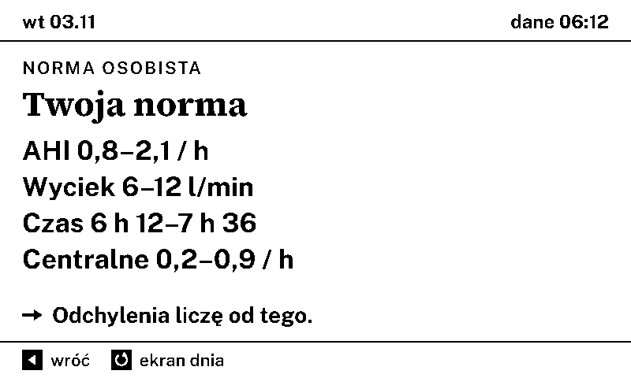

# cpapblog-eink

A bedside e-ink panel for people treated with CPAP or ASV. In the morning it shows, at a glance, how the last night went compared with your own recent nights. A button opens a cockpit with trends. Everything is computed locally on the panel.

You need a ResMed Series 10 device with an AirBridge module and a Seeed reTerminal E1001; you build and flash the firmware yourself from a computer (see [Build and flash](#build-and-flash)).

Author: Rafał Myrta ([drcpap.pl](https://drcpap.pl)). Status: beta (`1.0.0-beta.1`). Polish version below. The repository is `cpapblog-eink`; in code, network names and file names the internal prefix `cpap-eink` is used. Contributing: [CONTRIBUTING.md](CONTRIBUTING.md). Specification: [docs/spec/](docs/spec/README.md).

> **Not a medical device.** The panel does not diagnose, does not change or suggest therapy device settings and does not replace a doctor. It summarises data the device already records and, when something keeps differing from your usual nights, it says that it is worth talking to your doctor. See [Disclaimer](#disclaimer).

## Screens

| Day screen | Week summary | Your personal norm |
|---|---|---|
|  |  |  |

Previews rendered from the design files (800×480, 1-bit), not photos of the device. The texts on the panel are in Polish.

## What it is

- A morning **day screen**: the last night (time with mask, AHI, leak) compared with your personal norm from the last 30 valid nights, not with textbook thresholds. Usually it says there is nothing to do.
- A **cockpit** of six pages (`1 / 6` … `6 / 6`): trends of the last 30 nights, details of the last night, open matters, your personal norm, equipment, settings.
- **Context**: a short morning question "What was different yesterday?" after an unusual night (and on a random night as a control), bedroom temperature and humidity, optional outdoor weather and bedroom CO2, a night screen ("Dobranoc", Polish for "good night") from 23:30 to 05:00, and a day slot (airing window, tomorrow morning, equipment, sunrise).
- **Talk to your doctor**: when a pattern lasts, the panel says whether and how soon to bring it up with a doctor and prepares a one-page A4 report, downloadable with a QR code from the panel's own local server for 15 minutes.
- **Equipment**: reminders for mask and filter replacement.
- A cartoon **alarm clock character** on cards; screens are either data screens or cards, never mixed.

All screen texts are in Polish.

## Hardware

| Part | Role |
|---|---|
| Seeed reTerminal E1001 | ESP32-S3, 800×480 monochrome e-ink, 3 buttons, buzzer, temperature and humidity sensor, microSD slot, battery |
| AirBridge module ([m-kozlowski/airbridge](https://github.com/m-kozlowski/airbridge), v2.2.0 or newer) | plugged into a ResMed Series 10 device (AirSense 10, AirCurve 10); serves therapy data over HTTP in the home network |
| microSD card | optional copy of history and reports |
| local environment source (optional) | any device in the home network serving the JSON contract from the functional spec, Annex C (e.g. Home Assistant, Node-RED): outdoor weather, bedroom CO2 |

Supported therapy modes in release 1.x: `CPAP`, `AutoSet`, `ASV` and `ASVAuto`. Only `ASVAuto` on an AirCurve 10 CS has been checked on a real device; `CPAP`, `AutoSet` and `ASV` were checked on synthetic data only ([ADR-0030](docs/decisions/0030-wersja-1-dla-asv-cpap-i-autoset.md)).

## Architecture

- **All processing local** ([ADR-0001](docs/decisions/0001-przetwarzanie-lokalne.md)). The panel only sends read requests to AirBridge and to the optional environment source in the home network. Outside the home network it asks only for time (NTP) and, if city coordinates are configured, weather and air quality (Open-Meteo). No cloud, no account, no therapy data leaves the panel.
- **Data flow:** AirBridge (`/api/status`, night list and night reports, HTTP Digest login) → panel wakes up on a schedule (from 05:00 every 30 min until the night is downloaded) → night record in the panel flash (LittleFS, CSV files with a version header) → personal norm and rules → one screen drawn on e-ink → deep sleep.
- **Firmware split** ([ADR-0021](docs/decisions/0021-podzial-firmware-na-komponenty.md)), in `firmware/prototyp/src/`:
  - core without hardware, compiled and tested on a PC: nights and metrics (`noc`, `stany`, `kokpit`), rules engine (`reguly*`, `rodzaje_*`, `wzorce`, `sprawy`), screens (`ekrany*`, `dzien`, `dobranoc`, `slot_*`), humour and character (`humor`), storage (`magazyn`), report (`raport*`, `qr`), wake-up plan (`plan`);
  - hardware and network adapters (`adaptery_esp32`, `serwer_raportu_esp32`) behind interfaces in `adaptery.h`;
  - a thin conductor of one wake-up (`dyrygent`, `wybudzenie`, `start`, `main.cpp`).
- **Data-driven rules** ([ADR-0023](docs/decisions/0023-silnik-regul-sterowany-danymi.md)): thresholds (`docs/spec/progi.csv`), rule catalogue (`docs/spec/katalog/*.csv`) and texts are data files. `tools/zestaw/buduj_zestaw.py` builds them into `firmware/prototyp/src/zestaw_wbudowany.h` (generated, do not edit).
- **Hard limits** ([ADR-0002](docs/decisions/0002-panel-nie-zmienia-ustawien.md)): the panel never changes device settings, never shows setting values or how to change them, and does not diagnose.

## Build and flash

Requirements: [PlatformIO](https://platformio.org/) (`python3 -m pip install platformio`; the pioarduino platform version is pinned in `platformio.ini`), Python 3, a USB cable and internet access: the first build downloads the platform and toolchain (about a gigabyte). Building needs neither a panel nor real passwords; the example secrets file is enough.

```
git clone <repository-url> && cd cpapblog-eink
cd firmware/prototyp
cp include/secrets.example.h include/secrets.h   # never commit secrets.h
pio run -e e1001                                  # build
pio run -e e1001 -t upload --upload-port /dev/cu.usbserial-XXXX
```

- `include/secrets.h` holds only initial values (Wi-Fi, AirBridge address and account, optional environment source, optional city coordinates, password of the Wi-Fi service window). Network and AirBridge settings entered from a phone are stored on the panel (NVS) and are used instead. On macOS `tools/prototyp/sekrety.sh` can create the file from the Keychain.
- The example file has every line commented out: built unchanged, the panel starts in first configuration and Wi-Fi upload is disabled. Set your own long random `OTA_PASS` (e.g. `openssl rand -hex 16`); an empty password does not protect the window.
- Upload speed is 115200 baud; the USB bridge of the panel loses data at higher speeds.
- Uploading over Wi-Fi (`-e e1001_ota`) is locked in `platformio.ini` (`blokada_ota.py`) until a panel has been switched to the 32 MB partition layout over a cable. Details: [`firmware/prototyp/README.md`](firmware/prototyp/README.md).

**First configuration.** A panel with no network saved starts its own WPA2 network `cpap-eink-XXXX` after power-up and shows two QR codes: one to join that network, one to open the setup form (`http://192.168.4.1/u/{token}/`). In the form you enter the home Wi-Fi and the AirBridge address, account and password. The panel checks AirBridge (`GET /api/status`) and saves the settings only when the check succeeds. Later the same form is opened from the settings page (`6 / 6`) by holding ▶ for 2 s; the panel network can be started again by holding ◀ for 2 s. Buttons on the housing are `<` (◀), `>` (▶) and the green one (↻).

## Tests

```
python3 -m pip install -r requirements-dev.txt   # pytest, pillow, numpy
bash tools/prototyp/testy.sh        # firmware tests on a PC, needs GNU GCC (not clang), C++17, -Werror
python3 -m pytest -q tools          # tools, simulator, rule set builder
python3 tools/spojnosc.py --strict  # consistency of the functional spec (IDs, EARS, screens)
python3 tools/spojnosc_tech.py      # consistency of the technical spec (references to code)
```

- On macOS: `brew install gcc grep findutils coreutils`, then `eval "$(bash tools/prototyp/srodowisko-macos.sh)"` (GNU g++, grep, xargs and nproc first on `PATH`; `testy.sh` checks this and says what is missing).
- Time: the C++ tests take about 3 minutes and `pytest` about 4 minutes, so the whole set takes about 7 minutes. `testy.sh` writes screen previews to `/tmp/cpap-eink-podglad` (another directory can be passed as an argument).
- Optional, as in CI: `bash tools/jakosc/sprawdz.sh` runs the sanitizers, clang-tidy 18 and coverage against the baselines in `tools/jakosc/` (needs bash 4 or newer).
- `tools/prototyp/testy.sh` also renders previews of the screens as PNG and runs a day simulator on synthetic data.
- `tools/symulator/` runs the panel program on a PC for a chosen period, with scenarios and button presses, and saves every screen as an image.
- CI ([`.github/workflows/testy.yml`](.github/workflows/testy.yml)): PC tests with g++, spec consistency, pytest; core gates (ASan and UBSan, clang-tidy against a baseline, line coverage against a baseline, no exceptions and RTTI in `src/`); ESP32 build with a flash and RAM budget. CI also regenerates the rule set and the alarm clock images and fails when they differ from the repository.

## Repository layout

| Path | Contents |
|---|---|
| `firmware/prototyp/` | panel firmware: `src/`, generated `include/` (fonts, images), `test/` (PC tests and hardware stubs), `platformio.ini` |
| `firmware/boards/`, `firmware/partycje-*.csv` | board definition (32 MB flash) and partition tables |
| `firmware/pomiar16/` | separate sketch that checks flash above 16 MB on a unit |
| `tools/prototyp/` | test runner, asset generators (fonts, images), upload and dump scripts |
| `tools/symulator/` | day simulator on a PC |
| `tools/zestaw/` | builder of the rule data set |
| `tools/jakosc/` | quality gates (coverage, clang-tidy, size budget) |
| `tools/kalibracja/`, `tools/pomiary/` | night table from a copy of the device SD card, analysis of panel log files (tested on synthetic data) |
| `tools/airbridge/` | read-only dump of AirBridge responses |
| `tools/obrazki/` | converter of your own daily pictures to panel format (no pictures included) |
| `docs/spec/` | functional specification (EARS requirements), technical specification, thresholds, rule catalogue, traceability matrices ([how to read them](docs/spec/README.md)) |
| `docs/decisions/` | architecture decision records (ADR) |
| `docs/design/` | visual design notes (readability scale, cockpit, character scenes) |
| `design/kanwa/`, `design/png/` | screen designs (source files and 800×480 1-bit previews) |
| `assets/budzik/` | alarm clock character scenes (all rights reserved, see NOTICE) |

Documentation and code identifiers are in Polish.

## Status

Beta `1.0.0-beta.1` (November 2026), running on two test units. Firmware `1.0.0-beta.1` implements specification 1.2 ([docs/spec/](docs/spec/README.md)). Thresholds marked `[PRÓG]` in the specification are not yet calibrated. The therapy modes `CPAP`, `AutoSet` and `ASV` were checked on synthetic data only. Not a release for the general public. Known limitations: [CHANGELOG.md](CHANGELOG.md) and [SECURITY.md](SECURITY.md).

## Disclaimer

This project is not a medical device and has no medical certification. It does not diagnose, does not monitor for emergencies, does not change therapy device settings and does not tell you what settings to use. It does not replace a doctor or the device manufacturer's software. Decisions about treatment belong to you and your doctor. The panel does not warn about sudden conditions: with shortness of breath or chest pain call for help. Use at your own risk.

## License

Code, tools and documentation: [GNU General Public License v3.0 or later](LICENSE) (`GPL-3.0-or-later`). The firmware links GxEPD2 (GPL-3.0), so the firmware image as a whole is distributed under the GPL. Exception: the alarm clock artwork (© Rafał Myrta, all rights reserved) is not covered by the GPL and may be used only within this project. Fonts: SIL Open Font License 1.1. Third-party components and their licenses: [NOTICE](NOTICE).

## Credits

- [AirBridge](https://github.com/m-kozlowski/airbridge) by m-kozlowski (GPL-3.0): the module that makes the data available. This project only talks to it over HTTP; no AirBridge code is included or linked.
- Fonts: Source Serif 4, Public Sans, IBM Plex Sans Condensed (SIL OFL 1.1), rendered to bitmaps in `firmware/prototyp/include/fonty.h`.
- Libraries: GxEPD2, Adafruit GFX, Arduino core for ESP32 (pioarduino).
- City coordinates: GeoNames (CC BY 4.0). Weather: Open-Meteo.
- ResMed, AirSense and AirCurve are trademarks of ResMed. Seeed and reTerminal are trademarks of Seeed Technology. This project is independent and not affiliated with, endorsed by or sponsored by ResMed, Seeed Technology or the AirBridge project. Other names are trademarks of their owners.

---

# cpapblog-eink (po polsku)

Ekran e-ink przy łóżku dla osób leczonych CPAP albo ASV. Rano jednym spojrzeniem pokazuje, jak minęła noc w porównaniu z Twoimi ostatnimi nocami. Przycisk otwiera kokpit z trendami. Wszystko liczone lokalnie na panelu.

Potrzebujesz aparatu ResMed serii 10 z modułem AirBridge i Seeed reTerminal E1001; firmware budujesz i wgrywasz sam z komputera (zob. [Budowa i wgranie](#budowa-i-wgranie)).

Autor: Rafał Myrta ([cpapblog.pl](https://cpapblog.pl)). Stan: beta (`1.0.0-beta.1`). Repozytorium nazywa się `cpapblog-eink`; w kodzie, nazwach sieci i plików jest wewnętrzny prefiks `cpap-eink`. Współtworzenie: [CONTRIBUTING.md](CONTRIBUTING.md). Specyfikacja: [docs/spec/](docs/spec/README.md).

> **To nie jest wyrób medyczny.** Panel nie diagnozuje, nie zmienia i nie podpowiada ustawień aparatu i nie zastępuje lekarza. Zestawia dane, które aparat już zapisuje, a gdy coś przez dłuższy czas odbiega od Twoich zwykłych nocy, mówi, że warto porozmawiać z lekarzem. Zobacz [Zastrzeżenie](#zastrzeżenie).

## Ekrany

| Ekran dnia | Podsumowanie tygodnia | Twoja norma |
|---|---|---|
|  |  |  |

Podglądy wyrenderowane z plików projektowych (800×480, 1 bit), nie zdjęcia urządzenia. Teksty na panelu są po polsku.

## Czym jest

- Rano **ekran dnia**: ostatnia noc (czas z maską, AHI, wyciek) wobec Twojej normy osobistej z ostatnich 30 nocy ważnych, a nie wobec progów z podręcznika. Zwykle mówi, że nie ma nic do zrobienia.
- **Kokpit** z sześciu stron (`1 / 6` … `6 / 6`): trendy 30 nocy, szczegóły ostatniej nocy, otwarte sprawy, Twoja norma, sprzęt, ustawienia.
- **Kontekst**: krótkie pytanie rano „Co było inaczej?” po nietypowej nocy (i w losową noc jako grupa kontrolna), temperatura i wilgotność w sypialni, opcjonalnie pogoda za oknem i CO2 w sypialni, ekran nocny „Dobranoc” od 23:30 do 05:00 i slot dzienny (okno na wietrzenie, jutro rano, sprzęt, wschód słońca).
- **Rozmowa z lekarzem**: gdy wzorzec się utrzymuje, panel mówi, czy i jak szybko pokazać to lekarzowi, i przygotowuje jednostronicowy raport A4 do pobrania kodem QR z lokalnego serwera panelu przez 15 minut.
- **Sprzęt**: przypomnienia o wymianie maski i filtra.
- **Budzik**, postać w stylu kreskówki, na kartach; ekran jest albo ekranem danych, albo kartą, bez mieszania.

## Sprzęt

| Element | Rola |
|---|---|
| Seeed reTerminal E1001 | ESP32-S3, e-ink 800×480 mono, 3 przyciski, buzzer, czujnik temperatury i wilgotności, gniazdo microSD, bateria |
| moduł AirBridge ([m-kozlowski/airbridge](https://github.com/m-kozlowski/airbridge), od v2.2.0) | wpięty w aparat ResMed serii 10 (AirSense 10, AirCurve 10); udostępnia dane terapii przez HTTP w sieci domowej |
| karta microSD | opcjonalna kopia historii i raportów |
| lokalne źródło otoczenia (opcja) | dowolne urządzenie w sieci domowej podające JSON według Załącznika C specyfikacji funkcjonalnej (np. Home Assistant, Node-RED): pogoda za oknem, CO2 w sypialni |

Tryby terapii w wydaniu 1.x: `CPAP`, `AutoSet`, `ASV` i `ASVAuto`. Na prawdziwym aparacie sprawdzono tylko `ASVAuto` na AirCurve 10 CS; `CPAP`, `AutoSet` i `ASV` sprawdzono wyłącznie na danych syntetycznych ([ADR-0030](docs/decisions/0030-wersja-1-dla-asv-cpap-i-autoset.md)).

## Architektura

- **Całe przetwarzanie lokalnie** ([ADR-0001](docs/decisions/0001-przetwarzanie-lokalne.md)). Panel wysyła tylko żądania odczytu do AirBridge i do opcjonalnego źródła otoczenia w sieci domowej. Poza domem pyta tylko o czas (NTP) i, gdy podano współrzędne miasta, o pogodę i jakość powietrza (Open-Meteo). Bez chmury, bez konta, dane terapii nie wychodzą z panelu.
- **Przepływ danych:** AirBridge (`/api/status`, lista nocy i raporty nocy, logowanie HTTP Digest) → panel budzi się według planu (od 05:00 co 30 min, aż noc zostanie pobrana) → rekord nocy w pamięci flash panelu (LittleFS, pliki CSV z wersją w nagłówku) → norma osobista i reguły → jeden ekran na e-inku → głęboki sen.
- **Podział firmware** ([ADR-0021](docs/decisions/0021-podzial-firmware-na-komponenty.md)), w `firmware/prototyp/src/`: rdzeń bez sprzętu, kompilowany i testowany na komputerze (noce i metryki, silnik reguł, ekrany, budzik, magazyn danych, raport, plan wybudzeń); adaptery sprzętu i sieci za interfejsami z `adaptery.h`; cienki dyrygent jednego wybudzenia (`dyrygent`, `main.cpp`).
- **Reguły jako dane** ([ADR-0023](docs/decisions/0023-silnik-regul-sterowany-danymi.md)): progi (`docs/spec/progi.csv`), katalog reguł (`docs/spec/katalog/*.csv`) i teksty to pliki danych; `tools/zestaw/buduj_zestaw.py` buduje z nich `firmware/prototyp/src/zestaw_wbudowany.h` (plik generowany).
- **Granice** ([ADR-0002](docs/decisions/0002-panel-nie-zmienia-ustawien.md)): panel nigdy nie zmienia ustawień aparatu, nie pokazuje ich wartości ani drogi do ich zmiany i nie diagnozuje.

## Budowa i wgranie

Potrzebne: [PlatformIO](https://platformio.org/) (`python3 -m pip install platformio`; wersja platformy pioarduino przypięta w `platformio.ini`), Python 3, kabel USB i internet: pierwszy build ściąga platformę i toolchain (około gigabajta). Do samego builda nie trzeba panelu ani prawdziwych haseł; wystarczy plik `secrets.example.h`.

```
git clone <repository-url> && cd cpapblog-eink
cd firmware/prototyp
cp include/secrets.example.h include/secrets.h   # secrets.h nigdy do repozytorium
pio run -e e1001
pio run -e e1001 -t upload --upload-port /dev/cu.usbserial-XXXX
```

- `include/secrets.h` ma tylko wartości początkowe (Wi-Fi, adres i konto AirBridge, opcjonalnie źródło otoczenia i współrzędne miasta, hasło okna serwisowego). Sieć i AirBridge wpisane z telefonu panel trzyma u siebie (NVS) i używa ich zamiast pliku. Na macOS plik może zrobić `tools/prototyp/sekrety.sh` z Pęku kluczy.
- Wzór ma wszystkie linie zakomentowane: bez zmian panel startuje w pierwszej konfiguracji, a wgrywanie przez Wi-Fi jest wyłączone. `OTA_PASS` ustaw własne, długie i losowe (np. `openssl rand -hex 16`); puste hasło nie chroni okna.
- Prędkość wgrywania 115200 bodów; mostek USB panelu gubi dane przy wyższych.
- Wgrywanie przez Wi-Fi (`-e e1001_ota`) jest zablokowane w `platformio.ini` (`blokada_ota.py`) do przejścia egzemplarza kablem na układ partycji 32 MB. Szczegóły: [`firmware/prototyp/README.md`](firmware/prototyp/README.md).

**Pierwsza konfiguracja.** Panel bez zapisanej sieci po włączeniu zasilania uruchamia własną sieć WPA2 `cpap-eink-XXXX` i pokazuje dwa kody QR: jeden do połączenia z tą siecią, drugi do formularza (`http://192.168.4.1/u/{token}/`). W formularzu wpisujesz sieć domową oraz adres, konto i hasło AirBridge. Panel sprawdza AirBridge (`GET /api/status`) i zapisuje ustawienia tylko wtedy, gdy sprawdzenie się uda. Później ten sam formularz otwiera się ze strony ustawień (`6 / 6`) przytrzymaniem ▶ przez 2 s; sieć panelu można uruchomić znowu przytrzymaniem ◀ przez 2 s. Przyciski na obudowie: `<` (◀), `>` (▶) i zielony (↻).

## Testy

```
python3 -m pip install -r requirements-dev.txt   # pytest, pillow, numpy
bash tools/prototyp/testy.sh        # testy firmware na komputerze, wymaga GNU GCC (nie clang)
python3 -m pytest -q tools
python3 tools/spojnosc.py --strict
python3 tools/spojnosc_tech.py
```

- Na macOS: `brew install gcc grep findutils coreutils`, potem `eval "$(bash tools/prototyp/srodowisko-macos.sh)"`; `testy.sh` sprawdza środowisko i mówi, czego brakuje.
- Czas: testy C++ trwają około 3 minut, `pytest` około 4, razem około 7 minut. `testy.sh` zapisuje podglądy ekranów w `/tmp/cpap-eink-podglad` (inny katalog można podać jako argument).
- Opcjonalnie, jak w CI: `bash tools/jakosc/sprawdz.sh` uruchamia sanitizery, clang-tidy 18 i pokrycie względem baz w `tools/jakosc/` (wymaga bash 4 albo nowszego).
- CI uruchamia te same testy, bramki rdzenia (ASan, UBSan, clang-tidy, pokrycie) i budowę na ESP32 z budżetem pamięci ([`.github/workflows/testy.yml`](.github/workflows/testy.yml)). CI generuje też zestaw reguł i obrazy budzika od nowa i zgłasza błąd, gdy różnią się od repozytorium.
- `tools/symulator/` uruchamia program panelu na komputerze dla wybranego okresu, ze scenariuszami i naciśnięciami przycisków, i zapisuje każdy ekran jako obraz.

## Układ repozytorium

| Ścieżka | Zawartość |
|---|---|
| `firmware/prototyp/` | firmware panelu: `src/`, generowane `include/` (kroje, obrazy), `test/` (testy na komputerze i atrapy sprzętu), `platformio.ini` |
| `firmware/boards/`, `firmware/partycje-*.csv` | definicja płytki (flash 32 MB) i tablice partycji |
| `firmware/pomiar16/` | osobny szkic sprawdzający pamięć flash powyżej 16 MB na egzemplarzu |
| `tools/prototyp/` | uruchamianie testów, generatory zasobów (kroje, obrazy), skrypty wgrywania i zrzutu |
| `tools/symulator/` | symulator dnia na komputerze |
| `tools/zestaw/` | budowa zestawu danych reguł |
| `tools/jakosc/` | bramki jakości (pokrycie, clang-tidy, budżet rozmiaru) |
| `tools/kalibracja/`, `tools/pomiary/` | tabela nocy z kopii karty SD aparatu, analiza plików dziennika panelu (testowane na danych syntetycznych) |
| `tools/airbridge/` | zrzut odpowiedzi AirBridge tylko do odczytu |
| `tools/obrazki/` | konwerter własnych obrazków dnia do formatu panelu (bez dołączonych obrazków) |
| `docs/spec/` | specyfikacja funkcjonalna (wymagania EARS), techniczna, progi, katalog reguł, macierze śledzenia ([jak je czytać](docs/spec/README.md)) |
| `docs/decisions/` | decyzje projektowe (ADR) |
| `docs/design/` | notatki projektowe (skala czytelności, kokpit, sceny budzika) |
| `design/kanwa/`, `design/png/` | projekty ekranów (pliki źródłowe i podglądy 800×480 1-bit) |
| `assets/budzik/` | sceny budzika (wszystkie prawa zastrzeżone, zob. NOTICE) |

Teksty na ekranie są po polsku. Dokumentacja i identyfikatory w kodzie również.

## Stan

Beta `1.0.0-beta.1` (listopad 2026), działa na dwóch egzemplarzach testowych. Firmware `1.0.0-beta.1` realizuje specyfikację 1.2 ([docs/spec/](docs/spec/README.md)). Progi oznaczone w specyfikacji `[PRÓG]` nie są jeszcze skalibrowane. Tryby `CPAP`, `AutoSet` i `ASV` sprawdzono tylko na danych syntetycznych. To nie jest wydanie dla każdego. Znane ograniczenia: [CHANGELOG.md](CHANGELOG.md) i [SECURITY.md](SECURITY.md).

## Zastrzeżenie

Projekt nie jest wyrobem medycznym i nie ma certyfikacji medycznej. Nie diagnozuje, nie czuwa nad stanami nagłymi, nie zmienia ustawień aparatu i nie mówi, jakie ustawienia wybrać. Nie zastępuje lekarza ani oprogramowania producenta aparatu. O leczeniu decydujesz Ty z lekarzem. Panel nie ostrzega o nagłych stanach: przy duszności lub bólu w klatce wezwij pomoc. Używasz na własną odpowiedzialność.

## Licencja

Kod, narzędzia i dokumentacja: [GNU General Public License v3.0 lub późniejsza](LICENSE) (`GPL-3.0-or-later`). Firmware linkuje GxEPD2 (GPL-3.0), więc obraz firmware jako całość jest rozpowszechniany na GPL. Wyjątek: grafiki budzika (© Rafał Myrta, wszystkie prawa zastrzeżone) nie są objęte GPL i wolno ich używać tylko w ramach tego projektu. Kroje: SIL Open Font License 1.1. Składniki obce i ich licencje: [NOTICE](NOTICE).

## Podziękowania

- [AirBridge](https://github.com/m-kozlowski/airbridge), autor m-kozlowski (GPL-3.0): moduł, który udostępnia dane. Ten projekt tylko łączy się z nim przez HTTP, bez kodu AirBridge w repozytorium i bez linkowania.
- Kroje: Source Serif 4, Public Sans, IBM Plex Sans Condensed (SIL OFL 1.1).
- Biblioteki: GxEPD2, Adafruit GFX, rdzeń Arduino dla ESP32 (pioarduino).
- Współrzędne miast: GeoNames (CC BY 4.0). Pogoda: Open-Meteo.
- ResMed, AirSense i AirCurve są znakami towarowymi ResMed. Seeed i reTerminal są znakami towarowymi Seeed Technology. Projekt jest niezależny i nie jest powiązany z firmami ResMed i Seeed Technology ani z projektem AirBridge, nie jest przez nie wspierany ani sponsorowany. Inne nazwy są znakami towarowymi ich właścicieli.
