# Ekran terapii CPAP: specyfikacja techniczna

| | |
|---|---|
| Wersja | **1.0.0-beta.1**: wszystkie 14 sekcji w stanie „szkic” według [ADR-0020](../decisions/0020-struktura-specyfikacji-technicznej.md); fakty zgodne z kodem wersji beta (stan 08.11.2026); co zostało do stanu „do przeglądu”: tabela „Stan sekcji” |
| Data | 08.11.2026 |
| Autor | zob. [README](../../README.md) |
| Odwołanie | [specyfikacja funkcjonalna](specyfikacja-funkcjonalna.md) w wersji 1.2 (tag `spec-v1.2`) |
| Struktura | arc42 skrócony (14 sekcji) z diagramami C4 1–3 w Mermaid; standardy jako wzorzec, bez deklaracji zgodności (ADR-0020 pkt 7) |
| Decyzje wiążące | wszystkie ADR o statusie „przyjęta” z [indeksu](../decisions/README.md) |
| Spójność | `python3 tools/spojnosc_tech.py --macierz docs/spec/macierz-techniczna.csv` (macierz generowana, nie edytowana ręcznie) |

**Czym jest ten dokument.** [Specyfikacja funkcjonalna](specyfikacja-funkcjonalna.md) mówi, co panel robi i mówi. Ten dokument mówi, jak panel jest zbudowany: z jakich części składa się firmware, gdzie i w jakim formacie trzyma dane, jak się go testuje, kompiluje, wgrywa i wydaje. Nie zmienia zachowania opisanego w specyfikacji funkcjonalnej; gdy architektura wymaga innego zachowania, zmienia się najpierw specyfikacja funkcjonalna (ADR-0020 pkt 3).

**Konwencje.** ID stabilne (ADR-0020 pkt 4): `T-KOMP-nn` komponent, `T-INT-nn` interfejs, `T-DANE-nn` trwała struktura danych, `T-WYM-nn` wymaganie techniczne (EARS), `T-NF-nn` scenariusz jakości, `T-SOUP-nn` element obcy, `T-TEST-nnn` przypadek testowy. Odwołania idą w jedną stronę: ten dokument wskazuje R-*, M-*, E-*, L-*, H-*, ekrany i ADR, a specyfikacja funkcjonalna nie wskazuje ID `T-`. Liczba o sprzęcie ma link do źródła producenta, wynik pomiaru w T-TEST albo `[do zmierzenia]` z numerem pomiaru z planu pomiarów 2.4 (`pomiar N`, ADR-0020 pkt 5). Progi terapii są w [progi.csv](progi.csv) i nie są tu powtarzane. Odwołania do kodu prototypu podają plik względem `firmware/prototyp/` i nazwę funkcji albo stałej, np. `src/dyrygent.cpp` `Przebieg::spij()`, bez numeru linii, bo numery przesuwają się z każdą zmianą kodu; `tools/spojnosc_tech.py` sprawdza, że wskazana nazwa jest w tym pliku. Numeru linii nie podajemy: odwołanie zawsze idzie po nazwie pliku i funkcji, stałej albo struktury (np. `src/noc.h`, struktura `Noc`).

## Stan sekcji

Stan „szkic” oznacza treść zgodną z kodem wydania beta, jeszcze bez formalnego przeglądu; stan „do przeglądu” wymaga zamknięcia pozycji z kolumny Uwagi. Kolejność stanów: do napisania, szkic, do przeglądu, przyjęta ([ADR-0020](../decisions/0020-struktura-specyfikacji-technicznej.md)).

| Sekcja | Stan | Uwagi (co zostało do stanu „do przeglądu”) |
|---|---|---|
| 1. Wprowadzenie | szkic | nic nie czeka |
| 2. Cele jakości i scenariusze | szkic | pomiar 12 (dryf zegara) skończony 04.11.2026 i wpisany; pomiar 9 (tydzień na baterii) i pomiar 10 (krzywa baterii) niezrobione; wyniki z wersji beta (rysowanie, PDF) nie zamieniły jeszcze `[do zmierzenia]` |
| 3. Ograniczenia | szkic | 3.1 wiersz „zegar”: PCF8563 albo krótszy czas z R-AW-19 (do decyzji); zapas stosu i sterty jako wymaganie (po awarii stosu 06.11.2026) |
| 4. Kontekst | szkic | nic nie czeka |
| 5. Strategia rozwiązania | szkic | nic nie czeka |
| 6. Widok bloków | szkic | przegląd kolumny „Prototyp (plik)” w 6.4 wobec kodu wersji beta (T-KOMP-01, 13, 15, 16, 19 mówią „brak” albo opisują stan sprzed bety) |
| 7. Widok czasu wykonania | szkic | czasy kroków po pomiarach 4, 5, 6 |
| 8. Widok wdrożenia | szkic | pomiar 16 (pamięć powyżej 16 MB) zaliczony na panelu 05.11.2026 i wpisany w 8; czasy wgrania z pomiaru 14; 8.8 i 8.10: aktualizacja z GitHub według ADR-0032 do opisu przy wdrożeniu |
| 9. Koncepcje przekrojowe | szkic | 9.1 model danych wobec plików, które kod wersji beta pisze (`/dane/reguly.csv`, `/konfiguracja.txt`); 9.4 zegar (do decyzji); 9.3 lista reguł obowiązkowych tylko w spec, nie w kodzie; 9.5: narzut wielu małych plików |
| 10. SOUP i licencje | szkic | odczyt wersji rdzenia i bibliotek (`pio pkg list`) |
| 11. Plan testów | szkic | wyniki T-TEST-275 i T-TEST-242 po wgraniu na panel i wyniki pomiarów w 11.11 |
| 12. Plan wydań | szkic | wybór wariantu wydania z `/noce.csv` o 24 polach wobec bieżącej wersji (12.5) |
| 13. Rozjazdy prototyp ↔ architektura docelowa | szkic | wynik wgrania na panel |
| 14. Decyzje | szkic | indeks ADR |

## 1. Wprowadzenie

### 1.1 Cel

Dokument opisuje budowę firmware panelu (reTerminal E1001) tak, żeby obca osoba mogła go zbudować, przetestować i utrzymywać zgodnie ze specyfikacją funkcjonalną. Każdy element techniczny wskazuje wymagania funkcjonalne, które realizuje, i test, który to sprawdza (macierz techniczna).

### 1.2 Czytelnicy i ich pytania

| Czytelnik | Pytanie | Gdzie odpowiedź |
|---|---|---|
| autor projektu | czy każde wymaganie ma część firmware i test; co się zmieni, gdy zmieni się próg albo tekst | sekcje 6, 9, 11; macierz techniczna |
| programista firmware | z jakich części składa się firmware, jak się komunikują, gdzie leżą dane | sekcje 6, 7, 8, 9 |
| osoba testująca | co testować, na jakim poziomie, kiedy test zalicza | sekcja 11 |
| osoba wydająca wersję | jak oznaczyć, zbudować i wgrać wydanie; co musi być spełnione | sekcje 8, 12 |
| osoba oceniająca bezpieczeństwo i zgodność z MDR | gdzie są dane zdrowotne i sekrety, czego panel nie robi, jakie są obce składniki | sekcje 3, 9, 10 |
| osoba z zewnątrz (open source) | od czego zacząć, jak uruchomić symulator i testy | sekcje 4, 8, 11 |

### 1.3 Słownik

Pojęcia i skróty jak w specyfikacji funkcjonalnej, rozdz. 1.5. Pojęcia techniczne spoza 1.5 są objaśniane przy pierwszym użyciu w tym dokumencie.

## 2. Cele jakości i scenariusze

Cele jakości mówią, jak dobrze panel ma działać, a nie co robi. Wzorcem jest ISO/IEC 25010 (ADR-0020 pkt 7): bierzemy tylko cechy, których wymaga już spec 8.x (energia, czas, niezawodność, utrzymywalność, bezpieczeństwo), każdą jako scenariusz z mierzalną odpowiedzią. Pełnego modelu cech 25010 nie przepisujemy, bo pozostałe cechy (np. przenośność, współpraca z innymi systemami) nie mają w spec wymagań do sprawdzenia.

Skutek w jednym zdaniu: przy założeniach z 2.2 bateria wystarcza na ok. 46 dni zwykłej pracy (cel spec: 30 dni), ale to rachunek, nie pomiar; plan pomiarów w 2.4 mówi, czym i jak długo to sprawdzić na egzemplarzu.

### 2.1 Jak czytać scenariusze

Każdy scenariusz T-NF ma: **bodziec** (co się dzieje), **warunki** (w jakim stanie jest panel), **mierzalną odpowiedź** (co panel ma zrobić i jak to zmierzyć) i wymaganie R-NF, z którego wynika. Kolumna „Stan liczby” mówi, skąd jest liczba:

| Stan liczby | Znaczy |
|---|---|
| źródło | liczba z wymagania spec, z ADR albo od producenta (link w sekcji 3.1) |
| `[szacunek]` | liczba z rachunku w tej sekcji, z jawnymi założeniami; do zastąpienia pomiarem |
| `[do zmierzenia]` z numerem pomiaru | liczby nie znamy; plan pomiaru jest w 2.4 |
| zmierzone | wynik pomiaru z datą (docelowo przypadek T-TEST w sekcji 11) |

Progi terapii nie są celami jakości i nie występują w tej sekcji (są w `progi.csv`). Liczby oznaczone w spec `[PRÓG]` (np. 30 dni, 10 min Wi-Fi) są tu celami do sprawdzenia, nie wartościami zmierzonymi.

### 2.2 Model energii i rachunek baterii `[szacunek]`

**Po co ten rachunek.** Spec 8.1 daje budżet doby (wybudzenia, czas Wi-Fi, czas Bluetooth, odświeżenia), a R-NF-01 chce 30 dni na jednym ładowaniu. Rachunek sprawdza, czy budżet i cel do siebie pasują, zanim są pomiary, i pokazuje, która część firmware zużywa najwięcej. Wszystkie wyniki są `[szacunek]`; zastępuje je pomiar z 2.4.

**Założenia.** Prądy z karty katalogowej ESP32-S3 (v2.2, tabele 5-7 do 5-10, mierzone przy 3,3 V) przyjmujemy jako prąd pobierany z baterii, czyli tak, jakby między baterią a układem był stabilizator liniowy. To założenie ostrożne: przetwornica obniżyłaby prąd z baterii. Rodzaj stabilizatora na płytce nie jest sprawdzony.

| Założenie | Wartość przyjęta | Skąd |
|---|---|---|
| pojemność baterii | 2000 mAh nominalnie | sekcja 3.1 (Seeed) |
| pojemność użyteczna | 1600 mAh (80% nominalnej) | `[szacunek]`: odliczenie na starzenie, temperaturę i odcięcie przy ok. 3,3 V; prawdziwa wartość z testu rozładowania [do zmierzenia] (pomiar 10) |
| prąd w głębokim uśpieniu, cały panel | 14 µA | Seeed (sekcja 3.1, bez wskazania, czy dla całego urządzenia); sam układ 7–8 µA (tabela 5-10); cały panel [do zmierzenia] (pomiar 1) |
| średni prąd przy włączonym Wi-Fi | 100 mA | `[szacunek]`: odbiór 88–91 mA (tabela 5-7) przez większość czasu połączenia, nadawanie 283–340 mA tylko w krótkich; średnia na egzemplarzu [do zmierzenia] (pomiar 3) |
| średni prąd przy skanie Bluetooth LE | 100 mA | `[szacunek]`: odbiór Bluetooth LE 93 mA (tabela 5-8) plus procesor; [do zmierzenia] (pomiar 7) |
| procesor aktywny bez radia | 50 mA | `[szacunek]`: tabela 5-9, 240 MHz: 33–48 mA w czekaniu, 51–81 mA przy pracy; wersja z PSRAM może pobierać więcej (uwaga pod tabelą 5-9) |
| czuwanie na przycisk bez radia | 40 mA | `[szacunek]`: tabela 5-9, 240 MHz w czekaniu (WAITI), 33–48 mA; w uśpieniu lekkim byłoby ok. 0,4 mA (240 µA plus ok. 140 µA PSRAM, tabela 5-10) |
| wybudzenie bez Wi-Fi (zapis czujników) | 2 s aktywności | `[szacunek]`: rozruch, odczyt SHT40 i baterii, zapis; [do zmierzenia] (pomiar 2) |
| pełne odświeżenie e-ink | 3 s przy 50 mA | `[szacunek]`: czas z 3.1 (1,2–5 s według źródła), procesor czeka na linię BUSY; prąd samego ekranu [do zmierzenia] (pomiar 4) |
| naciśnięcia przycisku | 10 na dobę, każde z czuwaniem 20 s | `[szacunek]`; czuwanie 20 s jak w prototypie (`src/wybudzenie.h` `CZUWANIE_MS`) |
| zapis na kartę microSD | raz na dobę, 2 s przy 100 mA | `[szacunek]` przy nośniku z ADR-0022 wariant A (zależy od ADR-0022, przyjęte 01.11.2026); [do zmierzenia] (pomiar 13) |
| serwer raportu albo formularza | raz w tygodniu po 15 min z Wi-Fi | definicja zwykłej pracy w spec 8.1 |

**Rozpisanie na komponenty, zwykła doba na granicy budżetu 8.1.** Komponenty według kontraktu sekcji 6 (ADR-0021, przyjęty 01.11.2026). Ładunek liczony jako prąd × czas.

| Komponent | Pozycja budżetu 8.1 | Przydział na dobę | Ładunek na dobę `[szacunek]` | Udział |
|---|---|---|---|---|
| T-KOMP-16 adapter sieci (z nim T-KOMP-03, T-KOMP-04 i T-KOMP-02: AirBridge, otoczenie, czas) | czas Wi-Fi ≤ 10 min | 10 min × 100 mA | 16,7 mAh | 48% |
| T-KOMP-19 adapter wejść i czujników (skan Bluetooth LE dla Qingping, z T-KOMP-04) | czas skanu ≤ 5 min | 5 min × 100 mA | 8,3 mAh | 24% |
| T-KOMP-11 serwery lokalne (raport, formularz) | poza budżetem dobowym, raz w tygodniu | 15 min × 100 mA ÷ 7 | 3,6 mAh | 10% |
| T-KOMP-01 dyrygent wybudzenia (rozruch, decyzje, zapis czujników przez T-KOMP-19) | wybudzenia ≤ 80 | 80 × 2 s × 50 mA | 2,2 mAh | 6% |
| T-KOMP-10 przyciski i nawigacja (czuwanie po naciśnięciu, przez T-KOMP-01) | brak pozycji w 8.1 | 10 × 20 s × 40 mA | 2,2 mAh | 6% |
| T-KOMP-17 adapter ekranu (z T-KOMP-09 rysowanie do bufora) | pełne odświeżenia ≤ 30 | 30 × 3 s × 50 mA | 1,25 mAh | 4% |
| uśpienie (wszystkie komponenty uśpione, stan w pamięci RTC przez T-KOMP-18) | brak pozycji w 8.1 | 24 h × 14 µA | 0,34 mAh | 1% |
| T-KOMP-18 adapter pamięci (karta microSD) | brak pozycji w 8.1 | 1 × 2 s × 100 mA | 0,06 mAh | 0% |
| T-KOMP-20 raport A4 (składanie PDF), T-KOMP-13 dźwięk, T-KOMP-14 log | brak pozycji w 8.1 | rzadko, krótko | pominięte (poniżej 0,2 mAh) | 0% |
| **razem** | | | **ok. 35 mAh** | 100% |

Tabela liczy pełne 10 min Wi-Fi z budżetu 8.1, czyli górną granicę. Panel budzi się tylko z powodów z R-NF-02 (plan wybudzenia T-KOMP-24, T-WYM-28), więc Wi-Fi włącza się tylko w wybudzeniach z powodem sieciowym; zapis czujników co 15 min i oceny slotu wieczornego idą bez Wi-Fi (R-DANE-33, T-WYM-31), a od 23:30 do 05:00 panel nie pyta AirBridge (R-DANE-18). Zwykła doba według planu `[szacunek]`, noc zapisana o 07:00: okno poranne 05:00–07:00, 5 wybudzeń po ok. 8 s (łączenie, `/api/status`, lista nocy, jedno żądanie do źródła otoczenia), ok. 0,7 min; import nocy z odpytywaniem raportu (do 120 s, R-DANE-11) ok. 3 min; ponowne sprawdzenie o 11:00 (R-DANE-24), pogoda przed slotem wieczornym (R-DANE-16) i początek slotu nocnego o 23:30 (`/api/status` dla S9, R-KON-33) ok. 0,5 min; pogoda, pyłek i czas ok. 1 min. Razem ok. 5 min, czyli ok. połowa budżetu. Przerysowania ekranu dnia bez Wi-Fi co 2 h od 11:00 do okna slotu wieczornego (R-EKR-60, 03.11.2026) nie zmieniają czasu Wi-Fi: przy oknie od 21:00 to 4 wybudzenia więcej (13:00, 15:00, 17:00, 19:00), przy innych oknach 3–6, czyli ok. 5 pełnych odświeżeń e-ink więcej na dobę; e-ink ok. 5 × 3 s × 50 mA ≈ 0,2 mAh i rozruch ok. 5 × 2 s × 50 mA ≈ 0,14 mAh, razem ok. 0,35 mAh `[szacunek]`, w ramach już policzonych pozycji 80 wybudzeń i 30 odświeżeń (tabela wyżej). Doba, w której noc jest niekompletna po 11:00, dokłada ponowienia co 30 min do 23:30 (R-DANE-18): do 25 wybudzeń po ok. 8 s, ok. 3,3 min, nadal w budżecie. Gdy AirBridge milczy, każde z tych wybudzeń trwa ok. 68 s (3 próby, R-AW-01), więc od drugiej doby bez danych z rzędu R-DANE-18 ponawia po 11:00 tylko co 3 h `[PRÓG]` (14:00, 17:00, 20:00, 23:00; scenariusze niżej). Czas łączenia z siecią na egzemplarzu [do zmierzenia] (pomiar 3) rozstrzyga, czy 8 s na wybudzenie wystarcza. Według R-NF-02 w slocie nocnym nie ma wybudzeń z Wi-Fi dla CO2 ze źródła otoczenia.

**Rachunek pełnych odświeżeń e-ink (budżet ≤ 30 na dobę z 8.1).** Liczy się tylko odświeżenie, które zmienia obraz (7.1 „Klatka bez zmian”): ponowienie bez nowych danych, które rysowałoby tę samą S5, nie odświeża ekranu. Liczby z symulacji z atrapami (`test/testy_plan_wybudzen.cpp` `testR_NF_01_odswiezeniaDobBezDanych`, odczyt czujnika co godzinę inny) i rachunku:

| Doba | Odświeżeń przed wariantem A | Po wariancie A |
|---|---|---|
| zwykła doba z nocą o 07:00 (okno stałe 21:00) | 12 | 10 (dwa sprawdzenia okna porannego dawały tę samą klatkę) |
| pierwsza doba bez danych (22.10, T-TEST-279) | 37 | ok. 3 |
| druga i trzecia doba bez danych (23.10, 24.10) | 17 | ok. 1–4 |
| odrzucone logowanie (22.10–24.10) | 37 | ok. 1–2 |
| dzień bez terapii (AirBridge działa, nocy brak na liście, 4.11) | 38 | ok. 15 (zmiany odczytu w stopce) |
| najgorsza zwykła doba z 8.1 (noc o 13:00, okno slotu od 19:00, K1 o 14:10) | 31 (rachunek: okno poranne 13, ponowienia 11:00–12:30 4, import 1, K1 i powrót 2, R-EKR-60 2, slot do 9, S9 1) | najwyżej 20 (okno poranne 1, 11:00 1, ponowienia do 3, import 1, K1 i powrót 2, R-EKR-60 2, slot do 9, S9 1); symulacja bez slotu wieczornego: 10 |

Wszystkie doby mieszczą się w 30; dzień bez danych nie ma osobnej pozycji odświeżeń w 8.1, a po wariancie A jej nie potrzebuje. Ładunek e-ink spada w dobie bez danych z ok. 37 × 3 s × 50 mA ≈ 1,5 mAh do ok. 0,1 mAh `[szacunek]`; liczenie skrótu klatki to kilka ms procesora na wybudzenie z rysowaniem, poniżej rozdzielczości rachunku.

**Scenariusze doby i wynik.**

| Scenariusz | Co się zmienia wobec zwykłej doby | Ładunek na dobę `[szacunek]` | Dni na baterii `[szacunek]` (1600 mAh) |
|---|---|---|---|
| zwykła doba (8.1, z Qingping) | nic; cały budżet wykorzystany | ok. 35 mAh | **ok. 46 dni**; do ostrzeżenia E-05 przy 15% ok. 39 dni |
| zwykła doba bez Qingping | brak skanu Bluetooth | ok. 26 mAh | ok. 61 dni |
| wariant ostrożny | Wi-Fi 130 mA, Bluetooth 120 mA, uśpienie całego panelu 200 µA | ok. 47 mAh | ok. 34 dni |
| doba bez danych, pierwsza | AirBridge nie odpowiada; bez serwera raportu; 38 wybudzeń z siecią po ok. 68 s (okno poranne 05:00–11:00 co 30 min: 13, potem co 30 min do 23:30: 25, w tym początek slotu nocnego), plus pogoda, pyłek i czas ok. 1 min: ok. 44 min Wi-Fi, w limicie 45 min z 8.1 (od 02.11.2026, wcześniej 40 min) | ok. 88 mAh, czyli ok. 2,5 zwykłej doby (wcześniej w tej tabeli ok. 82 mAh, liczone z limitu 40 min zamiast oddolnie) | każda taka doba skraca pracę o ok. 1,5 dnia |
| doba bez danych, druga i dalsze z rzędu (R-DANE-18 od zmiany 01.11.2026) | okno poranne bez zmian (13 wybudzeń), po 11:00 tylko 14:00, 17:00, 20:00, 23:00 i początek slotu nocnego o 23:30 (`/api/status` dla S9): 18 wybudzeń po ok. 68 s, plus pogoda, pyłek i czas ok. 1 min: ok. 21 min Wi-Fi | ok. 50 mAh (wcześniej ok. 88); model zapasowy (18 i 38 wybudzeń): ok. 52 i 90 mAh bazowo, ok. 77 i 130 mAh ostrożnie | każda taka doba skraca pracę o ok. 0,4 dnia |
| wyjazd z aparatem: same doby bez danych od pełnej baterii (AirBridge gaśnie z aparatem) | pierwsza doba jak wyżej, potem doby kolejne | ok. 88 mAh, potem ok. 50 mAh na dobę | ok. 31 dni (przy ponawianiu co 30 min każdego dnia ok. 18); model zapasowy: ok. 30 dni bazowo, ok. 20 ostrożnie |
| doba z niedziałającym źródłem otoczenia (8.1, wiersz R-AW-26) | źródło skonfigurowane, ale nie odpowiada; AirBridge działa | najwyżej ok. 43 mAh (35 + 5 min × 100 mA); według planu z ok. 10 wybudzeniami z Wi-Fi ok. 1 min więcej (15 s + 9 × 6 s), ok. 37 mAh | ok. 37–43 dni |
| miesiąc z 2 dobami bez danych z rzędu | 28 zwykłych + pierwsza i druga doba bez danych | ok. 1118 mAh na 30 dni (przy ponawianiu co 30 min także w drugiej dobie: ok. 1156) | mieści się w 1600 mAh |
| tydzień z serwerem raportu | serwer 15 min raz w tygodniu | już w zwykłej dobie (3,6 mAh) | bez zmiany |
| prototyp dziś (bez Qingping) | 48 wybudzeń na dobę, każde z Wi-Fi: ok. 5 s pobierania i 20 s czuwania z włączonym Wi-Fi | ok. 21–35 mAh (zależnie od prądu Wi-Fi w czuwaniu: 45–100 mA) | ok. 45–78 dni; Wi-Fi ok. 20 min na dobę, ponad budżet 10 min (rozjazd, niżej) |
| prototyp dziś, AirBridge nie działa | każde wybudzenie ok. 65 s prób więcej (README prototypu, „Budżet czasu wybudzenia”) | ok. 107–122 mAh | ok. 13–15 dni |

**Wnioski z rachunku.**

1. Budżet 8.1 i cel 30 dni pasują do siebie z zapasem ok. 1,5 raza przy założeniach przyjętych, a ok. 1,1 raza w wariancie ostrożnym. Cel jest realny, ale nie ma dużego luzu.
2. Prawie połowa energii to Wi-Fi, a jedna czwarta to Bluetooth. Najważniejsze liczby do zmierzenia to średni prąd i czas połączenia Wi-Fi oraz skanu Bluetooth; prąd uśpienia ma znaczenie dopiero wtedy, gdy cały panel bierze ponad ok. 200 µA.
3. **Rozjazd prototypu z R-NF-03:** prototyp włącza Wi-Fi przy każdym wybudzeniu zegarem i wyłącza je dopiero przy zasypianiu, więc radio działa także przez 20 s czuwania na przycisk (`src/dyrygent.cpp` `Przebieg::pobierz()` start pomiaru Wi-Fi przy `WiFi.begin`, `src/dyrygent.cpp` `Przebieg::czuwanie()` czuwanie, `src/dyrygent.cpp` `Przebieg::spij()` wyłączenie radia w `spij()`). Wychodzi ok. 20 min Wi-Fi na dobę zamiast najwyżej 10 min. Architektura docelowa wyłącza Wi-Fi zaraz po ostatnim żądaniu, a czuwanie na przycisk robi bez radia (T-NF-06).
4. Czuwanie 20 s po każdym wybudzeniu zegarem nie jest potrzebne do spełnienia R-PRZ-01, bo przycisk budzi panel z głębokiego uśpienia (prototyp ustawia budzenie wszystkimi trzema, 3.1; do potwierdzenia na egzemplarzu). Docelowo czuwanie tylko po wybudzeniu przyciskiem; to nie zmienia zachowania widocznego dla użytkownika.
5. Pierwsza doba bez danych kosztuje ok. 2,5 zwykłej doby, a każda następna z rzędu ok. 1,4 zwykłej doby, bo od drugiej doby R-DANE-18 ponawia po 11:00 co 3 h zamiast co 30 min. Wyjazd z aparatem albo dłuższa awaria AirBridge zjada więc baterię ok. 1,4 raza szybciej niż zwykła praca, a nie ok. 2,5 raza. Skutek dla użytkownika: gdy AirBridge wraca po 11:00 drugiej albo dalszej doby bez danych (np. aparat podłączony po powrocie z wyjazdu), noc pojawia się na panelu do 3 h później niż przy ponawianiu co 30 min; okno poranne działa jak dotąd, więc noc przespana w domu po powrocie pojawia się rano jak zwykle. Obie doby bez danych liczone jedną metodą: oddolnie z planu wybudzeń (68 s Wi-Fi na wybudzenie przy 3 próbach, R-AW-01; początek slotu nocnego o 23:30 i ok. 1 min na pogodę, pyłek i czas), a część bez Wi-Fi jak w zwykłej dobie bez serwera raportu (ok. 14,4 mAh). Model zapasowy daje te same relacje. Wszystko `[szacunek]` bez miernika. Pierwsza doba według tego rachunku (ok. 44 min) przekraczała dawny limit Wi-Fi 40 min z 8.1; od 02.11.2026 limit to 45 min.

### 2.3 Scenariusze jakości

| ID | Cecha | Bodziec | Warunki | Mierzalna odpowiedź | R-NF | Stan liczby |
|---|---|---|---|---|---|---|
| T-NF-01 | energia | doba zwykłej pracy | definicja zwykłej pracy w 8.1: raport nocy przed 11:00, bez E-01, Qingping aktywny, serwer raportu raz w tygodniu | ładunek na dobę ≤ 53 mAh (1600 mAh ÷ 30 dni), cel projektowy ok. 35 mAh (2.2); z 7 dni logu ekstrapolacja ≥ 30 dni | R-NF-01, R-NF-02 | cel ze spec; 35 mAh `[szacunek]` (2.2); ładunek na egzemplarzu tylko pośrednio z napięcia w pomiarze 9 (bez miernika) |
| T-NF-02 | energia | doba bez danych | AirBridge wyłączony od 05:00 do 23:30, ponawianie R-DANE-18 i R-AW-01; potem druga doba z rzędu tak samo | pierwsza doba: wybudzenia ≤ 110, Wi-Fi ≤ 45 min (według rachunku 2.2 ok. 44 min; limit podniesiony z 40 min 02.11.2026), ładunek ok. 88 mAh; druga doba: po 11:00 tylko 5 wybudzeń z Wi-Fi (14:00, 17:00, 20:00, 23:00 i początek slotu nocnego 23:30), Wi-Fi ok. 21 min, ładunek ok. 50 mAh; doby poza testem 7 dni | R-NF-01 | limity ze spec 8.1; 88 i 50 mAh `[szacunek]` (2.2) |
| T-NF-03 | energia | otwarcie serwera raportu albo formularza | zwykła doba, serwer włączony na pełne 15 min (R-LEK-04, R-KONF-15) | po zamknięciu serwera Wi-Fi wyłączone w ≤ 5 s; ładunek jednego włączenia ≤ ok. 25 mAh | R-NF-03 | 15 min ze spec; 25 mAh `[szacunek]` (100 mA × 15 min); czas zamknięcia połączeń (cel 5 s) [do zmierzenia] (pomiar 8) |
| T-NF-04 | energia | panel śpi | wszystkie komponenty uśpione, karta włożona albo nie, zasilanie karty (`SD_EN`) wyłączone | prąd całego panelu w uśpieniu ≤ 50 µA (uśpienie poniżej ok. 4% ładunku zwykłej doby) | R-NF-01 | 50 µA to cel projektowy `[szacunek]` z rachunku 2.2; prądu nie mierzymy, więc T-NF-04 sprawdzany pośrednio: tydzień pomiaru 9 w budżecie T-NF-01 |
| T-NF-05 | energia | wybudzenie zegarem z Wi-Fi bez nowych danych | ostatnia noc już zapisana, AirBridge i źródło otoczenia odpowiadają | Wi-Fi włączone ≤ 8 s na wybudzenie (łączenie, `/api/status`, jedno żądanie do źródła otoczenia) | R-NF-03 | 8 s `[szacunek]` (podział budżetu, 2.2); czas łączenia [do zmierzenia] (pomiar 3) |
| T-NF-06 | energia | koniec ostatniego żądania sieciowego w wybudzeniu | dowolne wybudzenie z Wi-Fi | Wi-Fi wyłączone przed rysowaniem albo czuwaniem, nie przy zasypianiu; w logu radia z 24 h brak okresów Wi-Fi bez żądania | R-NF-03 | reguła ze spec; prototyp jej nie spełnia (2.2, wniosek 3) |
| T-NF-07 | energia | odczyty czujnika Qingping przez dobę | czujnik skonfigurowany, odczyty co 15 min w oknie R-DANE-10 | łączny czas skanu Bluetooth LE ≤ 5 min na dobę | R-NF-01 | limit ze spec 8.1; czas jednego skanu [do zmierzenia] (pomiar 7) |
| T-NF-08 | energia | źródło otoczenia nie odpowiada przez dobę | zwykła doba, adres źródła poprawny, źródło wyłączone | najwyżej ok. 5 min Wi-Fi więcej na dobę; pierwsze wybudzenie bez odpowiedzi ≤ 15 s, każde następne ≤ 6 s (R-AW-26) | R-NF-01, R-NF-03 | limity ze spec 8.1 |
| T-NF-09 | czas | naciśnięcie przycisku | panel w głębokim uśpieniu, widok z mapy przycisków | widok gotowy w ≤ 5 s (R-PRZ-01); rozpisanie: rozruch, odczyt stanu, rysowanie do bufora, przesłanie bufora 48 000 B po SPI (ok. 0,19 s przy 2 MHz, `src/adaptery_esp32.cpp` `WyswietlaczEsp32::odswiez()`, `[szacunek]`; dwa razy tyle, gdy sterownik wysyła stary i nowy obraz), odświeżenie częściowe ok. 0,45 s albo pełne 1,2–5 s (3.1) | R-NF-05 | 5 s ze spec; czas rozruchu i rysowania [do zmierzenia] (pomiar 5) |
| T-NF-10 | czas | ▶ na ekranie L albo w K2 | panel w uśpieniu, Wi-Fi wyłączone, raport do złożenia | ekran z kodem QR w ≤ 20 s (R-LEK-02); w tym łączenie z Wi-Fi i złożenie PDF | R-NF-05 | 20 s ze spec; czas składania PDF [do zmierzenia] (pomiar 18) |
| T-NF-11 | czas | ▶ na `Więcej na telefonie` w U-01 | wydanie z formularzem, panel w uśpieniu | U-03 z kodem QR w ≤ 20 s (R-KONF-12) | R-NF-05 | 20 s ze spec; czas łączenia z Wi-Fi [do zmierzenia] (pomiar 5) |
| T-NF-12 | czas | zapis rekordu nocy w slocie porannym | import nocy zakończony (R-DANE-04) | koniec pełnego odświeżenia ekranu dnia ≤ 60 s od zapisu rekordu | R-NF-04 | 60 s ze spec; czas rysowania ekranu ze sceną [do zmierzenia] (pomiar 6) |
| T-NF-13 | czas | żądanie raportu doby z AirBridge | moduł składa raport (odpowiedź 202, R-DANE-11) | odpytywanie co 5 s, najwyżej 120 s; po 120 s R-AW-11; raport 6–9 KB JSON (Załącznik A) czytany bez przekroczenia budżetu wybudzenia | R-NF-04 | 5 s i 120 s ze spec; czas składania raportu przez AirBridge [do zmierzenia] (pomiar 6) |
| T-NF-14 | czas | odświeżenie ekranu | ekran dnia (pełne) albo widok z przycisku (częściowe, R-NF-25) | pełne odświeżenie w granicach z 3.1, częściowe ok. 0,45 s; po N częściowych pełne; obraz bez widocznych śladów poprzedniego | R-NF-25 | czasy ze źródeł 3.1; czas na egzemplarzu i N [do zmierzenia] (pomiar 4) |
| T-NF-15 | niezawodność | zanik zasilania w losowej chwili doby | 20 zaników (bateria i USB odłączone naraz) | po każdym restarcie ekran dnia i każdy wiersz tabeli 8.4 jak przed zanikiem (porównanie zrzutu stanu) | R-NF-11 | 20 ze spec; sposób odcięcia zasilania na egzemplarzu [do zmierzenia] (pomiar 11) |
| T-NF-16 | niezawodność | zanik zasilania w trakcie zapisu pliku | 50 przerw w trakcie zapisu rekordu nocy, konfiguracji i raportu | każdy plik czytelny w starej albo nowej wersji, nigdy uszkodzony (zapis atomowy, ADR-0022 decyzja 3) | R-NF-12 | 50 ze spec; wyzwalanie przerwy w trakcie zapisu [do zmierzenia] (pomiar 11) |
| T-NF-17 | niezawodność | karta microSD wyjęta, tylko do odczytu albo uszkodzona | panel w zwykłej pracy | ocena nocy, norma, stany odchylenia i nowy poziom bez zmian, dane w pamięci panelu bez zmian, kopia ponowiona przy następnym zapisie nocy (R-AW-28); po 7 dniach bez kopii linia `Brak kopii na karcie od {data}. Dane są w panelu.` raz na 7 dni (R-AW-29); awaria samej pamięci panelu: R-AW-05, R-AW-05b, R-AW-16, R-AW-17 | R-NF-11, R-AW-28, R-AW-29 | zachowanie ze spec (spec funkcjonalna 1.2); brak liczby |
| T-NF-18 | niezawodność | zły albo brakujący zestaw danych reguł przy starcie | skrót (hash) albo wersja pliku progów, katalogu reguł albo tekstów niezgodne | panel używa całego zestawu wbudowanego w firmware (jednej wersji, nigdy mieszanki plików z dwóch zestawów), pokazuje jego wersję i powód na ekranie testu, dodaje linię uwagi grupy „awarie”, a noce z tego czasu oznacza jako poza okresem testowym WY16 (T-WYM-65); reguła bez progu jest nieoceniona i blokuje uspokojenie (T-WYM-66, R-EKR-32) | R-AW-30, R-AW-31 | zachowanie ze spec (spec funkcjonalna 1.2); brak liczby |
| T-NF-19 | niezawodność | brak NTP i AirBridge przez 72 h | zegar chodzi bez restartu od ostatniej synchronizacji (R-AW-19) | błąd zegara po 72 h nie przesuwa slotów ani okna porannego o więcej niż tolerancja z sekcji 9 (czas) | R-NF-20 | 72 h ze spec; dryf zegara zmierzone (pomiar 12: zegar panelu bez sieci ok. 587 s na dobę, PCF8563 ok. 0,71 s na dobę (PCF8563 z 49,8 h, zegar panelu z pierwszych 4,9 h; 1 egzemplarz, temperatura pokojowa; błąd po 72 h to ekstrapolacja)); wybór źródła czasu: otwarte (PCF8563 albo krótszy czas z R-AW-19) |
| T-NF-20 | niezawodność | 10 lat zapisów do pamięci flash | zwykła praca, nośnik według ADR-0022 | liczba zapisów na dobę × 10 lat poniżej wytrzymałości pamięci W25Q256 z karty producenta, z wyrównywaniem zużycia | brak (cel projektowy; R-NF-06 nie podaje czasu życia panelu) | 10 lat to cel projektowy `[szacunek]`, bez źródła w spec; rachunek zużycia w 9.1 („Zużycie pamięci flash”) |
| T-NF-21 | utrzymywalność | zmiana jednego progu po kalibracji | wpis w `progi.csv` i CHANGELOG, zestaw zbudowany skryptem (ADR-0023 pkt 6) | zero zmian w `firmware/`; po wgraniu zestawu panel pokazuje nową wersję progów na ekranie testu; rekordy nocy, odpowiedzi i liczniki bez zmian | R-NF-19 | zależy od ADR-0023, przyjęte 01.11.2026; brak liczby |
| T-NF-22 | utrzymywalność | zmiana ustawienia z tabeli 5.6.4 | każdy wiersz 5.6.4, droga z tabeli (przyciski, formularz, plik) | nowa wartość działa bez wgrywania oprogramowania | R-NF-16 | reguła ze spec |
| T-NF-23 | utrzymywalność | uruchomienie testów logiki na komputerze | czysta kopia repozytorium, bez panelu i bez narzędzi PlatformIO | `tools/prototyp/testy.sh` przechodzi w ≤ 2 min i rysuje podgląd wszystkich ekranów | brak (ADR-0021, testy na PC) | zmierzone 01.11.2026: 36 s, 1946 sprawdzeń, 0 błędów (2 rdzenie); 2 min to cel projektowy |
| T-NF-24 | utrzymywalność | nowsza wersja AirBridge z dodatkowymi kluczami w raporcie | wersja z zakresu WY14 | metryki policzone, brak E-03; klucze spoza Załącznika A pominięte | R-NF-17 | reguła ze spec |
| T-NF-25 | utrzymywalność | wgranie nowej wersji firmware | egzemplarz ze 100 rekordami nocy, kablem i przez Wi-Fi | po starcie te same rekordy, konfiguracja, raporty i stan z 8.4; migracja formatu krok po kroku (ADR-0022 decyzja 3) | R-NF-19 | zależy od ADR-0022 i ADR-0024, przyjęte 01.11.2026; brak liczby |
| T-NF-26 | bezpieczeństwo | 7 dni pracy panelu | podsłuch ruchu wychodzącego z sieci domowej | poza sieć lokalną tylko zapytania do serwisu pogody (miasto z konfiguracji) i do serwerów czasu (T-INT-03, T-INT-04); w żądaniach zero pól rekordu nocy | R-NF-07 | reguła ze spec |
| T-NF-27 | bezpieczeństwo | 100 kolejnych uruchomień serwera raportu i formularza | Wi-Fi włączone w chwili losowania tokenu | token ≥ 128 bitów z generatora sprzętowego ESP32-S3 (`esp_random`) losowany przy włączonym Wi-Fi, bo ESP-IDF gwarantuje liczby prawdziwie losowe tylko przy działającym Wi-Fi albo Bluetooth albo po włączeniu źródła entropii (`bootloader_random_enable`) ([ESP-IDF, Random Number Generation](https://raw.githubusercontent.com/espressif/esp-idf/v5.5.1/docs/en/api-reference/system/random.rst)); brak powtórzeń; 5 złych żądań wyłącza serwer (R-LEK-03b, R-KONF-14); serwer raportu czyta tylko `/raporty/` i EDF (R-NF-10) | R-NF-09, R-NF-10 | 128 bitów i 5 żądań ze spec |
| T-NF-28 | bezpieczeństwo | odczyt pliku konfiguracji i logu poza panelem | plik po pierwszej konfiguracji; log z 7 dni | hasło Wi-Fi i token źródła otoczenia nieodczytywalne bez tego egzemplarza (próby base64 i hex bez wyniku); ta sama karta w innym egzemplarzu daje U-02; log bez haseł, tokenów i wartości terapii | R-NF-22 | reguła ze spec; metoda szyfrowania w sekcji 9 |
| T-NF-29 | bezpieczeństwo | adres źródła otoczenia spoza sieci lokalnej albo przekierowanie 3xx | plik K albo formularz z adresem publicznym; źródło lokalne odpowiada 302 | zero żądań i zero tokenu pod adres publiczny, brak drugiego żądania po 302, błąd konfiguracji (R-KONF-18, R-KONF-21) | R-NF-27 | reguła ze spec |

Scenariusze nie dodają zachowania. Gdzie odpowiedź zależy od propozycji ADR (T-NF-17, T-NF-18, T-NF-21, T-NF-25), wiersz mówi to wprost, a zachowanie trafia do spec funkcjonalnej dopiero po decyzji.

### 2.4 Plan pomiarów na egzemplarzu

**Po co.** Liczby `[szacunek]` i `[do zmierzenia]` z 2.2 i 2.3 zamieniają się w pomiary. Pomiarów prądu nie będzie (decyzja 01.11.2026): ładunki zostają `[szacunek]` z kart katalogowych, a o tym, czy cel 30 dni jest zagrożony, rozstrzyga pomiar 9 (tydzień na baterii, napięcie z `/bateria.csv`).

**Sprzęt.**

| Co | Do czego | Uwagi |
|---|---|---|
| miernik prądu w linii baterii z zapisem w czasie, zakres od ok. 1 µA do co najmniej 500 mA (np. Nordic Power Profiler Kit II albo podobny) | prąd uśpienia i profil wybudzenia | nie będzie: decyzja 01.11.2026; pomiary 1, 2, 3, 4, 7, 8, 10, 13 i 14 bez części prądowej zwykły multimetr nie wystarczy: w jednym zakresie nie zmierzy naraz mikroamperów uśpienia i paczek nadawania Wi-Fi do 340 mA; spadek napięcia na mierniku potrafi zresetować panel przy nadawaniu |
| sposób wpięcia miernika i odcięcia zasilania (złącze baterii, przewód z przerwą, przekaźnik sterowany z komputera) | pomiary prądu, zaniki zasilania T-NF-15 i T-NF-16 | do ustalenia na płytce [do zmierzenia] (pomiar 11); przy podłączonym USB panel ładuje baterię, więc pomiary prądu robimy bez USB |
| log panelu: `/bateria.csv` prototypu (napięcie, czas Wi-Fi, czas aktywności, powód wybudzenia) i port serwisowy | doba, tydzień, rozładowanie | narzędzie już istnieje (README prototypu, „Pomiar baterii”); zrzut przez `tools/prototyp/zrzut_plikow.py` |
| znaczniki czasu w logu portu serwisowego (`millis()` przy wybudzeniu, po połączeniu Wi-Fi, po zwolnieniu linii BUSY ekranu) | czasy z T-NF-09…T-NF-14 | port serwisowy może być podłączony przy pomiarach czasu, nie przy pomiarach prądu |

**Pomiary.**

| Nr | Co mierzymy | Jak | Ile i jak długo | Kryterium | Wynik trafia do |
|---|---|---|---|---|---|
| 1 | prąd całego panelu w głębokim uśpieniu | nie wykonywany: bez miernika | – | T-NF-04 sprawdzany pośrednio przez pomiar 9 (napięcie baterii w tygodniu); cel 50 µA zostaje `[szacunek]` | T-NF-04 |
| 2 | profil wybudzenia zegarem bez Wi-Fi (zapis czujników) | log: czas od wybudzenia do zaśnięcia; ładunek nie mierzony (bez miernika) | 10 wybudzeń | czas ≤ 2 s; ładunek ok. 0,03 mAh zostaje `[szacunek]` (2 s × 50 mA) | rachunek 2.2 |
| 3 | profil wybudzenia z Wi-Fi bez nowych danych | log: czas łączenia, czas do wyłączenia radia; prąd nie mierzony (bez miernika) | 10 wybudzeń, w dzień i w nocy | Wi-Fi ≤ 8 s (T-NF-05); średni prąd z włączonym Wi-Fi zostaje `[szacunek]` z karty katalogowej (3.1) | T-NF-05 |
| 4 | pełne i częściowe odświeżenie e-ink | znacznik w logu po zwolnieniu linii BUSY (bez miernika) | 10 pełnych, 10 częściowych, ekran dnia ze sceną i bez | czasy w granicach 3.1; ładunek pełnego zostaje `[szacunek]` (ok. 0,04 mAh) | T-NF-14 |
| 5 | czasy reakcji | log portu serwisowego od wybudzenia przyciskiem do końca odświeżenia; raport i formularz od naciśnięcia ▶ do kodu QR | po 10 razy dla każdego przypadku | ≤ 5 s, ≤ 20 s, ≤ 20 s (T-NF-09…T-NF-11) | – |
| 6 | import nocy rano | log od zapisu rekordu do końca odświeżenia; czas joba AirBridge; z komputera co 5 min `/api/status` i `action=days` od końca sesji (`rop` 1 → 0) do pojawienia się dnia na liście **Część z komputera od 02.11.2026:** zadanie na komputerze deweloperskim codziennie 04:30–11:00, co 5 min `/api/status` i przy `rop` = 0 `action=days`, przy nowej dobie czas joba raportu dnia i manifestu; do CSV tylko czasy, kody i numery dób, poza repo (WY12); kończy się samo po 10 porankach z nową dobą. Część z panelu (od zapisu rekordu do końca odświeżenia) do zrobienia. | 10 poranków | ≤ 60 s (T-NF-12), job ≤ 120 s | T-NF-12, T-NF-13 |
| 7 | skan Bluetooth LE | log: czas jednego skanu (bez miernika) | 10 skanów, po podłączeniu Qingping | dobowy czas ≤ 5 min (T-NF-07) | – |
| 8 | serwer raportu przez 15 min | log: czas od zamknięcia serwera do wyłączenia Wi-Fi; ładunek nie mierzony (bez miernika) | 2 włączenia | Wi-Fi wyłączone ≤ 5 s po zamknięciu (T-NF-03); ładunek ok. 25 mAh zostaje `[szacunek]` | – |
| 9 | tydzień zwykłej pracy | `/bateria.csv`: wybudzenia, czas Wi-Fi, napięcie; naładowana bateria na starcie, bez USB | 7 dni plus osobno 1 doba bez danych (AirBridge wyłączony) | wybudzenia, Wi-Fi i Bluetooth w budżecie 8.1; ekstrapolacja ≥ 30 dni (R-NF-01) | R-NF-01, T-NF-01, T-NF-02 |
| 10 | pojemność użyteczna i krzywa napięcia | rozładowanie przyspieszone: panel czuwa z włączonym Wi-Fi do wyłączenia, napięcie zapisywane co minutę; prąd nie mierzony (bez miernika) | jedno pełne rozładowanie (przy ok. 100 mA ok. 16–20 h `[szacunek]`) | czas od 4,2 V do wyłączenia i krzywa napięcia; tabela napięcie → procent dla M-25 i E-05 według czasu rozładowania (od 05.11.2026 firmware ma krzywą typową `KRZYWA_BATERII` w `src/bateria.cpp`, którą ten pomiar kalibruje); pojemność w mAh nie mierzona, rachunek 2.2 zostaje przy 1600 mAh `[szacunek]` | – |
| 11 | zaniki zasilania | odcięcie baterii i USB w losowych chwilach (przekaźnik) i w trakcie zapisu (wyzwalanie z logu) | 20 zaników i 50 przerw zapisu | jak T-NF-15 i T-NF-16 | R-NF-11, R-NF-12 |
| 12 | dryf zegara | 72 h bez sieci, porównanie zegara panelu i PCF8563 z NTP **Zakończony 04.11.2026 po 49,8 h**: zegar panelu ok. 587 s na dobę, PCF8563 ok. 0,71 s na dobę (8 ppm); bez sieci źródłem czasu może być tylko PCF8563. | 1 przebieg 72 h | według sekcji 9 | T-NF-19 |
| 13 | montowanie karty microSD | log: od włączenia `SD_EN` do gotowej karty i od zapisu kopii do wyłączenia (bez miernika) | 10 montowań, karta 1 GB i 32 GB | czas do rachunku 2.2; ładunek zostaje `[szacunek]` | – |
| 14 | wgranie firmware kablem i przez Wi-Fi | log komputera (czas `pio run -t upload` przy 115 200 b/s i wgrania `espota`); bez miernika. Pierwsze wgranie przez Wi-Fi 01.11.2026: obraz 1,7 MB w 32 s (log `pio`) | po 3 wgrania obrazu 2 MB i 3 MB każdą drogą | czasy do 8.8 | – |
| 15 | zapis plików LittleFS na partycji docelowej | firmware testowy z 400 i 2 000 nocy syntetycznych: przepisanie pliku nocy roku (ok. 95 KB), dopisanie wiersza serii; czasy z dziennika wybudzeń, zajętość z `LittleFS.usedBytes()` **Wynik 02.11.2026 na partycji 1,5 MB**: przepisanie pliku 400 nocy (46 532 B) ok. 0,63 s, 2 000 nocy (232 666 B) ok. 3,0 s, czyli ok. 13 ms na 1 KB; dopisanie wiersza mediana 54–58 ms, max 126 ms; wiersz nocy `/noce.csv` (20 pól) 115 B; narzut systemu plików przy dużym pliku 0,3–6%; sumy plików zgodne. Zostaje: partycja docelowa 23,9 MB (po pomiarze 16) i wiele małych plików. | po 10 zapisów każdego rodzaju | rozmiar rekordu w formacie docelowym i narzut systemu plików do 9.1, czas zapisu do 9.5 | – |
| 16 | pamięć flash powyżej 16 MB | obraz z flagą rozmiaru 32 MB i własną definicją płytki (8.3): zapis pliku 20 MB w partycji powyżej `0x1000000`, skrót, 3 restarty, ponowny odczyt | 1 przebieg | skrót zgodny po każdym restarcie → partycja plików 23,9 MB; inaczej partycja zapasowa 7,9 MB (8.2); przy okazji pierwsze formatowanie partycji nowej (T-WYM-84) na egzemplarzu: wpis `pierwsze formatowanie` w logu i znacznik w NVS. **Narzędzie:** szkic `firmware/pomiar16/` (osobne środowisko `pomiar16`, poza `e1001`, ta sama płytka i tablica partycji `partycje-e1001.csv`); robi kontrolę (sterownik zna 32 MB, partycja sięga powyżej `0x1000000`, adres się nie zawija), zapis i odczyt całego obszaru partycji powyżej `0x1000000` z wzorcem zależnym od adresu, formatowanie, plik 20 MB ze skrótem SHA-256 i 3 restarty programowe z odczytem i porównaniem skrótu po każdym; wynik jako wiersz `WYNIK: …` w porcie szeregowym, stan w NVS. Skompilowany, na sprzęcie jeszcze nie uruchomiony | T-TEST-253 |
| 17 | dane nocy z AirBridge poza raportem doby | z komputera w sieci domowej (curl z Digest) i z panelu: `GET /api/report?source=edf&action=prepare&day={n}` → manifest z listą artefaktów; `GET /api/report/artifact?day={RRRRMMDD}&hash={digest}&kind=tiles` dla artefaktu PLD i SAD w całości i zakresem bajtów (`Range`, najwyżej 8 zakresów i 256 KiB na żądanie) tylko ścieżek `Leak`, `Press`, `EprPress`; `GET /api/storage/list?path=/DATALOG` i archiwum jednej nocy `/api/storage/archive` **Z komputera zrobione 01.11.2026** (3 doby, AirBridge v2.3.0); z panelu do zrobienia po wdrożeniu firmware docelowego. | 3 noce | czas i bajty każdego żądania; czy build AirBridge ma trasy `/api/storage/*` (build z kartą); wynik do T-DANE-03, 9.1 (EDF), 7.2 i budżetu 8.1 | T-TEST-251 |
| 18 | raport PDF | składanie raportu tematycznego i ogólnego na panelu (T-KOMP-20): czas od ▶ do gotowego pliku i rozmiar pliku | po 3 raporty każdego rodzaju | rozmiar do T-DANE-25 i 9.1; czas w granicy T-NF-10 | – |
| 19 | AirBridge po wyłączeniu aparatu z prądu; strefa czasu AirBridge | rano po nocy: aparat odłączony od gniazdka, z komputera `GET /api/status` co 10 s przez 5 min; z tych samych odpowiedzi `esp_time` i `resmed_time` porównane z zegarem lokalnym **Rozstrzygnięte bez pomiaru 01.11.2026:** AirBridge gaśnie z aparatem (informacja od autora); strefa i zegar AirBridge sprawdzone odczytem 01.11.2026; poranki z odłączeniem niepotrzebne. | 3 poranki; odczyt ustawień raz | czas do zaniku odpowiedzi albo „nie gaśnie” (wejście do kroku E-01); przesunięcia `esp_time` i `resmed_time` do T-WYM-80 (9.4) | T-TEST-250 |
| 20 | sposób podsłuchu ruchu wychodzącego | sprawdzenie, co daje router (dziennik zapytań DNS, lista połączeń, kopia ruchu); gdy nic: punkt dostępowy na komputerze z zapisem ruchu | jednorazowo, przed T-TEST-244 | wybrany sposób wpisany do T-TEST-244 | – |
| 21 | surowy przepływ i zdarzenia z AirBridge | z komputera: manifest `action=prepare` jednej nocy → artefakt BRP: zakres bajtów (do 8 zakresów, 256 KiB na żądanie) z kafelkami ścieżki `Flow` poziomu 0 dla 30 min nocy i całość ścieżki `Flow` kolejnymi żądaniami; dokumenty grup zdarzeń (`kind=document`) z czasem i długością zdarzeń; ścieżka `Press` z artefaktu PLD **Z komputera zrobione 01.11.2026** (2 noce z danymi): cała ścieżka `Flow` nocy 8,9 h to 1,71 MB w 7 żądaniach, 7,4 s; liczba zdarzeń zgodna z `counts`. | 2 noce | czas i bajty całej ścieżki `Flow` nocy; liczba zdarzeń zgodna z `counts` raportu doby; wynik do T-KOMP-21 i 6.7 | – |

Pomiary 13–21 nie zależą od 1–12 i można je robić przy okazji; pomiar 17 robi się z komputera jeszcze przed wdrożeniem firmware docelowego, bo jego wynik wchodzi do formatu T-DANE-03. Bez miernika rachunek 2.2 zostaje `[szacunek]`, a pomiar 9 sprawdza go pośrednio: spadek napięcia przez 7 dni przeliczony krzywą z pomiaru 10. Jeśli ekstrapolacja da mniej niż 30 dni, panel nie spełni R-NF-01, a winnego nie wskaże pomiar (to koszt braku miernika prądu); pierwsze kandydatury do zmiany to krótsze wybudzenia z Wi-Fi: szybsze łączenie (zapamiętany kanał sieci) i mniej żądań w jednym wybudzeniu, czyli zmiana w sekcji 9 (energia), nie w spec funkcjonalnej. Rzadsze wybudzenia z Wi-Fi niż w R-NF-02 to już zmiana spec. Każdy pomiar po wykonaniu staje się przypadkiem T-TEST w sekcji 11, a wartość w kolumnie „Stan liczby” zmienia się na „zmierzone” z datą.

## 3. Ograniczenia

Ograniczenia to rzeczy, których firmware nie wybiera: sprzęt, decyzje z ADR, licencje i narzędzia. Każda liczba o sprzęcie ma źródło producenta albo `[do zmierzenia]` z numerem pomiaru z 2.4.

### 3.1 Sprzęt

Dane zebrane 01.11.2026 ze stron i schematu Seeed (rewizja płytki v1.2) oraz z dokumentacji Espressif. Gdzie źródła się różnią, tabela podaje obie wartości, a rozstrzyga pomiar na egzemplarzu.

| Element | Wartość | Skutek dla firmware | Źródło |
|---|---|---|---|
| układ | ESP32-S3R8 (sam układ, nie moduł XIAO ani WROOM), z zewnętrzną pamięcią flash | kompilacja jak dla `seeed_xiao_esp32s3` działa, ale to tylko zgodny cel; parametry płytki trzeba ustawić jawnie | [schemat v1.2](https://files.seeedstudio.com/wiki/reterminal_e10xx/res/202004307_reTerminal_E1001_V1_2_SCH_251120.pdf) |
| pamięć flash | 32 MB (Winbond W25Q256, QIO). Instrukcje Seeed dla Arduino każą jednak ustawić 8 MB i partycje `default_8MB` | prototyp widzi tylko 8 MB, a na pliki ma 1,5 MB; 24 MB leży nieużywane. Układ partycji to decyzja w ADR o danych trwałych i w sekcji 8 | [schemat v1.2](https://files.seeedstudio.com/wiki/reterminal_e10xx/res/202004307_reTerminal_E1001_V1_2_SCH_251120.pdf), [Arduino peripherals](https://wiki.seeedstudio.com/reterminal_e10xx_with_arduino_peripherals/), [Getting started](https://wiki.seeedstudio.com/getting_started_with_reterminal_e1001/), [Seeed OSHW](https://github.com/Seeed-Projects/OSHW-reTerminal-Series-E-D), [Arduino peripherals 2](https://wiki.seeedstudio.com/reterminal_e10xx_with_arduino_peripherals_2/) |
| PSRAM | 8 MB, Octal SPI, w obudowie układu | bufory ekranu i odpowiedzi HTTP mogą leżeć w PSRAM; **PSRAM traci zawartość w głębokim uśpieniu**, a zadanie ze stosem w PSRAM nie może zasnąć. Firmware: zwykłe alokacje od 8 B idą do PSRAM (`heap_caps_malloc_extmem_enable(8)` w `src/main.cpp`), stos zadania loop 48 KB zostaje w pamięci wewnętrznej; pomiar na egzemplarzu z kilkumiesięczną historią (06.11.2026): minimum wolnej pamięci wewnętrznej 162 KB, zapas stosu 24 KB (bez PSRAM 452 B, przy stosie 24 KB przepełnienie stosu na S8) | [datasheet ESP32-S3](https://www.espressif.com/sites/default/files/documentation/esp32-s3_datasheet_en.pdf), [ESP-IDF: tryby uśpienia](https://docs.espressif.com/projects/esp-idf/en/stable/esp32s3/api-reference/system/sleep_modes.html) |
| pamięć przeżywająca uśpienie | 16 KB pamięci RTC (8 KB FAST + 8 KB SLOW); zmienne aplikacji (`RTC_DATA_ATTR`) trafiają do RTC SLOW, więc aplikacja ma realnie mniej niż 8 KB; pamięć flash (NVS, pliki) przeżywa wszystko | stan między wybudzeniami w pamięci RTC, NVS albo w plikach we flash, nigdy w PSRAM; wybór rozstrzyga się technicznie. Prototyp zajmuje ok. 0,5 KB RTC (struktury z `RTC_DATA_ATTR`, pomiar 01.11.2026; blok `StanRtc` 540 B i licznik startów 16 B w `src/adaptery_esp32.cpp`, `xtensa-esp32s3-elf-nm` 02.11.2026) | [datasheet ESP32-S3](https://www.espressif.com/sites/default/files/documentation/esp32-s3_datasheet_en.pdf), [ESP-IDF: tryby uśpienia](https://docs.espressif.com/projects/esp-idf/en/stable/esp32s3/api-reference/system/sleep_modes.html) |
| NVS | klucz najwyżej 15 znaków; tekst do 4000 B; wyrównywanie zużycia wbudowane | NVS na małe ustawienia i liczniki, nie na historię | [ESP-IDF: NVS](https://docs.espressif.com/projects/esp-idf/en/stable/esp32s3/api-reference/storage/nvs_flash.html) |
| ekran | 7,5", 800×480, panel GDEY075T7, sterownik UC8179, SPI; natywnie 1 bit, 4 odcienie przez własne tablice odświeżania (ok. 4 razy wolniej) | grafika 1-bit (spec 2.4); pełne odświeżenie: Seeed podaje 1–3 s albo 2–5 s, sterownik biblioteki ok. 1,2 s; częściowe ok. 0,45 s; czas na egzemplarzu [do zmierzenia] (pomiar 4) | [Arduino](https://wiki.seeedstudio.com/reterminal_e10xx_with_arduino/), [strona główna E10xx](https://wiki.seeedstudio.com/reterminal_e10xx_main_page/), [Seeed_GxEPD2](https://github.com/Seeed-Projects/Seeed_GxEPD2) |
| przyciski | 3: GPIO3 (prawy, zielony), GPIO4 (środkowy), GPIO5 (lewy); aktywne stanem niskim, podciągnięte 10 kΩ | wszystkie trzy są pinami RTC, więc mogą budzić przez `ext1` z poziomem niskim; Seeed pokazuje przykład tylko z jednym. Prototyp ustawia budzenie wszystkimi trzema; potwierdzenie na egzemplarzu [do zmierzenia] (pomiar 5). GPIO3 jest pinem rozruchowym | [Arduino peripherals](https://wiki.seeedstudio.com/reterminal_e10xx_with_arduino_peripherals/), [Arduino peripherals 2](https://wiki.seeedstudio.com/reterminal_e10xx_with_arduino_peripherals_2/), [datasheet ESP32-S3](https://www.espressif.com/sites/default/files/documentation/esp32-s3_datasheet_en.pdf) |
| buzzer | GPIO45 (pin rozruchowy napięcia pamięci) | buzzer nie może być włączony w chwili startu | [Arduino peripherals](https://wiki.seeedstudio.com/reterminal_e10xx_with_arduino_peripherals/), [datasheet ESP32-S3](https://www.espressif.com/sites/default/files/documentation/esp32-s3_datasheet_en.pdf) |
| czujnik temperatury i wilgotności | Sensirion SHT40, I2C 0x44 (SDA 19, SCL 20) | M-22 z obudowy panelu | [schemat v1.2](https://files.seeedstudio.com/wiki/reterminal_e10xx/res/202004307_reTerminal_E1001_V1_2_SCH_251120.pdf), [Arduino peripherals](https://wiki.seeedstudio.com/reterminal_e10xx_with_arduino_peripherals/) |
| zegar | ESP32-S3 nie ma kwarcu 32 kHz (jego piny GPIO15 i 16 zajmuje karta: wykrycie i `SD_EN`), więc zegar w uśpieniu chodzi na wewnętrznym generatorze RC; obok jest zegar PCF8563 z kwarcem (I2C 0x51), zasilany z baterii głównej, a z baterii CR1220 (gniazdo na spodzie płytki, bateria **nie ma w zestawie**) tylko po odłączeniu baterii głównej | dokładność zegara panelu przez 72 h bez sieci (R-AW-19) zależy od dryfu generatora RC albo od użycia PCF8563: zmierzone (pomiar 12: zegar panelu bez sieci ok. 587 s na dobę, PCF8563 ok. 0,71 s na dobę (PCF8563 z 49,8 h, zegar panelu z pierwszych 4,9 h; 1 egzemplarz, temperatura pokojowa; błąd po 72 h to ekstrapolacja)); wybór źródła czasu: otwarte (PCF8563 albo krótszy czas z R-AW-19). R-AW-19 dotyczy zegara, który chodzi bez przerwy, więc nie zależy od CR1220 | [schemat v1.2](https://files.seeedstudio.com/wiki/reterminal_e10xx/res/202004307_reTerminal_E1001_V1_2_SCH_251120.pdf), [Arduino peripherals 2](https://wiki.seeedstudio.com/reterminal_e10xx_with_arduino_peripherals_2/), [datasheet ESP32-S3](https://www.espressif.com/sites/default/files/documentation/esp32-s3_datasheet_en.pdf) |
| karta microSD | SPI **dzielone z ekranem** (SCK 7, MOSI 9), MISO 8, CS 14, wykrycie karty 15, zasilanie karty `SD_EN` 16; Seeed podaje maks. 32 GB albo 64 GB FAT32 | panel może odcinać zasilanie karty; włożona karta przy źle ustawionych pinach potrafi zablokować ekran (linia BUSY). Dostęp do karty i ekranu musi być rozłączny w czasie | [Arduino peripherals](https://wiki.seeedstudio.com/reterminal_e10xx_with_arduino_peripherals/), [Arduino](https://wiki.seeedstudio.com/reterminal_e10xx_with_arduino/), [Getting started](https://wiki.seeedstudio.com/getting_started_with_reterminal_e1001/) |
| bateria | LiPo 2000 mAh; pomiar przez GPIO1 po włączeniu GPIO21, dzielnik 1:2; ok. 4,2 V pełna, ok. 3,3 V niska; ładowanie USB-C 5 V / 1 A | budżet energii (spec 8.1); Seeed deklaruje ok. 3 miesiące przy „ustawieniach domyślnych”, bez definicji tych ustawień, więc to nie jest cel dla panelu | [Getting started](https://wiki.seeedstudio.com/getting_started_with_reterminal_e1001/), [Arduino peripherals](https://wiki.seeedstudio.com/reterminal_e10xx_with_arduino_peripherals/) |
| pobór prądu | układ w głębokim uśpieniu 7–8 µA (wersje z PSRAM mogą więcej); Seeed podaje ok. 14 µA bez wskazania, czy dla całego urządzenia; Wi-Fi: odbiór ok. 90 mA, nadawanie do 340 mA | prąd całego panelu w uśpieniu [do zmierzenia] (pomiar 1); Wi-Fi dominuje budżet doby | [datasheet ESP32-S3](https://www.espressif.com/sites/default/files/documentation/esp32-s3_datasheet_en.pdf), [Arduino peripherals 2](https://wiki.seeedstudio.com/reterminal_e10xx_with_arduino_peripherals_2/) |
| Wi-Fi i Bluetooth | tylko 2,4 GHz, 802.11 b/g/n; Bluetooth 5 LE | sieć 5 GHz nie zadziała (instrukcja instalacji); Qingping przez Bluetooth LE (T-INT-05) | [Getting started](https://wiki.seeedstudio.com/getting_started_with_reterminal_e1001/), [datasheet ESP32-S3](https://www.espressif.com/sites/default/files/documentation/esp32-s3_datasheet_en.pdf) |
| port serwisowy | mostek USB-UART CH340 na UART0 (GPIO43, GPIO44) | T-INT-08, T-INT-10 | [Arduino peripherals 2](https://wiki.seeedstudio.com/reterminal_e10xx_with_arduino_peripherals_2/), [schemat v1.2](https://files.seeedstudio.com/wiki/reterminal_e10xx/res/202004307_reTerminal_E1001_V1_2_SCH_251120.pdf) |
| temperatura pracy | urządzenie 0–40 °C; panel ekranu bez danych | sypialnia mieści się w zakresie | [Getting started](https://wiki.seeedstudio.com/getting_started_with_reterminal_e1001/) |
| nieużywane | mikrofon PDM (GPIO41, 42, 38), złącze rozszerzeń J2 | poza wydaniem 1.0 | [Arduino peripherals 2](https://wiki.seeedstudio.com/reterminal_e10xx_with_arduino_peripherals_2/), [Getting started](https://wiki.seeedstudio.com/getting_started_with_reterminal_e1001/) |

Sprzeczności w źródłach Seeed (rozmiar flash 32 i 8 MB; README Seeed mówi „zbudowany na XIAO ESP32-S3”, a schemat pokazuje sam układ ESP32-S3R8; czas odświeżenia, maksymalna karta, nazwy przycisków, prąd uśpienia) rozstrzyga pomiar na egzemplarzu albo jawny wybór w sekcji 8; żadna nie blokuje projektu.

### 3.2 Ograniczenia z decyzji (ADR)

| ADR | Ograniczenie dla budowy firmware | Gdzie to widać |
|---|---|---|
| 0001, 0013, 0017, 0019 | całe liczenie na panelu; z sieci tylko odczyt z AirBridge, lokalnego źródła otoczenia, pogody i czasu; poza dom wychodzą tylko zapytania o pogodę i czas, bez danych terapii (R-NF-07) | interfejsy T-INT-01…T-INT-04 (4.2), test ruchu wychodzącego (sekcja 11) |
| 0002, 0012 | firmware nie ma kodu, który zmienia ustawienia aparatu: żadnych żądań zapisu do AirBridge (`/api/settings` zakazane, R-LEK-08), żadnych tekstów z wartością albo drogą zmiany ustawień | adapter HTTP AirBridge zna tylko żądania `GET`; kontrola tekstów przed wgraniem (ADR-0023, propozycja) |
| 0007, 0009, 0018 | trzy rodzaje ekranu: ekran danych, karta z budzikiem, ekran nocny S9; budzik nigdy na czarnym tle, także na S9 (ADR-0018 łamie dla S9 tylko budowę karty) | komponent rysowania (sekcja 6), testy pikselowe symulatora (sekcja 11) |
| 0011 | konfiguracja przyciskami i formularzem z telefonu; pierwsza konfiguracja przez własną sieć Wi-Fi panelu | T-INT-07 |
| 0016 | reguły zależne od trybu w jednej tabeli wariantów (pkt 1–2 o jednym trybie zastąpione przez ADR-0030) | katalog reguł (ADR-0023, propozycja) |
| 0030 | wydanie 1.x obsługuje tryby `CPAP`, `AutoSet`, `ASV`, `ASVAuto`; ten sam zestaw reguł i stanów minimalnych w każdym trybie; reguła bez warunku dla trybu w nim nie działa | plik progów z polem `tryb`, nagłówek zestawu z listą trybów (9.3); lista reguł obowiązkowych bez zmian (T-WYM-86) |
| 0020 | ten dokument nie zmienia zachowania; zmiana zachowania idzie przez spec funkcjonalną | cały dokument |

### 3.3 Licencje

| Składnik | Licencja | Skutek dla firmware panelu |
|---|---|---|
| firmware AirBridge (m-kozlowski/airbridge) | GPL-3.0 ([README](../../README.md), spec 2.4) | panel nie zawiera kodu AirBridge, tylko rozmawia z nim przez HTTP w sieci (T-INT-01). Według FAQ licencji GNU dwa programy, które komunikują się przez gniazda sieciowe i nie wymieniają wewnętrznych struktur, to zwykle osobne programy, więc licencja AirBridge nie przechodzi na panel ([GPL FAQ, MereAggregation](https://www.gnu.org/licenses/gpl-faq.html#MereAggregation)). To odczyt FAQ, nie opinia prawna; ostateczna ocena przy wyborze licencji (R-NF-21) |
| GxEPD2 (sterownik ekranu, `zinggjm/GxEPD2` w `lib_deps` prototypu) | GPL-3.0 (plik [LICENSE](https://raw.githubusercontent.com/ZinggJM/GxEPD2/master/LICENSE) w repozytorium biblioteki, sprawdzone 01.11.2026) | biblioteka jest wkompilowana w firmware, więc firmware panelu przy publikacji musi mieć licencję zgodną z GPL-3.0 albo zamienić sterownik ekranu. To wejście do decyzji o licencji i R-NF-21 już dziś |
| pozostałe biblioteki wkompilowane w firmware (grafika, rdzeń Arduino-ESP32, ESP-IDF, kroje pisma) | do ustalenia w sekcji 10 (T-SOUP) | lista i ocena: sekcja 10, przed decyzją o licencji |
| sceny budzika (68 grafik z generatora obrazów, ADR-0008) | prawa zastrzeżone autora, wyjątek od GPL opisany w `NOTICE` | poza kodem; R-NF-21 |

### 3.4 Narzędzia i środowisko budowania

| Ograniczenie | Skutek | Źródło |
|---|---|---|
| prototyp budowany w PlatformIO na platformie pioarduino (rdzeń Arduino-ESP32 3.x, ESP-IDF 5.x); starsza platforma 6.5.0 nie łączyła się z siecią WPA3 z H2E | wersja platformy przypięta adresem wydania; wersje bibliotek przypięte w `lib_deps` (GxEPD2 1.6.9, Adafruit GFX 1.13.0, Adafruit BusIO 1.17.4) | `firmware/prototyp/platformio.ini` |
| płytka w PlatformIO to `seeed_xiao_esp32s3` z tablicą partycji `default_8MB.csv` i pamięcią `qio_opi` (prototyp nie ma własnej definicji płytki E1001) | układ pamięci flash i PSRAM musi zgadzać się z modułem E1001 (3.1) | `firmware/prototyp/platformio.ini` |
| wgrywanie kablem tylko przy 115 200 b/s (mostek USB panelu gubi dane przy 460 800 i 921 600) | pełne wgranie kablem trwa kilka minut [do zmierzenia] (pomiar 14) | `firmware/prototyp/platformio.ini` |
| kompilacja na ESP32 nie działa w środowiskach bez dostępu do narzędzi PlatformIO; testy logiki na komputerze działają | kompilacja ESP32 z sekretami ze wzoru i budżet rozmiaru w CI GitHub (job `esp32` w PR i na `main`); wgranie i kompilacja z prawdziwymi sekretami na komputerze budującym; testy rdzenia i symulator przy każdej zmianie | `.github/workflows/testy.yml` |
| prawdziwe noce nie trafiają do repozytorium (WY12) | testy i symulator na danych syntetycznych; dane prawdziwych nocy tylko lokalnie, do repo liczby zbiorcze | spec WY12 |

## 4. Kontekst (C4, poziom 1)

Panel jest jednym urządzeniem, które samo pobiera dane z sieci domowej i samo je ocenia. Nie ma zewnętrznego serwera, chmury ani aplikacji na telefon; panel sam na chwilę staje się serwerem dla telefonu (raport, formularz). Strzałka z numerem T-INT to interfejs zewnętrzny z tabeli 4.2 (strzałka komputera łączy trzy); wnętrze panelu (ekran, przyciski, buzzer, czujnik, karta) opisuje sekcja 3.

### 4.1 Diagram kontekstu

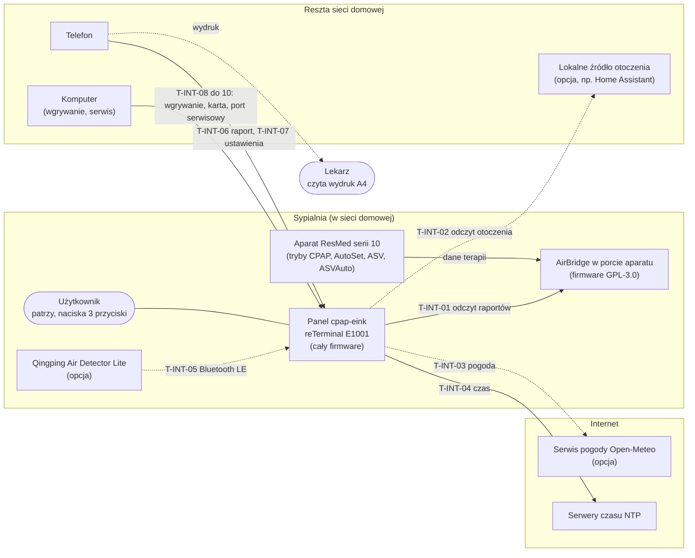

Linia przerywana: interfejs opcjonalny (źródło otoczenia, pogoda, Qingping) albo poza panelem (wydruk). Strzałki bez numeru (użytkownik, aparat, wydruk) to relacje poza firmware. Szczegóły każdej strzałki: tabela 4.2. Granica prywatności (ADR-0001, R-NF-07): poza sieć domową wychodzą tylko T-INT-03 i T-INT-04, oba bez danych terapii, sypialni, czynników i raportów.

### 4.2 Interfejsy zewnętrzne

| ID | Interfejs | Kierunek i protokół | Co płynie | Wymagania | Prototyp (kod w wersji beta) | Źródło |
|---|---|---|---|---|---|---|
| T-INT-01 | AirBridge | panel → AirBridge; HTTP w sieci lokalnej, logowanie Digest (MD5, `qop=auth`), adres z konfiguracji: IP albo nazwa `.local` przez mDNS (R-KONF-40) | lista nocy, raport doby (6–9 KB JSON), `/api/status`; manifest nocy (`action=prepare`) i artefakty nocy `/api/report/artifact` z przebiegami kanałów co 2 s (wyciek, ciśnienia) i co 1 s (SpO2, puls), także zakresem bajtów (najwyżej 8 zakresów i 256 KiB na żądanie, [`storage_browser.cpp`](https://raw.githubusercontent.com/m-kozlowski/airbridge/v2.2.1/src/storage_browser.cpp) l. 82–89); trasy artefaktów i `/api/storage/*` są tylko w buildzie AirBridge z kartą (`AB_STORAGE_HAS_SDCARD`, [`web_ui.cpp`](https://raw.githubusercontent.com/m-kozlowski/airbridge/v2.2.1/src/web_ui.cpp) l. 2479–2481, [`sleep_report.cpp`](https://raw.githubusercontent.com/m-kozlowski/airbridge/v2.2.1/src/sleep_report.cpp) l. 17); przy braku miejsca na karcie modułu manifest jest odmawiany (`recording_headroom`, [`edf_report.cpp`](https://raw.githubusercontent.com/m-kozlowski/airbridge/v2.2.1/src/edf_report.cpp) l. 1627–1636, 1741) (job kończy się odpowiedzią 503 `report_build_failed`); ta odmowa i 404 na żądanie artefaktu przy pobranym raporcie dnia to fail-path „brak przebiegu” (R-DANE-23, R-DANE-32), bez nieudanej próby; po 503 najwyżej 2 ponowienia w kolejnych wybudzeniach okna porannego, po 404 bez ponowień (R-AW-37 zamknięte); AirBridge podaje tylko `{"source":"edf","error":"report_build_failed"}`, powód (np. `recording_headroom`) zostaje w jego logu, a przy innych powodach sam ponawia budowę po 30 s ([`edf_report.cpp`](https://raw.githubusercontent.com/m-kozlowski/airbridge/v2.2.1/src/edf_report.cpp) l. 2451–2457, 3240, 3253); build AirBridge bez karty nie ma też źródła `edf` (lista nocy i raport dnia: 503 `unsupported`, [`edf_report.cpp`](https://raw.githubusercontent.com/m-kozlowski/airbridge/v2.2.1/src/edf_report.cpp) l. 3553–3560), więc panel z nim nie pobiera nocy; `/api/status` daje też `pna` i `srn` zapisywane w rekordzie nocy przy pobraniu (R-NOR-25) i `resmed_time` do porównania zegara aparatu (R-AW-36, T-WYM-80); tylko żądania odczytu, `/api/settings` zakazane; konto i hasło z konfiguracji (spec 5.6.4); puste hasło: bez logowania; adres może mieć port (`http_port` AirBridge) | R-DANE-11, R-AW-01, R-AW-34, R-AW-36, R-AW-37, R-NOR-25, R-KONF-09, R-AW-18 (czas z pola `esp_time` w `/api/status`; nagłówka `Date` AirBridge nie wysyła), R-AW-11, R-AW-12, R-DANE-35, R-LEK-08 | jest: `src/airbridge.cpp` (Digest, parsowanie), `src/adaptery_esp32.cpp` `SiecEsp32::get()` (HTTPClient) | spec Załącznik A |
| T-INT-02 | lokalne źródło otoczenia | panel → źródło; HTTP GET, opcjonalny nagłówek `X-Token`, tylko adresy lokalne, bez przekierowań | JSON kontraktu wersji 1: pogoda, PM2.5 za oknem, CO2 sypialni, ostrzeżenia | R-DANE-33, R-AW-25, R-AW-26, R-AW-27, R-NF-27, R-NF-22, R-KONF-35 | jest bez R-NF-27 (adres nie jest sprawdzany pod kątem sieci lokalnej, zachowanie przy przekierowaniu niesprawdzone, README prototypu): `src/otoczenie.cpp`; adres i token w `include/secrets.h` (poza repo), nie w pliku konfiguracji | spec Załącznik C, ADR-0019 |
| T-INT-03 | serwis pogody Open-Meteo | panel → internet; zapytanie o prognozę, powietrze i pyłek dla miasta z konfiguracji | prognoza (M-26), powietrze i pyłek (M-27); przy lokalnym źródle tylko pyłek | R-DANE-16, R-AW-07, R-KONF-24, R-NF-07 | brak (pogoda tylko z T-INT-02) | spec 4.3, R-DANE-16 |
| T-INT-04 | serwery czasu NTP | panel → internet; NTP, zapytanie bez danych | czas UTC; strefa Europe/Warsaw liczona na panelu | R-AW-08, R-AW-20, R-NF-20, R-NF-07 | jest: `configTzTime` z `pool.ntp.org` i `time.google.com` (`src/adaptery_esp32.cpp` `SiecEsp32::czasZSieci()`) | ADR-0013 |
| T-INT-05 | Qingping Air Detector Lite | czujnik → panel; Bluetooth LE (odbiór rozgłoszeń, szczegóły do ustalenia) | CO2, PM2.5, PM10, temperatura, wilgotność sypialni (M-23) | R-DANE-10, R-AW-06 | brak | spec 2.1 |
| T-INT-06 | serwer raportu dla telefonu | telefon → panel; HTTP w domowym Wi-Fi, adres z tokenem w kodzie QR, serwer włączony najwyżej 15 min | strona z PDF raportu, lista poprzednich raportów, EDF przekazana z AirBridge | R-LEK-03, R-LEK-04, R-LEK-20, R-NF-09, R-NF-10 | `src/serwer_raportu.cpp`, `src/serwer_raportu_esp32.cpp`; paczki EDF w wersji beta nie ma (stała `EDF_DOSTEPNA` = false w `src/dyrygent.cpp`): od 08.11.2026 strona dla telefonu bez linku, ze zdaniem `Paczka EDF: niedostępna w tej wersji.`, a `/edf` odpowiada 501 tym samym zdaniem | ADR-0005, spec 5.13 |
| T-INT-07 | serwer formularza ustawień | telefon → panel; HTTP przez własną sieć Wi-Fi panelu (U-02, AP WPA2 `cpap-eink-XXXX` pod 192.168.4.1, uruchamiana tylko ręcznie; adapter: `WiFi.persistent(false)`, STA bez łączenia dla generatora, potem `esp_wifi_stop`, tryb AP, konfiguracja WPA2 i dopiero `esp_wifi_start` (bez chwili otwartej sieci, RP7B-02), koniec przez `WiFi.mode(WIFI_OFF)`, najwyżej 2 telefony, bez DNS) albo domowe Wi-Fi, kod QR, najwyżej 15 min | zapis ustawień z tabeli 5.6.4, nic poza nią; pola haseł (sieć domowa, AirBridge) bez wartości w stronie, puste pole = bez zmiany, pole wyboru `bez hasła` usuwa hasło | R-KONF-01, R-KONF-15, R-KONF-18, R-KONF-38, R-KONF-39, R-NF-10 | częściowo: formularz U-03 w domowym Wi-Fi (`src/formularz.h`, gniazdo `GniazdoHttp::obsluzZadania()` z POST), sieć i AirBridge sprawdzane przed zapisem w NVS `sekrety`; strona ma też ustawienia `co2`, `miasto`, `humor`, `buzzer`, `cisza`, `podpowiedz` i `raport.czynniki`, od 06.11.2026 `uwaga_o_masce` (R-KONF-42, liczba 10–15 w grupie „Sprzęt”, 15 = bez tej informacji) (`formularz::waliduj()`, `formularz::scal()`, `formularz::strona()`; tabela 18 miast wojewódzkich `src/miasta.cpp`), strona ok. 6,4 KB (6,4 KB bez pola CO2, 6,6 KB z nim) składana raz w pamięci (`std::string`) i wysyłana jednym `sendContent()`, ciało POST z wszystkimi polami poniżej 2 KB przy limicie 4 KB, bez zewnętrznych zasobów; własna sieć panelu (U-02) | ADR-0011, spec 5.6 |
| T-INT-08 | wgrywanie firmware | komputer → panel; kabel USB (mostek USB-UART) albo Wi-Fi w sieci lokalnej | obraz firmware; dane panelu muszą zostać | R-NF-19 | jest: kabel 115 200 b/s; Wi-Fi przez ArduinoOTA z hasłem, okno 10 min na ekranie „Test sprzętu”, nazwa `cpap-eink.local` ogłaszana przez mDNS; w kodzie także samosprawdzenie nowej wersji i powrót do poprzedniej (`src/start.h` `decyzjaSamosprawdzenia()`, T-WYM-41) | `platformio.ini`, README prototypu |
| T-INT-09 | karta microSD jako nośnik wymienny | komputer ↔ karta panelu | plik importu historii z karty SD aparatu (ADR-0017), raporty, kopia danych | R-DANE-31, R-NF-11 | rozjazd: brak obsługi karty; historia w pamięci flash panelu (LittleFS), import przez `pio run -t uploadfs`, który kasuje całą pamięć plików | ADR-0017, README prototypu |
| T-INT-10 | port serwisowy | komputer ↔ panel; UART 115 200 b/s przez USB | log, komendy serwisowe (`Z` zrzut plików, `O` okno wgrywania; `W` zapis plików zrzutu do katalogu przywracania w oknie przywracania, `K` koniec okna, `?` stan okna, T-WYM-87, 8.9) | brak (narzędzie serwisowe, poza spec funkcjonalną) | jest: `src/adaptery_esp32.cpp` `PortEsp32::wiersz()`, komendy w `src/dyrygent.cpp` `Przebieg::czuwanie()` | README prototypu |

**Rozjazdy widoczne już na poziomie kontekstu** (pełna lista w sekcji 13):

- T-INT-08: spec 2.1 do 01.11.2026 mówiła „brak mDNS” o adresie AirBridge (ADR-0001); adres AirBridge może być nazwą `.local` (R-KONF-40, T-KOMP-16). Prototyp nie szuka AirBridge przez mDNS (adres IP w `secrets.h`), ale sam ogłasza się przez mDNS, żeby komputer znalazł go przy wgrywaniu przez Wi-Fi. To nie łamie ADR-0001 (nic nie wychodzi poza sieć domową); drogę wgrywania przez Wi-Fi ustala ADR-0024 (przyjęty 01.11.2026, sekcja 8).
- T-INT-09: spec zakłada historię i raporty na karcie microSD (8.1, 8.4, R-NF-11), a prototyp trzyma wszystko w pamięci flash panelu. Wybór nośnika jest częścią decyzji o formacie plików i migracjach (sekcja 9).
- T-INT-02: prototyp nie spełnia R-NF-27 (nie sprawdza, czy adres źródła jest w sieci lokalnej; zachowanie przy przekierowaniu niesprawdzone). To dotyczy granicy ADR-0001, więc w kolejności wdrożenia (sekcja 13) idzie przed nowymi funkcjami.
- T-INT-02 i T-INT-07: adres i token źródła otoczenia są w prototypie zaszyte przy kompilacji, a spec chce ich w pliku konfiguracji w postaci nieczytelnej bez panelu (R-NF-22, R-KONF-35).

## 5. Strategia rozwiązania

Sekcja zbiera kluczowe decyzje techniczne w jednym miejscu. Każdy wiersz mówi, co postanowiono, gdzie jest uzasadnienie (ADR) i co to zmienia dla budowy i używania panelu. Decyzje ADR-0021…ADR-0025 są przyjęte (01.11.2026); fragmenty od nich zależne mają dopisek „(zależy od ADR-002x, przyjęty 01.11.2026)”.

| Decyzja | Na czym polega | Skutek | ADR |
|---|---|---|---|
| trzy warstwy: rdzeń, adaptery, dyrygent | cała logika (dane, norma, reguły, wybór ekranu, treść, rysowanie do bufora) w rdzeniu bez Arduino; sprzęt i sieć za cienkimi adapterami z atrapami; dyrygent tylko wykonuje plan wybudzenia, który oddaje rdzeń | cały dzień panelu, także awarie z 5.3, zmiana czasu i brak karty, da się odtworzyć i narysować na komputerze; 15 plików logiki prototypu zostaje, `main.cpp` trzeba rozłożyć | 0021 |
| całe liczenie na panelu | brak serwera, chmury i aplikacji; z sieci tylko odczyt z AirBridge, lokalnego źródła otoczenia, pogody i czasu | poza dom wychodzą tylko zapytania o pogodę i czas, bez danych terapii; panel działa bez internetu poza pogodą | 0001, 0013, 0017, 0019 |
| tylko odczyt z aparatu, bez drogi zmiany ustawień | adapter sieci zna wyłącznie żądanie GET (T-WYM-27); teksty z wartością albo drogą zmiany ustawień zatrzymuje skrypt budowy zestawu przed wgraniem (9.3); panel sprawdza wkompilowaną listę reguł obowiązkowych (T-WYM-86) | zmiany ustawień aparatu panel nie wykona, bo w kodzie nie ma takiego żądania; tekst z podpowiedzią zmiany zatrzymuje skrypt przed wgraniem, ale ręcznie poprawionego pliku tekstów panel nie odróżni od zbudowanego skryptem (ADR-0023 pkt 4), więc tu granica trzyma się procesu; panel sprawdza tylko, że reguły z listy obowiązkowej są w katalogu włączone i mają poziom i pilność nie niższe niż w spec, a pozostałe parametry tych reguł (okna, liczone noce, tryby, wykluczenia, bramki, progi) pilnuje skrypt budowy i przegląd przed wgraniem | 0002, 0012, 0015, 0023 (adnotacja 01.11.2026) |
| dane trwałe w pamięci flash panelu, karta jako kopia i wymiana | historia, odpowiedzi, konfiguracja i raporty na partycji plików we flash; karta: kopia raz na dobę, import historii, plik konfiguracji zapasowej; pliki CSV z wersją w nagłówku, migracja przy starcie, zapis atomowy | awaria karty nie zmienia tego, co panel mówi rano; wgranie nowej wersji nie kasuje danych. Wymaga zmiany spec funkcjonalnej (miejsce zapisu w ok. 44 wymaganiach) | 0022, 0017, 0011 |
| silnik reguł sterowany danymi | progi, katalog reguł (które wzorce, okna, pilność, tryb) i teksty jako pliki z wersją, budowane skryptem ze spec i `progi.csv`; rodzaje warunków jako kod z testami | kalibracja w etapie 2 i uwagi lekarzy PSG zmieniają plik, a nie kod; nowy rodzaj warunku nadal przechodzi przez kod, testy i przegląd granicy ADR-0002 | 0023, 0004, 0016 |
| symulator ekranów na komputerze | rdzeń skompilowany na komputerze z atrapami adapterów rysuje ten sam bufor 1 bit co panel | każdy ekran i każda awaria do obejrzenia i porównania pikselowego bez panelu; panel potrzebny tylko do pomiarów sprzętu | 0021 pkt 4 |
| trzy rodzaje ekranu, 1 bit, budzik nigdy na czarnym | ekran danych, karta z budzikiem, ekran nocny S9; wybór trybu w jednym komponencie, rysowanie w jednym | zasada „budzik nigdy na czarnym tle” jest pilnowana w jednym miejscu kodu, niezależnie od danych (T-WYM-79), i w jednym zestawie testów pikselowych | 0007, 0008, 0009, 0018 |
| konfiguracja przyciskami i formularzem z kodem QR | proste przełączniki w U-01; reszta formularzem z telefonu; pierwsza konfiguracja przez własną sieć Wi-Fi panelu; serwery lokalne z tokenem, najwyżej 15 min | serwery raportu i formularza w jednym komponencie z jednym mechanizmem tokenu i limitu czasu | 0011, 0005 |
| raport A4 z kryterium stopu | PDF składany na panelu; gdy warunek ADR-0005 nie jest spełniony, ekran-ściąga zamiast PDF | komponent raportu można w wydaniu zastąpić ekranem-ściągą bez zmiany reszty firmware | 0005 |
| cztery tryby terapii w 1.x | reguły zależne od trybu w jednej tabeli wariantów (kolumna „tryby” w katalogu reguł, pole `tryb` w pliku progów) | noc w trybie spoza listy jest zapisana i pokazana, ale nieoceniana (R-DANE-29); progi trybów CPAP, AutoSet i ASV bez nocy strojenia, kalibracja na tryb po wersji 1 | 0016, 0030 |
| norma osobista, nowy poziom tylko dla metryk technicznych | jeden komponent liczy normę, odchylenia i stany odchylenia dla wszystkich metryk | reguły, ekrany i raport biorą normę z jednego źródła, więc nie mogą się rozjechać | 0003, 0014 |
| czynniki nocy z grupą kontrolną | pytania i zapis odpowiedzi w komponencie przycisków, losowanie i odkrycie O-12 w silniku reguł | odpowiedzi użytkownika leżą tylko w magazynie danych panelu i trafiają do raportu tylko według konfiguracji | 0006 |
| moduły włączane ustawieniem (spec 2.6) | każdy komponent rdzenia czyta listę włączonych modułów z konfiguracji | wyłączony moduł nie ocenia reguł i nie pokazuje ekranów; rdzeń działa bez zmian | spec 2.6, R-KONF-32 |
| energia: głęboki sen między wybudzeniami | plan wybudzenia (T-KOMP-24) budzi panel tylko z powodów z R-NF-02; Wi-Fi tylko na czas pobierania i serwera (R-NF-03), wyłączone przed zapisem i rysowaniem; czuwanie na przycisk tylko po wybudzeniu przyciskiem | Wi-Fi i odświeżanie e-ink to główny koszt energii; ich liczba na dobę wynika z planu, nie z rozproszonych miejsc w kodzie | spec 8.1 |
| aktualizacja oprogramowania i zestawu danych reguł | firmware przez Wi-Fi w sieci lokalnej tylko w oknie serwisowym, z hasłem i powrotem do poprzedniej wersji; zestaw danych reguł przychodzi z nowym firmware (zestaw wbudowany podmienia zestaw z poprzedniego firmware, T-WYM-85), a pakiety spoza firmware i sceny z karty microSD, bez kasowania danych; kabel jako droga ratunkowa | nowa wersja albo nowe progi bez utraty historii; zła wersja cofa się sama; wersja, która po oznaczeniu jako dobra wpada w pętlę restartów albo się zawiesza, kończy w trybie awaryjnym (U-06) z wyłączonym radiem zamiast rozładować baterię (7.8, R-AW-39). Wymaga zmiany spec funkcjonalnej (R-NF-02, R-NF-03, ekran testu sprzętu) | 0024 (przyjęty 01.11.2026, adnotacja 01.11.2026) |
| klasa bezpieczeństwa oprogramowania | IEC 62304 klasa B jako wzorzec staranności testów i przeglądu, bez deklaracji zgodności | lista SOUP z wymaganiami i przeglądem znanych błędów przed wydaniem (10.4) | 0025 |
| struktura dokumentu i macierz | każdy komponent ma kolumnę „Realizuje”, macierz techniczna jest generowana skryptem | kryterium „każde wymaganie ma część firmware i test” jest sprawdzane automatycznie | 0020 |

Granice z ADR-0001, ADR-0002, ADR-0012 oraz ADR-0007, ADR-0009 i ADR-0018 nie mają w firmware wyjątku konfiguracyjnego: żaden plik danych ani ustawienie nie włącza żądań zapisu do AirBridge, wysyłki danych terapii poza dom ani budzika na czarnym tle.

## 6. Widok bloków (C4, poziomy 2 i 3)

Sekcja opisuje, z jakich części składa się firmware i co między nimi płynie. **Zależy od ADR-0021 **: podział na rdzeń, adaptery i dyrygenta. Magazyn danych zależy od ADR-0022, silnik reguł i zestaw danych od ADR-0023. Ścieżki plików prototypu w tej sekcji są względne do `firmware/prototyp/`; odwołania po nazwie funkcji według konwencji z nagłówka dokumentu (kod jak na `main` `c518470`).

### 6.1 Warstwy i pliki danych (C4, poziom 2)

Panel to jeden program (firmware) na jednym układzie. Poziom 2 C4 pokazuje więc nie osobne programy, tylko warstwy firmware i pliki danych, które firmware czyta i zapisuje.

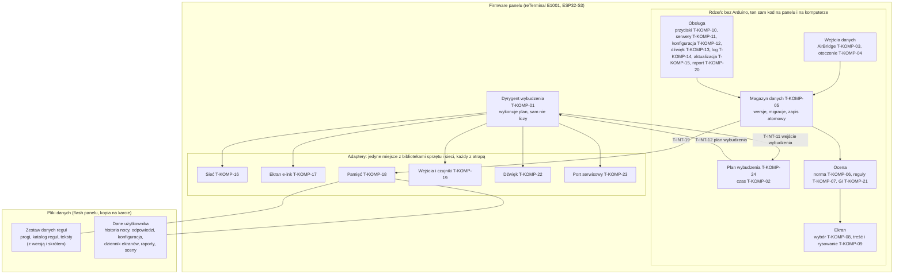

Strzałki bez numeru to skrót: dyrygent przekazuje adapterom polecenia z planu i oddaje rdzeniowi ich wyniki (interfejsy w 6.5).

| Warstwa | Co zawiera | Czego nie wolno | Gdzie się kompiluje |
|---|---|---|---|
| rdzeń | logikę: pobieranie i parsowanie (bez gniazd sieci), magazyn danych jako format i migracje, normę, reguły, wybór ekranu, treść, rysowanie do bufora, przyciski jako mapa przejść, serwery jako trasy i tokeny, konfigurację, decyzje o dźwięku i logu, raport PDF, plan wybudzenia | wołać bibliotek sprzętu i sieci (T-WYM-01), czytać zegara systemowego (T-WYM-04), trzymać stanu poza magazynem (T-WYM-07) | na panelu i zwykłym kompilatorem na komputerze |
| adaptery | sterowniki: Wi-Fi, HTTP, NTP, mDNS, ekran e-ink, LittleFS, NVS, pamięć RTC, karta, przyciski, SHT40, bateria, PCF8563, Bluetooth LE, buzzer, port serwisowy, zapis obrazu firmware | podejmować decyzji o danych terapii; każdy adapter ma atrapę (T-WYM-02) | na panelu; na komputerze zastępują je atrapy |
| dyrygent | jedno wybudzenie: zebranie wejścia, wywołanie planu, wykonanie poleceń, sen | podejmować własnych decyzji (T-WYM-03) | na panelu; na komputerze test doby uruchamia go z atrapami |
| pliki danych | zestaw danych reguł (ADR-0023) i dane użytkownika (ADR-0022) | edycji ręcznej zestawu reguł (budowany skryptem, ADR-0023 pkt 1) | poza kodem |

### 6.2 Komponenty (C4, poziom 3)

Diagram pokazuje główne przepływy danych w jednym wybudzeniu porannym. Interfejsy z numerem są w tabeli 6.5; połączenia z dyrygentem i logiem pominięto dla czytelności.

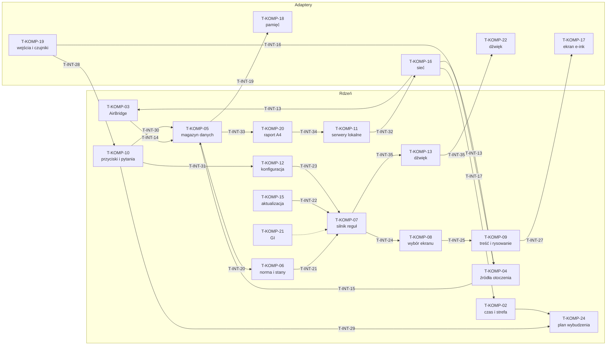

Linia przerywana: T-KOMP-21 w wydaniu 1.0 nie dostarcza cech GI (zablokowane do pomiaru 21, 6.7); dostarcza tylko stan „GI niedostępne” i wariant z ustawienia.

### 6.3 Moduł specyfikacji → komponenty

Moduły spec (2.3) opisują, co panel robi, a komponenty, gdzie to siedzi w kodzie. Jeden moduł zwykle dotyczy kilku komponentów; pełne przypisanie wymagań jest w kolumnie „Realizuje” tabeli 6.4 i w macierzy technicznej.

| Moduł spec | Główne komponenty | Pomocnicze | Co gdzie |
|---|---|---|---|
| 5.1 DANE | T-KOMP-03, T-KOMP-05 | T-KOMP-24, T-KOMP-04, T-KOMP-19, T-KOMP-07 | pobranie, metryki i stany nocy w T-KOMP-03; zapis i import w T-KOMP-05; okna poranne i ponowienia co 30 min w T-KOMP-24; sypialnia i pogoda w T-KOMP-04 |
| 5.2 NORMA | T-KOMP-06 | T-KOMP-08, T-KOMP-07 | linie „Nowy poziom”, „Nowe ustawienia” wybiera T-KOMP-08 z kolejki 7.5 |
| 5.3 AWARIE | T-KOMP-03, T-KOMP-02, T-KOMP-05 | T-KOMP-04, T-KOMP-08, T-KOMP-24, T-KOMP-18, T-KOMP-21 | każda awaria jest obsłużona w komponencie, który jej doznaje; jej widok (S5, U-04, linia uwagi) wybiera T-KOMP-08 |
| 5.4 EKRAN DANYCH | T-KOMP-08, T-KOMP-09 | T-KOMP-07, T-KOMP-06, T-KOMP-10 | warunki odkryć i warunek uspokojenia w T-KOMP-07; wybór, rotacje, kolejka linii i limity w T-KOMP-08; teksty, strefy i typografia w T-KOMP-09 |
| 5.5 KOKPIT | T-KOMP-09 | T-KOMP-06, T-KOMP-07, T-KOMP-10 | agregacje 7 i 30 nocy z T-KOMP-06; znaczniki pilności C i „P95 przy maksimum” z T-KOMP-07 |
| 5.6 PRZYCISKI (mapa, U-01…U-03, pierwsza konfiguracja) | T-KOMP-10, T-KOMP-12, T-KOMP-11 | T-KOMP-16, T-KOMP-19, T-KOMP-24, T-KOMP-17 | mapa przejść w T-KOMP-10; zapis i walidacja ustawień w T-KOMP-12; formularz i własna sieć w T-KOMP-11 z T-KOMP-16 |
| 5.7 KARTA I HUMOR | T-KOMP-08 | T-KOMP-09, T-KOMP-05 | wybór trybu, sceny i zdania w T-KOMP-08; rysowanie karty i zasada tła w T-KOMP-09 |
| 5.8 KONTEKST (S-K, S9) | T-KOMP-07, T-KOMP-08 | T-KOMP-24, T-KOMP-09, T-KOMP-17, T-KOMP-03 | warunki S-K w T-KOMP-07; sloty i jedno narysowanie S9 w T-KOMP-24; limity w T-KOMP-08 |
| 5.9 SPRZĘT | T-KOMP-07 | T-KOMP-10, T-KOMP-09, T-KOMP-06, T-KOMP-05 | daty wymiany zapisuje T-KOMP-10, reguły S-K-31, S-K-32 i blokada L-09 w T-KOMP-07 |
| 5.10 INFEKCJA | T-KOMP-07 | T-KOMP-10, T-KOMP-08 | okres infekcji jako stan w T-KOMP-07 (trwały przez T-KOMP-05) |
| 5.11 CZYNNIKI | T-KOMP-10, T-KOMP-07 | T-KOMP-08, T-KOMP-05, T-KOMP-06, T-KOMP-20 | pytanie i zapis w T-KOMP-10; grupa kontrolna i O-12 w T-KOMP-07; wyłączenie z normy w T-KOMP-06 |
| 5.12 LEKARZ (wzorce L, hipotezy H, „Omówione”) | T-KOMP-07 | T-KOMP-08, T-KOMP-10, T-KOMP-09, T-KOMP-20, T-KOMP-12 | stany wzorców i hipotezy w T-KOMP-07; pytania o senność i „gorzej” w T-KOMP-10; linie i powroty w T-KOMP-08 |
| 5.13 RAPORT | T-KOMP-20, T-KOMP-11 | T-KOMP-09, T-KOMP-10, T-KOMP-05, T-KOMP-16 | składanie PDF w T-KOMP-20; serwer z tokenem w T-KOMP-11; kod QR i ekran raportu w T-KOMP-09 |
| 5.14 BUZZER | T-KOMP-13 | T-KOMP-22, T-KOMP-02, T-KOMP-12 | kiedy i czy dźwięk w T-KOMP-13; sygnał na GPIO45 w T-KOMP-22 |
| 5.15 GI | T-KOMP-21 | T-KOMP-07, T-KOMP-12 | w 1.0 tylko stan „GI niedostępne” i wariant z ustawienia; liczenie cech po pomiarze 21 (6.7) |
| 7.1…7.5, 7.7 pierwszeństwo, bramki, limity, kolejka linii | T-KOMP-08 | T-KOMP-10 | jedna funkcja wyboru dla wszystkich slotów; terminy odpowiedzi porannych w T-KOMP-10 |
| 8.1, 8.2 niefunkcjonalne | T-KOMP-24, T-KOMP-01, T-KOMP-09, T-KOMP-05 | adaptery, T-KOMP-11, T-KOMP-12, T-KOMP-15 | energia i czasy reakcji w planie i dyrygencie; typografia i 1 bit w T-KOMP-09; trwałość w T-KOMP-05 |
| 8.4 stan trwały panelu | T-KOMP-05 | T-KOMP-18 | wszystkie pozycje 8.4 jako rekordy magazynu (zależy od ADR-0022, przyjęte 01.11.2026) |
| Załącznik A (API AirBridge) | T-KOMP-03 | T-KOMP-16 | parser i stany nocy; T-INT-01 |
| Załącznik C (źródło otoczenia) | T-KOMP-04 | T-KOMP-16, T-KOMP-12 | parser kontraktu wersji 1; sprawdzenie adresu R-NF-27; T-INT-02 |

### 6.4 Komponenty

Kolumna „Realizuje” wskazuje wymagania funkcjonalne i techniczne, za które komponent odpowiada (wymaganie może mieć kilka komponentów). Kolumna „Prototyp (plik)” wskazuje kod, który już istnieje; „brak” znaczy, że komponent trzeba napisać.

| ID | Komponent | Warstwa | Odpowiedzialność | Realizuje | Prototyp (plik) |
|---|---|---|---|---|---|
| T-KOMP-01 | dyrygent wybudzenia | dyrygent | wykonuje jedno wybudzenie: zbiera wejście (powód wybudzenia, przyczyna startu, przyciski, napięcie baterii), prowadzi strażnika zadania i licznik startów po błędzie (T-WYM-81, T-WYM-82), woła plan wybudzenia, wykonuje polecenia przez adaptery w podanej kolejności, włącza i wyłącza Wi-Fi, usypia z czasem i maską przycisków; niczego nie liczy | R-KONF-25, R-KONF-26, R-NF-01, R-NF-03…R-NF-05, R-NF-25, R-PRZ-01, R-PRZ-09, T-WYM-03, T-WYM-20, T-WYM-21, T-WYM-22, T-WYM-24, T-WYM-28, T-WYM-30, T-WYM-41, T-WYM-81, T-WYM-82 | `src/dyrygent.cpp` `Przebieg::zwykleWybudzenie()`, `src/dyrygent.cpp` `Przebieg::odczyt()`, `src/dyrygent.cpp` `Przebieg::pokaz()`, `src/dyrygent.cpp` `Przebieg::spij()`; dziś miesza decyzje z wykonaniem |
| T-KOMP-02 | czas i strefa | rdzeń | kolejność źródeł czasu (NTP, AirBridge, własny zegar, 5.3.3), odrzucenie czasu wcześniejszego niż ostatnia sesja, strefa Europe/Warsaw z czasem letnim, data poranka, dzień tygodnia, cisza nocna | R-AW-08, R-AW-08b, R-AW-18…R-AW-21, R-BUZ-02, R-BUZ-02b, R-BUZ-05, R-NF-20, T-WYM-01, T-WYM-04, T-WYM-22, T-WYM-69, T-WYM-70, T-WYM-71, T-WYM-80, T-WYM-88 | `src/wspolne.cpp` `nrDnia()`, `src/wspolne.cpp` `dzienTygodnia()`, `src/dobranoc.cpp` `numerPoranka()`; odczyt zegara w `src/dyrygent.cpp` `Przebieg::zegar()`, 3 próby NTP i `zegarZAirBridge()` (R-AW-18, T-WYM-88) w `src/dyrygent.cpp` `Przebieg::pobierz()`, `src/airbridge.cpp` `parsujCzasAb()`, metody zegara zLokalnego i ustaw w interfejsie `Zegar` (`src/adaptery.h`); strefa w `src/dyrygent.cpp` `Przebieg::pobierz()`, `src/adaptery_esp32.cpp` `configTzTime`) do przeniesienia |
| T-KOMP-03 | pobieranie z AirBridge | rdzeń | logowanie Digest, budowa żądań odczytu, klasyfikacja odpowiedzi (200, 202, 409, inne), odpytywanie joba, parsowanie listy nocy, raportu i `/api/status`, liczenie metryk nocy (4.3), stany nocy (5.1.4), luki w historii, nieudane próby dób | R-AW-01…R-AW-03, R-AW-09…R-AW-12, R-AW-14, R-AW-15, R-AW-18, R-AW-22, R-CZY-19, R-DANE-01…R-DANE-03, R-DANE-06, R-DANE-07, R-DANE-11…R-DANE-15, R-DANE-18…R-DANE-27, R-DANE-29, R-DANE-32, R-DANE-34, R-DANE-35, R-KON-12, R-KON-33, R-KONF-11, R-KONF-27, R-KONF-37, R-AW-34, R-AW-37, R-NOR-25, R-LEK-08, R-NF-17, R-PRZ-06, T-WYM-01, T-WYM-25, T-WYM-26, T-WYM-27, R-AW-38, T-WYM-89, T-WYM-91 | `src/airbridge.cpp` `parsujWyzwanie()`, `src/airbridge.cpp` `klasyfikujOdpowiedz()`, `src/airbridge.cpp` `parsujListeNocy()`, `src/airbridge.cpp` `nocZRaportu()`, `src/airbridge.cpp` `parsujStatus()`; przebieg pobrania w `src/dyrygent.cpp` `Przebieg::pobierz()` i `src/dyrygent.cpp` `Przebieg::dociagnijHistorie()` do przeniesienia |
| T-KOMP-04 | źródła otoczenia | rdzeń | lokalne źródło otoczenia (kontrakt wersji 1, sprawdzenie adresu lokalnego, ponowienia), serwis pogody, Qingping, czujnik panelu: bufory odczytów co 15 min, mediany nocy, świeżość bloków, ostrzeżenie E-08; prognoza godzinowa z serwisu pogody Open-Meteo (temperatura, opad, zachmurzenie, porywy, PM2.5, pyłki) i jej ważność, seria CO2 nocy z odczytów źródła | R-AW-06, R-AW-07, R-AW-13, R-AW-25…R-AW-27, R-DANE-09, R-DANE-10, R-DANE-16, R-DANE-17, R-DANE-33, R-EKR-10, R-KONF-24, R-KONF-35, R-NF-07, R-NF-27, T-WYM-01, T-WYM-31, R-KON-52, R-KON-53 | `src/otoczenie.cpp` `parsujOtoczenie()`, `src/otoczenie.cpp` `ponowicOtoczenie()`, `src/otoczenie.cpp` `pokazE08()`, `src/sypialnia.cpp` `zamknijNoc()`; pogoda z serwisu i Qingping: brak; `src/slot_dzienny.cpp` `parsujPrognoze()`, `src/slot_dzienny.cpp` `parsujPowietrze()`, `src/slot_dzienny.cpp` `prognozaWazna()`, `src/kontekst.cpp` `statystykaCo2()`, pobranie w `src/dyrygent.cpp` `Przebieg::pobierzPrognozeB9()` |
| T-KOMP-05 | magazyn danych | rdzeń | rekordy logiczne (noce, sypialnia, czynniki i odpowiedzi, wyciszenia, daty wymiany, dziennik ekranów, liczniki, stan 8.4), format CSV z wersją, migracje przy starcie, zapis atomowy, import historii z karty, kopia na kartę, reakcja na awarię nośnika (zależy od ADR-0022, przyjęte 01.11.2026) | R-AW-03, R-AW-05, R-AW-05b, R-AW-14, R-AW-16, R-AW-23, R-CZY-03, R-CZY-10, R-CZY-13, R-DANE-01, R-DANE-04…R-DANE-06, R-DANE-09, R-DANE-10, R-DANE-15, R-DANE-24, R-DANE-25, R-DANE-31, R-DANE-34, R-HUM-11, R-KON-40, R-KONF-22, R-KONF-23, R-LEK-01, R-LEK-23, R-LEK-32, R-MAS-01, R-NF-06, R-NF-08, R-NF-11, R-NF-12, R-NF-19, R-NOR-17, R-PRZ-13, T-WYM-01, T-WYM-07, T-WYM-23, T-WYM-32, T-WYM-34, T-WYM-43, T-WYM-50, T-WYM-51, T-WYM-52, T-WYM-53, T-WYM-54, T-WYM-55, T-WYM-56, T-WYM-57, T-WYM-58, T-WYM-59, T-WYM-60, T-WYM-61, T-WYM-62, T-WYM-84, T-WYM-87, R-AW-28, R-DANE-36, R-DANE-37, R-NF-28, T-WYM-90 | `src/magazyn.cpp` `rejestrFormatow()`, `Magazyn::czytaj()`, `Magazyn::zapisz()`, `Magazyn::dopisz()`, `Magazyn::migrujNaNoweSciezki()`, `Magazyn::migrujWMiejscu()`, `Magazyn::zapiszSurowy()`, `Magazyn::przywrocZKatalogu()`, `Magazyn::bezPlikowNocy()`, `NvsTylkoZmiany::ustawBajty()`, `decyzjaPartycji()`, `identyfikatorUkladu()`, `parsujKomendeW()`, `sprawdzPlikW()`, `sha256Hex()`; parsery wersji 0 i wiersze wersji 1: `src/noc.cpp` `parsujNoc()` (układ po liczbie pól), `src/noc.cpp` `wierszNocyV1()`, `src/noc.cpp` `parsujNocV1()`, `src/czynniki.cpp` `parsujWpis()`, `src/sypialnia.cpp` `parsujSypialnie()`, `src/humor.cpp` `parsujHumor()`; wczytanie, migracje przed oznaczeniem, przywrócenie i import w dyrygencie: `src/dyrygent.cpp` `Przebieg::wczytajPliki()`, `Przebieg::wczytajDane()`, `Przebieg::poOznaczeniu()`, `Przebieg::oknoPrzywracania()`, `Przebieg::importujJesliCzas()` |
| T-KOMP-06 | norma i stany odchylenia | rdzeń | norma osobista z 30 nocy ważnych (mediana, P10, P90, Δ), okno 90 dni, zerowanie przy zmianie ustawień, maski i aparatu, odchylenie w jednej nocy, stan odchylenia, nowy poziom, agregacje 7 i 30 nocy dla ekranów | R-CZY-05, R-CZY-23, R-EKR-34, R-EKR-55, R-EKR-56, R-KOK-01…R-KOK-16, R-MAS-11, R-NOR-01…R-NOR-26, T-WYM-01 | `src/noc.cpp` `mediana()`, `src/noc.cpp` `percentyl()`, `src/noc.cpp` `odchylenieWNocy()`, `src/stany.cpp` `liczStany()`, `src/stany.cpp` `porownajTydzien()`, `src/kokpit.cpp` `linia()`, `src/czynniki.cpp` `wykluczoneZNormy()` |
| T-KOMP-07 | silnik reguł | rdzeń | wykonuje katalog reguł z zestawu danych: zdarzenia E, ekrany kontekstowe S-K, wzorce L ze stanami i pilnością, hipotezy H, odkrycia O z testem permutacyjnym, okres infekcji, sprzęt, grupa kontrolna; rodzaje warunków jako kod z testami (zależy od ADR-0023, przyjęte 01.11.2026) | R-AW-05b, R-AW-06, R-AW-08b, R-CZY-01, R-CZY-02, R-CZY-04, R-CZY-07, R-CZY-12, R-CZY-19, R-CZY-21, R-CZY-24, R-DANE-21, R-DANE-22, R-DANE-28, R-DANE-29, R-EKR-19, R-EKR-26, R-EKR-28, R-EKR-32, R-EKR-46, R-EKR-48, R-GI-06, R-HIP-01, R-HIP-03, R-HIP-04, R-HIP-06, R-HIP-08, R-HIP-09, R-HIP-10, R-INF-01…R-INF-10, R-KOK-12, R-KOK-13, R-KON-01, R-KON-05…R-KON-13, R-KON-17, R-KON-18, R-KON-22…R-KON-24, R-KON-26…R-KON-28, R-KON-30, R-KONF-32, R-KONF-42, R-LEK-09, R-LEK-10, R-LEK-25…R-LEK-27, R-MAS-02…R-MAS-04, R-MAS-06, R-MAS-08…R-MAS-13, R-NF-24, R-NOR-02, R-NOR-11, R-PRZ-10…R-PRZ-13, R-SKI-01…R-SKI-05, R-SKI-07…R-SKI-15, R-SKI-19…R-SKI-21, R-SKI-23, R-SKI-27, R-SKI-29…R-SKI-32, R-SKI-35, R-SKI-40, R-SKI-42, R-SKI-43, R-SKI-44, T-WYM-01, T-WYM-66, T-WYM-68, R-AW-31 | `src/stany.cpp` `nieocenianeUspokojenia()`, `src/czynniki.cpp` `losujKontrolna()`, `src/czynniki.cpp` `decyzjaZaproszenia()`; progi jako stałe w `src/kokpit.h` i `src/sypialnia.h`; od wersji beta silnik reguł z zestawem wbudowanym: `src/reguly.cpp`, `src/reguly_parser.cpp`, `src/reguly_rodzaje.cpp`, `src/reguly_pamiec.cpp`, rodzaje E `src/rodzaje_e.cpp`, wzorce L i hipotezy H `src/rodzaje_l.cpp`, `src/wzorce.cpp`, odkrycia `src/odkrycia.cpp`, moduły SPRZĘT i INFEKCJA, pozostałe S-K `src/sprzet.cpp`, `src/infekcja.cpp`, `src/kontekst_sk.cpp`; braki w README prototypu, „Uproszczenia” |
| T-KOMP-08 | wybór ekranu | rdzeń | tabela pierwszeństwa 7.2, bramki 7.3, limity 7.4, kolejka linii uwagi 7.5, rotacje i dziennik wyświetleń, wybór trybu (karta albo ekran danych), sceny i zdania budzika, wariant S9; część „Dzień” tabeli 7.2 (reguła wietrzenia, „Jutro rano”, sprzęt, pyłek, rotacja słońca i obrazka dnia, drzemka) i dobór obrazka dnia | R-AW-05, R-AW-20, R-AW-23, R-AW-24, R-AW-27, R-CZY-01, R-CZY-07, R-CZY-09, R-CZY-15, R-CZY-17, R-CZY-22, R-EKR-03, R-EKR-12, R-EKR-13, R-EKR-15, R-EKR-16, R-EKR-18, R-EKR-21…R-EKR-25, R-EKR-27, R-EKR-28, R-EKR-30…R-EKR-33, R-EKR-37, R-EKR-38, R-EKR-40, R-EKR-48, R-HUM-01…R-HUM-03, R-HUM-05…R-HUM-12, R-HUM-14…R-HUM-17, R-HUM-19, R-HUM-20, R-HUM-22, R-HUM-23, R-HUM-25…R-HUM-29, R-INF-10, R-KON-04, R-KON-14, R-KON-16, R-KON-19…R-KON-21, R-KON-25…R-KON-27, R-KON-29, R-KON-32, R-KON-35, R-KON-38, R-KON-40, R-KONF-06, R-KONF-21, R-KONF-23, R-LEK-24, R-LEK-27, R-NOR-13, R-NOR-14, R-NOR-21, R-NOR-23, R-NOR-25, R-NOR-26, R-PIE-01…R-PIE-13, R-PRZ-03, R-PRZ-15…R-PRZ-17, R-SKI-02, R-SKI-09…R-SKI-13, R-SKI-16…R-SKI-18, R-SKI-22, R-SKI-24…R-SKI-26, R-SKI-28, R-SKI-33, R-SKI-34, R-SKI-36, R-SKI-37, R-SKI-39, R-SKI-41, T-WYM-01, R-AW-29, R-AW-30, R-AW-31, R-EKR-57, R-AW-32, R-AW-35, R-AW-36, R-KON-40, R-KONF-06, R-KONF-21, R-KONF-23, R-LEK-24, R-LEK-27, R-NOR-13, R-NOR-14, R-NOR-21, R-NOR-23, R-NOR-25, R-NOR-26, R-PIE-01…R-PIE-13, R-PRZ-03, R-PRZ-15…R-PRZ-17, R-SKI-02, R-SKI-09…R-SKI-13, R-SKI-16…R-SKI-18, R-SKI-22, R-SKI-24…R-SKI-26, R-SKI-28, R-SKI-33, R-SKI-34, R-SKI-36, R-SKI-37, R-SKI-39, R-SKI-41, T-WYM-01, R-AW-29, R-AW-30, R-AW-31, R-EKR-57, R-AW-32, R-AW-35, R-AW-36, R-KON-43…R-KON-50, R-KON-54, R-KON-56…R-KON-62 | `src/humor.cpp` `wybierzEkranDnia()`, `src/humor.cpp` `wybierzTryb()`, `src/humor.cpp` `zdaniaDoLosowania()`, `src/dobranoc.cpp` `wyborNocy()`, `src/cykl.cpp` `stanDnia()`; `src/slot_dzienny.cpp` `wybierzSlot()`, `src/slot_dzienny.cpp` `regulaWietrzenia()`, `src/slot_dzienny.cpp` `jutroRano()`, `src/slot_dzienny.cpp` `wymianaSprzetu()`, `src/slot_dzienny.cpp` `pylekDnia()`, `src/slot_dzienny.cpp` `dzienINoc()`, `src/slot_dzienny.cpp` `liczDrzemke()`, `src/obrazki.cpp` `wybierzObrazek()`, `src/kontekst.cpp` `ocenWieczor()`, `src/kontekst.cpp` `ocenRano()`; `src/sprawy.cpp` `limitProblemu()`, `src/sprawy.cpp` `rangaProblemu()`, `src/sprawy.cpp` `problemPoranny()` (S3 zdarzeń E w tabeli 7.2, R-KON-14), linia `Wciąż: {tytuł}.` w `src/kolejka.cpp` `kolejkaLinii()` |
| T-KOMP-09 | treść i rysowanie | rdzeń | wstawia wartości w teksty z zestawu danych, typografia polska, limity długości, strefy i tony ekranu, rysuje do bufora 800×480 1 bit ekran dnia, kartę, K1, K2, pytania, S9, ekran raportu z kodem QR, ekran testu; ten sam kod w symulatorze; ekrany slotu dziennego S-K-33…S-K-39, obrazek dnia (PBM 1-bit do 800×434) i stopka dzienna | R-AW-07, R-AW-09, R-AW-10, R-AW-17, R-AW-24, R-CZY-20, R-CZY-21, R-EKR-04…R-EKR-11, R-EKR-14, R-EKR-17, R-EKR-19…R-EKR-21, R-EKR-29, R-EKR-34, R-EKR-36, R-EKR-39, R-EKR-41…R-EKR-43, R-EKR-45…R-EKR-47, R-EKR-49…R-EKR-56, R-EKR-59, R-HIP-01, R-HIP-02, R-HIP-05, R-HUM-04, R-HUM-05, R-HUM-13, R-HUM-18, R-HUM-21, R-HUM-24, R-KOK-01…R-KOK-16, R-KON-11, R-KON-15, R-KON-28, R-KON-31…R-KON-33, R-KON-36, R-KON-39, R-KONF-10, R-KONF-11, R-KONF-37, R-AW-35, R-LEK-05…R-LEK-07, R-LEK-18, R-LEK-21, R-LEK-22, R-LEK-28, R-MAS-05, R-MAS-06, R-MAS-14, R-NF-13…R-NF-15, R-NF-18, R-NF-23, R-NF-26, R-SKI-06, R-SKI-07, R-SKI-38, T-WYM-01, T-WYM-09, T-WYM-33, T-WYM-68, T-WYM-78, T-WYM-79, R-KON-51, R-KON-55 | `src/dzien.cpp` `trescDnia()`, `src/dobranoc.cpp` `tekstyNocy()`, `src/ekrany.cpp` `rysujEkranDanych()`, `src/ekrany.cpp` `rysujKarte()`, `src/ekrany.cpp` `rysujK1()`, `src/ekrany.cpp` `rysujK2()`, `src/ekrany.cpp` `rysujPytanie()`, `src/ekrany.cpp` `rysujDobranoc()`, `src/kokpit.cpp` `format()`; kod QR `src/qr.cpp` `koduj()` (tryb bajtowy, poziom M, wersje 1–10), ekrany `src/raport_ekran.cpp` `rysujRaportQr()`, `rysujSciage()`, `rysujRaportBezWifi()`; `src/ekrany_kontekst.cpp` `rysujSlotDzienny()`, `src/ekrany_kontekst.cpp` `rysujObrazekDnia()`, `src/ekrany_kontekst.cpp` `rysujEkranKontekstu()`, `src/slot_dzienny.cpp` `stopkaDzienna()`, `src/slot_dzienny.cpp` `tekstySlotu()`, `src/obrazki.cpp` `parsujPbm()`; `src/ekrany_zdarzen.cpp` `trescZdarzenia()` (pełny ekran S3 zdarzenia E z wykresem 30 nocy), krój P24 600 (`F_P24S`) w wierszach „Otwartych spraw” |
| T-KOMP-10 | przyciski, nawigacja i pytania | rdzeń | mapa przycisków 5.6.2 jako przejścia między widokami, krótkie naciśnięcie i przytrzymanie, powroty po czasie, pytania tak/nie i „Co było inaczej?”, zapis i cofanie odpowiedzi, „wiem”, „Omówione”, daty wymiany, nawigacja U-01 | R-CZY-03, R-CZY-08, R-CZY-10, R-CZY-11, R-CZY-13, R-CZY-14, R-CZY-16…R-CZY-18, R-CZY-22, R-CZY-23, R-EKR-35, R-EKR-47, R-EKR-51, R-INF-05, R-INF-08, R-KOK-14, R-KON-37, R-KONF-02…R-KONF-05, R-KONF-12, R-KONF-28, R-KONF-30, R-KONF-31, R-KONF-33, R-LEK-02, R-LEK-09, R-LEK-16, R-LEK-18, R-LEK-25, R-LEK-26, R-LEK-29, R-LEK-33, R-MAS-01, R-MAS-11, R-MAS-13, R-MAS-14, R-NF-05, R-PIE-13, R-PRZ-01…R-PRZ-21, R-SKI-16…R-SKI-18, R-SKI-25, R-SKI-26, R-SKI-28, R-SKI-34, T-WYM-01, R-KONF-36 | `src/nawigacja.cpp` `nacisniecie()`, `src/nawigacja.cpp` `sekundDoPowrotu()`, `src/czynniki.cpp` `przelacz()`, `src/czynniki.cpp` `zapiszOdpowiedz()`, `src/czynniki.cpp` `pominPytanie()`; obsługa w `src/dyrygent.cpp` `Przebieg::obsluz()`, `src/dyrygent.cpp` `Przebieg::otworzPytanie()` do przeniesienia |
| T-KOMP-11 | serwery lokalne (raport, formularz) | rdzeń | trasy HTTP serwera raportu i formularza, token jednorazowy, odpowiedź 404 bez tokenu, wyłączenie po 5 złych żądaniach i po 15 min, strona z PDF i listą raportów, formularz z polami tylko z 5.6.4 i walidacją, pierwsza konfiguracja; gniazdo i własna sieć przez T-KOMP-16 | R-KONF-01, R-KONF-07, R-KONF-09, R-KONF-10, R-KONF-12…R-KONF-18, R-KONF-28, R-KONF-29, R-KONF-34, R-KONF-37, R-KONF-38, R-KONF-39, R-LEK-02, R-LEK-03, R-LEK-03b, R-LEK-04, R-LEK-11, R-LEK-20…R-LEK-22, R-LEK-32, R-LEK-33, R-NF-05, R-NF-09, R-NF-10, T-WYM-01, T-WYM-35 | serwer raportu: `src/serwer_raportu.cpp` `Sesja::otworz()`, `Sesja::obsluz()` (trasy, 404, 5 złych żądań, 15 min, lista 90 dni, R-LEK-33), `token()` (128 bitów, base32), `pozycjeZPlikow()`; gniazdo `src/serwer_raportu_esp32.cpp` `GniazdoEsp32` (WebServer, port 80); w dyrygencie `src/dyrygent.cpp` `Przebieg::otworzRaportB13()`, `Przebieg::obsluzRaportB13()`; formularz: `src/formularz.cpp` `formularz::Sesja::obsluz()` (trasy `/u/{token}/`, GET i POST, 404, 5 złych żądań, 15 min), walidacja pól `formularz::waliduj()` (R-KONF-18, zła wartość odrzucona z opisem przy polu), strona `formularz::strona()` (ucieczka znaków `formularz::html()`), tabela miast `src/miasta.cpp` |
| T-KOMP-12 | konfiguracja i sekrety | rdzeń | ustawienia z 5.6.4: wartości domyślne, wczytanie przy starcie, walidacja, zapis każdej zmiany, błąd pliku, moduły z 2.6, metryki niewalidowane; sekrety (hasło sieci domowej, hasło AirBridge, token źródła otoczenia) zaszyfrowane kluczem egzemplarza przez T-KOMP-18, nigdy jawnie w logu i na ekranie; konto AirBridge jawnie | R-BUZ-03, R-CZY-06, R-CZY-20, R-DANE-28, R-EKR-43, R-GI-10, R-KONF-01…R-KONF-09, R-KONF-17…R-KONF-24, R-KONF-30…R-KONF-35, R-KONF-38, R-KONF-39, R-KONF-42, R-NF-16, R-NF-22, R-SKI-38, R-SKI-42, T-WYM-01, T-WYM-74, T-WYM-75, T-WYM-76 | częściowo: sieć i AirBridge w NVS `sekrety` (`src/sekrety.h`, `include/secrets.h` tylko jako wartość początkowa, bez szyfrowania); reszta w `/konfiguracja.txt` (parser `parsujUstawieniaDnia()` w `src/slot_dzienny.cpp`: także `humor`, `buzzer`, `cisza`, `podpowiedz`, `miasto`, od 06.11.2026 `uwaga_o_masce` (R-KONF-42: `UstawieniaDnia::uwagaOMasce`, do `sk::Wejscie::uwagaOMasce` w `Przebieg::wejscieB16()`); humor w `Przebieg::humorB32()`, dźwięk i cisza w `Przebieg::buzzerB5()`, podpowiedź w `Przebieg::` przy `sprawyOtwarte()` i `we.podpowiedziH`, współrzędne w `Przebieg::pogodaLatB32()` / `pogodaLonB32()` z pierwszeństwem przed `POGODA_LAT` i `POGODA_LON` z `include/secrets.h`, wzór `include/secrets.example.h:1`) i stałych kodu |
| T-KOMP-13 | dźwięk | rdzeń | czy i kiedy sygnał: wyzwalacze z pilności A i trzeciej nocy bez danych, cisza nocna, sygnał odłożony, brak powtórzeń dla tej samej sprawy, wyłącznik w konfiguracji | R-BUZ-01, R-BUZ-02, R-BUZ-02b, R-BUZ-03…R-BUZ-07, T-WYM-01 | brak (sam sygnał: `src/adaptery_esp32.cpp` `DzwiekEsp32::pisk()`) |
| T-KOMP-14 | log i diagnostyka | rdzeń | wpisy logu bez danych terapii i sekretów (poza logiem trybu próbnego), log trybu próbnego z 3 miesięcy, nieudane próby, pomiar baterii dla oceny energii, ekran testu | R-AW-01, R-KON-05, R-NF-06, T-WYM-01, T-WYM-39, T-WYM-42, T-WYM-49, T-WYM-72, T-WYM-73, R-KONF-41 | `src/bateria.cpp` `trendBaterii()`, `src/bateria.cpp` `parsujBaterie()`, `src/bateria.cpp` `procentBaterii()`, `src/bateria.cpp` `wygladzProcent()`; log na porcie szeregowym rozsiany po `src/dyrygent.cpp` (`Przebieg::log()`) |
| T-KOMP-15 | aktualizacja oprogramowania i zestawu danych reguł | rdzeń | decyzje: wersja firmware i zestawu danych, sprawdzenie formatu, identyfikatora i skrótu zestawu przy starcie, zestaw wbudowany przy złym pliku (ADR-0023 pkt 4–5), wgranie pakietu zestawu i scen z karty, okno serwisowe, samosprawdzenie nowej wersji i powrót do poprzedniej; droga wgrania według ADR-0024 (przyjęty 01.11.2026, sekcja 7.8). Część sprzętowa leży w adapterach (T-INT-38): nasłuch aktualizacji i mDNS w T-KOMP-16, zapis obrazu do wolnego slotu aplikacji i oznaczenie wersji w T-KOMP-18 | R-NF-18, R-NF-19, T-WYM-01, T-WYM-39, T-WYM-40, T-WYM-41, T-WYM-42, T-WYM-43, T-WYM-44, T-WYM-45, T-WYM-46, T-WYM-49, T-WYM-64, T-WYM-65, T-WYM-67, T-WYM-68, R-AW-30, R-NF-28, R-NF-29, R-NF-30, R-AW-33, R-NF-31, R-AW-39, T-WYM-83, T-WYM-85, T-WYM-86 | `src/dyrygent.cpp` `Przebieg::startOta()` (`ArduinoOTA.begin`); zestaw danych: brak |
| T-KOMP-16 | adapter sieci (Wi-Fi, HTTP, mDNS, NTP) | adapter | połączenie z siecią domową, własna sieć panelu z hasłem jednorazowym, klient HTTP tylko GET z limitem czasu, serwer HTTP dla T-KOMP-11, zapytanie NTP, nasłuch aktualizacji (ArduinoOTA) i ogłoszenie mDNS tylko w oknie serwisowym; rozwiązanie adresu AirBridge `.local` przez mDNS (R-KONF-40) | R-AW-08, R-AW-25, R-AW-26, R-DANE-16, R-DANE-33, R-KONF-07, R-KONF-08, R-KONF-10, R-KONF-15, R-KONF-16, R-KONF-25, R-KONF-26, R-KONF-28, R-KONF-29, R-LEK-02, R-LEK-04, R-LEK-08, R-LEK-11, R-NF-01, R-NF-03, R-NF-07, R-NF-09, R-NF-27, T-WYM-02, T-WYM-05, T-WYM-26, T-WYM-27, T-WYM-35, T-WYM-40, T-WYM-46, R-NF-29, R-NF-31, R-KONF-40 | `src/dyrygent.cpp` `Przebieg::pobierz()` (`WiFi.mode`), `src/dyrygent.cpp` `Przebieg::pobierz()` (`WiFi.begin`), `src/dyrygent.cpp` `Przebieg::abGetRaz()` (HTTPClient), `src/dyrygent.cpp` `Przebieg::otoGetRaz()`, `src/dyrygent.cpp` `Przebieg::pobierz()` (NTP); serwer HTTP i własna sieć: brak |
| T-KOMP-17 | adapter ekranu e-ink | adapter | przesłanie bufora do sterownika UC8179 przez GxEPD2, pełne i częściowe odświeżenie, czekanie na koniec odświeżania, wspólna magistrala SPI z kartą | R-KON-02, R-KON-31, R-NF-01, R-NF-04, R-NF-13, R-NF-25, R-PRZ-01, R-PRZ-09, T-WYM-02, T-WYM-63 | `src/adaptery_esp32.cpp` `epd`, `src/adaptery_esp32.cpp` `WyswietlaczEsp32::wlacz()` (`epd.init`) |
| T-KOMP-18 | adapter pamięci (flash, NVS, RTC, karta) | adapter | system plików na partycji flash, zapis przez plik tymczasowy i zmianę nazwy, NVS, blok w pamięci RTC, karta microSD (zasilanie `SD_EN`, wykrycie, montowanie, zajętość), klucz egzemplarza dla sekretów, zapis obrazu firmware do wolnego slotu aplikacji i oznaczenie wersji (`otadata`) dla T-KOMP-15 | R-AW-16, R-AW-23, R-DANE-31, R-KONF-19, R-NF-06, R-NF-11, R-NF-12, R-NF-22, T-WYM-02, T-WYM-23, T-WYM-34, T-WYM-38, T-WYM-44, T-WYM-51, T-WYM-59, T-WYM-63, T-WYM-74, T-WYM-84, T-WYM-87, R-AW-28, R-DANE-36 | `src/adaptery.h` `Pliki` (kontrakty), `src/adaptery_esp32.cpp` `PlikiEsp32::zamontuj()` (`LittleFS.begin(false)`), `PlikiEsp32::czytaj()`, `PlikiEsp32::zapisz()`, `PlikiEsp32::listuj()`, `PlikiEsp32::zmienNazwe()`, `PlikiEsp32::partycja()` (tablica panelu przez `esp_partition_find`), `PlikiEsp32::czytajPartycje()` (`esp_partition_read`), `PlikiEsp32::formatuj()` (`LittleFS.format()`, jedyne formatowanie), `NvsEsp32::ustawBajty()`, `PortEsp32::znak()`; decyzje nad adapterem: `src/dyrygent.cpp` `Przebieg::sprawdzPartycje()`, `Przebieg::nvsTekst()`; pamięć RTC: `src/wybudzenie.h` `ab`, `src/adaptery_esp32.cpp` `RTC_DATA_ATTR`; karta i klucz egzemplarza: brak |
| T-KOMP-19 | adapter wejść i czujników (przyciski, SHT40, bateria, PCF8563, Bluetooth LE) | adapter | stan trzech przycisków i przycisk budzący, czas naciśnięcia, kolejka naciśnięć z czasu rysowania i pisk w chwili naciśnięcia (próbkowanie pinów co 5 ms w zadaniu esp_timer, stan po 15 ms zgodnych próbek, 8 pozycji; `PrzyciskiEsp32::zKolejki()`, R-PRZ-20), odczyt SHT40 przez I2C, napięcie baterii, zegar PCF8563, odbiór rozgłoszeń Qingping | R-AW-13, R-AW-19, R-DANE-09, R-DANE-10, R-PRZ-07, R-PRZ-08, R-PRZ-20, T-WYM-02, T-WYM-21, T-WYM-29, T-WYM-31 | `src/dyrygent.cpp` `Przebieg::wcisniety()`, `src/dyrygent.cpp` `Przebieg::przytrzymany()`, `src/adaptery_esp32.cpp` `CzujnikiEsp32::czytaj()`, `src/dyrygent.cpp` `Przebieg::spij()` (budzenie `ext1`); PCF8563 i Bluetooth LE: brak |
| T-KOMP-20 | raport A4 (składanie PDF i EDF) | rdzeń | jedna strona A4 PDF ≤ 250 kB ze strefami 5.13.3, wykres 90 nocy, raport tematyczny, ogólny i „przed i po”, wzorce A, B i C z datami, czynniki według konfiguracji, pytania H, EDF przekazana z AirBridge, kopia każdego raportu | R-AW-17, R-CZY-06, R-HIP-06, R-HIP-07, R-LEK-01, R-LEK-05, R-LEK-07, R-LEK-12…R-LEK-17, R-LEK-19, R-LEK-23, R-LEK-28…R-LEK-31, R-LEK-34, R-LEK-35, R-NF-18, R-SKI-14, R-SKI-15, T-WYM-01 | `src/raport.cpp` `zbuduj()` (strefy 1–10, 5.13.3, 5.13.4), `src/raport_pdf.cpp` `pdf()` (jedna strona A4, PDF 1.4, ok. 45–55 kB); raport „przed i po” (R-LEK-29), raport przy wejściu wzorca (R-LEK-01), EDF, kopia na kartę: brak |
| T-KOMP-21 | GI (eksperymentalne, zależne od pomiaru 21) | rdzeń | w 1.0: stan „GI niedostępne” (GI jako „–”, bez E-37, O-10, O-11 i wariantów GI) i wybór wariantu S-K-19 i L-10 z ustawienia; po pomiarze 21: cechy GI z surowego przepływu (6.7) | R-AW-04, R-GI-06, R-GI-10, T-WYM-01 | brak |
| T-KOMP-22 | adapter dźwięku (buzzer) | adapter | sekwencja sygnałów na GPIO45; buzzer wyłączony w chwili startu, bo GPIO45 jest pinem rozruchowym (3.1) | R-BUZ-01, R-BUZ-06, R-BUZ-07, T-WYM-02, T-WYM-08 | `src/adaptery_esp32.cpp` `DzwiekEsp32::pisk()` (`tone`) |
| T-KOMP-23 | adapter portu serwisowego (UART) | adapter | log na żywo i komendy serwisowe `Z` (zrzut plików) i `O` (okno wgrywania) przez mostek USB-UART; narzędzie serwisowe poza spec funkcjonalną (T-INT-10) | T-WYM-02 | `src/dyrygent.cpp` `Przebieg::czuwanie()` (komendy), `src/dyrygent.cpp` `Przebieg::zrzutPlikow()` |
| T-KOMP-24 | plan wybudzenia | rdzeń | okna i sloty (poranne, dzienne, wieczorne, tygodniowe, nocne), wybudzenia wyłącznie z powodów z R-NF-02 i czas następnego (bez stałego odświeżania co 30 min przez dobę i bez zapytań do AirBridge 23:30–05:00, R-DANE-18), decyzja nocy S9 (wariant S9 wybiera T-KOMP-08), kolejność kroków jednego wybudzenia (konfiguracja przed pobraniem, zapis przed odświeżeniem), budżet czasu wybudzenia, jedno narysowanie S9, plan po starcie bez karty | R-AW-11, R-AW-16, R-AW-20, R-DANE-02…R-DANE-04, R-DANE-15, R-DANE-18, R-DANE-19, R-DANE-24…R-DANE-26, R-DANE-35, R-EKR-37, R-EKR-60, R-KON-01, R-KON-02, R-KON-07, R-KON-09, R-KON-31, R-KON-34, R-KON-41, R-KON-42, R-KON-52, R-KONF-19, R-KONF-27, R-NF-01, R-NF-02, R-NF-04, R-PRZ-01, R-PRZ-02, R-PRZ-06, R-PRZ-14, R-PRZ-18, T-WYM-01, T-WYM-20, T-WYM-24, T-WYM-28, T-WYM-31, T-WYM-32, T-WYM-33 | `src/plan.cpp` `nastepnyTermin()`, `src/plan.cpp` `powodyTeraz()`, `src/plan.cpp` `poczatekSlotuDziennego()`, `src/plan.cpp` `tylkoStatus()`, `src/plan.cpp` `przerysowanieDnia()`, `src/plan.cpp` `startSlotuPrzyciskiem()` (slot dzienny R-KON-41, R-KON-42, R-KON-52: terminy i powody; wybór ekranu dnia S-K-33…S-K-38 i prognoza z serwisu pogody), `src/cykl.cpp` `stanDnia()`, `src/cykl.cpp` `decyzjaDnia()`, `src/dobranoc.cpp` `wieczorNocy()`; decyzje w `src/dyrygent.cpp` `Przebieg::nocTeraz()` i `src/dyrygent.cpp` `Przebieg::rysujDzien()` do przeniesienia; `src/plan.cpp` `koniecSlotuDziennego()` (koniec slotu dziennego i przerysowań R-EKR-60 na początku okna slotu wieczornego R-KON-09, przy pustym oknie 23:30) |

T-KOMP-22, T-KOMP-23 i T-KOMP-24 dochodzą do listy z kontraktu (01…21). Powód: ADR-0021 wymienia dźwięk wśród adapterów, port serwisowy obsługuje istniejący interfejs T-INT-10, a decyzje o czasie wybudzeń muszą mieć miejsce w rdzeniu, skoro dyrygent ma niczego nie liczyć (ADR-0021 pkt 1).

### 6.5 Interfejsy wewnętrzne

Interfejs to umowa: jakie dane płyną, w którą stronę i w jakiej formie. Wszystkie interfejsy wewnętrzne to wywołania funkcji z danymi (struktury, teksty, bufory); żaden nie idzie przez sieć. Interfejsy zewnętrzne T-INT-01…T-INT-10: sekcja 4.2.

| ID | Od → do | Co płynie | Forma i warunki |
|---|---|---|---|
| T-INT-11 | T-KOMP-01 → T-KOMP-24 | wejście wybudzenia: powód (zegar, przycisk, zimny start, powrót zasilania), czas od T-KOMP-02, przyciski, napięcie baterii | raz na wybudzenie; jedyna droga czasu do rdzenia (T-WYM-04) |
| T-INT-12 | T-KOMP-24 → T-KOMP-01 | plan wybudzenia: polecenia w kolejności (pobierz, zapisz, narysuj, sygnał, uruchom serwer, kopia na kartę), czas następnego wybudzenia, maska przycisków | dyrygent wykonuje bez zmian (T-WYM-03); wynik każdego polecenia wraca do rdzenia jako dane |
| T-INT-13 | T-KOMP-16 ↔ T-KOMP-03, T-KOMP-04 | żądanie GET (adres, ścieżka, nagłówki, limit czasu) → odpowiedź (kod, nagłówki `WWW-Authenticate` i przy artefaktach `Content-Range`, ciało) albo błąd połączenia | tylko GET (T-WYM-05, R-LEK-08); do AirBridge i źródła otoczenia tylko adresy lokalne (R-NF-27) |
| T-INT-14 | T-KOMP-03 → T-KOMP-05 | rekord nocy z metrykami, stan nocy (5.1.4), lista nocy, nieudane próby dób, ustawienia, typ maski, model aparatu | rekord logiczny; po pomiarze 21 także cechy GI dla T-KOMP-21 |
| T-INT-15 | T-KOMP-04 → T-KOMP-05 | odczyty sypialni co 15 min, mediany nocy, pogoda, powietrze i pyłek, ostrzeżenia źródła | brak pomiaru jako brak, nie zero (R-AW-13) |
| T-INT-16 | T-KOMP-19 → T-KOMP-04 | surowe odczyty SHT40, rozgłoszenia Qingping, stan ładowania Qingping | wartość albo brak odczytu |
| T-INT-17 | T-KOMP-16, T-KOMP-19, T-KOMP-03 → T-KOMP-02 | surowe źródła czasu: NTP, zegar PCF8563, AirBridge (pole `esp_time` w `/api/status`) | trafiają tylko do T-KOMP-02, który wybiera źródło według 5.3.3 i ustala jedną chwilę wybudzenia (czas lokalny, data poranka) albo stan „bez czasu”; reszta rdzenia dostaje tę chwilę razem z wejściem wybudzenia (T-INT-11, T-WYM-04, T-WYM-22) |
| T-INT-18 | komponenty rdzenia ↔ T-KOMP-05 | odczyt i zapis rekordów logicznych: noce, sypialnia, czynniki, odpowiedzi, wyciszenia, daty wymiany, okres infekcji, stany wzorców, dziennik ekranów, liczniki limitów, znacznik buzzera | po polach rekordu, bez wiedzy o nośniku; jedyne miejsce stanu między wybudzeniami (T-WYM-07) |
| T-INT-19 | T-KOMP-05 ↔ T-KOMP-18 | czytaj plik, zapisz plik atomowo, dopisz wiersz, klucz NVS, blok RTC, stan i zajętość karty, wynik operacji | zależy od ADR-0022; błąd zapisu wraca jako wynik, nie przerywa wybudzenia |
| T-INT-20 | T-KOMP-05 → T-KOMP-06 | historia nocy ważnych, noce wyłączone czynnikami, zmiany ustawień, maski i aparatu | tylko odczyt |
| T-INT-21 | T-KOMP-06 → T-KOMP-07, T-KOMP-08, T-KOMP-09, T-KOMP-20 | norma metryki (mediana, P10, P90, Δ), odchylenie nocy, stan odchylenia z liczbą nocy, nowy poziom, agregacje 7 i 30 nocy | jedno źródło normy dla reguł, ekranów i raportu |
| T-INT-22 | T-KOMP-15 → T-KOMP-07, T-KOMP-09 | zestaw danych reguł: progi, katalog reguł, teksty, z wersją formatu, wersją progów i skrótem; albo zestaw wbudowany | zależy od ADR-0023; trzy pliki z jednej wersji, nigdy mieszanka |
| T-INT-23 | T-KOMP-12 → komponenty rdzenia | ustawienia z 5.6.4: moduły, humor, buzzer, cisza nocna, profil publiczny, czynniki wrażliwe, GI, saturacja, metryki niewalidowane, adresy | zmiana działa od najbliższego wyboru ekranu (R-KONF-06) |
| T-INT-24 | T-KOMP-07 → T-KOMP-08 | kandydaci slotu (E, S-K, L z pilnością, O, prośby, pytania), linie uwagi z grupą 7.5, hipoteza przy wzorcu, wyzwalacze dźwięku, lista otwartych spraw | reguła nieoceniona blokuje warunek uspokojenia (ADR-0023 pkt 5) |
| T-INT-25 | T-KOMP-08 → T-KOMP-09 | wybrany ekran (ID, wariant, ton), tryb (karta albo ekran danych), scena, zdanie budzika, linia uwagi, stopka | tryb dobierany po wyborze ekranu (R-PIE-05) |
| T-INT-26 | T-KOMP-08 ↔ T-KOMP-05 | dziennik wyświetleń: ekrany, karty, sceny, zdania, prośby, kolejka linii jednorazowych | liczy tylko to, co było na ekranie (R-PIE-08) |
| T-INT-27 | T-KOMP-09 → T-KOMP-17 | bufor 800×480 1 bit i rodzaj odświeżenia (pełne albo częściowe) | ten sam bufor w symulatorze (T-WYM-09); rodzaj według R-NF-25 |
| T-INT-28 | T-KOMP-19 → T-KOMP-10 | zdarzenie przycisku: ◀, ↻ albo ▶, krótko albo przytrzymanie ≥ 2 s, przycisk budzący | przytrzymanie według R-PRZ-08; w trakcie odświeżania tylko ostatnie naciśnięcie (R-PRZ-09) |
| T-INT-29 | T-KOMP-10 → T-KOMP-24, T-KOMP-08 | przejście: nowy widok, polecenie (pobierz teraz, otwórz raport, otwórz formularz, zapisz konfigurację), czas samoczynnego powrotu | w slocie nocnym bez samoczynnego powrotu (R-PRZ-18) |
| T-INT-30 | T-KOMP-10 → T-KOMP-05 | odpowiedzi tak/nie, czynniki nocy, „wiem”, „Omówione”, daty wymiany, cofnięcie odpowiedzi | przez T-INT-18 |
| T-INT-31 | T-KOMP-10, T-KOMP-11 → T-KOMP-12 | zmiana ustawienia: pozycja, wartość, źródło (przyciski albo formularz) → przyjęte albo odrzucone z powodem | tylko pozycje z 5.6.4, żadnych ustawień aparatu (R-KONF-01) |
| T-INT-32 | T-KOMP-11 ↔ T-KOMP-16 | uruchom własną sieć z hasłem jednorazowym, uruchom serwer, żądanie (ścieżka, token, ciało) → odpowiedź, wyłącz serwer i Wi-Fi | tylko w sieci lokalnej albo sieci panelu (R-NF-09); T-INT-06, T-INT-07 |
| T-INT-33 | T-KOMP-05, T-KOMP-06, T-KOMP-07 → T-KOMP-20 | dane raportu: 90 nocy parametru kluczowego, norma sprzed wzorca, wzorce A, B i C z datami, daty „Omówione”, czynniki według konfiguracji, pytania H | czynniki tylko według R-CZY-06 |
| T-INT-34 | T-KOMP-20 → T-KOMP-11, T-KOMP-05 | plik PDF, lista raportów z 90 dni, błąd generowania z kodem | kopia każdego raportu w magazynie (R-LEK-23) |
| T-INT-35 | T-KOMP-07, T-KOMP-08 → T-KOMP-13 → T-KOMP-22 | wyzwalacz sygnału (sprawa, pilność, chwila) → decyzja z ciszą nocną i odłożeniem → sekwencja „3 krótkie sygnały” | stan „sygnał dla tej sprawy już był” w magazynie |
| T-INT-36 | wszystkie komponenty → T-KOMP-14 → T-KOMP-18, T-KOMP-23 | wpis logu: kod zdarzenia, liczby techniczne, bez danych terapii i sekretów (poza logiem trybu próbnego) | szczegóły logu: sekcja 9 |
| T-INT-37 | T-KOMP-23 ↔ T-KOMP-01 | komendy serwisowe `Z` i `O`, log na żywo | tylko kablem; T-INT-10 |
| T-INT-38 | T-KOMP-15 ↔ T-KOMP-16, T-KOMP-18 | obraz firmware albo zestaw danych reguł → zapis do partycji, sprawdzenie, wersja po starcie | dane użytkownika zostają (R-NF-19); T-INT-08, droga według sekcji 8 |
| T-INT-39 | T-KOMP-12 ↔ T-KOMP-18 | sekrety (hasło Wi-Fi, token źródła otoczenia) do zaszyfrowania i odszyfrowania kluczem egzemplarza | metoda: sekcja 9 (R-NF-22) |

### 6.6 Wymagania techniczne podziału

Wymagania, bez których podział z ADR-0021 nie daje obiecanego zysku (testy całej doby na komputerze). Pozostałe wymagania techniczne są w sekcjach 7–9.

| ID | Wzorzec | Wymaganie | Weryfikacja |
|---|---|---|---|
| T-WYM-01 | Ubiquitous | The firmware shall budować każdy komponent warstwy „rdzeń” (6.4) bez nagłówków Arduino, ESP-IDF i bibliotek sprzętu i sieci, tak żeby kompilował się zwykłym kompilatorem na komputerze. | kompilacja plików rdzenia `g++ -std=c++17` bez katalogu `test/atrapy/arduino` → 0 błędów; wyszukanie `#include <Arduino.h>`, `<WiFi.h>` i `<GxEPD2` w plikach rdzenia → 0 trafień |
| T-WYM-02 | Ubiquitous | The firmware shall mieć dla każdego adaptera (T-KOMP-16, T-KOMP-17, T-KOMP-18, T-KOMP-19, T-KOMP-22, T-KOMP-23) atrapę w `test/atrapy/` z tym samym interfejsem, w której test ustawia odpowiedzi, opóźnienia i awarie. | lista adapterów z 6.4 porównana z plikami atrap → każdy adapter ma atrapę; test z atrapą pamięci zwracającą błąd zapisu → linia R-AW-05 w kolejce linii uwagi |
| T-WYM-03 | Ubiquitous | The dyrygent wybudzenia shall wykonywać wyłącznie polecenia z planu wybudzenia (T-INT-12) w podanej kolejności i nie podejmować własnych decyzji o pobraniu, zapisie, rysowaniu ani czasie snu. | test doby na komputerze: dyrygent z atrapami adapterów, 48 wybudzeń → log wykonanych poleceń równy planom z T-KOMP-24; przegląd kodu dyrygenta → 0 warunków na danych terapii |
| T-WYM-04 | Ubiquitous | The rdzeń shall dostawać czas wyłącznie jako dane: surowe źródła czasu (T-INT-17) tylko w T-KOMP-02, a w pozostałych komponentach rdzenia jedną chwilę wybudzenia ustaloną przez T-KOMP-02 i podaną z wejściem wybudzenia (T-INT-11), i nie odczytywać zegara systemowego. | test doby ze zmianą czasu (ostatnia niedziela marca i października) podaną w wejściu → okna i sloty według R-NF-20; wyszukanie `time(`, `millis(` i `gettimeofday` w plikach rdzenia → 0 trafień |
| T-WYM-05 | Ubiquitous | The adapter sieci shall udostępniać komponentom rdzenia wyłącznie żądanie HTTP GET, bez metod POST, PUT, PATCH i DELETE. | atrapa sieci rejestruje żądania przez dobę z awariami z 5.3 → 0 żądań innych niż GET; przegląd interfejsu T-INT-13 → brak parametru metody |
| T-WYM-07 | Ubiquitous | The rdzeń shall przechowywać stan między wybudzeniami wyłącznie przez magazyn danych (T-INT-18), a nie w zmiennych statycznych ani w PSRAM. | test doby, w którym rdzeń jest tworzony od nowa przed każdym wybudzeniem, a magazyn zostaje → ekrany, zapisy i plany równe wynikowi bez ponownego tworzenia |
| T-WYM-08 | Event | WHEN panel startuje, the adapter dźwięku shall trzymać GPIO45 w stanie wyłączonym do końca startu i włączać buzzer dopiero po nim. | 20 restartów na panelu z odłożonym sygnałem (R-BUZ-02b) → 20 poprawnych startów, sygnał po starcie |
| T-WYM-09 | Ubiquitous | The komponent treści i rysowania shall oddawać każdy ekran jako bufor 800×480 1 bit, który dla tych samych danych wejściowych jest taki sam na panelu i w symulatorze na komputerze. | ten sam stan wejścia: zrzut bufora z panelu (`ZRZUT_EKRANU`) i obraz z symulatora → 0 różnych pikseli |

### 6.7 Wymagania bez komponentu

Wymagania, które w wydaniu 1.0 nie mają części firmware. Każde ma powód; gdy powód zniknie, wymaganie dostaje komponent i wiersz stąd jest usuwany.

| Wymaganie | Powód |
|---|---|
| R-DANE-08 | zablokowane do pomiaru 21: GI wymaga surowego przepływu `Flow.40ms`; dostęp jest potwierdzony w kodzie AirBridge v2.2.1 (artefakt BRP ze ścieżką `Flow`), ale nie na egzemplarzu (pomiar 21 w 2.4); po pomiarze R-DANE-08 i R-GI-01…R-GI-09 mogą dostać komponent T-KOMP-21, a przejście na wariant GI to zmiana ustawienia `GI` w spec funkcjonalnej (R-GI-10); w 1.0 T-KOMP-21 realizuje tylko stan „GI niedostępne” (R-AW-04, R-GI-06) |
| R-GI-01…R-GI-05 | zablokowane do pomiaru 21: cechy GI, ich norma, dominująca cecha i E-37 w wariancie GI liczone z surowego przepływu; moduł GI jest w 1.0 wyłączony bez możliwości włączenia (spec 2.6) |
| R-GI-07…R-GI-09 | zablokowane do pomiaru 21, a R-GI-07 i R-GI-09 także do odczytu przebiegu ciśnienia: O-10, O-11 i H-01 dla L-10 na GI |
| R-NF-21 | nie dotyczy działania firmware: zgodność licencji składników i grafik to warunek publikacji repozytorium i wydania, realizowany listą T-SOUP (sekcja 10) i kryterium wydania (sekcja 12) po decyzji o licencji |

### 6.8 Co z prototypu przechodzi do komponentów

Stan w wersji beta. Prototyp ma 15 plików logiki bez Arduino (w nagłówku każdego: „bez zależności od Arduino”), dwa nowe pliki rdzenia z decyzjami wyniesionymi z dawnego `src/main.cpp` (`src/wybudzenie.cpp`, `src/start.cpp`), dyrygenta (`src/dyrygent.cpp`), interfejsy adapterów bez Arduino (`src/adaptery.h`), adaptery ESP32 (`src/adaptery_esp32.cpp`) i `src/main.cpp` z 81 liniami, który tylko tworzy adaptery i woła dyrygenta. Tabela mówi, który komponent dostaje który plik i co trzeba jeszcze zmienić. Kolejność wdrożenia: sekcja 13.

| Plik prototypu | Komponent | Zostaje | Do zmiany |
|---|---|---|---|
| `src/noc.cpp`, `src/noc.h` | T-KOMP-05, T-KOMP-06 | parser i zapis rekordu nocy, uzupełnianie z importu, mediana i percentyle | wersja formatu jawnie w nagłówku pliku zamiast liczby pól (`src/noc.cpp` `parsujNoc()`); norma do T-KOMP-06 osobno od formatu |
| `src/stany.cpp` | T-KOMP-06, T-KOMP-07 | stany odchylenia (`src/stany.cpp` `liczStany()`), porównanie tygodnia | lista nieocenianych punktów uspokojenia (`src/stany.cpp` `nieocenianeUspokojenia()`) przechodzi do silnika reguł |
| `src/airbridge.cpp`, `src/airbridge.h` | T-KOMP-03 | Digest, parser JSON i listy nocy, raport nocy, klasyfikacja odpowiedzi, nieudane próby | brak; parser JSON (`src/airbridge.cpp` `parsujJson()`) używany też przez T-KOMP-04 |
| `src/otoczenie.cpp` | T-KOMP-04 | kontrakt wersji 1, świeżość bloków, E-08 | sprawdzenie adresu lokalnego (R-NF-27, 4.2) |
| `src/sypialnia.cpp` | T-KOMP-04, T-KOMP-05 | bufor nocy i mediana | okno od slotu wieczornego co 15 min (README prototypu, „Uproszczenia”) |
| `src/czynniki.cpp` | T-KOMP-10, T-KOMP-07, T-KOMP-05, T-KOMP-06 | zapis odpowiedzi, grupa kontrolna, termin odpowiedzi, wyłączenia z normy | podział funkcji na cztery komponenty bez zmiany zachowania |
| `src/kokpit.cpp` | T-KOMP-09, T-KOMP-06 | formatowanie i linia 30 nocy | progi ze stałych (`src/kokpit.h`) do zestawu danych |
| `src/dzien.cpp` | T-KOMP-09 | treść ekranów dnia | teksty jako napisy w kodzie do pliku tekstów (ADR-0023) |
| `src/humor.cpp` | T-KOMP-08, T-KOMP-05 | wybór ekranu dnia i trybu, pule zdań, dziennik | pule zdań i sceny do zestawu danych i plików scen (ADR-0022, ADR-0023) |
| `src/dobranoc.cpp` | T-KOMP-08, T-KOMP-09, T-KOMP-24, T-KOMP-02 | wariant S9, teksty S9, numer poranka | teksty do pliku tekstów |
| `src/nawigacja.cpp` | T-KOMP-10 | mapa przejść i powroty | dopisanie widoków U-01…U-03, raportu i „Otwarte sprawy” |
| `src/ekrany.cpp`, `src/ekrany.h` | T-KOMP-09 | płótno 1 bit, kroje, zawijanie, wszystkie rysunki ekranów | kod QR w `src/qr.cpp`, ekrany raportu w `src/raport_ekran.cpp` |
| `src/bateria.cpp` | T-KOMP-14, T-KOMP-19 | pomiar baterii jako narzędzie oceny energii; od 05.11.2026 procent M-25 z krzywej napięcia `[PRÓG]` (odczyt 3,0–4,5 V) i jego wygładzenie między wybudzeniami (stan w RTC, chwilowy brak odczytu: procent z RTC przez jedno wybudzenie) dla E-05 | brak |
| `src/cykl.cpp` | T-KOMP-24, T-KOMP-08 | decyzje dnia (`src/cykl.cpp` `decyzjaDnia()`) | stany nocy 5.1.4 i slot wieczorny (13.1) |
| `src/wspolne.cpp` | T-KOMP-02, T-KOMP-09 | daty, dzień tygodnia, formatowanie liczb | brak |
| `src/wybudzenie.cpp`, `src/wybudzenie.h` | T-KOMP-24, T-KOMP-08, T-KOMP-10, T-KOMP-03, T-KOMP-14 | decyzje jednego wybudzenia wyniesione z dawnego `src/main.cpp`, bez zmiany zachowania (`src/wybudzenie.h` `pobranieNaStarcie()`, `ekranPoStarcie()`, `planSnu()`, `przytrzymanie()`, `wcisnietyPrzycisk()`, `poStatusie()`, `dociagacZalegle()`, `wierszPamieci()`, `StanRtc`): kiedy pobierać, ekran po starcie, czas snu, przytrzymanie i zacięty przycisk, decyzje po `/api/status`, zaległe doby, wiersz logu pamięci; bloki RTC prototypu w jednej strukturze | decyzje, w których prototyp różni się od spec (czas snu w slocie nocnym wobec T-WYM-28, granica 12:00 wobec R-DANE-35), zmieniają się w planie wybudzeń (komentarze w pliku) |
| `src/start.cpp`, `src/start.h` | T-KOMP-01, T-KOMP-15 | siatka aktualizacji (`src/start.h` `decyzjaStartu()`, `tekstyU06()`, `decyzjaSamosprawdzenia()`, `ustawieniaStraznika()`): licznik startów po błędzie i decyzja startu (T-WYM-82), tryb awaryjny i teksty U-06 (T-WYM-83, R-AW-39), samosprawdzenie nowej wersji (T-WYM-41), strażnik 150 s (T-WYM-81) | działanie na panelu: T-TEST-275 i T-TEST-242 po wgraniu |
| `src/dyrygent.cpp`, `src/dyrygent.h` | T-KOMP-01 | cały przebieg jednego wybudzenia na adapterach razem z siatką aktualizacji (`src/dyrygent.cpp` `Przebieg::zwykleWybudzenie()`, `Przebieg::pobierz()`, `Przebieg::pokaz()`, `Przebieg::czuwanie()`, `Przebieg::samosprawdzenie()`, `Przebieg::spij()`); bez Arduino, więc biegnie też na komputerze z atrapami | w `Przebieg` zostały tylko rozgałęzienia po wynikach rdzenia i składanie danych ekranu dnia; kolejność zapisów do NVS w przebiegu doby z AirBridge (`src/dyrygent.cpp` `Przebieg::dobaZAirBridge()`) i odtworzenie `StanAB` z NVS (T-WYM-23) przeszły bez nowych testów |
| `src/adaptery.h` | T-KOMP-16…T-KOMP-19, T-KOMP-22, T-KOMP-23 | interfejsy adapterów jako klasy abstrakcyjne bez Arduino (zegar, NVS, pliki, sieć, ekran, przyciski, czujniki, dźwięk, uruchomienie, strażnik, sen, port serwisowy, diagnostyka pamięci) | nowe interfejsy razem z kolejnymi adapterami: karta microSD, Bluetooth LE, PCF8563, serwer HTTP |
| `src/adaptery_esp32.cpp`, `src/adaptery_esp32.h` | T-KOMP-16…T-KOMP-19, T-KOMP-22, T-KOMP-23 | kod sprzętu z dawnego `src/main.cpp` bez zmiany zachowania (`src/adaptery_esp32.cpp` `SiecEsp32::get()`, `SiecEsp32::czasZSieci()`, `WyswietlaczEsp32::odswiez()`, `CzujnikiEsp32::czytaj()`, `DzwiekEsp32::pisk()`, `PortEsp32::wiersz()`, `StraznikEsp32::zapisz()`): Wi-Fi i HTTP, NTP, ekran, czujniki, dźwięk, port serwisowy, strażnik; na komputerze tylko sprawdzenie składni | zapis atomowy, karta, PCF8563, Bluetooth LE i serwer HTTP według kolejności 13.1 |
| `src/raport.cpp`, `src/raport_pdf.cpp`, `src/raport.h` | T-KOMP-20 | treść stref raportu i składanie PDF bez biblioteki | raport „przed i po”, raport przy wejściu wzorca, aneks (5.13.3), krój osadzony (do decyzji) |
| `src/serwer_raportu.cpp`, `src/serwer_raportu.h`, `src/serwer_raportu_esp32.cpp` | T-KOMP-11, T-KOMP-16 | trasy i token serwera raportu, gniazdo WebServer | formularz ustawień w tym samym mechanizmie tokenu |
| `src/qr.cpp`, `src/raport_ekran.cpp` | T-KOMP-09 | kod QR i ekrany raportu, ściągi i braku Wi-Fi | brak |
| `src/ekrany_zdarzen.cpp`, `src/ekrany_zdarzen.h` | T-KOMP-09, T-KOMP-08 | pełny ekran S3 zdarzenia E (`zdarzenia::trescZdarzenia()`: tytuł, powód, krok, wykres 30 nocy z progiem albo medianą normy, podpisy osi), wybór i limit R-KON-14 w `src/sprawy.cpp` | etykiety wykresu według kanwy po becie |
| `src/odkrycia.cpp`, `src/odkrycia.h` | T-KOMP-07 | odkrycia O-03…O-12 z testem permutacyjnym i poprawką Holma, przegląd tygodnia, wybór R8, teksty S1 | `/dane/limity.csv` zamiast NVS `odk_pok` (T-DANE-11) |
| `src/podsumowanie.cpp`, `src/podsumowanie.h` | T-KOMP-09 | S7, S8, „Co znaczą te liczby” (przez `profil=publiczny`), ekran danych S1 | brak |
| `src/sprzet.cpp`, `src/infekcja.cpp`, `src/kontekst_sk.cpp` i nagłówki | T-KOMP-08, T-KOMP-09 | moduł SPRZĘT (wiek i termin elementów, S-K-31, S-K-32, pytanie `Wymieniona maska?`, blokada L-09, ekran „Sprzęt”, zapis i cofnięcie dat wymiany; elementy tylko maska i filtr, okres filtra w tygodniach, jeden licznik pokazań S-K-31, migracja starych kluczy `wymiana.poduszka`, `okres.filtr` w parserze `parsujUstawieniaDnia` i w formularzu), moduł INFEKCJA (S-K-30, okresy infekcji z odpowiedzi, noce okresu poza normą, pytanie „gorzej”, linia R-INF-10), pozostałe ekrany S-K (wieczór S-K-03…S-K-09, rano S-K-10…S-K-17 bez S-K-13, S-K-27, S-K-29, tydzień S-K-18, poniedziałek S-K-19…S-K-21) z bramkami 7.3, limitami 7.4 i rysowaniem; punkty wejścia w `src/dyrygent.cpp` (`Przebieg::rysujB16()`, `Przebieg::pytanieB16()`, `Przebieg::bramkiB16()`, `Przebieg::wykluczoneB16()`, `Przebieg::nowyModelB16()`) | S-K-11 i S-K-19 wariant GI zablokowane; S-K-07, krok „pora” S-K-18, S-K-06 i S-K-21 pyłek bez danych w rekordzie; sygnały M-15 i puls S-K-30 bez źródła |
| `src/main.cpp` (81 linii) | T-KOMP-01 (rozruch) | tworzy adaptery ESP32, składa konfigurację z `include/secrets.h` i woła dyrygenta (`src/main.cpp` `konfiguracja()`, `setup()`); `verifyRollbackLater()` zwraca „tak”, żeby nową wersję oznaczał dyrygent po samosprawdzeniu (7.8); identyfikator wersji z `WERSJA` i skrótu commitu (12.1) | konfiguracja z pliku zamiast `secrets.h` (T-KOMP-12) |

Atrapy: `test/atrapy/adaptery_atrapy.h` ma atrapy wszystkich interfejsów z `src/adaptery.h` z zachowaniem sterowanym z testu (wirtualny czas, wspólny dziennik zdarzeń, kolejki odpowiedzi HTTP, strażnik liczący przerwy między odnowieniami; T-WYM-02). Na nich biegną testy dyrygenta (`test/testy_wybudzenie.cpp`, `test/testy_dyrygenta.cpp`). `test/atrapy/arduino/` zostaje: puste nagłówki Arduino i ESP-IDF tylko do sprawdzenia składni `src/main.cpp` i `src/adaptery_esp32.cpp` (`tools/prototyp/testy.sh`).

## 7. Widok czasu wykonania

Ta sekcja pokazuje, co panel robi w czasie: jedno wybudzenie od budzika do snu, a potem typowe chwile doby (poranek, wieczór, noc, naciśnięcie przycisku), awarie, raport dla lekarza i aktualizację. Diagramy opisują architekturę docelową według podziału z ADR-0021 (wariant A, przyjęty 01.11.2026): dyrygent wybudzenia T-KOMP-01 pyta rdzeń, co zrobić, i woła adaptery; sam niczego nie liczy. Przy każdym kroku stoi miejsce w kodzie prototypu (plik i funkcja, np. `src/dyrygent.cpp` `Przebieg::pobierz()`), który dziś robi to samo albo coś podobnego; różnice są wypisane przy krokach i zebrane w sekcji 13.

Czasy na diagramach są **limitami** (najdłużej, ile krok może trwać), a nie pomiarami. Limity pochodzą ze spec (R-AW-01, R-DANE-11, R-AW-26) albo ze stałych prototypu. Zmierzone czasy kroków i energia wybudzenia należą do sekcji 2 i budżetu spec 8.1; do czasu pomiaru na egzemplarzu: czas rysowania [do zmierzenia] (pomiar 4), prąd i czas pozostałych kroków [do zmierzenia] (pomiary 2 i 3).

### 7.1 Jedno wybudzenie

Panel przez prawie całą dobę śpi w głębokim uśpieniu. Budzi go zegar w terminie z planu wybudzenia (T-KOMP-24), naciśnięcie przycisku albo włączenie zasilania. Plan budzi panel wyłącznie z powodów z R-NF-02: okno poranne co 30 min, dopóki ostatnia noc nie jest kompletna (R-DANE-19, R-DANE-03), sprawdzenie o 11:00 (R-DANE-15, R-DANE-24), ponowienia co 30 min do 23:30 przy nocy niekompletnej, a od drugiej doby bez odpowiedzi AirBridge z rzędu co 3 h (R-DANE-18), pogoda przed slotem porannym i wieczornym (R-DANE-16), przerysowanie ekranu dnia bez Wi-Fi co 2 h od 11:00 do okna slotu wieczornego (R-EKR-60), odświeżenia slotu wieczornego co 30 min (R-KON-01) i slot tygodniowy (R-KON-08), zapis czujników co 15 min od okna slotu wieczornego do 9:00 (R-DANE-09, R-DANE-10), początek slotu nocnego (R-KON-31), odłożony sygnał (R-BUZ-02b) i limity czasu powrotów i pytań z R-NF-02. Stałego budzenia co 30 min przez całą dobę nie ma, a od 23:30 do 05:00 panel nie pyta AirBridge (R-DANE-18); w nocy nie ma wybudzeń z Wi-Fi dla CO2 ze źródła otoczenia. Każde wybudzenie to start programu od zera: zmienne zwykłe znikają, zostaje tylko pamięć RTC, NVS i pliki (sekcja 3.1, wiersz „pamięć przeżywająca uśpienie”). Dlatego jedno wybudzenie to zawsze ten sam ciąg kroków: najpierw cała praca w sieci, potem Wi-Fi wyłączone, dopiero potem zapis, ocena i rysowanie (2.2, 9.5, T-NF-06).

| Nr | Krok | Komponent | Limit | Prototyp | Wymagania |
|---|---|---|---|---|---|
| 1 | przyczyna wybudzenia i przycisk budzący (który, czy przytrzymany 2 s) | T-KOMP-01, T-KOMP-19 | ułamek sekundy | `src/dyrygent.cpp` `Przebieg::zwykleWybudzenie()` | R-PRZ-08, T-WYM-21 |
| 2 | czujnik w obudowie i bateria, przed ekranem i Wi-Fi (napięcie bez obciążenia) | T-KOMP-19 | ok. 30 ms [szacunek]: 10 ms pomiar SHT40, 5 ms włączenie dzielnika, 8 próbek co 2 ms | `src/adaptery_esp32.cpp` `CzujnikiEsp32::czytaj()`, `src/dyrygent.cpp` `Przebieg::zwykleWybudzenie()` | R-DANE-09 |
| 3 | stan z pamięci: RTC, a gdy RTC jest nieważna (start inny niż wybudzenie z uśpienia), NVS i pliki | T-KOMP-05, T-KOMP-18 | [do zmierzenia] (pomiary 2 i 3) | `src/dyrygent.cpp` `Przebieg::zwykleWybudzenie()`, `src/dyrygent.cpp` `Przebieg::wczytajPliki()` | R-NF-11, T-WYM-23 |
| 4 | plan tego wybudzenia: czy potrzebna sieć; przy wybudzeniu przyciskiem obsługa przycisku bez sieci (dalej 7.5); przy samym zapisie czujników wybudzenie pomiarowe (7.3) | T-KOMP-24, T-KOMP-10 | bez sieci | `src/dyrygent.cpp` `Przebieg::zwykleWybudzenie()` | R-PRZ-01, R-NF-02, T-WYM-24, T-WYM-31 |
| 5 | Wi-Fi i czas: połączenie, potem NTP, a bez NTP czas z AirBridge albo zegar panelu | T-KOMP-16, T-KOMP-02 | Wi-Fi 20 s, NTP 5 s | `src/dyrygent.cpp` `Przebieg::pobierz()` | R-AW-08, R-AW-18, R-AW-19, T-WYM-22 |
| 6 | AirBridge: `/api/status`, lista nocy i raport ostatniej nocy, z logowaniem Digest, ponowieniami i odpytywaniem joba | T-KOMP-03, T-KOMP-16 | 120 s łącznie | `src/dyrygent.cpp` `Przebieg::pobierz()`, stała `AB_LIMIT_WYBUDZENIA_MS` | R-DANE-02, R-DANE-11, R-AW-01, R-AW-11, T-WYM-25, T-WYM-26, T-WYM-27 |
| 7 | lokalne źródło otoczenia (gdy skonfigurowane), po AirBridge, także gdy AirBridge nie odpowiedział | T-KOMP-04 | 15 s, a 6 s w slocie nocnym (gdy są tam wybudzenia z Wi-Fi) i po wybudzeniu bez odpowiedzi | `src/dyrygent.cpp` `Przebieg::pobierzOtoczenie()`, `src/otoczenie.h` `OTO_PROB` | R-DANE-33, R-AW-26 |
| 8 | zaległe doby z AirBridge (luki, pierwsze pobranie historii), tylko po wybudzeniu zegarem albo starcie, poza slotem nocnym, w tej samej sesji Wi-Fi co krok 6 | T-KOMP-03 | 90 s i 4 raporty | `src/dyrygent.cpp` `Przebieg::dociagnijHistorie()`, stałe `AB_ZALEGLE_NA_WYBUDZENIE` | R-DANE-06, R-DANE-26 |
| 9 | Wi-Fi wyłączone zaraz po ostatnim żądaniu sieciowym | T-KOMP-01, T-KOMP-16 | ułamek sekundy | `src/dyrygent.cpp` `Przebieg::zamknijSiec()` po pobraniu i zaległych dobach (2.2, wniosek 3) | R-NF-03, T-WYM-20 |
| 10 | zapis: rekord nocy, zaległe doby i stan pobierania przed rysowaniem | T-KOMP-05 | [do zmierzenia] (pomiary 2 i 3) | `src/dyrygent.cpp` `Przebieg::zapiszStanHist()`, `Przebieg::zapiszFormat()`, `src/magazyn.cpp` `Magazyn::zapisz()` | R-DANE-04, R-NF-12 |
| 11 | ocena: norma, stany odchylenia, reguły, wybór ekranu i jego treść | T-KOMP-06, T-KOMP-07, T-KOMP-08 | bez sieci, w pamięci | `src/cykl.cpp` `decyzjaDnia()`, `src/dyrygent.cpp` `Przebieg::rysujDzien()` | R-KON-07, R-NF-04 |
| 12 | rysowanie: bufor 800×480 w pamięci, skrót klatki (CRC-32 bufora 48 000 B); klatka identyczna z wyświetloną bez odświeżenia e-ink (niżej, „Klatka bez zmian”), inna: przesłanie do ekranu i uśpienie sterownika ekranu | T-KOMP-09, T-KOMP-17 | rysowanie pełne [do zmierzenia] (pomiar 4); skrót ok. 48 000 B, kilka ms [szacunek] | `src/dyrygent.cpp` `Przebieg::pokaz()`, `src/wspolne.h` `crc32()`, `src/adaptery_esp32.cpp` `WyswietlaczEsp32::bufor()` | R-NF-01, R-NF-04, R-NF-25 |
| 13 | czuwanie tylko po wybudzeniu przyciskiem: przyciski działają od razu, bez czekania na sen, bez Wi-Fi | T-KOMP-10 | 20 s (w oknie serwisowym 10 min) | `src/dyrygent.cpp` `Przebieg::zwykleWybudzenie()`, stała `CZUWANIE_MS`, `src/plan.h` `czuwanieMs()` | R-PRZ-01 |
| 14 | sen: wpis pomiaru baterii, czas do następnego wybudzenia z planu, budzenie przyciskami | T-KOMP-01, T-KOMP-24 | ułamek sekundy | `src/dyrygent.cpp` `Przebieg::spij()` | R-NF-02, T-WYM-28, T-WYM-29 |

Najdłuższe wybudzenie zegarem bez serwera: 20 s Wi-Fi + 5 s NTP + 120 s AirBridge + 15 s źródła otoczenia + 90 s zaległych dób, czyli ok. 250 s plus zapis i rysowanie [szacunek] z limitów tabeli; czuwania po wybudzeniu zegarem nie ma. Zwykłe wybudzenie z siecią (noc już zapisana, nic zaległego) to sam `/api/status` i kilka sekund z Wi-Fi (README prototypu, „Budżet czasu wybudzenia”). Twardy limit całego wybudzenia: T-WYM-30.

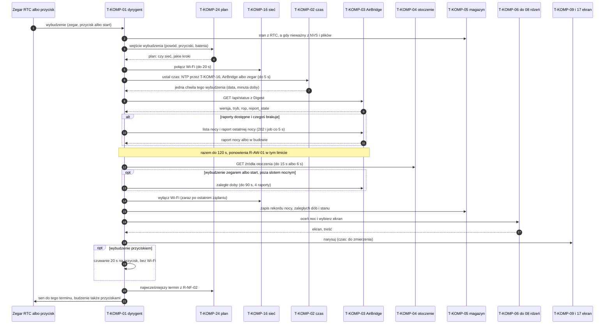

**Klatka bez zmian.** Ekran e-ink trzyma obraz bez zasilania, więc odświeżenie, które dałoby piksel w piksel ten sam obraz, tylko zużywa energię i błyska. Dyrygent rysuje każdą klatkę do bufora jak dotąd, liczy jej skrót (`src/wspolne.h` `crc32()` z bufora płótna, na panelu `src/adaptery_esp32.cpp` `WyswietlaczEsp32::bufor()`) i porównuje go ze skrótem klatki naprawdę wyświetlonej, zapisanym w RTC razem z chwilą tego odświeżenia (pola `klatkaSkrot` i `klatkaOd` w `src/wybudzenie.h` `StanRtc`). Ten sam skrót: bez pełnego odświeżenia, w logu `ekran … bez zmian: klatka jak wyświetlona` (`src/dyrygent.cpp` `Przebieg::pokaz()`). Skrót jest nieważny, więc rysowanie zawsze odświeża ekran: po każdym starcie innym niż wybudzenie z uśpienia (pierwsze rysowanie po włączeniu zasilania, restarcie, wgraniu), po zmianie ekranu (`Przebieg::ustawEkran()`), po rysowaniu poza `Przebieg::pokaz()` (tryb awaryjny U-06, U-05), bez zegara, na ekranie testu, przy wersji „do sprawdzenia” po wgraniu (samosprawdzenie T-WYM-41 wymaga rysowania) i gdy od ostatniego pełnego odświeżenia minęło 24 h `[PRÓG]` (`src/wybudzenie.h` `KLATKA_NAJDLUZEJ_S`; producenci ekranów e-ink zalecają odświeżenie co najmniej raz na dobę, np. instrukcje Waveshare; dla ekranu E1001 [DOMYSŁ], do sprawdzenia w karcie katalogowej). Odświeżenie częściowe (R-NF-25) też będzie kasować skrót, bo zostawia na ekranie obraz inny niż bufor pełnej klatki; pominięte odświeżenie nie liczy się do licznika „pełne co N-te częściowe” z R-NF-25. Plan wybudzeń się nie zmienia: wybudzenie, ocena i rysowanie do bufora zostają, a chwila ostatniego narysowania ekranu dnia dla R-EKR-60 przesuwa się także przy klatce bez zmian. Spec funkcjonalna bez zmian: R-NF-25 mówi o rodzaju odświeżenia ekranu dnia, a klatka bez zmian nie zmienia obrazu. Skutek dla budżetu 8.1: liczy się tylko odświeżenie, które zmienia obraz (2.2, rachunek odświeżeń).

**Jedna chwila na wybudzenie.** Prototyp pyta o godzinę w wielu miejscach jednego wybudzenia (`src/dyrygent.cpp` `Przebieg::minutaDoby()`, wołane m.in. w `pobierz()`, `setup()`). Wybudzenie o 23:29:50, które przez 2 min pobiera dane, mogłoby wtedy wybrać ekran dnia według pory sprzed 23:30, a decyzję o S9 według pory po 23:30. W architekturze docelowej dyrygent ustala chwilę raz, po kroku 5, i przekazuje ją do wszystkich decyzji (T-WYM-22). Wyjątek: limity czasu kroków liczy się zegarem procesora (`millis()`), nie zegarem doby.

**Czas następnego wybudzenia.** Panel śpi do terminu z `src/plan.h` `nastepnyTermin()` (`src/dyrygent.cpp` `Przebieg::spij()`); termin z powodem sieciowym albo terminem pytania, który wypadł w trakcie wybudzenia (czuwanie po przycisku, okno serwisowe, długi start), daje sen 1 s i osobne wybudzenie z tym powodem (`src/plan.h` `powodyZalegle()`, chwila obsłużona w RTC); plan daje też przerysowanie ekranu dnia bez Wi-Fi 2 h po jego ostatnim narysowaniu, od 11:00 do 21:00 (okno stałe z R-KON-17), tylko gdy na panelu stoi ekran dnia ze stopką standardową z R-EKR-10, czyli karta albo ekran danych z pogodą i `przy łóżku` (kryterium z treści ekranu `TrescEkranu::stopkaStandardowa` z `src/dzien.h` `trescDnia()`, nie lista wykluczeń; S5, S10 i ekran nocny mają w stopce akcję, więc odpadają same; `src/plan.h` `POWOD_ODSWIEZENIE`; chwila ostatniego rysowania ekranu dnia w RTC); przerysowanie bez pobrania bierze tryb (karta albo ekran danych) i linię uwagi z ostatniego narysowania (`StanRtc::dzienTryb`, `StanRtc::dzienLinia`), więc zmienia się tylko stopka; ten termin nie jest zaległy (bez snu 1 s), bo następne rysowanie i tak liczy 2 h od nowa (R-EKR-60); plan daje też terminy slotu dziennego: start 60 min po imporcie nocy (albo od naciśnięcia na ekranie dnia po imporcie, `src/plan.h` `startSlotuPrzyciskiem()`), oceny o pełnych godzinach do 21:00 z Wi-Fi tylko na `/api/status` (`src/plan.h` `poczatekSlotuDziennego()`, `tylkoStatus()`; R-KON-41, R-KON-42, R-KON-52), a w slocie dziennym przerysowanie R-EKR-60 milczy; progi: `LIMIT_STATUSU_SLOTU_MS` = 3 s [PRÓG] (jedna próba `/api/status` w ocenie slotu, bez ponowień R-AW-01, bez liczenia do E-01) i `KOREKTA_NTP_S` = 15 min [PRÓG] (obsłużona chwila „w przyszłości” po cofnięciu zegara przez NTP; `src/plan.h`), do kalibracji na egzemplarzu; dyrygent przy tych powodach przerysowuje ekran dnia jak przy R-EKR-60 (`src/plan.h` `przerysowanieDnia()`). Czas snu to najwcześniejszy z terminów, które zwraca plan wybudzenia T-KOMP-24, i wyłącznie z powodów z R-NF-02 (lista wyżej; T-WYM-28). Rdzeń zna te terminy, bo zna stan nocy, stan ekranu i porę; dyrygent tylko usypia do najwcześniejszego.

### 7.2 Poranek i okno poranne

Okno poranne trwa od 05:00 do 11:00 (R-DANE-02). W tym czasie panel co 30 min pyta AirBridge, czy ostatnia noc już jest, dopóki nie jest kompletna (R-DANE-19, R-DANE-03), i prowadzi dla niej jeden stan z tabeli spec 5.1.4: `nieobecna` → `w budowie` → `kompletna` albo `częściowa`, a o 11:00 także `bez terapii`. Po 11:00 do 23:30 sprawdza dalej co 30 min, gdy noc nie jest kompletna, a od drugiej doby z rzędu, w której AirBridge nie odpowiada, co 3 h (R-DANE-18), i raz ponownie pobiera noc zapisaną przed 11:00 (R-DANE-24).

**Kto co trzyma.** Stan nocy przy pobieraniu jest decyzją rdzenia (T-KOMP-03, część bez sprzętu), a nie dyrygenta: rdzeń dostaje odpowiedzi `/api/status`, listy i raportu oraz chwilę wybudzenia i zwraca nowy stan, to, czy zapisać rekord, i czy pokazać E-01 albo E-10. Stan przeżywa uśpienie i restart (spec 8.4, wiersz „stan nocy przy pobieraniu”), więc leży w magazynie T-KOMP-05; format w sekcji 9.

**Blokada w terapii i przetwarzanie po terapii** (spec Załącznik A pkt 4, R-DANE-35). Gdy `/api/status` podaje `rop` = 1 albo `report_state` = `blocked`, panel w tym wybudzeniu nie pyta o listę ani raporty; przy `post-processing`, `waiting_storage` i `storage_busy` pyta, ale pusta lista znaczy „w budowie”, nie „brak nocy”. W obu przypadkach to nie jest błąd: bez E-01 i bez E-10. Prototyp robi to w `src/dyrygent.cpp` `Przebieg::pobierz()` (decyzja w `src/airbridge.cpp` `raportyZablokowane()`), ale z granicą 12:00 zamiast 23:30 dnia poranka i bez stanów 5.1.4 (rozjazd w README prototypu, tabela „Uproszczenia”, wiersz R-DANE-35).

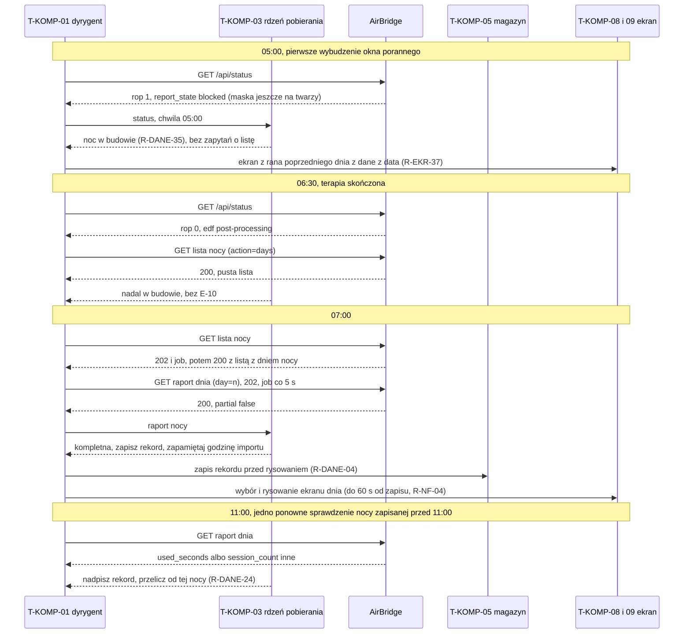

| Chwila | Co decyduje rdzeń | Wymagania | Prototyp |
|---|---|---|---|
| 05:00, ekran wieczorny albo S9 na ekranie | przerysować ekran z rana poprzedniego dnia z `dane z {data}` | R-EKR-37, R-EKR-39 | wybór od nowa w `src/cykl.cpp` `decyzjaDnia()`; ekran tymczasowy do 11:00, bez S9 w wyborze |
| każde wybudzenie 05:00–11:00 | stan nocy według 5.1.4; czy pytać o listę | R-DANE-02, R-DANE-19, R-DANE-03, R-DANE-22 | `src/airbridge.cpp` `potrzebnaLista()`; brak jawnych stanów |
| raport kompletny | zapis przed rysowaniem, ocena S-K porannych przed wyborem ekranu | R-DANE-04, R-KON-07 | `src/dyrygent.cpp` `Przebieg::dobaZAirBridge()`, zapis `zapiszStanHist()` |
| 11:00 | `częściowa` (R-DANE-15), `bez terapii` (R-DANE-20), ponowne pobranie (R-DANE-24) | R-DANE-15, R-DANE-20, R-DANE-24 | tylko R-DANE-24 (`src/airbridge.cpp` `sprawdzenie11()`, klucze NVS `ab_rano`, `ab_11`) |
| 11:00–23:30 | sprawdzanie co 30 min, gdy noc nie jest kompletna; od drugiej doby bez odpowiedzi AirBridge z rzędu co 3 h (14:00, 17:00, 20:00, 23:00) | R-DANE-18, R-DANE-21, R-DANE-25 | brak (README prototypu, tabela „Uproszczenia”) |
| 23:30 | noc z R-DANE-35 nadal bez dnia na liście: `nieobecna` bez E-10 | R-DANE-35, R-DANE-25 | brak |

### 7.3 Wieczór i slot wieczorny

Slot wieczorny zaczyna się 90 min przed zwykłą porą założenia maski (mediana M-18 z 14 nocy, nie wcześniej niż 19:00; R-KON-09), a przy mniej niż 3 nocach ze znanym startem od 21:00 (R-KON-17). Kończy się o 23:30 początkiem slotu nocnego. W slocie panel co 30 min ocenia warunki ekranów wieczornych S-K-01…S-K-09 (R-KON-01), przed pierwszym odświeżeniem slotu pobiera pogodę (R-DANE-16), a od początku okna slotu do 9:00 co 15 min zapisuje odczyty czujnika w obudowie i czujnika Qingping (R-DANE-09, R-DANE-10). W niedzielę o 17:00 zaczyna się slot tygodniowy (R-KON-08).

**Dwa rodzaje wybudzeń.** Zapis czujników co 15 min nie wymaga sieci ani ekranu. Architektura docelowa ma więc obok zwykłego wybudzenia (7.1) **wybudzenie pomiarowe**: odczyt czujnika w obudowie (i Qingpinga po Bluetooth LE, T-INT-05), dopisanie wiersza do serii nocy we flash (T-DANE-02; zapis do flash jest tani, 9.5) i od razu sen, bez Wi-Fi i bez rysowania (T-WYM-31). Tak każe R-DANE-33 („bez włączania Wi-Fi przy samych zapisach czujników”) i to trzyma budżet R-NF-03. Wybudzenia pomiarowe liczą się do limitu wybudzeń w budżecie 8.1. Czas i energia wybudzenia pomiarowego [do zmierzenia] (pomiar 2).

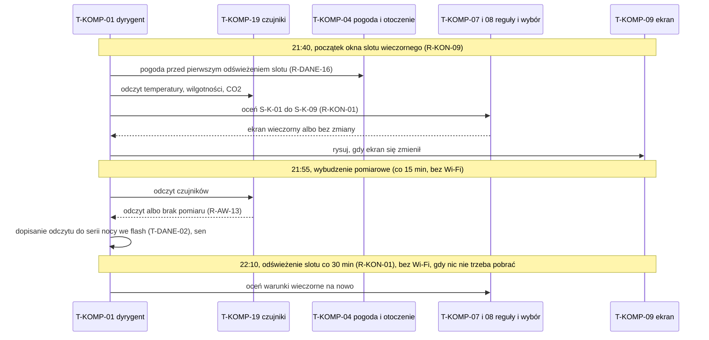

Prototyp ma slot wieczorny (`src/slot_wieczorny.h`, powód planu `slot_wieczorny` co 30 min w oknie, Wi-Fi tylko na `/api/status` i lokalne źródło otoczenia, bo CO2 przychodzi z niego, a nie z Bluetooth) i początek slotu tygodniowego (`slot_tygodniowy`, niedziela 17:00); okno liczy się z R-KON-09 z M-18 (start pierwszej sesji, `sessions[].start_ms`, pole `m18` w pliku `noce` wersji 3), a przy mniej niż 3 nocach ze znanym startem jest stałe 21:00–23:30 (R-KON-17). Stany nocy 5.1.4: `src/stan_nocy.h` (T-KOMP-24 z T-KOMP-03), testy `test/testy_stany_nocy_sloty_wieczorne.cpp` (T-TEST-001 w części stanów nocy, T-TEST-120 na atrapach, T-TEST-007 w części slotów). Prototyp nie budzi się co 15 min: odczyt czujnika i CO2 bierze z każdego wybudzenia co 30 min w oknie nocy 23:00–06:00 (README prototypu, tabela „Uproszczenia”, wiersze „odczyty CO2 ze źródła” i „wyświetlenie”; bufor `src/wybudzenie.h` `buforSyp`, zamknięcie nocy `sypialniaTeraz()`). Okno slotu wieczornego z mediany M-18 to nowa decyzja planu wybudzenia (T-KOMP-24), liczona raz na dobę po zapisie nocy.

Egzemplarz bez ekranów CO2 (bez lokalnego źródła otoczenia albo `co2=nie`, 5.8.8 spec funkcjonalnej) w tych samych minutach okna ma powód `slot_wieczorny_bez_sieci` (`src/plan.h` `POWOD_SLOT_WIECZORNY_BEZ_SIECI`, wzór `slot_dzienny_bez_sieci`): wybudzenie bez Wi-Fi, ocena S-K-03…S-K-09 z danych w pamięci (noce, prognoza z pobrania `pogoda` o 21:00 przy źródle), rysowanie przez `pokaz()`, które przy klatce identycznej z wyświetloną nie odświeża e-ink (7.1). Wybudzenie z samą taką oceną rysuje najpierw klatkę z odczytem czujnika z ostatnio wyświetlonej klatki (`StanRtc::stopkaTemp`, `stopkaWilg`; stopka i liczby na S-K-03…S-K-05), a wybór ekranu liczy ze świeżego odczytu, więc sama zmiana temperatury nie odświeża e-ink; gdy klatka jest inna (ekran się zmienił), rysuje ją jeszcze raz ze świeżym odczytem i dopiero wtedy odświeża. Przedtem S-K-08 i pozostałe ekrany wieczorne pokazywały się w takim egzemplarzu dopiero po naciśnięciu. Egzemplarz z CO2 bez zmian (`slot_wieczorny` z Wi-Fi). Koszt: 5 wybudzeń bez Wi-Fi na dobę przy oknie od 21:00, najwyżej 9 przy oknie od 19:00 (ocena o 23:00 w jednym wybudzeniu z czujnikami), w budżecie wybudzeń i odświeżeń e-ink 8.1 spec funkcjonalnej, który liczył już odświeżenia slotu wieczornego co 30 min; testy `test/testy_wieczor_bez_wifi_obrazki.cpp` (T-TEST-320, T-TEST-321).

### 7.4 Noc i ekran S9

Slot nocny trwa od 23:30 do 05:00. Pierwsze wybudzenie po 23:30 podejmuje **jedną decyzję na noc**: czy narysować ekran nocny S9 (R-KON-31), czy zostawić bieżący ekran (R-KON-35: S5, ekran L z pilnością A albo B, niewyciszony wzorzec A, ekran otwarty przyciskiem, U-04). Decyzja trafia do NVS **przed** rysowaniem, więc restart w środku nocy nie narysuje S9 drugi raz (T-WYM-32). To samo wybudzenie o 23:30 jest ostatnim zapytaniem do AirBridge tej doby: `/api/status` dla godziny maski (R-KON-33), ostatnie ponowienie R-DANE-18 i zapis „częściowa” z R-DANE-25. Od 23:30 do 05:00 panel nie pyta AirBridge (R-DANE-18, „brak zapytań 23:30–05:00”); jedyne wybudzenia zegarem w nocy to wybudzenia pomiarowe co 15 min, bez Wi-Fi i bez rysowania (7.3, T-WYM-31), oraz terminy z R-NF-02, które wypadną w nocy (np. pytanie bez odpowiedzi); żadne nie odświeża ekranu (R-KON-02, R-KON-34). Czy w nocy są wybudzenia z Wi-Fi dla CO2 ze źródła otoczenia (R-DANE-33 mówi „także w slocie nocnym”, R-NF-02 nie ma takiego powodu): do decyzji dokument trzyma się R-NF-02. Decyzję nocy i jej zapis prowadzi plan wybudzenia T-KOMP-24; T-KOMP-08 wybiera tylko wariant i scenę S9 (R-KON-32). Budzik na S9 jest czarny na białym tle (R-KON-36, ADR-0018); pilnuje tego komponent rysowania T-KOMP-09 niezależnie od danych (T-WYM-79) i test pikselowy (sekcja 11), nie dyrygent.

**Fakty S9** (godzina założenia maski, temperatura i wilgotność, scena, zdanie) są ustalane przy pierwszym rysowaniu tej nocy i trzymane w pamięci RTC z kluczem „wieczór tej nocy”. Godzina maski pochodzi tylko z `/api/status` tego wybudzenia (`rop` = 1 i `edf_prefix`, R-KON-33), bez dodatkowych zapytań. Gdy użytkownik w nocy przejdzie przyciskiem do K1 albo K2 i wróci (R-KON-37), panel rysuje S9 z tymi samymi faktami (T-WYM-33).

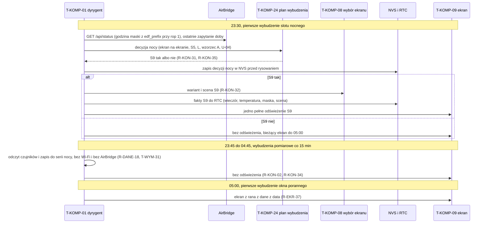

| Krok | Prototyp | Uwagi |
|---|---|---|
| decyzja nocy | `src/dobranoc.cpp` `decyzjaNocy()`, wołana z `src/dyrygent.cpp` `Przebieg::nocTeraz()` | prototyp uznaje za „ekran dnia trwa” tylko S5 (komentarz `nocTeraz()`); L i wzorzec A dojdą z silnikiem reguł |
| zapis decyzji przed rysowaniem | `src/dyrygent.cpp` `Przebieg::zwykleWybudzenie()`, NVS `cpap`: `noc_w`, `noc_s9` (`zapiszStanNocy()`) | zgodne z T-WYM-32 |
| bez odświeżenia po zegarze w nocy | `src/dyrygent.cpp` `Przebieg::zwykleWybudzenie()`, `src/cykl.cpp` `przerysowacPoZegarze()` | |
| fakty z pierwszego rysowania | `src/dobranoc.cpp` `daneNocy()`, RTC `faktyNocy` (`src/wybudzenie.h` `faktyNocy`) | po zaniku zasilania w nocy fakty z chwili ponownego rysowania |
| godzina maski | `src/dyrygent.cpp` `Przebieg::odczytMaski()`, `src/airbridge.cpp` `startZPrefiksu()` | |
| wariant i scena | `src/dobranoc.cpp` `wyborNocy()` | R-KON-32; brak pliku sceny (R-KON-40) dopiero po przeniesieniu scen do plików (ADR-0022) |

### 7.5 Naciśnięcie przycisku i powrót po 5 min

Wszystkie trzy przyciski budzą panel z uśpienia przez `ext1` stanem niskim (sekcja 3.1; do potwierdzenia na egzemplarzu). Po wybudzeniu przyciskiem panel **nie pobiera danych**: zmienia widok według mapy przycisków (spec 5.6.2, w prototypie `src/nawigacja.cpp` `nacisniecie()`) i rysuje go z danych, które już ma. Wyjątki to akcje, które same są pobraniem: ↻ na S5 (R-PRZ-06) i ekran testu sprzętu. Dzięki temu czas od naciśnięcia do widoku to rozruch, wczytanie stanu i jedno rysowanie, co ma się zmieścić w 5 s (R-PRZ-01) [do zmierzenia] (pomiar 5).

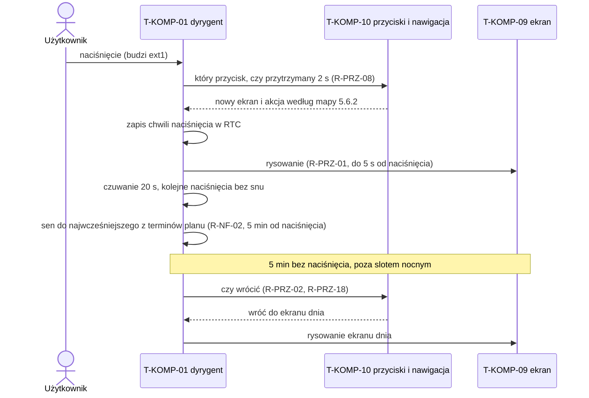

| Sprawa | Jak w architekturze docelowej | Prototyp |
|---|---|---|
| powrót po 5 min | sen ustawiony na termin powrotu (5 min od ostatniego naciśnięcia + 2 s zapasu), więc panel budzi się w chwili powrotu, nie przy najbliższej pełnej godzinie | `src/nawigacja.cpp` `sekundDoPowrotu()`, sen `src/dyrygent.cpp` `Przebieg::spij()`, powrót `setup()` |
| slot nocny | bez samoczynnych powrotów do 05:00 (R-PRZ-18); termin powrotu w nocy nie istnieje, więc nie skraca snu | `src/nawigacja.cpp` `sekundDoPowrotu()` |
| naciśnięcie bez skutku w nocy | bez odświeżenia (błysk e-ink w sypialni) | `src/dyrygent.cpp` `Przebieg::zwykleWybudzenie()` |
| naciśnięcia w trakcie rysowania | zapamiętane tylko ostatnie, wykonane po rysowaniu (R-PRZ-09) | prototyp odczytuje przyciski po rysowaniu (`src/dyrygent.cpp` `Przebieg::zwykleWybudzenie()`); czy gubi naciśnięcie z czasu rysowania: do sprawdzenia testem T-TEST w sekcji 11 |
| ↻ na S5 w trakcie pobierania | kolejne ↻ pomijane (R-PRZ-14), ekran `Pobieram dane z AirBridge…` (R-PRZ-06) | rozjazd: kolejne naciśnięcie przerywa pobieranie (`src/dyrygent.cpp` `Przebieg::abPrzerwij()`; README prototypu, tabela „Uproszczenia”, wiersz „↻ na S5”) |
| przycisk zacięty | wciśnięty co najmniej 10 s ignorowany do puszczenia, także w kolejnych wybudzeniach, i wyłączony z budzenia | `src/dyrygent.cpp` `Przebieg::czekajNaPuszczenie()`, `Przebieg::spij()`; T-WYM-29 |

### 7.6 Awarie

Zasada spec 5.3: błąd nigdy nie udaje sukcesu ani braku danych, a brak danych nigdy nie udaje zera. Technicznie każda awaria ma jedno miejsce wykrycia (adapter albo parser w rdzeniu), jedną klasę wyniku i jedną reakcję w rdzeniu. Adaptery nie decydują, co pokazać: zwracają wynik („brak odpowiedzi”, „w budowie”, „nieczytelne”, „odmowa”), a rdzeń wybiera ekran i linię.

| Awaria | Wykrycie (adapter albo parser) | Klasa wyniku | Reakcja (spec) | Prototyp |
|---|---|---|---|---|
| brak Wi-Fi | T-KOMP-16: brak połączenia w 20 s | brak sieci | S5 po regułach E-01; bez AirBridge i bez źródła otoczenia w tym wybudzeniu; kosztuje tylko czas łączenia | `src/dyrygent.cpp` `Przebieg::pobierz()` |
| AirBridge nie odpowiada, timeout | T-KOMP-16: brak odpowiedzi w 15 s; 3 próby co 10 s, jeśli mieszczą się w limicie wybudzenia | brak odpowiedzi | wpis w logu, rekordy bez zmian (R-AW-01, R-AW-14); E-01 według 5.1.4 | `src/dyrygent.cpp` `Przebieg::abGet()`, `src/airbridge.cpp` `ponowicZadanie()` |
| kod HTTP inny niż 200, 202, 409 | T-KOMP-16 | brak odpowiedzi | jak timeout (R-AW-12) | `src/airbridge.cpp` `brakOdpowiedzi()` |
| logowanie odrzucone (drugie 401 z rzędu) | adapter Digest | odmowa | bez ponowień, powód `logowanie odrzucone` w logu bez hasła (R-AW-34); także pierwsze 401 przy pustym haśle w konfiguracji; na ekranie dnia od tej próby (po 05:00, bez czekania do 11:00 i bez S10) E-01 z tekstem R-AW-35; przy pierwszej konfiguracji U-02 ze stanem R-KONF-37 | `src/dyrygent.cpp` `Przebieg::abGetRaz()`; rozjazd: prototyp pokazuje zwykły tekst E-01 (README prototypu, „Uproszczenia”) |
| odmowa przebiegów nocy (job `action=prepare` z 503 i ciałem `{"source":"edf","error":"report_build_failed"}`, bez powodu w odpowiedzi) albo 404 na `/api/report/artifact` (brak artefaktu, np. usunięty) przy pobranym raporcie dnia | rdzeń pobierania | brak przebiegu | rekord nocy z raportu dnia, metryki z przebiegów według fail-path (M-28 i M-28p `–`, GI i czasy zdarzeń brak; M-08 z `leak_high_seconds` bez zmian); bez nieudanej próby; po 503 manifest ponownie przy najbliższym wybudzeniu okna porannego, najwyżej 2 razy (licznik w T-DANE-15), po 404 bez ponowień; kod HTTP i pole `error` w logu i na ekranie testu (R-AW-37) | brak (prototyp nie pobiera artefaktów); zadanie w README prototypu, „Uproszczenia” |
| raport w budowie ponad 120 s | rdzeń pobierania | w budowie | bez nieudanej próby; następne wybudzenie (R-AW-11, R-AW-15) | `src/dyrygent.cpp` `Przebieg::abRaport()` |
| ciało odpowiedzi urwane | adapter HTTP: `Content-Length` różny od odebranych bajtów albo błąd zapisu strumienia | brak odpowiedzi | ponowienie jak timeout, nie E-03 (T-WYM-26) | `src/airbridge.cpp` `cialoKompletne()`, `src/dyrygent.cpp` `Przebieg::abGetRaz()` |
| ciało odpowiedzi ponad limit trasy (status 16 KiB, lista 512 KiB, raport 64 KiB) | adapter HTTP: `Content-Length` ponad limit albo odczyt przerwany po limicie | brak odpowiedzi | kod -301 „odpowiedź za duża” w logu i na ekranie testu, nieudana próba bez ponowień w tym wybudzeniu, nie E-03 (T-WYM-89) | `src/airbridge.cpp` `limitOdpowiedziAB()`, `src/dyrygent.cpp` `Przebieg::abGetRaz()` |
| brak klucza krytycznego, zły typ | parser raportu w rdzeniu | nieczytelne | E-03 (R-AW-02); pole metryki: tylko ta metryka „–” (R-AW-22) | `src/airbridge.cpp` `nocZRaportu()`; rozjazd: nieczytelny `/api/status` daje od razu E-03 (README prototypu, „Uproszczenia”) |
| liczba spoza zakresu (poza ±1e15, `1e309`, pole poza zakresem typu) | parser JSON i CSV w rdzeniu | nieczytelne albo brak pola | dokument poza ±1e15 nieczytelny (raport: ponowienie; lista: E-03), pole poza zakresem typu = brak tej metryki (R-AW-22), wiersz CSV z `inf` albo minutami spoza 0–1440 nieczytelny (T-WYM-91) | `src/airbridge.cpp` `Czytnik::liczba()`, `nocZRaportu()`, `src/noc.cpp` `parsujNoc()` |
| AirBridge spoza zakresu wersji | rdzeń, z `/api/status` | nieczytelne | E-03 z wersją (Załącznik A pkt 4) | `src/dyrygent.cpp` `Przebieg::pobierz()` |
| brak czasu | T-KOMP-02: NTP bez odpowiedzi, AirBridge bez czasu, zegar panelu po restarcie albo ponad 72 h od synchronizacji | bez czasu | U-04, bez E-01, ponawianie co 30 min (R-AW-20, R-AW-08b); diagram niżej | tylko NTP (README prototypu, „Uproszczenia”, wiersz „czas z AirBridge”) |
| źródło otoczenia: brak odpowiedzi, odmowa, zła wersja, za duża odpowiedź | T-KOMP-04 | brak odpowiedzi albo odmowa | ostatnia odpowiedź w granicach świeżości, bez komunikatu na ekranie dnia (R-AW-25, R-AW-26) | `src/dyrygent.cpp` `Przebieg::otoGetRaz()`, `src/otoczenie.cpp` `nieudanaOtoczenia()` |
| pamięć plików we flash nie montuje się | T-KOMP-18 przy starcie | awaria pamięci (partycja nowa: pierwsze formatowanie, T-WYM-84) | **bez formatowania** (formatowanie skasowałoby historię), poza partycją nową, której ten panel nigdy nie sformatował (T-WYM-84); praca na danych w pamięci, powód na ekranie testu i w logu, linia R-AW-05 `Błąd pamięci panelu. Wyniki mogą być niepełne.` (R-AW-16, T-WYM-34) | `LittleFS.begin(false)` `src/dyrygent.cpp` `Przebieg::wczytajPliki()` |
| karta microSD nieczytelna albo zapis kopii nieudany | T-KOMP-18 | awaria karty | (zależy od ADR-0022, przyjęte 01.11.2026) panel liczy dalej z pamięci flash, karta jest tylko kopią: ocena nocy, norma i nowy poziom bez zmian (R-AW-28), kopia ponowiona przy następnym zapisie nocy (T-WYM-61), po 7 dniach bez kopii linia grupy „dane” `Brak kopii na karcie od {data}. Dane są w panelu.` raz na 7 dni (R-AW-29) | brak obsługi karty |
| zanik zasilania w trakcie zapisu | T-KOMP-05: zapis przez plik tymczasowy i zmianę nazwy; przy starcie plik tymczasowy bez celu zostaje przywrócony | brak | stara albo nowa wersja pliku (R-NF-12); stan z NVS i plików (R-NF-11) | `src/magazyn.cpp` `Magazyn::zapisz()`, `Magazyn::czytaj()` (wybór `.tmp`, T-WYM-53) |
| zawieszenie biblioteki (HTTP, Bluetooth LE, ekran) | dyrygent: twardy limit całego wybudzenia, sprawdzany w kodzie (T-WYM-30); wywołanie, które w ogóle nie wraca: strażnik zadania (T-WYM-81) | przekroczony czas | zapis stanu, sen, wpis w logu (T-WYM-30); po strażniku błąd programu i restart, liczony jako start po błędzie (T-WYM-82) | brak twardego limitu, tylko limity kroków; strażnik zadania pętli Arduino domyślnie wyłączony (7.8) |
| pętla restartów: błąd programu przy każdym starcie, także w wersji już oznaczonej jako dobra | T-KOMP-01: licznik startów po nieprawidłowym zakończeniu w pamięci RTC (T-WYM-82) | pętla restartów | po liczbie startów z R-AW-39 tryb awaryjny: U-06, bez sieci poza oknem serwisowym, bez zapisu danych, sen do naciśnięcia przycisku (T-WYM-83) | brak: po błędzie programu ESP-IDF wypisuje rejestry i restartuje, bez końca (7.8) |

**Źródło czasu** (spec 5.3.3, „Źródła czasu”; ADR-0013). Kolejność w T-KOMP-02:

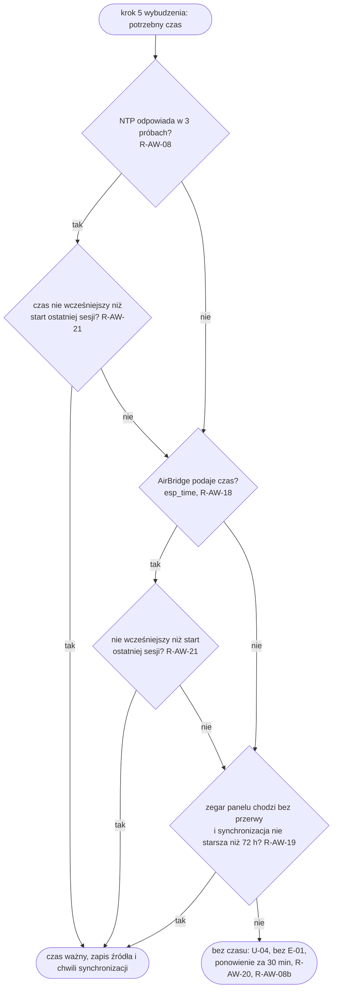

Dokładność zegara panelu przez 72 h bez sieci zależy od wewnętrznego generatora RC albo od użycia zegara PCF8563 (sekcja 3.1): zmierzone (pomiar 12: zegar panelu bez sieci ok. 587 s na dobę, PCF8563 ok. 0,71 s na dobę (PCF8563 z 49,8 h, zegar panelu z pierwszych 4,9 h; 1 egzemplarz, temperatura pokojowa; błąd po 72 h to ekstrapolacja)); wybór źródła czasu: otwarte (PCF8563 albo krótszy czas z R-AW-19). „Zegar chodzi bez przerwy” technicznie znaczy: od ostatniej synchronizacji nie było startu innego niż wybudzenie z uśpienia; znacznik tego trzyma pamięć RTC, która ginie przy zaniku zasilania i restarcie.

### 7.7 Raport QR i formularz

Raport dla lekarza i formularz ustawień to jedyne chwile, w których panel jest serwerem. Serwer działa najwyżej 15 min od włączenia (R-LEK-04, R-KONF-15), tylko w sieci lokalnej, z tokenem jednorazowym (R-LEK-03, R-KONF-13, R-NF-09). Przez ten czas panel nie zasypia i trzyma Wi-Fi; to poza budżetem dobowym (spec 8.1, wiersz „serwer raportu albo formularza”). Prototyp nie ma serwera formularza (T-INT-07); serwer raportu (stan niżej, przed sekcją 7.8).

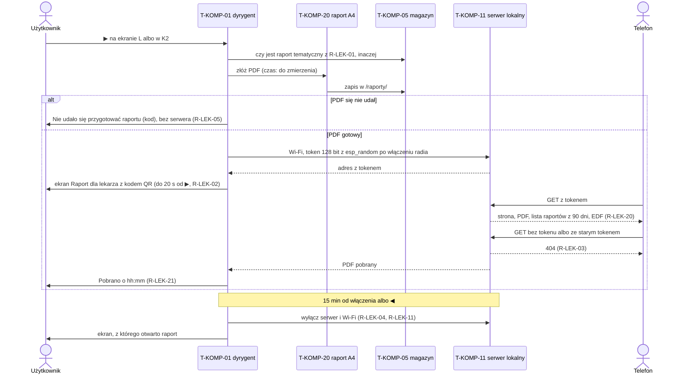

| Sprawa | Rozwiązanie | Wymagania |
|---|---|---|
| token | 128 bitów z `esp_random` wołanego **po** włączeniu Wi-Fi: według ESP-IDF generator daje liczby prawdziwie losowe tylko przy włączonym radiu (Wi-Fi albo Bluetooth) albo włączonym źródle entropii; inaczej tylko pseudolosowe ([ESP-IDF: Random Number Generation](https://docs.espressif.com/projects/esp-idf/en/stable/esp32s3/api-reference/system/random.html)) | R-NF-09, T-WYM-35 |
| odliczanie 15 min | zegar procesora od chwili włączenia serwera, w tym samym wybudzeniu (panel nie śpi) | R-LEK-04, R-KONF-15 |
| przyciski w czasie serwera | działają według mapy; ◀ zamyka serwer | R-LEK-11, R-KONF-16 |
| co serwer udostępnia | raport: tylko odczyt plików z `/raporty/` i EDF; formularz: tylko zapis ustawień z tabeli 5.6.4 | R-NF-10, R-KONF-18 |
| EDF | panel nie podaje adresu AirBridge; przechować przed włączeniem serwera albo pośredniczyć strumieniowo przy żądaniu telefonu: do decyzji | R-LEK-20 |
| Wi-Fi albo serwer nie startuje | `Nie mogę włączyć Wi-Fi` i ścieżka pliku | R-LEK-22 |
| pierwsza konfiguracja | tylko ręcznie (◀ 2 s): własna sieć panelu z hasłem jednorazowym, formularz (sieć, adres, konto i opcjonalne hasło AirBridge), po zapisie sieć wyłączona, połączenie z siecią domową i `GET /api/status` z logowaniem; 401 → U-02 ze stanem R-KONF-37 | R-KONF-07, R-KONF-08, R-KONF-09, R-KONF-25, R-KONF-29, R-KONF-37 |
| zbyt wiele złych żądań do formularza | 5 żądań bez ważnego tokenu wyłącza serwer | R-KONF-14 |

**Raport dla lekarza.** Raport działa w rdzeniu i w dyrygencie: ▶ na ekranie L daje raport tematyczny, ▶ w K2 raport ogólny; treść stref 1–10 (`src/raport.cpp` `zbuduj()`), PDF jednej strony A4 składany na panelu bez biblioteki (`src/raport_pdf.cpp` `pdf()`: PDF 1.4, kroje standardowe Helvetica i Symbol bez osadzania, polskie litery przez kodowanie WinAnsi z `/Differences`, wykresy wektorowo, treść bez kompresji, ok. 45–55 kB na danych syntetycznych 90 nocy, limit 250 kB), zapis w `/raporty/RRRR-MM-DD-{temat}.pdf` przed włączeniem serwera, Wi-Fi i serwer na 15 min z tokenem 128 bitów z `Siec::losowa()` po połączeniu (T-WYM-35), strona dla telefonu z `Pobierz PDF`, `Udostępnij` (Web Share API z plikiem, bez niego pobranie), listą raportów z 90 dni i `↻ 2 s` (R-LEK-33). Wariant z warunku ADR-0005 w `/konfiguracja.txt`: `raport=pdf` (domyślnie; R-LEK-18 dotyczy wydania bez generatora PDF) albo `raport=sciaga` (ekran-ściąga z kodem do EDF; bez paczki, czyli w wersji beta, ściąga bez kodu QR, bez Wi-Fi i bez serwera). Czynniki do raportu: `raport.czynniki=K,L,…` (domyślnie 5.13.7). Błąd składania albo zapisu: `Nie udało się przygotować raportu ({kod})` z kodem `R2` (strona się nie mieści), `R3` (ponad 250 kB), `R4` (zapis), `R5` (brak historii); brak Wi-Fi albo gniazda: `Nie mogę włączyć Wi-Fi` (bez ścieżki, panel nie obsługuje karty). Testy (T-TEST-302): `test/testy_raport_a4.cpp` (treść stref według trybu, „tylko raport”, „nie oceniam”, R-LEK-30, R-LEK-31, R-LEK-35, R-LEK-19, serwer, token, QR, ekrany, dyrygent z atrapą gniazda: 15 min, brak sieci, ◀ z K2, ściąga), odczyt kodów QR z podglądu przez OpenCV w `tools/prototyp/testy.sh`. Braki w wersji beta: EDF (odpowiedź 503 i dopisek `AirBridge nie odpowiada`), raport przy wejściu wzorca przed odświeżeniem (R-LEK-01), raport „przed i po” (R-LEK-29), kopia na kartę (R-LEK-22, R-LEK-23 w części karty), aneks, krój osadzony.

**Treść i rysowanie ekranów.** Podpisy osi pełnego ekranu S3 zdarzeń E z zestawu (role `podpis_lewo`, `podpis_prawo` w `teksty.csv`, `sprawy::SprawaL::podpisLewo/podpisPrawo`, `zdarzenia::trescZdarzenia()`), pusty ekran „Otwarte sprawy” z `Ocena: częściowa` i wierszem `KartaSprawy::dopisek` (`sprawy::kartaPusta()`, `rysujSprawy()`, R-EKR-50), wspólny nagłówek i stopka ekranów rysowanych poza `ekrany.cpp` (`naglowekEkranu()`, `stopkaEkranu()`, ekran „Sprzęt”), słowo trendu wiersza `Wsparcie` w K1 z Δ `R-KOK-16.delta_ps` = 2 cmH2O (`TREND_DELTA_PS`, `src/kokpit.cpp` `deltaTrendu()`). `reguly::tekst()` zapisuje `{x}`, `{norma}`, `{wartosc}` w jednostce metryki wiersza katalogu (M-01 `7 h 12`, M-17 i M-08 bez `,0`), zmienne wyniku zostają liczbami (`wzorce::wartoscX()`); w rodzaju `stan_odchylenia` `{x}` to średnia z 5 ostatnich nocy ważnych z wartością (AHI bez nocy niepewnych), jak w tekstach 6.4 (`Średnio {x}…`). Testy: T-TEST-301.

**Ekrany CO2 i karencja po infekcji.** Ekrany CO2 per egzemplarz: wiersz `co2=tak|nie` w `/konfiguracja.txt` (`parsujUstawieniaDnia()` w `src/slot_dzienny.cpp`, pole `co2` struktury `UstawieniaDnia` w `src/slot_dzienny.h`), decyzja `co2Wlaczone(zrodlo, ustawienie)`: bez lokalnego źródła otoczenia zawsze wyłączone, ze źródłem włączone, chyba że `co2=nie`; `co2=tak` bez źródła nic nie włącza; plan wybudzeń bierze to jako `WejsciePlanu::co2` (`src/plan.cpp`). Przerywniki S2d: `wybierzPrzerywnik()` w `src/humor.cpp` z `ustawieniaPrzerywnikowBety()` (teksty G01–G18 przyjęte, sceny z datami); okazja ze stałą datą ma pierwszeństwo, inaczej najwyżej 1 na 7 dni losowanie spośród scen dozwolonych dziś (G09–G18, G02 tylko w poniedziałek, G03 tylko w piątek, scena ze zdaniem, spoza 6 poprzednich dni): lista posortowana, własny Fisher–Yates na surowym wyjściu `std::mt19937` z ziarnem = numer dnia, więc ten sam wynik na panelu i w symulatorze. Bez przerywnika przy humorze innym niż normalny, poza dowodem spokoju, przy aktywnym wzorcu B (`KontekstHumoru::wzorzecB`, R-HUM-26) i przy linii uwagi; nowy przerywnik tylko w oknie porannym 05:00–11:00 (R-HUM-14, `src/dyrygent.cpp`), jeden wiersz `S2D` na dzień. Karencja po okresie infekcji zakończonym limitem 14 nocy: 14 dni `[PRÓG]` `R-INF-04.karencja` bez S-K-30 i bez nowego okresu (`infekcja::karencja()`, `infekcja::koniecKarencji()` w `src/infekcja.cpp`), wiersz logu `infekcja: karencja do {data} (R-INF-04.karencja, bez S-K-30 i nowego okresu)` z `bramkiB16()` w `src/dyrygent.cpp`. Testy: T-TEST-293, T-TEST-300.

Prototyp losuje dziś ziarno grupy kontrolnej (R-CZY-02) przed włączeniem Wi-Fi (`src/dyrygent.cpp` `Przebieg::zwykleWybudzenie()`), więc z generatora pseudolosowego. Dla grupy kontrolnej to wystarcza (ziarno nie jest tajne), dla tokenów serwera nie; stąd T-WYM-35.

### 7.8 Aktualizacja oprogramowania i zestawu danych reguł

Ten opis zależy od ADR-0024 : aktualizacja firmware przez Wi-Fi w sieci lokalnej tylko w oknie serwisowym, z hasłem i z powrotem do poprzedniej wersji; zestaw danych reguł (pliki z ADR-0023) przychodzi razem z firmware jako zestaw wbudowany, a pakiety spoza firmware i sceny budzika z karty microSD, bez kasowania danych (ADR-0024 decyzja 2 z adnotacją 01.11.2026). Kabel USB zostaje drogą ratunkową i jedyną drogą zmiany układu partycji (8.9).

**Okno serwisowe.** Otwiera się na ekranie testu sprzętu i trwa 10 min od ostatniego naciśnięcia; tylko wtedy panel nasłuchuje na porcie aktualizacji i ogłasza się przez mDNS (`src/dyrygent.cpp` `Przebieg::startOta()`, `src/dyrygent.cpp` `Przebieg::zwykleWybudzenie()`, stała `OTA_OKNO_MS`). Po wybudzeniu zegarem ekran testu wraca do ekranu dnia, więc okno nigdy nie otwiera się samo w nocy (`src/dyrygent.cpp` `Przebieg::zwykleWybudzenie()`). Droga do ekranu testu (U-05, spec 5.6.2 i 5.6.3, R-KONF-36): ▶ po stronach kokpitu do U-01 (`6 / 6`), potem ▶ U-03 ▶ U-05 (`src/nawigacja.cpp` `nacisniecie()`, ciąg stron `stronaPo()`); ◀ na U-05 wraca do U-01, ↻ do ekranu dnia i zamyka okno.

**Spec funkcjonalna (spec funkcjonalna 1.2).** Okno serwisowe opisuje R-NF-29 (Wi-Fi i przyjmowanie obrazu tylko na U-05, do 10 min od ostatniego naciśnięcia, tylko z hasłem); R-NF-03 wymienia okno wśród czynności, przy których wolno włączyć Wi-Fi, a R-NF-02 każe nie zasypiać w czasie okna. Ekran testu sprzętu to U-05 w katalogu 6.2, z wierszem w mapie 5.6.2 i treścią w 5.6.3. Wgranie pakietu z karty: R-NF-30 (przy starcie albo ↻ 2 s na U-05); powrót do starszej wersji: R-NF-28.

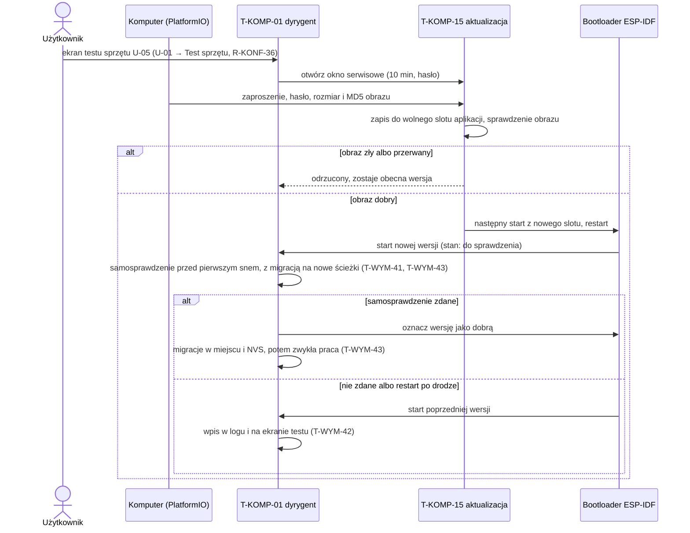

**Powrót do poprzedniej wersji.** ESP-IDF ma mechanizm powrotu: nowa wersja startuje w stanie „do sprawdzenia” i musi sama oznaczyć się jako dobra; jeśli nie zdąży przed następnym startem, bootloader wraca do poprzedniej ([ESP-IDF: OTA, App rollback](https://docs.espressif.com/projects/esp-idf/en/stable/esp32s3/api-reference/system/ota.html)). Rdzeń Arduino-ESP32 oznacza nową wersję jako dobrą od razu przy starcie, chyba że program nadpisze funkcję `verifyRollbackLater()` ([`cores/esp32/esp32-hal-misc.c`](https://raw.githubusercontent.com/espressif/arduino-esp32/master/cores/esp32/esp32-hal-misc.c), gałąź master, sprawdzone 01.11.2026). Druga funkcja z tego pliku, `verifyOta()`, nie wystarcza: rdzeń woła ją w `initArduino()`, przed `setup()` i nawet przed inicjalizacją NVS, więc w tej chwili nie da się sprawdzić partycji plików, zestawu reguł, ekranu ani Wi-Fi; dlatego firmware nadpisuje `verifyRollbackLater()` (zwraca „tak”) i oznacza wersję sam, po samosprawdzeniu; konfiguracja bibliotek Arduino ma `CONFIG_BOOTLOADER_APP_ROLLBACK_ENABLE=y` ([`configs/defconfig.common`](https://raw.githubusercontent.com/espressif/esp32-arduino-lib-builder/master/configs/defconfig.common), gałąź master). Prototyp nie nadpisuje tej funkcji, więc dziś powrót praktycznie nie działa. W przypiętej wersji rdzenia 3.3.12 (platforma `55.03.312-1`, ESP-IDF 5.5.5) konfiguracja bibliotek dla ESP32-S3 ma `CONFIG_BOOTLOADER_APP_ROLLBACK_ENABLE=y` i `CONFIG_BOOTLOADER_SKIP_VALIDATE_IN_DEEP_SLEEP=y` (plik `esp32-arduino-libs/esp32s3/sdkconfig`, l. 424 i 481, z archiwum [`esp32-core-3.3.12-libs.tar.xz`](https://github.com/espressif/arduino-esp32/releases/download/3.3.12/esp32-core-3.3.12-libs.tar.xz), sprawdzone 01.11.2026). Skutek dwóch ustawień razem: przy zwykłym starcie (reset, zanik zasilania, restart po błędzie) bootloader zmienia stan „do sprawdzenia” na „przerwany” i uruchamia poprzednią wersję ([ESP-IDF v5.5.1: OTA, App rollback](https://raw.githubusercontent.com/espressif/esp-idf/v5.5.1/docs/en/api-reference/system/ota.rst), l. 107–113), ale po wybudzeniu z głębokiego uśpienia uruchamia ostatnią aplikację z adresu zapisanego w pamięci RTC, bez żadnych sprawdzeń ([ESP-IDF v5.5.1: Fast Boot from Deep-Sleep](https://raw.githubusercontent.com/espressif/esp-idf/v5.5.1/docs/en/api-guides/bootloader.rst), l. 169–176; kod: [`bootloader_start.c` v5.5.5](https://raw.githubusercontent.com/espressif/esp-idf/v5.5.5/components/bootloader/subproject/main/bootloader_start.c), l. 43–49). Wersja, która zaśnie bez oznaczenia, nie wraca więc sama przy wybudzeniu, tylko przy najbliższym zwykłym starcie. Dlatego firmware nie zasypia przed oznaczeniem: samosprawdzenie zdane → oznaczenie; niezdane → powrót wywołany jawnie (`esp_ota_mark_app_invalid_rollback_and_reboot()`, T-WYM-41). Potwierdzenie na egzemplarzu w T-TEST-242.

**Samosprawdzenie** (T-WYM-41): partycja plików się montuje, zestaw danych reguł (wgrany albo wbudowany) wczytuje się, migracja na nowe ścieżki się udała (T-WYM-43), ekran się rysuje, panel łączy się z Wi-Fi. Wi-Fi jest w samosprawdzeniu celowo: aktualizacja przyszła przez Wi-Fi chwilę wcześniej, więc wersja, która nie łączy się z siecią, odcięłaby kolejne aktualizacje. Samosprawdzenie nie przechodzi ścieżki porannej (raport AirBridge, ocena reguł, zapis nocy); błąd w niej łapie dopiero licznik startów po błędzie (niżej). Powrót i samosprawdzenie muszą być w pierwszej wgranej wersji (13.1), bo kolejne wersje są wgrywane przez Wi-Fi.

**Migracje: na nowe ścieżki przed oznaczeniem, w miejscu po oznaczeniu** (T-WYM-43; ADR-0024 decyzja 4 z adnotacją 01.11.2026). Migracja, która zapisuje wynik pod nową ścieżką i nie rusza pliku źródłowego (np. `/noce.csv` w wersji 0 → `/dane/noce/RRRR.csv` w wersji 1, T-DANE-01), idzie w samosprawdzeniu, przed oznaczeniem wersji jako dobrej: kod migracji, który najczęściej zawodzi w nowej wersji, działa jeszcze z możliwością powrotu, a poprzednia wersja po powrocie zastaje swoje pliki nietknięte. Migracja, która zmienia plik pod tą samą ścieżką, i migracja NVS idą dopiero po oznaczeniu; przed nimi zostaje kopia `{nazwa}.v{n}` (T-WYM-55). Gdy migracja po oznaczeniu się nie uda, plik zostaje w starej wersji, a nowa wersja próbuje przy następnym starcie (T-WYM-56).

**Pętla restartów i zawieszenie** (T-WYM-81…T-WYM-83, R-AW-39). Powrót do poprzedniej wersji działa tylko w stanie „do sprawdzenia”. Wersja już oznaczona jako dobra, która trafia na błąd przy każdym starcie (np. dopiero przy zaległych dobach w poniedziałek rano), restartuje się bez końca: po błędzie programu ESP-IDF wypisuje rejestry i restartuje (`ESP_SYSTEM_PANIC_PRINT_REBOOT`, [ESP-IDF v5.5.1 `esp_system/Kconfig`](https://raw.githubusercontent.com/espressif/esp-idf/v5.5.1/components/esp_system/Kconfig), l. 31–33). Z Wi-Fi to ok. 100 mA, czyli pusta bateria w ok. 16 h `[szacunek]` z 2.2, a e-ink trzyma wczorajszy ekran, który wygląda na aktualny. Wywołanie, które w ogóle nie wraca, nie kończy się nawet błędem: rdzeń Arduino nie zapisuje zadania pętli do strażnika zadań (`loopTaskWDTEnabled = false` w `cores/esp32/main.cpp`, gałąź master; dla przypiętej wersji 3.3.12 do sprawdzenia przy kodowaniu), a T-WYM-30 jest sprawdzeniem w kodzie, które przy takim wywołaniu nie ruszy. Dlatego: (1) firmware sam zapisuje główne zadanie do strażnika z limitem dłuższym niż najdłuższy krok 7.1 (T-WYM-81), więc zawieszenie kończy się błędem i restartem; (2) licznik w pamięci RTC, zerowany tuż przed każdym zaśnięciem, liczy kolejne starty po nieprawidłowym zakończeniu według `esp_reset_reason()`: błąd programu, strażnik zadania, strażnik przerwań, inny strażnik (T-WYM-82). Nie liczy restartu po wgraniu nowej wersji ani jawnego powrotu do poprzedniej, więc nieudana aktualizacja nie wpycha dobrej wersji w tryb awaryjny, ani włączenia zasilania i spadku napięcia baterii, który trafia tylko do logu i na ekran testu; (3) po liczbie startów z R-AW-39 panel przechodzi w tryb awaryjny (T-WYM-83): rysuje U-06 tekstami wbudowanymi, nie montuje plików do zapisu, nie migruje, nie łączy się z siecią poza oknem serwisowym na U-05 i śpi do naciśnięcia przycisku. Poprawioną wersję wgrywa się przez to okno albo kablem.

**Zestaw danych reguł i sceny z karty** (ADR-0023 pkt 4 i 6, zależy od ADR-0022 i ADR-0024, przyjęte 01.11.2026). Pakiet nie ma osobnego manifestu: każdy z trzech plików zestawu niesie w nagłówku wersję formatu, identyfikator zestawu i skrót SHA-256 (9.3), a katalog scen ma spis ze skrótem każdej sceny (T-DANE-36). Panel wgrywa pakiet, gdy jego identyfikator jest **inny** niż zestawu we flash, nie tylko wyższy: tak da się cofnąć złą kalibrację, kładąc na kartę poprzedni pakiet. Poprzedni zestaw zostaje we flash do następnego wgrania (T-WYM-67).

**Zestaw reguł z nowym firmware** (T-WYM-85; ADR-0024 decyzja 2 z adnotacją 01.11.2026). Każdy zestaw ma w nagłówku pochodzenie (`wbudowany` albo `karta`) i zakres wersji firmware, dla których jest zbudowany (9.3). Przy starcie: zestaw we flash z pochodzeniem `wbudowany` i identyfikatorem innym niż zestaw wbudowany w bieżący firmware zostaje zastąpiony zestawem wbudowanym, bez linii uwagi. Tak poprawiony próg albo tekst w nowym firmware od razu działa na ekranie, a po powrocie do starszej wersji firmware wraca jej zestaw. Zestaw z pochodzeniem `karta` zostaje, dopóki zakres wersji obejmuje bieżący firmware; poza zakresem panel używa zestawu wbudowanego z linią R-AW-30 (T-WYM-65), bo nowszy pakiet ze starszym firmware albo odwrotnie mógłby wskazywać rodzaje warunków albo teksty, których firmware nie zna. Po aktualizacji firmware przy zestawie z karty ten zestaw wygrywa z wbudowanym, dopóki pasuje; żeby wrócić do zestawu wbudowanego, kładzie się na kartę pakiet zbudowany z tego samego commitu co firmware.

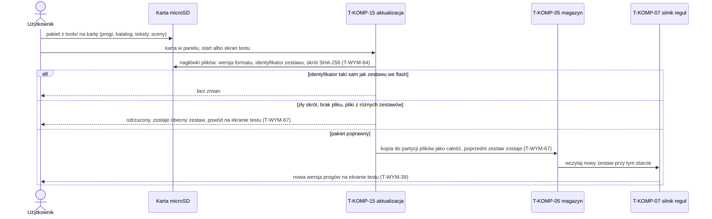

Pakiet na karcie nie zmienia historii, czynników ani dziennika ekranów: kopiowane są tylko trzy pliki zestawu i sceny. To zastępuje dzisiejsze `uploadfs`, które nadpisuje całą pamięć plików (`tools/prototyp/wgraj_wifi.sh`, opcja `--fs`; `src/dyrygent.cpp` `Przebieg::startOta()`). W architekturze docelowej obraz całej pamięci plików przez Wi-Fi jest odrzucany (T-WYM-46).

### 7.9 Wymagania techniczne czasu wykonania

| ID | Wzorzec | Wymaganie | Weryfikacja | Źródło |
|---|---|---|---|---|
| T-WYM-20 | Ubiquitous | The firmware shall wykonywać każde wybudzenie jako ten sam ciąg kroków z tabeli 7.1 (przyczyna, czujniki, stan, plan, czas, AirBridge, otoczenie, zaległe doby, wyłączenie Wi-Fi, zapis, ocena, rysowanie, czuwanie tylko po wybudzeniu przyciskiem, sen), z Wi-Fi wyłączonym zaraz po ostatnim żądaniu sieciowym, przed zapisem i rysowaniem, a dyrygent wybudzenia (T-KOMP-01) shall wołać rdzeń i adaptery bez własnych decyzji o treści ekranu. | Test na komputerze z atrapami adapterów: wybudzenie zegarem o 07:00 → kolejność wywołań atrap zgodna z tabelą 7.1, wyłączenie Wi-Fi w atrapie sieci przed pierwszym zapisem i rysowaniem, brak czuwania przed snem; wybudzenie przyciskiem → czuwanie 20 s bez Wi-Fi; przegląd kodu dyrygenta → brak warunków na metrykach i ID ekranów. | ADR-0021 pkt 1–2; `src/dyrygent.cpp` `Przebieg::zwykleWybudzenie()` |
| T-WYM-21 | Event | WHEN panel wybudzi się przyciskiem, the firmware shall ustalić przycisk budzący z maski `ext1` i mierzyć przytrzymanie od startu programu. | Wybudzenie ◀ przytrzymanym 2,5 s → akcja przytrzymania ◀; ◀ puszczony po 0,5 s → akcja krótkiego ◀ (log). | R-PRZ-08; `src/dyrygent.cpp` `Przebieg::zwykleWybudzenie()` |
| T-WYM-22 | Ubiquitous | The firmware shall ustalać datę i minutę doby raz na wybudzenie, po ustaleniu czasu, i używać tej samej chwili we wszystkich decyzjach tego wybudzenia (okno poranne, slot nocny, decyzja S9, terminy); limity czasu kroków shall liczyć zegarem procesora. | Atrapa: wybudzenie o 23:29:50 z pobieraniem trwającym 2 min → wybór ekranu i decyzja S9 według 23:29 (bez S9 w tym wybudzeniu), S9 przy następnym wybudzeniu. | R-KON-31, R-PRZ-18; `src/dyrygent.cpp` `Przebieg::minutaDoby()`, `Przebieg::pobierz()`, `src/dyrygent.cpp` `Przebieg::zwykleWybudzenie()` |
| T-WYM-23 | IF/THEN | IF pamięć RTC nie ma ważnej magii (start inny niż wybudzenie z uśpienia), THEN the firmware shall odtworzyć stan pobierania z NVS, a pozostały stan z plików, zanim użyje jakiejkolwiek wartości z RTC. | Odłączenie zasilania o 14:00 po zapisie nocy → po starcie stan pobierania z NVS (log), brak ponownego pobrania zapisanej nocy, ekran dnia jak przed odłączeniem. | R-NF-11; `src/dyrygent.cpp` `Przebieg::zwykleWybudzenie()` |
| T-WYM-24 | IF/THEN | IF panel wybudzi się przyciskiem, THEN the firmware shall nie łączyć się z Wi-Fi ani AirBridge, poza akcjami, które same są pobraniem (↻ na S5, ekran testu sprzętu, serwer raportu albo formularza). | Wybudzenie ▶ na ekranie dnia → K1 narysowany, w logu brak `WiFi.begin` i żądań HTTP; ↻ na S5 → pobranie w logu. | R-PRZ-01, R-PRZ-06, R-NF-03; `src/dyrygent.cpp` `Przebieg::zwykleWybudzenie()` |
| T-WYM-25 | Event | WHEN AirBridge odpowie kodem 401 z nagłówkiem `WWW-Authenticate`, a hasło AirBridge w konfiguracji nie jest puste (przy pustym haśle 401 od razu daje wynik „odmowa”, R-AW-34), the firmware shall powtórzyć żądanie raz z nagłówkiem Digest (konto i hasło z konfiguracji, MD5, `qop=auth`), używać tego samego `nonce` z rosnącym `nc` do końca wybudzenia i przy drugim 401 z rzędu zakończyć żądanie wynikiem „odmowa” bez ponowień z R-AW-01. | Atrapa AirBridge: 401, potem 200 → 2 żądania, kolejne żądania z tym samym `nonce` i `nc` 2, 3; atrapa ze złym hasłem → 2 żądania, wynik „odmowa”, brak 3 prób co 10 s. | Załącznik A pkt 0; R-AW-34; `src/dyrygent.cpp` `Przebieg::abGetRaz()` |
| T-WYM-26 | IF/THEN | IF odpowiedź HTTP ma nagłówek `Content-Length` różny od liczby odebranych bajtów albo zapis strumienia ciała zwróci błąd, THEN the firmware shall traktować tę odpowiedź jak brak odpowiedzi (ponowienie według R-AW-01), a nie jak odpowiedź nieczytelną (E-03). | Atrapa: `Content-Length: 8000`, połączenie zerwane po 3000 B → wynik „brak odpowiedzi”, ponowienie po 10 s, brak E-03. | R-AW-01, R-AW-02; `src/airbridge.cpp` `cialoKompletne()`, `src/dyrygent.cpp` `Przebieg::abGetRaz()` |
| T-WYM-27 | Ubiquitous | The firmware shall wysyłać do AirBridge wyłącznie żądania `GET` pod ścieżki z zamkniętej listy w adapterze (`/api/status`, `/api/report` z `action=days`, `day=` albo `job=`, oraz pobranie EDF po pomiarze 21). | Test integracyjny z atrapą rejestrującą żądania przez symulowaną dobę z awariami → tylko `GET` i tylko ścieżki z listy; przegląd kodu → brak innych metod HTTP w adapterze. | R-LEK-08, R-NF-07, ADR-0002; `src/airbridge.cpp` `sciezkaListy()` |
| T-WYM-28 | Event | WHEN wybudzenie się kończy, the firmware shall zapisać stan i zasnąć z budzeniem przez przyciski do najwcześniejszego terminu zwróconego przez plan wybudzenia (T-KOMP-24; w trybie awaryjnym bez terminu zegara, T-WYM-83), który podaje terminy wyłącznie z powodów z R-NF-02 (okno poranne i ponowienia z R-DANE-19, R-DANE-03, R-DANE-18, sprawdzenia o 11:00, pogoda przed slotami, przerysowania ekranu dnia bez Wi-Fi co 2 h z R-EKR-60 poza slotem dziennym, start slotu dziennego i ocena o każdej pełnej godzinie slotu z R-KON-41 i R-KON-42, pobranie prognozy godzinowej przy starcie slotu z R-KON-52, odświeżenia slotu wieczornego, zapis czujników, początek slotu nocnego, odłożony sygnał, powrót z R-PRZ-02 i pozostałe limity z R-NF-02). | Test na komputerze: K1 otwarty o 10:12:00 → sen do 10:17:02, nie do 10:30:05; o 02:12 w slocie nocnym → sen do 02:15 (zapis czujników, R-DANE-09), bez terminu powrotu i bez wybudzenia z Wi-Fi do 05:00; o 14:05 przy nocy kompletnej zapisanej o 07:00 → sen do 15:00:05 (ocena slotu dziennego R-KON-42, slot od 08:00), nie do 14:30; bez slotu dziennego (plan bez chwili startu slotu, wariant testowy symulatora) i przy ekranie dnia narysowanym o 13:00 → sen do 15:00:05 (przerysowanie ekranu dnia bez Wi-Fi, R-EKR-60); o 19:05 po przerysowaniu o 19:00 → sen do najbliższego powodu z R-NF-02 (pogoda przed slotem wieczornym), nie do 21:00 z powodu R-EKR-60 (03.11.2026); import nocy o 06:55 → sen do 07:55:05 (start slotu dziennego, R-KON-41), import o 07:59:30 → jedno wybudzenie o 09:00:05 ze startem i oceną); log doby → każde wybudzenie z powodem z listy R-NF-02. | R-NF-02, R-PRZ-02, R-PRZ-18; `src/dyrygent.cpp` `Przebieg::spij()` |
| T-WYM-29 | IF/THEN | IF przycisk jest wciśnięty w chwili zasypiania po wybudzeniu zegarem albo starcie, THEN the firmware shall obsłużyć go jak przycisk budzący (R-PRZ-09); IF przycisk jest trzymany co najmniej 10 s (`ZACIECIE_MS`), THEN the firmware shall uznać go za zacięty: ignorować go do puszczenia, także w kolejnych wybudzeniach, bez czuwania na przycisk z jego powodu, i wyłączyć go z budzenia. | `testR_PRZ_09_przyciskPrzedSnemPoZegarze` (▶ wciśnięty 1,0–2,5 s po wybudzeniu zegarem → K1, czuwanie 20 s, budzą wszystkie przyciski); `testZacietyPrzycisk` (wciśnięty od 1. s do końca → jedno naciśnięcie, w logu `zacięty`, sen bez tego przycisku); `testT_WYM_29_zacietyWNocy` (taśma na ◀ w nocy → pierwsze wybudzenie krócej niż 15 s i najwyżej dwa piski, kolejne wybudzenia pomiarowe bez pisku, diody i rysowania, krócej niż 3 s, sen bez ◀; po zdjęciu taśmy budzą wszystkie). Na panelu: przycisk zablokowany taśmą → w logu `zacięty`, kolejne wybudzenia tylko zegarem i bez pisku; po zdjęciu taśmy przycisk znowu budzi. | U4 prototypu; `src/dyrygent.cpp` `Przebieg::czekajNaPuszczenie()`, `Przebieg::czuwanie()`, `Przebieg::spij()` (maska `StanRtc::zaciete`) |
| T-WYM-30 | IF/THEN | IF jedno wybudzenie bez serwera raportu, formularza i okna serwisowego trwa dłużej niż 300 s [szacunek], THEN the firmware shall przerwać bieżący krok, zapisać stan, wpisać przekroczenie do logu i zasnąć. | Atrapa AirBridge, która trzyma połączenie bez końca, w każdym kroku → wybudzenie kończy się snem po ≤ 300 s, wpis w logu, następne wybudzenie zwykłe. | R-NF-01; rachunek z 7.1: 20 + 5 + 120 + 15 + 90 = 250 s plus zapis i rysowanie; czuwanie 20 s tylko po przycisku, a takie wybudzenie nie łączy się z siecią |
| T-WYM-31 | Event | WHEN nadejdzie termin zapisu czujników (R-DANE-09, R-DANE-10) bez innego powodu wybudzenia, the firmware shall wykonać wybudzenie pomiarowe: odczyt czujnika w obudowie i Qingpinga, dopisanie odczytu do serii nocy we flash (T-DANE-02) i sen, bez Wi-Fi i bez rysowania. | Log nocy 21:00–09:00 → wybudzenia co 15 min z odczytem, po każdym nowy wiersz w `/dane/serie/RRRR-MM.csv`, w wybudzeniach pomiarowych brak `WiFi.begin` i brak odświeżenia ekranu. | R-DANE-09, R-DANE-10, R-DANE-33, R-NF-03 |
| T-WYM-32 | Event | WHEN pierwsze wybudzenie slotu nocnego podejmie decyzję o S9, the firmware shall zapisać decyzję (noc, S9 tak albo nie) w NVS przed rysowaniem. | Odłączenie zasilania w trakcie rysowania S9 o 23:30 → po starcie o 23:31 S9 rysowane raz z faktami z tej chwili; restart o 01:00 po decyzji „bez S9” → brak S9 do 05:00. | R-KON-31, R-KON-34, R-KON-35; `src/dyrygent.cpp` `Przebieg::zapiszStanNocy()`, `src/dyrygent.cpp` `Przebieg::zwykleWybudzenie()` |
| T-WYM-33 | State | WHILE trwa slot nocny, the firmware shall trzymać fakty S9 z pierwszego rysowania tej nocy w pamięci RTC z kluczem nocy i rysować S9 po powrocie z K1 albo K2 z tych faktów, bez nowego zapytania do AirBridge. | 23:30 S9 z `przy łóżku 21°`; 00:40 ▶ → K1; 00:42 ↻ przy 18° → S9 z `21°` i tą samą sceną, w logu brak `/api/status` z tego wybudzenia. | R-KON-33, R-KON-34, R-KON-37; `src/dobranoc.cpp` `daneNocy()`, `src/dyrygent.cpp` `Przebieg::rysujNocny()` |
| T-WYM-34 | IF/THEN | IF partycja plików we flash nie zamontuje się przy starcie i nie jest partycją nową z T-WYM-84, THEN the firmware shall nie formatować jej, pracować na danych w pamięci do restartu, pokazać powód na ekranie testu sprzętu i w logu i dodać linię uwagi R-AW-05 (`Błąd pamięci panelu. Wyniki mogą być niepełne.`, R-AW-16). | Obraz z uszkodzonym nagłówkiem LittleFS → panel startuje, U-05 `Pamięć panelu: nie zamontowana` (w diagnostyce U-05 `pamięć plików: nie zamontowana`), na ekranie dnia linia `Błąd pamięci panelu. Wyniki mogą być niepełne.`, partycja po restarcie z tym samym obrazem bajt w bajt. | R-NF-11, R-AW-16, ADR-0022; `src/dyrygent.cpp` `Przebieg::wczytajPliki()`, `Przebieg::sprawdzPartycje()`, `Przebieg::awariaPamieci()` |
| T-WYM-84 | IF/THEN | IF przy starcie partycja plików się nie montuje i jednocześnie spełnione są wszystkie cztery warunki: (1) tablica partycji, z której panel wystartował, jest tablicą wkompilowaną w firmware (identyfikator układu, 8.2); (2) w NVS nie ma znacznika `fs_init` z przesunięciem i rozmiarem bieżącej partycji plików (znacznik obecny wyklucza formatowanie także przy partycji w całości `0xFF`); (3) w NVS nie ma identyfikatora układu albo jest inny niż wkompilowany, albo dwa pierwsze bloki partycji są w całości `0xFF`; (4) dwa pierwsze bloki dają się odczytać i żaden nie ma superbloku LittleFS (napis `littlefs`), THEN the firmware shall sformatować partycję jeden raz, zapisać w NVS znacznik `fs_init` i identyfikator układu, wpisać `pierwsze formatowanie` do logu i przejść do okna przywracania przez port serwisowy (T-WYM-87), a potem do przywracania (T-WYM-62); gdy tablica panelu nie jest wkompilowana (warunek 1 niespełniony, np. firmware z nowym układem wgrany przez Wi-Fi na starą tablicę, 8.9 krok 2), the firmware shall nie formatować, nie migrować i nie zapisywać plików, czytać pliki prototypu tylko do odczytu, pokazać na U-05 `stary układ: wgraj kablem` (w kolumnie `układ: wgraj kablem`, pełny tekst `układ partycji: stary, wgraj kablem` w diagnostyce U-05, T-WYM-39) i linię R-AW-16, a przy wersji „do sprawdzenia” nie zdać samosprawdzenia (T-WYM-41, powrót do poprzedniej wersji); w każdym innym przypadku działać według T-WYM-34. | Test na PC z atrapą pamięci flash: partycja skasowana (`0xFF`), NVS bez znacznika (przejście z prototypu) → sformatowana, znacznik w NVS, okno przywracania (T-WYM-87); partycja ze śmieciami bez superbloku, NVS bez znacznika i bez identyfikatora układu → sformatowana; partycja z uszkodzonym superblokiem LittleFS, NVS bez znacznika → bez formatowania, ścieżka T-WYM-34, obraz bajt w bajt ten sam; partycja nieczytelna, znacznik w NVS → bez formatowania (T-WYM-34); partycja w całości `0xFF` i znacznik `fs_init` tej partycji w NVS → bez formatowania (T-WYM-34); start po formatowaniu z poprawnym montowaniem → bez drugiego formatowania; tablica panelu inna niż wkompilowana → bez formatowania i migracji, `/noce.csv` bajt w bajt, U-05 `Pamięć panelu: układ: wgraj kablem`; to samo przy wersji „do sprawdzenia” → powrót do poprzedniej wersji, 0 zapisów plików. | przegląd architektury 01.11.2026; R-AW-16, R-DANE-37; 8.9; `src/magazyn.cpp` `decyzjaPartycji()`, `src/dyrygent.cpp` `Przebieg::sprawdzPartycje()` |
| T-WYM-87 | State | WHILE po starcie zasilania (`ESP_RST_POWERON` albo `ESP_RST_EXT`; nie po restarcie programowym, np. po aktualizacji przez Wi-Fi, błędzie programu, strażniku, spadku napięcia ani wybudzeniu z uśpienia; także po pierwszym formatowaniu, T-WYM-84) przywracanie czeka, czyli w NVS nie ma znacznika końca przywracania (`cpap`/`przywr`: data i liczba nocy po udanym przywróceniu albo `bez przywracania {data}`), a partycja plików była sformatowana przez firmware (znacznik `fs_init`, 8.9; niezależnie od nocy pobranych potem z AirBridge) albo nie ma plików nocy (bez `/dane/noce/RRRR.csv`, bez `/noce.csv` i bez czekającego `/import.csv`), i nie minęło 10 min [szacunek] (także w trakcie treści komendy `W`), nie przyszło polecenie końca (`K`) ani naciśnięcie przycisku, the firmware shall trzymać okno przywracania: nie łączyć się z Wi-Fi, nie pobierać danych, pokazywać na U-05 w ramce `Okno przywracania do {hh:mm}`, a przy nieznanym zegarze `Okno przywracania: {m} min` (pełne minuty do końca okna; T-WYM-39), przy otwarciu wpisać do logu i na znak `?` odpowiadać wierszem okna (`okno przywracania do {hh:mm} (T-WYM-87): port serwisowy, komenda W, K kończy; bez Wi-Fi`), przyjmować przez port serwisowy komendę `W` z nazwą, rozmiarem, skrótem SHA-256 i treścią pliku (limit całej treści 5 s i 1 s na każdy pełny KB [PRÓG], w oknie najwyżej do końca okna), zapisywać plik atomowo (T-WYM-51) do `/przywracanie/` tylko przy nazwie z listy plików zrzutu, rozmiarze do 4 MB [PRÓG] i zgodnym skrócie, odpowiadać `OK {nazwa}` albo `BLAD {nazwa} {powód}`, pamiętać w NVS (`cpap`/`przywr_odrz`) pliki zrzutu odrzucone i nie przyjęte później (zapis przy każdej odpowiedzi, która listę zmienia) oraz to, że w oknie przyszła komenda `W` (`cpap`/`przywr_proba`), a po końcu okna przejść do przywracania (T-WYM-62), gdy przyszedł co najmniej jeden plik albo `K` zastało komplet; znacznik udanego przywrócenia stawiać tylko po oknie zakończonym komendą `K` przy komplecie plików (żaden plik zrzutu nie czeka na ponowne wgranie, a plik nocy przyjęty `OK` w tym albo wcześniejszym oknie; `cpap`/`przywr_k`) i po przywróceniu ze zgodną, niezerową liczbą nocy, nigdy po oknie zakończonym czasem albo przyciskiem ani po przywróceniu przed oknem bez wcześniejszego `K` z kompletem; po oknie zakończonym bez żadnej komendy `W` w tym ani we wcześniejszym oknie stawiać znacznik `bez przywracania {data}` (okno się już nie otwiera); przy pierwszym formatowaniu znaczniki kasować; poza oknem komendę `W` z plikiem zrzutu odrzucać bez zapisu (`BLAD {nazwa} poza oknem`; pliki obrazków dnia `obrazki/…` oraz `konfiguracja.txt` w oknie i poza nim według 8.6), a przy znaczniku `bez przywracania` zdejmować go i pamiętać próbę (okno wraca przy następnym starcie zasilania); na `?` poza oknem odpowiadać `przywracanie: poza oknem`, przy znaczniku `bez przywracania` z dopiskiem `, bez przywracania (…)` (decyzja 04.11.2026). | Test na PC z atrapą portu serwisowego: po formatowaniu 6 plików zrzutu z 412 nocami → w `/przywracanie/` 6 plików, potem 412 nocy w wersji 1 i znacznik `cpap`/`przywr` w NVS; plik nocy z jednym zmienionym bajtem → `BLAD noce.csv skrot`, pozostałe pliki przyjęte, po `K` `niezgodna liczba` (brak pliku nocy), noc z AirBridge pobrana; następny start zasilania → okno znowu, poprawny plik nocy przyjęty, przywrócenie ze scaleniem; okno minęło bez komendy `W`, noce z AirBridge pobrane → znacznik `bez przywracania`, następny start zasilania bez okna, `?` → `przywracanie: poza oknem, bez przywracania`, komenda `W` poza oknem → znacznik zdjęty, następny start zasilania → okno, `przywrócono 412`; restart w oknie po `BLAD czynniki.csv skrot` (bez `K`) → lista odrzuconych w NVS, przywrócenie przed oknem bez znacznika, następny start okno, czynniki przyjęte; okno zakończone czasem bez pliku czynników → `przywrócono 40 z 40` bez znacznika, następny start okno; `K` bez pliku nocy → bez znacznika; plik nocy bez nocy → `niezgodna liczba`, bez znacznika; `K` z kompletem i zanik zasilania przed znacznikiem → następny start: przywrócenie przed oknem stawia znacznik; restart programowy, błąd programu, strażnik, spadek napięcia → bez okna, reset pinem (`ESP_RST_EXT`) → okno; plik czynników odrzucony, noce przywrócone → bez znacznika, U-05 w następnym oknie `Pamięć panelu: odrzucone 1 plik`, następny start zasilania → okno, czynniki przyjęte; po udanym przywróceniu następny start zasilania bez okna, komenda `W` → `poza oknem`; komenda `W` przy partycji z nocami bez znacznika `fs_init` → odrzucona, pliki bez zmian; wybudzenie z uśpienia → bez okna; `?` w oknie → wiersz okna, poza oknem → `przywracanie: poza oknem`; przycisk → koniec okna przed 10 min; 10 min bez komendy → zwykła praca bez historii i znacznik `bez przywracania`; w oknie 0 wywołań atrapy sieci; start bez znanego zegara → U-05 w ramce `Okno przywracania: 10 min`; treść krótsza niż rozmiar → po 5 s bez bajtu `BLAD … rozmiar`; treść po bajcie co 4,9 s → okno kończy się po 10 min. | 8.9; T-INT-10; R-DANE-37, R-AW-16; `src/dyrygent.cpp` `Przebieg::oknoPrzywracania()`, `Przebieg::przywracanieCzeka()`, `Przebieg::przywroc()`, `Przebieg::kompletPlikow()`, `Przebieg::startZasilania()`, `Przebieg::komendaW()`, `Przebieg::czytajTresc()`, `Przebieg::plikWBezPrzywracania()`, `src/magazyn.cpp` `parsujKomendeW()`, `sprawdzPlikW()`, `sprawdzKonfiguracjeW()` |
| T-WYM-88 | IF/THEN | IF zegar panelu jest nieznany (nowy panel po `erase`, start po zaniku zasilania), THEN the Panel shall przy pierwszej synchronizacji dać NTP 3 próby po 5 s [PRÓG] (łącznie do 15 s), a gdy wszystkie zawiodą, ustawić zegar z `esp_time` z tego samego `GET /api/status` (czas lokalny strefy panelu, dokładność do minuty, `"--"`, pusta, nieczytelna albo nie późniejsza niż 14.11.2023 wartość odrzucona), w logu `źródło czasu: AirBridge`, i w tym samym wybudzeniu pobrać noce i narysować ekran dnia; przy zegarze znanym NTP dostaje jedną próbę 2 s, a `esp_time` jest ignorowany. Czas z AirBridge nie jest synchronizacją NTP (`ntpOstatnio` bez zmian), więc NTP wraca w następnym wybudzeniu (R-AW-08). | Test na PC `test/testy_zegar_ntp.cpp` (T-TEST-327): 3 próby NTP, zegar ustawiony raz, log, noc w pamięci i ekran w tym samym wybudzeniu, bez `następny termin: czas`; NTP odpowiada za 2. próbą → `esp_time` nieużyty; `esp_time` brak, `--`, nieczytelny, 30.02, 2001 i 2023 → zegar nieustawiony, sen 30 min (R-AW-20), bez E-01; zegar znany → jedna próba, `esp_time` ignorowany. Koszt baterii: do 13 s Wi-Fi więcej tylko w wybudzeniu bez zegara; pomiar na egzemplarzu. | R-AW-18, R-AW-20, R-AW-08b; stałe `NTP_PROBY_BEZ_ZEGARA`, `LIMIT_NTP_PROBY_BEZ_ZEGARA_MS`, `LIMIT_NTP_MS` w `src/dyrygent.cpp` |
| T-WYM-89 | IF/THEN | IF ciało odpowiedzi AirBridge przekracza limit trasy [PRÓG] (`/api/status` 16 KiB, lista `action=days` 512 KiB, raport doby i pozostałe trasy 64 KiB; przy odpytywaniu joba limit trasy pierwotnej), THEN the firmware shall odrzucić je bez trzymania w pamięci (adapter nie czyta ciała przy `Content-Length` ponad limit, przerywa odczyt bez niego), uznać tę próbę za nieudaną bez ponowień z R-AW-01 w tym wybudzeniu i bez E-03, a w logu i na ekranie testu podać kod panelu -301 „odpowiedź za duża”. | `test/testy_dyrygenta.cpp` `testListaPonadLimit()`: lista 512 KiB + 1 B → jedno żądanie listy, w logu `odpowiedź ponad 524288 B odrzucona`, brak zapisu nocy, brak udanego odczytu; `testListaPrzezJob()`: lista ok. 100 KB przez job → przyjęta, lista ponad 512 KiB przez job → odrzucona po jednym żądaniu joba; `test/testy.cpp`: `ponowicZadanie(AB_KOD_ZA_DUZO, …)` = false, `limitOdpowiedziAB()` dla trzech tras. | R-AW-01, R-AW-12; `src/airbridge.h` `AB_MAKS_BAJTOW_STATUSU`, `AB_MAKS_BAJTOW_LISTY`, `AB_MAKS_BAJTOW_RAPORTU`, `src/airbridge.cpp` `limitOdpowiedziAB()`, `ponowicZadanie()`, `src/dyrygent.cpp` `Przebieg::abGetRaz()`, `Przebieg::abRaport()` |
| T-WYM-90 | IF/THEN | IF zapis któregokolwiek pliku roku nocy (`/dane/noce/RRRR.csv`) po wczytaniu `/import.csv` się nie uda (pełna pamięć, błąd nośnika, format tylko do odczytu po nieudanej migracji), THEN the firmware shall zostawić `/import.csv` pod tą nazwą i nie ruszać `/import.wczytany`, żeby następne wybudzenie wczytało import od nowa (bez dublowania nocy, R-DANE-32), a pliki lat zapisanych bez błędu zostawić zapisane. | `test/testy_dyrygenta.cpp` `testImportZapisNieudany()`: import z nocami z 2025 i 2026, atrapa odmawia zapisu pod `/dane/noce/2025` → `/import.csv` zostaje, stary `/import.wczytany` bez zmian, `/dane/noce/2026.csv` z 2 nocami, w logu `zapis plików nocy nieudany`; następne wybudzenie bez odmowy → noc z 2025 zapisana, `/import.csv` przemianowany. | R-DANE-31, R-DANE-32, T-DANE-33; `src/dyrygent.cpp` `Przebieg::importujJesliCzas()`, `Przebieg::zapiszHistorie()`, `Przebieg::zapiszFormat()` |
| T-WYM-91 | IF/THEN | IF liczba w polu JSON AirBridge, które parser zapamiętuje, leży poza ±1e15 (także nieskończoność z `1e309`), THEN the firmware shall uznać dokument za nieczytelny (raport doby: jak urwany JSON, ponowienie; lista: R-AW-02); IF liczba mieści się w tym zakresie, ale nie w typie pola (`day`, `session_count`, `rop` poza ±2e9, `used_seconds` ponad 86 400 s, wynik na godzinę poza zakresem float), THEN the firmware shall potraktować to pole jak brak danych; IF wiersz nocy w CSV ma `inf` albo liczbę ponad zakres float albo minuty terapii spoza -1 i 0–1440, THEN the firmware shall odrzucić wiersz jako nieczytelny. | `test/testy.cpp` `testAirBridge()`: `used_seconds` `1e309` i `-2e15` → NIECZYTELNY, `1e12` → M-01 brak, `86400` → 1440, `1e-35` → M-03 NAN i brak `inf` w wierszu; lista z `day` `1e309` albo `3e9` odrzucona, `session_count` `5e9` → brak; `rop` `3e9` → brak; `testNoc()`: `inf`, `1e10`, `1e39`, `-inf`, 1441, -2 → błąd wiersza; 1440 i -1 przyjęte. Bramka `tools/jakosc/sprawdz.sh sanitizery` z `float-cast-overflow`. | R-AW-02, R-AW-22; `src/airbridge.cpp` `Czytnik::liczba()`, `wInt()`, `naFloat()`, `liczbaZTekstu()`, `nocZRaportu()`, `parsujStatus()`, `elementListy()`, `src/noc.cpp` `liczbaOk()`, `parsujNoc()` |
| T-WYM-35 | Ubiquitous | The firmware shall losować tokeny serwera raportu i formularza oraz hasło własnej sieci panelu z `esp_random()` wywołanego po włączeniu radia Wi-Fi. | Przegląd kodu → wywołania generatora po `WiFi.mode`; 100 uruchomień serwera → 100 różnych tokenów po 128 bitów. | R-NF-09, R-KONF-08; ESP-IDF Random Number Generation |
| T-WYM-81 | Ubiquitous | The firmware shall od początku `setup()` trzymać główne zadanie programu (to, w którym biegną `setup()` i `loop()`) zapisane do strażnika zadań ESP-IDF (task watchdog) z limitem 150 s [szacunek] bez odnowienia, odnawiać strażnika na granicy każdego kroku z 7.1 i w każdym obiegu pętli czekania (odpytywanie joba, serwer raportu i formularza, okno serwisowe, okno przywracania, czuwanie na przycisk) i co najmniej co plik w pracach długich (migracje, przywracanie z T-WYM-62, kopia na kartę, wgranie pakietu z T-WYM-67, zapis zestawu z T-WYM-85) i mieć ustawione, że przekroczenie limitu kończy się błędem programu i restartem, a nie samym wpisem. | Test na panelu: obraz testowy z pętlą bez końca w `setup()` przed Wi-Fi → restart po ≤ 150 s, przy następnym starcie `esp_reset_reason()` = `ESP_RST_TASK_WDT` w logu; obraz z wywołaniem HTTP, które nie wraca, w kroku 6 → to samo; test na PC z atrapą strażnika → odnowienie przy każdym kroku 7.1 i w pętli joba, wybudzenie z serwerem raportu 15 min → strażnik odnawiany, bez restartu. | przegląd architektury 01.11.2026; 7.8 („Pętla restartów i zawieszenie”); limit dłuższy niż najdłuższy krok 7.1 (120 s AirBridge) |

## 8. Widok wdrożenia

Ta sekcja mówi, gdzie co leży na panelu i jak firmware trafia z repozytorium na panel. Liczby układu partycji wynikają z ADR-0022 (wariant A, przyjęty 01.11.2026): pamięć flash panelu jest głównym nośnikiem, karta microSD kopią i wymianą. Droga aktualizacji zależy od ADR-0024.

### 8.1 Elementy wdrożenia

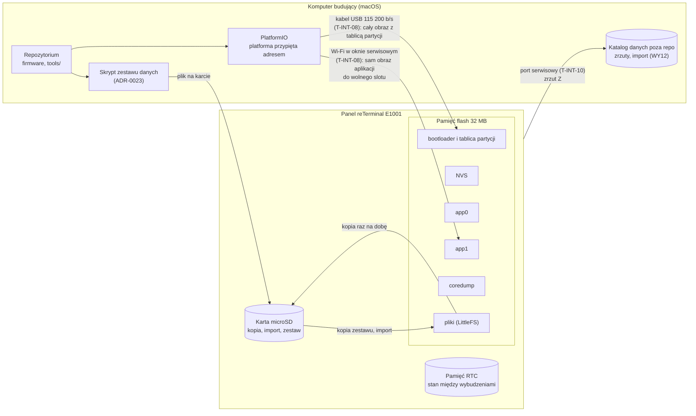

### 8.2 Układ partycji 32 MB

Firmware buduje się z układem poniżej (dawna tablica `default_8MB.csv` zostawiała 1,5 MB na pliki i 24 MB pamięci nieużywanych, sekcja 3.1): plik `firmware/partycje-e1001.csv` (`board_build.partitions` w `firmware/prototyp/platformio.ini`), obraz zajmuje 1 785 585 B, czyli 42,6% slotu 4 MB (kompilacja lokalna 04.11.2026, pio 6.2.0). Układ dla wydania 1.0:

| Nazwa | Typ, podtyp | Przesunięcie | Rozmiar | Co trzyma | Dlaczego tak |
|---|---|---|---|---|---|
| (bootloader) | | `0x0` | do `0x8000` | bootloader ESP-IDF | stałe miejsce dla ESP32-S3 |
| (tablica partycji) | | `0x8000` | `0x1000` | ta tabela | stałe miejsce |
| `nvs` | data, nvs | `0x9000` | `0x5000` (20 KB) | małe ustawienia i liczniki (8.5) | **to samo miejsce i rozmiar co w prototypie**, więc NVS przeżywa przejście na nowy układ (ziarno grupy kontrolnej, decyzja nocy, stan pobierania); prototyp zajmuje kilkanaście kluczy, NVS nie trzyma historii (sekcja 3.1) |
| `otadata` | data, ota | `0xE000` | `0x2000` | który slot startuje i stan „do sprawdzenia” | wymagana przy aktualizacji; dwa sektory ([ESP-IDF: OTA](https://docs.espressif.com/projects/esp-idf/en/stable/esp32s3/api-reference/system/ota.html)); to samo miejsce co dziś |
| `app0` | app, ota_0 | `0x10000` | `0x400000` (4 MB) | firmware | slot 1,25 raza większy niż dziś (4 MB wobec 3,2 MB) i 2,5 raza większy niż obraz prototypu (1 644 961 B): miejsce na serwer HTTP, PDF, kod QR i Bluetooth LE, których prototyp nie ma; rozmiar docelowego firmware [szacunek] 2–3 MB: obraz prototypu 1,6 MB plus te cztery części, których rozmiaru bez kompilacji nie znamy; pomiar po zbudowaniu |
| `app1` | app, ota_1 | `0x410000` | `0x400000` (4 MB) | druga wersja firmware | aktualizacja z powrotem wymaga dwóch slotów (ADR-0024) |
| `coredump` | data, coredump | `0x810000` | `0x10000` (64 KB) | zrzut po awarii programu | jak w tablicach Arduino dla 8 i 16 MB; diagnostyka zawieszeń bez kabla (sekcja 9) |
| `spiffs` | data, spiffs (LittleFS) | `0x820000` | `0x17E0000` (23,9 MB) | pliki: historia, czynniki, dzienniki, raporty PDF, sceny budzika, zestaw danych reguł | etykieta `spiffs`, bo pod tą nazwą rdzeń Arduino domyślnie montuje LittleFS ([`LittleFS.h`](https://raw.githubusercontent.com/espressif/arduino-esp32/master/libraries/LittleFS/src/LittleFS.h), `partitionLabel = "spiffs"`); cała reszta pamięci, bo zmiana układu później kosztuje wgranie kablem i przywrócenie danych (8.9) |

**Identyfikator układu.** Firmware porównuje przy starcie tablicę, z której panel wystartował, z tablicą wkompilowaną: skrypt budowy `firmware/prototyp/uklad_partycji.py` liczy z pliku tablicy identyfikator (CRC-32 wierszy app i data po adresie, `src/magazyn.cpp` `identyfikatorUkladu()`) i podaje go jako `UKLAD_PARTYCJI`, a adapter liczy go tak samo z tablicy panelu (`src/adaptery_esp32.cpp` `PlikiEsp32::partycja()`). Inna tablica (np. obraz z nowym układem wgrany przez Wi-Fi na starą tablicę) = brak formatowania i migracji (T-WYM-84). Identyfikator tablicy z tej sekcji: `0x6fcc622e`.

**Granica 16 MB.** Adresowanie 24-bitowe obejmuje 16 MB. Według ESP-IDF część pamięci powyżej 16 MB jest domyślnie dostępna dla danych, a uruchamianie kodu powyżej 16 MB wymaga opcji eksperymentalnej; W25Q256 jest na liście obsługiwanych układów ([ESP-IDF: SPI flash, funkcje opcjonalne](https://docs.espressif.com/projects/esp-idf/en/stable/esp32s3/api-reference/peripherals/spi_flash/spi_flash_optional_feature.html)). Dlatego oba sloty aplikacji i zrzut awaryjny leżą poniżej `0x1000000`, a powyżej tej granicy są tylko pliki (7,9 MB partycji plików poniżej granicy, 16 MB powyżej). Czy dostęp powyżej 16 MB działa w przypiętej wersji rdzenia na egzemplarzu: zaliczone 05.11.2026 (pomiar 16); od 06.11.2026 oba panele z wersją beta pracują na tym układzie. Gdy nie działa, układ zostaje ten sam, a partycja plików kończy się na `0x1000000` (7,9 MB, plik `firmware/partycje-e1001-16mb.csv`); decyzja przed pierwszym wgraniem układu, bo potem zmiana kosztuje przejście z 8.9.

**Dlaczego nie dwa duże sloty.** Układ z dwoma slotami aplikacji po 12 MB (z NVS 500 KB, 6 MB na pliki i 64 KB zrzutu) dawałby firmware kilka razy więcej miejsca, niż potrzebuje (12 MB wobec 2–3 MB [szacunek] z wiersza `app0`), a plikom 4 razy mniej niż ten układ. Przy dwóch slotach po 12 MB drugi slot musi wyjść poza 16 MB, czyli w obszar, w którym uruchamianie kodu wymaga opcji eksperymentalnej. NVS 500 KB nie jest potrzebne, bo konfiguracja i historia leżą w plikach (ADR-0022), a większe NVS w innym miejscu niż dziś skasowałoby stan prototypu przy przejściu.

### 8.3 Definicja płytki

Wcześniejszy prototyp kompilował się jak `seeed_xiao_esp32s3` z pamięcią 8 MB (sekcja 3.4). To tylko zgodny cel: panel ma sam układ ESP32-S3R8 z zewnętrzną pamięcią flash 32 MB (sekcja 3.1). Firmware ma własną definicję płytki w repozytorium (`firmware/boards/reterminal_e1001.json`, `boards_dir = ../boards` i `board = reterminal_e1001` w `platformio.ini`), żeby parametry pamięci nie zależały od cudzej płytki, która może się zmienić z wersją platformy. Definicja to `seeed_xiao_esp32s3` z pioarduino 55.03.312-1 z pamięcią 32 MB, prędkością wgrywania 115 200 b/s i wariantem pinów `XIAO_ESP32S3` (jak w prototypie); kompilacja `pio run -e e1001` sprawdzona 04.11.2026, start na egzemplarzu do sprawdzenia (pomiar 16).

| Parametr | Wartość | Źródło |
|---|---|---|
| układ | ESP32-S3, PSRAM 8 MB Octal (`qio_opi`) | sekcja 3.1, `platformio.ini` prototypu |
| pamięć flash | 32 MB, QIO | sekcja 3.1 (schemat v1.2) |
| tablica partycji | własna, 8.2 (`firmware/partycje-e1001.csv`) | 8.2 |
| system plików | `littlefs` | ADR-0022 |
| port szeregowy | UART0 przez mostek USB-UART (`-DARDUINO_USB_CDC_ON_BOOT=0`), bufor odbioru 4 KB (komenda `W`, T-WYM-87) | `platformio.ini` prototypu; `src/adaptery_esp32.cpp` `przygotujPanel()` |
| prędkość wgrywania | 115 200 b/s | sekcja 3.4 |

Czy panel startuje z flagą rozmiaru 32 MB w nagłówku obrazu i z tą definicją: tak, od 05.11.2026 (pomiar 16), od 06.11.2026 na obu panelach z wersją beta.

### 8.4 Pamięć plików (LittleFS)

LittleFS jest odporny na zanik zasilania (zapisy kopiują bloki, a nie nadpisują ich w miejscu) i wyrównuje zużycie. Firmware dokłada do tego własny zapis atomowy pliku: nowa treść do pliku tymczasowego, sprawdzenie liczby bajtów, potem zmiana nazwy (ADR-0022, decyzja 3 pkt 3; `src/magazyn.cpp` `Magazyn::zapisz()`, `Magazyn::zapiszSurowy()`). Montowanie zawsze **bez formatowania** przy błędzie (T-WYM-34). Jedyny wyjątek to partycja nowa, której ten panel nigdy nie sformatował: pierwsze wgranie, zmiana układu partycji (8.9) albo naprawa po skasowaniu całej pamięci; wtedy firmware formatuje ją raz i zapisuje znacznik w NVS (T-WYM-84; decyzja `src/magazyn.cpp` `decyzjaPartycji()`, formatowanie tylko w `src/adaptery_esp32.cpp` `PlikiEsp32::formatuj()`). W wydaniu 1.0 to jedyna droga utworzenia systemu plików, bo obraz `uploadfs` odpada (8.8). Pliki, ich formaty, wersje i rozmiary: sekcja 9 (model danych). Pliki (wersja 1): `/dane/noce/RRRR.csv`, `/dane/czynniki.csv`, `/dane/sypialnia/RRRR.csv`, `/dane/humor.csv`, `/log/wybudzenia.csv`, `/dane/ab-pominiete.csv`, `/dane/ab-proby.csv`, katalog `/przywracanie/` (zrzut wgrany komendą `W`, T-WYM-87), `/import.csv` (jednorazowy) i `/import.wczytany`; pliki prototypu (wersja 0: `/noce.csv`, `/czynniki.csv`, `/humor.csv`, `/sypialnia.csv`, `/sypialnia-co2.csv`, `/bateria.csv`, `/ab_pominiete.txt`, `/ab_proby.txt`) zostają nietknięte do następnej udanej migracji (T-WYM-43, T-WYM-55).

### 8.5 NVS i pamięć RTC

NVS trzyma małe wartości, które muszą przeżyć zanik zasilania i są zmieniane rzadko. Prototyp ma dwie przestrzenie nazw:

| Przestrzeń | Klucz | Co trzyma | Prototyp |
|---|---|---|---|
| `cpap` | `ziarno` | ziarno grupy kontrolnej, raz na panel (R-CZY-02) | `src/dyrygent.cpp` `Przebieg::zwykleWybudzenie()` |
| `cpap` | `noc_w`, `noc_s9` | decyzja ekranu nocnego tej nocy | `src/dyrygent.cpp` `Przebieg::zapiszStanNocy()` |
| `cpap` | `e08_od`, `e08_d`, `e08_k` | epizod `co2_milczy`, w którym linia E-08 już stała | `src/dyrygent.cpp` `Przebieg::rysujDzien()` |
| `cpap` | `ab_rano`, `ab_11` | noc zapisana przed 11:00 i jej sprawdzenie o 11:00 (R-DANE-24) | `src/dyrygent.cpp` `Przebieg::nvsTekst()` |
| `cpap` | `ab_zal`, `ab_czd` | zaległe doby z AirBridge i koniec czekania | `src/dyrygent.cpp` `Przebieg::wczytajZalegle()` |
| `cpap` | `fs_init`, `uklad` | przesunięcie i rozmiar partycji plików sformatowanej przez ten panel (tekst `{przesunięcie}:{rozmiar}` szesnastkowo), identyfikator układu partycji (T-WYM-84) | `src/dyrygent.cpp` `Przebieg::sprawdzPartycje()`, `src/magazyn.cpp` `znacznikPartycji()` |
| `cpap`, `noc` | `wersja` | wersja przestrzeni NVS (T-WYM-50), dziś 1; przestrzeń z wyższą wersją tylko do odczytu (T-WYM-54) | `src/dyrygent.cpp` `Przebieg::poOznaczeniu()`, `Przebieg::sprawdzWersjeNvs()` |
| `noc` | `ab` | kopia stanu AirBridge z pamięci RTC (bajty struktury z magią) | `src/dyrygent.cpp` `Przebieg::zapiszStanAB()`, `src/dyrygent.cpp` `Przebieg::zwykleWybudzenie()` |

Każda przestrzeń dostaje w wydaniu 1.0 klucz `wersja` (ADR-0022, decyzja 3 pkt 1); pełna lista kluczy z formatem: sekcja 9. NVS ma klucze do 15 znaków i teksty do 4000 B (sekcja 3.1).

Pamięć RTC trzyma stan między wybudzeniami (ekran, chwila naciśnięcia, pytanie w toku, fakty S9, w prototypie także bufor nocy sypialni, który docelowo zastępuje seria we flash T-DANE-02, ostatnia odpowiedź źródła otoczenia; `RTC_DATA_ATTR` w `src/wybudzenie.h` `ab`, `buforSyp`, `oto`, `aktywnyPoprzedniMs`). Ginie przy zaniku zasilania, restarcie i wgraniu firmware, więc wszystko, co ma przeżyć restart, ma kopię w NVS albo w plikach (T-WYM-23).

### 8.6 Karta microSD

(Zależy od ADR-0022, przyjęty 01.11.2026.) Karta jest opcjonalna i nie jest głównym nośnikiem. Ma cztery role:

| Rola | Kiedy | Kierunek |
|---|---|---|
| kopia danych | raz na dobę, po zapisie nocy | flash → karta |
| import historii z karty SD aparatu (ADR-0017) | jednorazowo, gdy na karcie jest plik importu | karta → flash |
| pakiet zestawu danych reguł i scen spoza firmware (ADR-0023, ADR-0024 z adnotacją 01.11.2026) | przy starcie albo z ekranu testu, gdy na karcie jest pakiet z identyfikatorem innym niż zestaw we flash (T-WYM-67); zestaw zbudowany razem z firmware przychodzi z firmware (T-WYM-85) | karta → flash |
| przywrócenie danych z kopii albo zrzutu na karcie, druga droga obok portu serwisowego (8.9, T-WYM-62, T-WYM-87, R-DANE-37), i plik konfiguracji jako droga zapasowa (ADR-0011 pkt 4 z adnotacją 01.11.2026, R-KONF-19) | przy starcie, gdy partycja plików jest pusta albo na karcie jest plik konfiguracji | karta → flash |
| obrazki dnia S-K-38 (ADR-0027 pkt 4) | dziś w pamięci panelu (LittleFS, katalog `/obrazki/`, wgrywane komendą `W` portu serwisowego bez kasowania danych; dawniej z obrazem plików); karta jako przyszłe źródło tego samego katalogu | karta → flash (po wydaniu) |

**Format obrazków dnia (04.11.2026).** Katalog `/obrazki/`: pliki PBM binarne (`P4`: nagłówek tekstowy `P4\n{szer} {wys}\n`, potem wiersze bitów od lewej, bit 1 = czarny, wiersz dopełniony do bajtu), szerokość i wysokość do 800×434, bez skalowania na panelu (R-KON-55); obok manifest `obrazki.json` (`{"wersja":1,"obrazki":[{"plik":…,"dni":[…],"pogoda":[…],"sezon":[…],"inne":[…]}]}`, R-KON-60, R-KON-62); dziennik wyboru w magazynie (format `obrazki`, `/dane/obrazki.csv`, `data;plik;pula`, R-KON-61). PBM wybrany, bo to standard czytany przez zwykłe narzędzia (obrazek da się obejrzeć na komputerze), a parser na panelu ma kilkanaście linii (`src/obrazki.cpp` `parsujPbm()`); obrazek 434×434 zajmuje 23,5 KB, zestaw przykładowy (47 obrazków) 1,1 MB [zmierzone na skrypcie 04.11.2026]. Przygotowanie poza panelem: `tools/obrazki/przygotuj.py` (zmniejszenie do 800×434 z zachowaniem stosunku boków, próg albo rozpraszanie, manifest tylko z polami czytanymi przez panel, odmowa zapisu w repozytorium). Prywatne obrazki i manifest nie trafiają do repozytorium (ADR-0027 pkt 11).

**Wgranie obrazków dnia komendą `W`.** `tools/prototyp/wgraj_pliki.py <port> --obrazki <wyjście przygotuj.py>` wysyła pliki `.pbm`, a na końcu `obrazki.json`, komendą `W` (protokół T-WYM-87) pod nazwami `obrazki/{plik}`. Firmware (`src/magazyn.h` `nazwaObrazkaW()`, `sprawdzObrazekW()`; `src/dyrygent.cpp` `Przebieg::obrazekW()`) przyjmuje tylko `obrazki/{[a-z0-9_-], 1…40 znaków}.pbm` i `obrazki/obrazki.json`, treść do 64 KB [PRÓG] (`MAKS_OBRAZKA_W`, mniej niż 4 MB plików zrzutu, bo bufor leży na stercie; treść ponad limit panel czyta i wyrzuca bez bufora, przy rozmiarze nieczytelnym i przy przerwie ponad 5 s w środku pliku wyrzuca bajty do 5 s ciszy, także dla plików zrzutu po przerwie, więc treść nigdy nie idzie do pętli jako komendy `Z`, `O`, `K`), ze zgodnym skrótem SHA-256 i czytelną treścią (`parsujPbm()` do 800×434, `parsujManifest()`), zapisuje atomowo (`Magazyn::zapiszSurowy()`) do `/obrazki/` w oknie przywracania i poza nim, bez zmiany plików nocy, listy odrzuconych i znaczników przywracania. Poza oknem panel czyta port w czuwaniu: komenda `?` albo `W` przedłuża je do 20 s od ostatniej. `tools/obrazki/przygotuj.py` nadaje nazwy w tej postaci (`nazwa_panelu()`). Manifest czytelny bez pozycji dla plików z katalogu panel przyjmuje, a przy doborze pisze w logu `obrazki: manifest bez pozycji z plikiem`; skrypt ostrzega już przy wysyłce. Skrypt nie wysyła dowiązań symbolicznych ani plików spoza katalogu po rozwiązaniu ścieżki (`dowiazanie`), po `brak odpowiedzi` przerywa z radą „panel zasnął: naciśnij przycisk panelu i uruchom ponownie”, a zły port kończy jednym zdaniem. Testy: T-TEST-322, T-TEST-323.

**Wgranie `/konfiguracja.txt` komendą `W`.** Tą samą drogą co obrazki: `tools/prototyp/wgraj_pliki.py <port> --konfiguracja <plik>` wysyła jeden plik pod nazwą `konfiguracja.txt` (nazwa pliku na dysku dowolna). Firmware (`src/magazyn.h` `NAZWA_KONFIGURACJI_W`, `MAKS_KONFIGURACJI_W`, `sprawdzKonfiguracjeW()`; `src/dyrygent.cpp` `Przebieg::konfiguracjaW()`, wspólna ścieżka `plikWBezPrzywracania()` z obrazkami) przyjmuje wyłącznie nazwę `konfiguracja.txt` (bez ukośnika, `..`, wielkich liter i przyrostków), treść do 16 KB [PRÓG] (`MAKS_KONFIGURACJI_W`; ponad limit panel czyta i wyrzuca bez bufora jak przy obrazkach), ze zgodnym skrótem SHA-256 i bez bajtu 0 (`tresc`), i zapisuje atomowo wprost do `/konfiguracja.txt` w oknie przywracania i poza nim, bez zmiany plików nocy, NVS, listy odrzuconych i `/przywracanie/`. Powody odmowy: `nazwa`, `rozmiar`, `skrot`, `tresc`, `zapis`. Panel czyta plik przy następnym wybudzeniu (ustawienia wczytywane raz na wybudzenie). Skrypt nie wysyła dowiązań symbolicznych, plików ponad 16 KB ani z bajtem 0, ponawia raz po `skrot` i `zapis`, po `brak odpowiedzi` przerywa (jak `--obrazki`) i nie wysyła `K`. Zastępuje `uploadfs` jako pierwsza droga na nowy panel. Testy: T-TEST-324, T-TEST-325.

**Prognoza godzinowa (R-KON-52).** Panel pyta Open-Meteo bezpośrednio (ADR-0027, ADR-0001: w zapytaniu tylko współrzędne miasta): `http://api.open-meteo.com/v1/forecast?…&hourly=temperature_2m,precipitation_probability,cloud_cover,wind_gusts_10m&timezone=Europe%2FWarsaw&forecast_days=2` i `http://air-quality-api.open-meteo.com/v1/air-quality?…&hourly=pm2_5,birch_pollen,grass_pollen,alder_pollen,mugwort_pollen&…`; oba adresy odpowiadają po `http://` (adapter HTTP panelu nie ma TLS), ok. 2 KB każdy, jednostki °C, %, km/h, µg/m³, ziarna/m³, pyłki poza sezonem 0. Kopia w magazynie (format `prognoza`, `/dane/prognoza.csv`, 48 wierszy `data;godz;temp;opad;chmury;porywy;pm25;brzoza;trawy;olcha;bylica;pobrano`), zapisana po wyłączeniu Wi-Fi (7.1 krok 10); seria CO2 nocy do S-K-01 i S-K-13 w formacie `sypialnia` wersja 2 (`co2_ponad;co2_maks;co2_seria`, migracja 1 → 2 krokiem ogólnym). Daty wymiany (5.9.2) i `Pyłki w dzień` do formularza z pliku `/konfiguracja.txt` (`klucz=wartość`, wartości domyślne 5.9.2 i 5.6.4). Współrzędne: wpis z formularza U-03 (`miasto=` w `/konfiguracja.txt`) ma pierwszeństwo, bez wpisu `POGODA_LAT` i `POGODA_LON` w `secrets.h` (R-KONF-24); geokodowanie miasta ma parser (`src/slot_dzienny.cpp` `parsujGeokodowanie()`), bez wywołania w przebiegu. Trafność PM2.5 przy smogu lokalnym do oceny po okresie testowym.

Karta dzieli magistralę SPI z ekranem i ma własne zasilanie `SD_EN` (sekcja 3.1). Firmware ustawia piny karty przy każdym starcie, włącza zasilanie karty tylko na czas pracy z nią i nigdy nie rozmawia z kartą i ekranem jednocześnie (T-WYM-63). Czas i energia montowania karty: [do zmierzenia] (pomiar 13). Kopia danych zdrowotnych na karcie jest bez szyfrowania (spec 8.1); szyfrowanie kopii: sekcja 9.

### 8.7 Kompilacja

| Element | Dziś (prototyp) | Wydanie 1.0 |
|---|---|---|
| narzędzie | PlatformIO na komputerze budującym; w środowiskach bez dostępu do narzędzi kompilacja na ESP32 nie działa (sekcja 3.4) | kompilacja i budżet rozmiaru także w CI GitHub (job `esp32`); wgranie z komputera budującego; testy rdzenia i symulator na komputerze przy każdej zmianie |
| platforma | pioarduino `55.03.312-1`, przypięta adresem wydania (`platformio.ini`) | przypięta adresem wydania i sumą kontrolną archiwum w notatce wydania |
| biblioteki | `zinggjm/GxEPD2`, `adafruit/Adafruit GFX Library` bez wersji | każda z dokładną wersją (`@=x.y.z`), odczytaną z `pio pkg list` w dniu zamrożenia; lista i licencje w sekcji 10 |
| tablica partycji i płytka | dawniej `default_8MB.csv`, `seeed_xiao_esp32s3`; `firmware/partycje-e1001.csv` i `firmware/boards/reterminal_e1001.json` (8.2, 8.3) | własne pliki w repozytorium (8.2, 8.3), wariant tablicy po pomiarze 16 |
| konfiguracja ESP-IDF | domyślna z bibliotek Arduino | domyślna z bibliotek Arduino; powrót do poprzedniej wersji włączony w bibliotekach 3.3.12 (`CONFIG_BOOTLOADER_APP_ROLLBACK_ENABLE=y`, 7.8); własna konfiguracja (np. podpis obrazów) wymaga przebudowy bibliotek i jest decyzją ADR-0024 |
| sekrety | `include/secrets.h` z Pęku kluczy macOS (`tools/prototyp/sekrety.sh`), poza repo | sieć, adres AirBridge i token źródła w pliku konfiguracji z formularza (R-NF-22, R-KONF-35); w firmware zostaje tylko hasło okna serwisowego, generowane przy pierwszym wgraniu (ADR-0024) |
| wersja w obrazie | stała `WERSJA` = numer docelowego wydania `1.0.0` (`src/main.cpp`); identyfikator `{WERSJA}+{skrót commitu}` w logu, licznikach i znaczniku trybu awaryjnego, na U-05 tylko numer wydania (`src/start.h` `wersjaWydania()`) | wersja z tagu git przy budowaniu, pokazywana na ekranie testu, w stopce raportu i w E-03 (R-NF-18) |
| powtarzalność | brak | ten sam tag i ta sama platforma dają obraz o tym samym rozmiarze; skrót obrazu w notatce wydania (sekcja 12) |

### 8.8 Wgrywanie

| Droga | Co wgrywa | Kiedy | Dane panelu | Prototyp |
|---|---|---|---|---|
| kabel USB, 115 200 b/s (`pio run -t upload`) | bootloader, tablica partycji, `otadata`, firmware | pierwsze wgranie, zmiana układu partycji, ratunek po nieudanej aktualizacji | zostają, gdy układ partycji się nie zmienia; NVS zostaje także przy zmianie z 8.2 (to samo miejsce); przy pierwszym wgraniu i zmianie układu partycja plików jest nowa i firmware formatuje ją raz (T-WYM-84) | `platformio.ini`, `[env:e1001]` |
| Wi-Fi w oknie serwisowym (ArduinoOTA, `cpap-eink.local`, hasło) | sam firmware do drugiego slotu, z zestawem wbudowanym w obrazie | zwykła aktualizacja; także zmiana progów i tekstów, gdy idą razem z firmware (T-WYM-85); **zablokowane do przejścia egzemplarza na układ 32 MB** | zostają (R-NF-19); powrót do poprzedniej wersji według 7.8; obraz z nowym układem na starej tablicy: T-WYM-84 (bez formatowania, powrót) | `[env:e1001_ota]`, `tools/prototyp/wgraj_wifi.sh` |
| karta microSD | pakiet zestawu danych reguł i scen (T-DANE-36) | zmiana progów, katalogu, tekstów albo scen bez nowego firmware (np. w okresie kalibracji); także powrót do poprzedniego pakietu | zostają (ADR-0023 pkt 6) | brak (dziś `uploadfs`, które kasuje pliki) |
| obraz pamięci plików (`uploadfs`) | cała partycja plików | **nie w wydaniu 1.0**: kasuje historię, czynniki i dziennik | kasowane | `tools/prototyp/wgraj_wifi.sh --fs`, `src/dyrygent.cpp` `Przebieg::startOta()` |
| kasowanie całej pamięci (`pio run -t erase`) | | nigdy przy zwykłej pracy | kasowane wszystkie, z NVS; po wgraniu pierwsze formatowanie (T-WYM-84) i przywrócenie z kopii na karcie (T-WYM-62) | |

Czas pełnego wgrania kablem: [do zmierzenia] (pomiar 14). Czas wgrania przez Wi-Fi: [do zmierzenia] (pomiar 14).

**Hasło i sprawdzenie obrazu przy wgraniu przez Wi-Fi.** ArduinoOTA w przypiętym rdzeniu 3.3.12 trzyma hasło jako skrót SHA-256 i uwierzytelnia komputer wyzwaniem PBKDF2-HMAC-SHA256 (10 000 iteracji), a obraz sprawdza sumą MD5 przesłaną przez komputer ([`ArduinoOTA.cpp`](https://raw.githubusercontent.com/espressif/arduino-esp32/3.3.12/libraries/ArduinoOTA/src/ArduinoOTA.cpp), l. 84–90, 247–301, 359). Skutek: hasło nie płynie siecią, ale MD5 chroni tylko przed uszkodzeniem obrazu w drodze, nie przed podmianą; podpis obrazu to krok późniejszy (ADR-0024).

### 8.9 Przejście z prototypu na układ 32 MB

Zmiana tablicy partycji przesuwa partycję plików (dziś od `0x670000`, w 8.2 od `0x820000`), więc po wgraniu nowego układu partycja plików nie ma jeszcze systemu plików. NVS zostaje, bo leży w tym samym miejscu. Kolejność (jednorazowo, zależy od ADR-0022, przyjęte 01.11.2026):

Cały przebieg prowadzi skrypt `tools/prototyp/przejscie_32mb.py` (kroki 1, 2, 4 i 5 wykonuje sam, krok 3 wypisuje), a ten sam przebieg na symulatorze panelu sprawdza test `testT_WYM_62_przejscieNaZrzucieZPanelu` na kopii zrzutu (zmienna `CPAP_ZRZUT`, README prototypu).

1. **Zrzut.** Na starym firmware: `tools/prototyp/zrzut_plikow.py` przez port serwisowy (komenda `Z`, `src/dyrygent.cpp` `Przebieg::zrzutPlikow()`) do katalogu danych poza repozytorium (WY12), dwa razy, z porównaniem skrótów obu zrzutów; różne skróty = zrzut powtórzony przed wgraniem. Zrzut obejmuje `/noce.csv`, `/czynniki.csv`, `/humor.csv`, `/sypialnia.csv`, `/sypialnia-co2.csv`, `/bateria.csv` (w obecnym firmware zamiast nich pliki `/dane/…` i `/log/…`, które skrypt przejścia przepisuje na pliki prototypu w `do-wgrania/`, a zrzut bez żadnej nocy kończy przejście błędem); nie obejmuje `/ab_pominiete.txt` i `/ab_proby.txt` (po przejściu panel spróbuje pominiętych dób jeszcze raz, README prototypu, „Pierwsze pobranie historii”) ani NVS (ta zostaje na miejscu).
2. **Wgranie kablem** firmware z nowym układem (8.2) i nową definicją płytki (8.3): `pio run -e e1001 -t upload`. Przez Wi-Fi się nie da: aktualizacja przez Wi-Fi zapisuje tylko slot aplikacji, nie tablicę partycji; dlatego `e1001_ota` jest zablokowane do przejścia (8.8), a obraz wgrany mimo to na starą tablicę nie formatuje, nie migruje, pokazuje `układ partycji: stary, wgraj kablem` i przy wersji „do sprawdzenia” wraca do poprzedniej (T-WYM-84).
3. **Pierwsze formatowanie.** Obszar nowej partycji plików nigdy nie był systemem plików tego panelu, więc się nie montuje. NVS nie ma znacznika `fs_init` i identyfikatora układu, więc firmware formatuje partycję raz (T-WYM-84); bez tego T-WYM-34 zablokowałoby formatowanie, a panel pokazywałby `Błąd pamięci panelu` bez przywrócenia. Gdy w obszarze leży stary system plików z firmware fabrycznego (superblok LittleFS), firmware go nie formatuje (to samo, gdy NVS ma już znacznik `fs_init`: wtedy obowiązuje T-WYM-34, a samo kasowanie obszaru nie wystarczy, trzeba też usunąć znacznik albo skasować całą pamięć i przywrócić dane kablem): ekran testu pokazuje `pamięć plików: nie zamontowana`, a obszar kasuje się kablem (`esptool.py erase_region 0x820000 0x17E0000`, tylko partycja plików, NVS zostaje) i panel startuje ponownie.
4. **Wgranie zrzutu kablem.** Po pierwszym formatowaniu nowy firmware otwiera okno przywracania (T-WYM-87): przez 10 min `[szacunek]` czeka na port serwisowy, bez Wi-Fi i bez pobierania danych, z napisem na ekranie testu. Ten sam kabel co w kroku 2 przejścia: skrypt restartuje panel przez DTR/RTS i pyta znakiem `?` o stan okna (nie czeka na wiersz wypisany, zanim otworzył port), potem `tools/prototyp/wgraj_pliki.py` (odwrotność `zrzut_plikow.py`) wysyła pliki zrzutu komendą `W`, każdy z rozmiarem i skrótem SHA-256, plik odrzucony jeszcze raz, a `K` tylko przy komplecie `OK`; panel zapisuje je atomowo do katalogu przywracania `/przywracanie/` w partycji plików i odrzuca plik ze złym skrótem (`src/dyrygent.cpp` `Przebieg::oknoPrzywracania()`). Karta nie jest potrzebna: sterownik karty jest osobnym elementem, a kabel i tak jest przy panelu.
5. **Przywrócenie.** Panel czyta pliki z `/przywracanie/` parserami wersji 0, scala je z plikami we flash i zapisuje w wersji bieżącej pod nowymi ścieżkami, cały zestaw atomowo (te same funkcje co migracja na nowe ścieżki, ADR-0022, decyzja 3), i sprawdza liczbę rekordów nocy zrzutu obecnych po zapisie z liczbą niepustych wierszy pliku nocy zrzutu (T-WYM-62, `src/magazyn.cpp` `Magazyn::przywrocZKatalogu()`); w logu `przywrócono {n} z {m}`, w NVS znacznik udanego przywrócenia, ale tylko gdy okno zakończyła komenda `K` przy komplecie plików (decyzja 04.11.2026); potem zwykła praca. Pliki w `/przywracanie/` zostają bez zmian. Bez wgrania w oknie panel pracuje dalej bez historii, a okno bez żadnej komendy `W` więcej się nie otwiera (znacznik `bez przywracania`, nowy egzemplarz bez zrzutu); komenda `W` poza oknem (`wgraj_pliki.py` wysyła ją sam po odpowiedzi `poza oknem, bez przywracania`) zdejmuje ten znacznik.
6. **Sprawdzenie.** U-05 pokazuje wynik przywrócenia w wierszu `Pamięć panelu` (`przywrócono {n} z {m}`, w kolumnie `przywrócono {n}/{m}`), a diagnostyka U-05 w logu portu liczbę nocy (`historia {n} nocy`) i wersje plików z wynikiem (`Dane: wersja plików 1 · przywrócono {n} z {m}`, T-WYM-39); ekran dnia jak przed przejściem. Zrzut zostaje w katalogu danych do następnej udanej aktualizacji.

Gdy przywrócenie się nie uda (plik odrzucony, okno przegapione, niezgodna liczba), panel działa dalej bez historii i pobiera noce z AirBridge (R-DANE-06, w granicach retencji AirBridge), a okno przywracania otwiera się przy każdym następnym starcie zasilania (włączenie albo restart przez DTR/RTS; nie restart po aktualizacji przez Wi-Fi ani po błędzie programu), dopóki przywrócenie po `K` przy komplecie się nie uda (brak znacznika `cpap`/`przywr` w NVS, T-WYM-87). Gdy okno minęło bez żadnej komendy `W` (np. Enter w kroku 3 po ponad 10 min), panel stawia znacznik `bez przywracania`, a skrypt w kroku 4 zdejmuje go komendą `W` poza oknem i restartuje panel. Wystarczy uruchomić panel ponownie (odłączyć i podłączyć zasilanie albo `wgraj_pliki.py --reset`) i powtórzyć krok 4: pliki przyjęte wcześniej zostają w `/przywracanie/`, a przywrócenie scala zrzut z nocami pobranymi w międzyczasie (T-WYM-62), więc nic nie przepada. Koszt: do udanego przywrócenia każdy start zasilania zaczyna się od 10 min bez Wi-Fi; okno kończy wcześniej przycisk albo `K`. Przywrócić można także z karty (katalog `/cpap-eink/przywracanie/`, T-WYM-62).

### 8.10 Wymagania techniczne wdrożenia i aktualizacji

| ID | Wzorzec | Wymaganie | Weryfikacja | Źródło |
|---|---|---|---|---|
| T-WYM-38 | Ubiquitous | The firmware shall używać tablicy partycji z 8.2, w której partycja `nvs` ma przesunięcie `0x9000` i rozmiar `0x5000`, a oba sloty aplikacji i `coredump` leżą poniżej `0x1000000`. | Przegląd pliku tablicy w repozytorium → zgodny z 8.2 (test `testT_WYM_38_tablicaPartycji` dla `firmware/partycje-e1001.csv` i wariantu `partycje-e1001-16mb.csv`, identyfikator układu w `testT_WYM_38_identyfikatorUkladu`); `esptool read_flash 0x8000 0x1000` na egzemplarzu → ta sama tablica. | 8.2; ESP-IDF SPI flash (granica 16 MB); `firmware/prototyp/uklad_partycji.py` |
| T-WYM-39 | Ubiquitous | The firmware shall rysować ekran testu sprzętu (U-05) według kanwy „interfejs docelowy v1” (`design/kanwa/U05-test-sprzetu.dc.html`, podgląd `design/png/U05-test-sprzetu.png`): nagłówek `Test sprzętu` z `Ustawienia → Test sprzętu`; kolumnę `Oprogramowanie i pamięć` z wierszami `Oprogramowanie` (`{numer wydania} ({slot})`, bez skrótu commitu, 8.7), `Zestaw reguł` (wersja zestawu danych reguł, bez zestawu w pamięci panelu `wbudowany`), `Pamięć panelu` (`wolne {n} MB`, a przy problemie pierwszy z listy: `stary układ: wgraj kablem`, `nie zamontowana`, `niezgodna liczba ({n} z {m})`, `odrzucone {n} pliki` (`plik`, `plików` według liczby; pliki zrzutu odrzucone w oknie przywracania i nie przyjęte później, okno wraca przy następnym starcie zasilania, T-WYM-87; nazwy plików w diagnostyce), `migracja {plik}: błąd`, `dane z nowszej wersji: {plik}`, po przywróceniu `przywrócono {n} z {m}`), `Karta` (data ostatniej kopii albo `brak karty`), `Źródło otoczenia` (`OK {hh:mm}` albo powód: `wyłączone`, `jeszcze bez odczytu`, `brak odpowiedzi`, `HTTP {kod}`, `przekierowanie`, `adres poza siecią domową`, `wersja kontraktu {n}`, `odpowiedź nieczytelna`, `odpowiedź za duża`); kolumnę `Łączność i bateria` z wierszami z R-KONF-41: `Panel` (adres IP z `WiFi.localIP()`; bez połączenia ostatni z godziną w nawiasie, przed pierwszym połączeniem `brak połączenia z Wi-Fi`), `Wi-Fi` (`{SSID} {RSSI} dBm`, tak samo z godziną), `AirBridge` (`{adres z konfiguracji} · {version}` z ostatniej odpowiedzi `/api/status`, bez pola `version` `{adres} · wersja nieznana`, bez odpowiedzi w tym wybudzeniu `brak odpowiedzi od {dd.mm hh:mm}` ostatniej udanej, bez żadnej `brak odpowiedzi`), `Ostatnie pobranie` (`{dd.mm hh:mm}` ostatniego udanego pobrania nocy: najpóźniejsza z chwili zapisanej w NVS `cpap`/`pobr_nocy` przy każdym pobraniu kompletnej nocy z AirBridge i z pola `import` rekordów nocy, więc zostaje po przywróceniu zrzutu, którego noce nie mają `import`; bez obu `–`), `Bateria` (`{n}%` z M-25: krzywa napięcie → procent `[PRÓG]` z wygładzeniem; bez odczytu napięcia `–`); wartość, która nie mieści się obok nazwy (kolumna 360 px minus nazwa minus 12 px), w krótszym wariancie (`poza siecią domową`, `układ: wgraj kablem`, `niezgodna liczba nocy`, `odrzucone pliki`, `migracja {plik bez .csv}: błąd`, `dane z nowszej wersji`, `przywrócono {n}/{m}`, `brak odp. od {dd.mm hh:mm}`, `{adres} · bez wersji`), a bez takiego skróconą z `…`; ramkę okna serwisowego: z lewej `Wgrywanie przez Wi-Fi do {hh:mm}` (bez zegara `Wgrywanie przez Wi-Fi: {m} min`), `Wgrywanie przez Wi-Fi: wyłączone` (T-WYM-45), `Wgrywanie przez Wi-Fi: brak sieci`, `Wgrywanie przez Wi-Fi: zamknięte` (R-NF-29), w oknie przywracania `Okno przywracania do {hh:mm}` (bez zegara `Okno przywracania: {m} min`, T-WYM-87), z prawej `hasła i dane terapii nie są pokazywane`; stopkę `◀ wróć` z lewej i `↻ odśwież · 2 s pakiet z karty` z prawej (kolejność ◀ ▶ ↻), w trybie awaryjnym tylko `◀ wróć` i tylko wiersze `Oprogramowanie` i `Tryb awaryjny` (przyczyna trybu, T-WYM-83); a przy każdym rysowaniu U-05 wypisywać w logu portu serwisowego blok diagnostyki (wiersze `U-05 · …`): pełny identyfikator wersji ze skrótem commitu i slotem, powód wybudzenia z licznikiem i przyciskiem, szczegóły Wi-Fi (adres, RSSI, średni czas Wi-Fi z doby) i AirBridge (kod HTTP, czas odpowiedzi, wersja, tryb, rop, zaległe doby), historię (`historia {n} nocy`, import), czynniki, dziennik ekranów i czujnik panelu, napięcie i trend baterii, pełny opis źródła otoczenia, minimum sterty i stosu z doby, ostatnią odmowę przebiegów nocy z datą, kodem HTTP i polem `error` (R-AW-37) i różnicę zegara aparatu (R-AW-36), gdy firmware je zna, oraz linię stanu danych `Dane: …`: bez problemów `wersja plików {n}` (po przywróceniu z dopiskiem `przywrócono {n} z {m}`), z problemami wszystkie pełnym tekstem po kolei: `układ partycji: stary, wgraj kablem`, `pamięć plików: nie zamontowana`, `przywracanie: niezgodna liczba ({n} z {m})`, `przywracanie: odrzucone {pliki}`, `migracja {plik}: błąd`, `dane z nowszej wersji: {plik}`. | Test na PC `testU05WedlugKanwy` (`test/testy.cpp`): kreski i ramka w pozycjach kanwy co do piksela, obwiednie tekstów z podglądu kanwy (±1 px w pionie, ±6 px w poziomie), najdłuższe wartości w kolumnach, tryb awaryjny; testy `testU05_*` (`test/testy_magazyn_danych.cpp`) z dyrygentem i atrapami: `Oprogramowanie: 1.0.0 (app0)`, `Zestaw reguł: wbudowany`, `Pamięć panelu: wolne 23 MB`, `Karta: brak karty`, `Panel: 192.168.1.50`, `Wi-Fi: Dom −60 dBm`, `AirBridge: 192.168.1.20 · v2.2.1`, `Bateria: 70%` (3,95 V z atrapy), ramka `Wgrywanie przez Wi-Fi do 10:10`, w logu `U-05 · Wersja: 1.0.0+abc1234 · slot app0` i `historia 30 nocy`; bez Wi-Fi `Panel: 192.168.1.50 (10:00)`, `AirBridge: brak odp. od 04.11 10:00`; po przywróceniu 412 nocy `Pamięć panelu: przywrócono 412/412`; po przywróceniu 412 nocy przy chwili pobrania 04.11 05:32 w NVS `Ostatnie pobranie: 04.11 05:32`, po pobraniu nocy o 07:00 `Ostatnie pobranie: 04.11 07:00`; w następnym oknie po odrzuconym pliku czynników `Pamięć panelu: odrzucone 1 plik`, w logu `Dane: … przywracanie: odrzucone czynniki.csv`, po trzech `odrzucone 3 pliki`. Na panelu po aktualizacji → `1.0.1 (app1)`, `wolne {n} MB`, `192.168.30.51`, `Dom −61 dBm`, `192.168.20.205 · v2.3.0`, `64%`. | R-NF-18, ADR-0023 pkt 6; R-KONF-41 (03.11.2026); kanwa U-05 |
| T-WYM-40 | State | WHILE okno serwisowe nie jest otwarte, the firmware shall nie nasłuchiwać na porcie aktualizacji i nie ogłaszać się przez mDNS. | Skan portów UDP i TCP panelu z komputera w sieci domowej przy ekranie dnia → brak odpowiedzi na porcie ArduinoOTA i brak usługi `_arduino._tcp`; na ekranie testu → port odpowiada. | ADR-0024, ADR-0001; R-NF-29; `src/dyrygent.cpp` `Przebieg::startOta()`, `src/dyrygent.cpp` `Przebieg::zwykleWybudzenie()` |
| T-WYM-41 | Event | WHEN nowy firmware wystartuje pierwszy raz po aktualizacji (stan „do sprawdzenia”), the firmware shall przed pierwszym uśpieniem sprawdzić, że partycja plików się montuje, zestaw danych reguł się wczytuje, migracje na nowe ścieżki z T-WYM-43 się udały, ekran się rysuje i panel łączy się z Wi-Fi, i dopiero wtedy oznaczyć wersję jako dobrą, a przy niepowodzeniu wrócić do poprzedniej wersji. | Obraz testowy, który nie łączy się z Wi-Fi → po restarcie poprzednia wersja, ekran testu `powrót do {wersja}`; obraz z migracją na nowe ścieżki i atrapą pamięci, która odmawia zapisu nowego pliku → powrót do poprzedniej wersji, stare pliki bez zmian; zwykły obraz → wersja oznaczona dobra, kolejne wybudzenia z nowego slotu. | ADR-0024, R-NF-19; ESP-IDF OTA, App rollback |
| T-WYM-42 | Event | WHEN firmware wystartuje po powrocie do poprzedniej wersji, the firmware shall wpisać do logu wersję odrzuconą i powód i pokazać to na ekranie testu sprzętu. | Obraz testowy z celowym błędem przy starcie → po powrocie wpis w logu i linia na ekranie testu z wersją odrzuconą. | ADR-0024 |
| T-WYM-43 | Ubiquitous | The firmware shall wykonywać migrację formatu pliku, która zapisuje wynik pod nową ścieżką i nie zmienia pliku źródłowego (np. `/noce.csv` w wersji 0 → `/dane/noce/RRRR.csv` w wersji 1, T-DANE-01), w samosprawdzeniu przed oznaczeniem wersji jako dobrej (T-WYM-41), a migrację, która zmienia plik pod tą samą ścieżką, i migrację NVS dopiero po oznaczeniu; pliku źródłowego migracji na nową ścieżkę shall nie zmieniać ani nie usuwać przed następną udaną migracją tego pliku. | Aktualizacja z migracją `/noce.csv` 0 → 1 na nowe ścieżki i obrazem, który przechodzi samosprawdzenie → przed oznaczeniem `/dane/noce/2025.csv` i `/dane/noce/2026.csv` w wersji 1, `/noce.csv` bajt w bajt jak przed; ta sama migracja z atrapą pamięci, która odmawia zapisu → samosprawdzenie niezdane, powrót do poprzedniej wersji, która czyta `/noce.csv` bez zmian; obraz z migracją w miejscu (wersja 1 → 2 tego samego pliku), który nie przejdzie samosprawdzenia z innego powodu → po powrocie plik nadal w wersji 1, bez kopii `.v1`; zanik zasilania po zapisie `/dane/noce/2025.csv`, a przed `2026.csv` → po restarcie migracja od nowa (znacznik migracji `w toku`), 400 z 400, a migracja 1 → 2 usuwa `/noce.csv` dopiero po potwierdzonej migracji 0 → 1; powrót do poprzedniej wersji przez bootloader (bez usunięcia plików migracji), poprzednia wersja dopisuje 2 noce do `/noce.csv` → przy następnym starcie nowej wersji scalenie, 102 z 102. | ADR-0022 decyzja 3, ADR-0024 decyzja 4 z adnotacją 01.11.2026|
| T-WYM-44 | IF/THEN | IF przesłany przez Wi-Fi obraz firmware nie przejdzie sprawdzenia (zgodność sumy MD5 przesyłu, poprawność obrazu według ESP-IDF, rozmiar nie większy niż slot), THEN the firmware shall go odrzucić i zostać przy obecnej wersji bez restartu. | Wgranie obrazu z jednym zmienionym bajtem → błąd po stronie komputera, panel na tej samej wersji, wpis w logu; obraz 5 MB → odrzucony przed zapisem. | ADR-0024; ArduinoOTA (`ArduinoOTA.cpp`, MD5 obrazu) |
| T-WYM-45 | IF/THEN | IF hasło okna serwisowego nie jest ustawione, THEN the firmware shall nie otwierać okna serwisowego i pokazać to na ekranie testu sprzętu. | Firmware bez hasła → ekran testu `Wgrywanie przez Wi-Fi: wyłączone`, skan portów → brak nasłuchu. | ADR-0024; `src/dyrygent.cpp` `Przebieg::startOta()`, README prototypu „Wgrywanie przez Wi-Fi” |
| T-WYM-46 | IF/THEN | IF przez Wi-Fi przyjdzie obraz partycji plików zamiast obrazu firmware, THEN the firmware shall go odrzucić bez zmiany partycji plików. | `pio run -e e1001_ota -t uploadfs` → błąd po stronie komputera, historia nocy i czynniki na panelu bez zmian (porównanie zrzutu `Z` przed i po). | R-NF-19, ADR-0024; prototyp przyjmuje (`src/dyrygent.cpp` `Przebieg::startOta()`) |
| T-WYM-49 | Event | WHEN zakończy się aktualizacja firmware albo zestawu danych reguł, the firmware shall zapisać w logu wersję poprzednią i nową. | Aktualizacja firmware i zestawu → dwa wpisy w logu `firmware 1.0.0 → 1.0.1`, `zestaw 2026-11-15 → 2026-12-01`. | R-NF-18, ADR-0024 |
| T-WYM-82 | Event | WHEN firmware startuje, the firmware shall przed montowaniem plików, migracjami i Wi-Fi odczytać `esp_reset_reason()` i licznik startów po nieprawidłowym zakończeniu, trzymany w pamięci RTC, która przeżywa restart programu (`RTC_NOINIT_ATTR`, z magią zawierającą wersję firmware i sumą kontrolną; nieważna magia daje licznik 0), zwiększyć licznik tylko przy przyczynie `ESP_RST_PANIC`, `ESP_RST_TASK_WDT`, `ESP_RST_INT_WDT` albo `ESP_RST_WDT`, nie zmieniać go przy `ESP_RST_SW` (restart po wgraniu i jawny powrót z T-WYM-41), przy `ESP_RST_BROWNOUT` nie zmieniać go i tylko zwiększyć osobny licznik spadków napięcia w logu i na ekranie testu, wyzerować licznik tuż przed każdym zaśnięciem (T-WYM-28, także po T-WYM-30) i przy wartości 3 z R-AW-39 przejść w tryb awaryjny (T-WYM-83) zamiast zwykłego wybudzenia. | Test na PC z atrapą pamięci RTC i przyczyny startu: włączenie zasilania, potem 3 starty z rzędu z przyczyną `ESP_RST_PANIC` bez zaśnięcia → przy 3. tryb awaryjny, przy 1. i 2. zwykłe wybudzenie; 2 starty `ESP_RST_TASK_WDT`, zaśnięcie, 2 kolejne → bez trybu awaryjnego; przebieg nieudanej aktualizacji `ESP_RST_SW`, `ESP_RST_SW` → licznik bez zmian, bez trybu awaryjnego; 5 startów `ESP_RST_BROWNOUT` → licznik bez zmian, licznik spadków napięcia 5; 10 wybudzeń z uśpienia → licznik 0; pamięć RTC z magią innej wersji firmware → licznik 0. | R-AW-39; [ESP-IDF: Memory Types](https://raw.githubusercontent.com/espressif/esp-idf/v5.5.1/docs/en/api-guides/memory-types.rst) (pamięć bez zerowania przy restarcie) |
| T-WYM-83 | State | WHILE panel jest w trybie awaryjnym (R-AW-39), the firmware shall nie montować partycji plików do zapisu, nie uruchamiać migracji, nie wczytywać zestawu danych reguł z flash, nie łączyć się z Wi-Fi poza oknem serwisowym na U-05 (R-NF-29), rysować U-06 tekstami wbudowanymi w firmware jeden raz (znacznik „U-06 narysowane” w NVS przed rysowaniem; start w trybie awaryjnym po błędzie programu przy tym znaczniku: bez rysowania, od razu sen, żeby błąd w rysowaniu nie dawał pętli), spać z budzeniem wyłącznie przyciskami, trzymać w NVS znacznik trybu z wersją firmware i przyczyną startu (jeden zapis przy wejściu) i usuwać go przy starcie innej wersji firmware albo po ↻ 2 s na U-06. | Test na PC z atrapami: start z licznikiem z R-AW-39 → 0 zapisów w atrapie pamięci plików, 0 wywołań atrapy sieci, U-06 narysowane, plan snu bez terminu zegara; ▶ → U-05 z oknem serwisowym i wierszami tylko z wersją, slotem, przyczyną trybu i stanem okna; restart atrapy zasilania → znowu U-06 (znacznik w NVS); start innej wersji → znacznik usunięty, zwykłe wybudzenie; ↻ 2 s na U-06 → zwykły start z licznikiem 0. | R-AW-39, R-NF-29; ADR-0024 decyzja 4 z adnotacją 01.11.2026|

## 9. Koncepcje przekrojowe

Ta sekcja opisuje rzeczy, które dotyczą wielu komponentów naraz: gdzie i w jakim formacie leżą dane, jak przechodzą przez nową wersję firmware, jak progi, reguły i teksty stają się danymi, jak panel liczy czas, oszczędza energię, obsługuje błędy, prowadzi log i chroni sekrety. Fragmenty oznaczone „(zależy od ADR-0022, przyjęte 01.11.2026)” albo „(zależy od ADR-0023, przyjęte 01.11.2026)” są napisane według wariantu A tych decyzji; przy zmianie wariantu te fragmenty trzeba zmienić.

Komponenty T-KOMP to lista ustalona w sekcji 6. W kolumnie „Pisze” stoi komponent, który decyduje o treści danych; fizycznie każdy zapis idzie przez magazyn danych T-KOMP-05 (wersje, migracje, zapis atomowy) i adapter pamięci T-KOMP-18.

### 9.1 Model danych

**Gdzie leżą dane (zależy od ADR-0022, przyjęte 01.11.2026).** Pamięć flash panelu (partycja plików LittleFS) trzyma dane główne. NVS trzyma małe stany i klucz sekretów. Pamięć RTC trzyma stan między wybudzeniami, który wolno stracić przy zaniku zasilania, bo da się go odtworzyć albo pobrać od nowa. Karta microSD jest opcjonalna: kopia danych raz na dobę, plik importu historii, plik konfiguracji jako droga zapasowa, pakiet nowego zestawu reguł i scen oraz jednorazowy zrzut prototypu do przywrócenia. Skutek dla użytkownika: panel działa bez karty, a jej awaria zabiera tylko kopię.

**Ścieżki.** Flash: `/dane/` (historia i stany), `/reguly/` (zestaw danych reguł), `/reguly-poprzednie/` (poprzedni zestaw, T-WYM-67), `/sceny/`, `/raporty/`, `/log/`, `/przywracanie/` (zrzut prototypu wgrany komendą `W`, T-WYM-87). Karta: katalog `/cpap-eink/`, w nim `przywracanie/` na jednorazowy zrzut prototypu (wersja 0, 8.9, T-WYM-62).

**Formaty (zależy od ADR-0022, przyjęte 01.11.2026).** CSV z separatorem `;`, puste pole = brak danych. Pierwszy wiersz to nazwa i wersja formatu (`#cpap-eink noce 1`), drugi to nazwy pól. Pliki przepisywane w całości kończą się wierszem `#koniec {n}` z liczbą wierszy danych (T-WYM-52), więc plik ucięty w połowie da się rozpoznać. Pliki dopisywane (logi, dzienniki) nie mają wiersza końca; urwany ostatni wiersz jest pomijany, jak w prototypie (`src/magazyn.cpp` `Magazyn::dopisz()`, `Magazyn::czytaj()`). Plik prototypu bez nagłówka to „wersja 0”, a jego układ rozpoznaje się po liczbie pól.

**Rozmiary.** Wiersz nocy w formacie `/noce.csv` prototypu (20 pól) ma w pliku 115 B: zmierzone 02.11.2026 na egzemplarzu (pomiar 15 w 2.4, partycja 1,5 MB, 1 egzemplarz); kod `zapiszNoc` daje 114 B bez znaku końca wiersza (ADR-0022). Pozostałe rozmiary są policzone z układów prototypu albo oznaczone `[szacunek]` z rachunkiem; pomiar formatu docelowego: pomiar 15.

**Wersja 1 = pola prototypu.** W kolumnie „Format, wersja startowa” wersja 1 każdego pliku, który ma już prototyp (noce, czynniki, sypialnia, dziennik ekranów, dziennik wybudzeń, pominięte i nieudane próby dób), to dokładnie pola prototypu (w nocach z polem `import` na końcu); pola docelowe z tej tabeli, których prototyp nie liczy, dochodzą na końcu wiersza jako wersja 2 w wydaniu, które je wypełnia (T-WYM-57). Rejestr formatów: `src/magazyn.cpp` `rejestrFormatow()`.

| ID | Nazwa i ścieżka | Zawartość | Format, wersja startowa | Migracja | Rekord i przyrost na dobę | Nośnik | Pisze |
|---|---|---|---|---|---|---|---|
| T-DANE-01 | Noce, pliki roczne `/dane/noce/RRRR.csv` | rekord nocy: pole `import` na końcu rekordu (czas unix UTC w sekundach pierwszego zapisu kompletnego rekordu tej nocy, puste = nieznane, np. noce z importu karty i z poprzedniego formatu; chwila importu po zaniku zasilania, R-KON-41); pola Załącznika A i metryki 4.3 potrzebne regułom, flagi ważna, niepewna, częściowa, bez terapii, źródło (AirBridge albo karta), tryb nocy i jego źródło, ustawienia (M-21), typ maski (`MSK`), model i numer aparatu; spec 8.4 wiersze „rekordy nocy” i „zmiany ustawień i aparatu”; R-DANE-04, R-DANE-05; odtwarzalne z AirBridge dla nocy nagranych przez moduł: AirBridge sam nie usuwa sesji, katalog mieści 4 096 sesji | CSV, `#cpap-eink noce 1`, przepisanie atomowe pliku jednego roku; wersja 1 = 20 pól prototypu + `import`; `#cpap-eink noce 2`: wersja 1 + `m13;m17;pna;srn;m08;mpa;mpi;ipc;eep;mns;mxs;ua;m10;m10p;eai;eax;ans;axs;epr;tryb` (M-13, M-17 z `session_count` − 1, model i numer aparatu z `/api/status` przy pobraniu, M-08, ustawienia z tagów `MPA`, `MPI`, `IPC`, `EEP`, `MNS`, `MXS`, `EAI`, `EAX`, `ANS`, `AXS`, `EPR` tylko do odczytu w regułach, UA/h, M-10 mediana i P95, tryb nocy z `MOP`; `src/noc.h` `wierszNocyV2()`, `parsujNocV2()`, `src/airbridge.cpp` `nocZRaportu()`), migracja 1 → 2 krokiem ogólnym `src/magazyn.cpp` `Magazyn::migrujWMiejscu()` (kopia `.v1`) | z wersji 0 (`/noce.csv` bez nagłówka): układ po liczbie pól, 8, 9, 12, 13, 14 i 20 pól (`src/noc.h`), w wariancie prototypu z 24 polami także 23 i 24 pola (`tryb_zr` 0–7 przechodzi 1:1); pola spoza układu puste; podział na lata według daty poranka | 20 pól: 115 B w pliku (zmierzone 02.11.2026, pomiar 15); format docelowy ok. 45 pól: ok. 260 B [szacunek: 114 B / 20 pól ≈ 5,7 B na pole × 45 pól]; 1 rekord na dobę ≈ 0,26 KB; przepisanie pliku roku do ok. 95 KB (366 × 260 B) | flash; kopia T-DANE-34 | T-KOMP-03; import i migracja T-KOMP-05 |
| T-DANE-02 | Serie nocy z czujników `/dane/serie/RRRR-MM.csv` | odczyty co 15 min od okna slotu wieczornego do 9:00: temperatura i wilgotność z czujnika panelu (R-DANE-09), CO2, PM2.5, PM10, temperatura i wilgotność z Qingping (R-DANE-10), CO2 ze źródła otoczenia (R-DANE-33); brak odczytu = puste pole, nie zero (R-AW-13) | CSV, `#cpap-eink serie 1`, dopisanie wiersza po każdym odczycie | brak w prototypie: odczyty leżą w RTC (`BuforSypialni`, `src/sypialnia.h` `BuforSypialni`) co 30 min, a do pliku trafia tylko mediana (T-DANE-04); serie zaczynają się od pierwszej nocy firmware docelowego | wiersz `data;hh:mm;t;w;co2;pm25;pm10;tq;wq;co2z` ok. 45 B; do 57 wierszy na noc (R-DANE-09) ≈ 2,6 KB na dobę [szacunek] | flash: 90 dni (do decyzji, „Pojemność”); wszystkie w archiwum na karcie | T-KOMP-04 |
| T-DANE-03 | Przebieg wycieku nocy `/dane/przebiegi/RRRR-MM.csv` | przebieg wycieku z artefaktu nocy AirBridge (ścieżka `Leak`, próbka co 2 s, T-INT-01): wizualizacja S-K-10, wyzwalacz S-K-11 i H-06; warunek dużego wycieku (M-08), noc niepewna i E-23 przebiegu nie potrzebują: M-08 z `leak_high_seconds` (24 L/min dla każdej maski), E-23 i od 06.11.2026 warunek nocy niepewnej P95 ≥ 15 L/min (4.9) z P95 kanału `Leak` raportu dnia (R-DANE-23) | CSV, `#cpap-eink przebiegi 1`, jeden wiersz na noc: data, krok czasu, wartości | brak w prototypie | zapis panelu: 1 wartość na minutę (mediana próbek 2 s z minuty), przy 8 h terapii ok. 480 × 4 B ≈ 2 KB na dobę [szacunek]; bajty i czas pobrania artefaktu: [do zmierzenia] (pomiar 17) | flash: 90 dni (do decyzji); wszystkie w archiwum na karcie | T-KOMP-03 |
| T-DANE-04 | Sypialnia, podsumowanie nocy `/dane/sypialnia/RRRR.csv` | mediana, minimum i maksimum temperatury i wilgotności nocy (M-22), CO2 nocy (M-23): mediana, czas powyżej progu, maksimum; PM2.5; normy sypialni, S2c, S-K-13, S-K-14, S-K-15, O-06, O-07 i S-K-21 liczą się z tego pliku bez czytania serii | CSV, `#cpap-eink sypialnia 1`, przepisanie atomowe pliku roku | z wersji 0: `/sypialnia.csv` (`data;temp;wilg`, wcześniej też 4 pola z CO2) i `/sypialnia-co2.csv` (`data;co2`) łączone po dacie (`src/sypialnia.h`, `src/dyrygent.cpp` `Przebieg::zapiszSypialnieNoce()`); pola spoza prototypu puste | ok. 50 B na dobę [szacunek: ok. 10 pól po ok. 5 B] | flash; kopia | T-KOMP-04 |
| T-DANE-05 | Czynniki nocy `/dane/czynniki.csv` | odpowiedź „Co było inaczej?”: stan, kody czynników, warstwa, termin, pokazanie linii (R-CZY-10, R-PIE-08, R-CZY-24); czynniki automatyczne z oznaczeniem (R-CZY-19); nieodtwarzalne (8.4) | CSV, `#cpap-eink czynniki 1`, przepisanie atomowe | z wersji 0: `data;stan;kody;warstwa;termin;pokazano` (`src/czynniki.h`) 1:1; nowe pole `auto` na końcu, puste | ok. 25 B na noc z pytaniem [szacunek z układu prototypu: 10 + 1 + do 8 + 1 + 4 + 1 znaków i separatory] | flash; kopia | T-KOMP-10 |
| T-DANE-06 | Odpowiedzi na pytania tak/nie `/dane/odpowiedzi.csv` | senność (tydzień), „gorzej”, przerwa planowana, wyjazd (R-CZY-22), S-K-30, `Wymieniona maska?` (R-MAS-12; w pliku rodzaj zostaje `poduszka` dla zgodności z zapisanymi odpowiedziami): rodzaj, data pytania, zakres nocy, odpowiedź albo „brak odpowiedzi” (R-SKI-17, R-SKI-19, R-SKI-34, R-INF-05); nieodtwarzalne | CSV, `#cpap-eink odpowiedzi 1`, przepisanie atomowe | brak w prototypie (pytań tak/nie jeszcze nie ma) | ok. 40 B na odpowiedź, kilka w tygodniu: średnio poniżej 0,02 KB na dobę [szacunek] | flash; kopia | T-KOMP-10 |
| T-DANE-07 | „Wiem” `/dane/wiem.csv` | sprawa (ID reguły), data końca wyciszenia (R-PRZ-03, R-EKR-22); nieodtwarzalne | CSV, `#cpap-eink wiem 1`, przepisanie atomowe | brak | ok. 30 B na wyciszenie; plik zwykle poniżej 1 KB | flash; kopia | T-KOMP-10 |
| T-DANE-08 | „Omówione z lekarzem” `/dane/omowione.csv` | wzorzec, daty potwierdzeń, licznik potwierdzeń wzorca A bez poprawy, wartość parametru kluczowego przy potwierdzeniu, data ostatniej linii R-LEK-24, data ostatniego raportu otwartego z ekranu L, data ostatniego pełnego ekranu po trzecim potwierdzeniu; L-01: data wyjścia, próg wyjścia, stan sprzed wyjścia (R-LEK-09, R-LEK-16, R-LEK-25, R-LEK-26, R-LEK-27, R-SKI-31); nieodtwarzalne | CSV, `#cpap-eink omowione 1`, przepisanie atomowe | brak | ok. 80 B na wzorzec; plik poniżej 2 KB | flash; kopia | T-KOMP-10, T-KOMP-07 |
| T-DANE-09 | Normy i stany odchylenia (pamięć podręczna) `/dane/normy.csv` | mediana, P10, P90 każdej metryki (4.4), norma sprzed odchylenia (R-NOR-22), stan odchylenia, noc wejścia, liczniki, nowy poziom (8.4); odtwarzalne przeliczeniem nocy po kolei (R-NOR-17), więc brak albo uszkodzenie pliku = przeliczenie przy starcie | CSV, `#cpap-eink normy 1`, przepisanie po każdej ocenie nocy | brak: prototyp liczy normy i stany przy każdym starcie z historii (`src/stany.cpp`) | stały ok. 2 KB [szacunek: ok. 30 metryk × ok. 60 B]; zapis ok. 2 KB na dobę | flash (bez kopii: odtwarzalne) | T-KOMP-06 |
| T-DANE-10 | Stany reguł (pamięć podręczna) `/dane/stany-regul.csv` | stan wzorca L z 5.12.12, pilność, data wejścia, licznik karencji L-01, czas w B do wygaszenia (R-SKI-02, R-SKI-03, R-SKI-08, R-SKI-09, R-SKI-30); aktywne zdarzenia E i ekrany S-K z datą wejścia; okres infekcji (R-INF-05); odtwarzalne, jeśli T-DANE-06, T-DANE-07 i T-DANE-08 są zapisane | CSV, `#cpap-eink stany 1`, przepisanie po każdej ocenie | brak | stały ok. 3 KB [szacunek: najwyżej ok. 50 aktywnych reguł × ok. 60 B] | flash | T-KOMP-07 |
| T-DANE-11 | Liczniki limitów i historia pokazań `/dane/limity.csv` | pokazania ekranów do limitów 7.4, odkrycia z wartością (R-EKR-27), kamienie pokazane, licznik S-K-31 (R-MAS-10), rotacja S2a–S2c, liczniki karty (R-PIE-08, R-EKR-15); nieodtwarzalne | CSV, `#cpap-eink limity 1`, przepisanie po wyborze ekranu dnia | częściowo z wersji 0: rotacja i kamienie liczone dziś z T-DANE-12 | stały ok. 3 KB [szacunek: ok. 60 ID ekranów × 40 B plus odkrycia z 30 dni] | flash; kopia | T-KOMP-08 |
| T-DANE-12 | Dziennik wyświetleń ekranu dnia `/dane/humor.csv` | wyświetlenie: data, typ ekranu, klucz, tryb (karta albo dane), scena, zdanie budzika (R-HUM-07, R-HUM-09, R-HUM-10, R-HUM-20); 120 dni | CSV, `#cpap-eink humor 1`, dopisanie; przycięcie do 120 dni przepisaniem | z wersji 0: `data;typ;klucz;tryb;scena;zdanie` (`src/humor.h`) 1:1 | ok. 35 B na wyświetlenie, do ok. 3 na dobę ≈ 0,1 KB na dobę; najwyżej ok. 13 KB [szacunek: 120 dni × 3 × 35 B] | flash; kopia | T-KOMP-08 |
| T-DANE-13 | Linie uwagi czekające i pokazane `/dane/linie.csv` | linie jednorazowe (R-EKR-13), linia R-SKI-28 dnia odpowiedzi, linia R-SKI-36, naprzemienność R-PIE-09, data ostatniej linii R-NOR-21, epizod E-08 (`od`, dzień pokazania, R-AW-27), linia o zegarze aparatu (wynik ostatniego porównania, dzień pokazania, R-AW-36) | CSV, `#cpap-eink linie 1`, przepisanie atomowe | epizod E-08 z NVS prototypu (przestrzeń `cpap`, klucze `e08_od`, `e08_d`, `e08_k`, `src/dyrygent.cpp` `Przebieg::rysujDzien()`) przenoszony do pliku, klucze potem usuwane | stały poniżej 1 KB | flash; kopia | T-KOMP-08 |
| T-DANE-14 | Buzzer, NVS `buzzer` | odłożony sygnał, sprawy, które już zabrzmiały (R-BUZ-02b, R-BUZ-04, R-BUZ-07); nieodtwarzalne | NVS: klucz `wersja` = 1, blob `stan` | brak | blob do 256 B | NVS | T-KOMP-13 |
| T-DANE-15 | Stan pobierania z AirBridge, RTC i NVS `ab` | ostatni `/api/status` (wersja, tryb, `rop`, `edf_prefix`, blokada), zaległe doby, początek błędu (`od` w E-01), godzina ostatniej udanej odpowiedzi (R-CZY-19), licznik nocy bez danych (R-BUZ-07, R-AW-24), licznik ponowień manifestu nocy po 503 (R-AW-37), godzina importu (R-DANE-24), stan ostatniej nocy (5.1.4, R-DANE-19…R-DANE-22) | struktura z magią i wersją w RTC (praca), kopia w NVS po każdej zmianie: `wersja` = 1, blob `stan` | z wersji 0: NVS `noc`/`ab` (`StanAB`, magia `0xC0A70005`, `src/wybudzenie.h` `StanAB`, `src/dyrygent.cpp` `Przebieg::zapiszStanAB()`) i `cpap`/`ab_zal`, `ab_czd` (`src/dyrygent.cpp` `Przebieg::wczytajZalegle()`) | ok. 90 B [szacunek z pól `StanAB`] | RTC, NVS | T-KOMP-03 |
| T-DANE-16 | Doby pominięte `/dane/ab-pominiete.csv` | doby z listy `action=days` bez rekordu, których panel nie pobiera drugi raz; noce uznane za bez terapii z braku na liście (R-DANE-20, cofane według R-DANE-21) | CSV, `#cpap-eink pominiete 1`, przepisanie atomowe | z wersji 0: `/ab_pominiete.txt` (format `pominiete` w `src/magazyn.cpp` `rejestrFormatow()`) | ok. 12 B na dobę pominiętą; rzadko | flash | T-KOMP-03 |
| T-DANE-17 | Próby dób `/dane/ab-proby.csv` | nieudane próby starszej doby: doba, liczba prób, ostatnia próba, znacznik `stale` | CSV, `#cpap-eink proby 1`, przepisanie atomowe | z wersji 0: `/ab_proby.txt`, wiersz `day;proby;ostatnia;stale` (`src/airbridge.h`) | ok. 25 B na dobę z błędem; przycinane | flash | T-KOMP-03 |
| T-DANE-18 | Czas, NVS `czas` i RTC | źródło czasu (NTP, AirBridge, zegar panelu), chwila ostatniej synchronizacji w UTC, znacznik ciągłości zegara (R-AW-08, R-AW-18, R-AW-19, R-AW-21); przesunięcia `esp_time` (do korekty czasu z AirBridge) i `resmed_time` (tylko diagnostyka, bez korekty danych) AirBridge względem czasu lokalnego panelu w minutach, wielokrotność 15 (T-WYM-80); strefa w wydaniu 1.0 stała w firmware (9.4) | NVS: `wersja` = 1, klucze `zrodlo`, `sync`, `przes_ab`, `przes_ap` (liczba całkowita minut; brak klucza = przesunięcie nieznane); RTC: kopia robocza | brak: prototyp ma zegar systemowy i stałą strefę (`src/adaptery_esp32.cpp` `STREFA`, `src/dyrygent.cpp` `Przebieg::pobierz()`, `src/dyrygent.cpp` `Przebieg::zwykleWybudzenie()`) | ok. 20 B | NVS, RTC | T-KOMP-02 |
| T-DANE-19 | Decyzja ekranu nocnego, NVS `s9` | noc, dla której zapadła decyzja (`noc_w`), czy S9 powstał (`noc_s9`) (R-KON-31, R-KON-32) | NVS: `wersja` = 1 | z wersji 0: NVS `cpap`/`noc_w`, `noc_s9` (`src/dyrygent.cpp` `Przebieg::zapiszStanNocy()`) | ok. 16 B | NVS | T-KOMP-24 |
| T-DANE-20 | Ziarno grupy kontrolnej, NVS `cpap`/`ziarno` | losowe ziarno wyboru 1 na 7 nocy (R-CZY-02), raz na panel; zmiana ziarna zmienia grupę kontrolną O-12 | NVS: klucz bez zmian (zgodność z prototypem), przestrzeń `cpap` dostaje klucz `wersja` = 1 | z wersji 0 bez zmian (`src/dyrygent.cpp` `Przebieg::zwykleWybudzenie()`) | 4 B | NVS, bez kopii na karcie (T-DANE-34 obejmuje tylko pliki); utrata ziarna zmienia tylko dobór grupy kontrolnej | T-KOMP-10 |
| T-DANE-21 | Stan wybudzenia, RTC | bieżący ekran i chwila naciśnięcia (R-PRZ-02), licznik wybudzeń, wynik ostatniego pobrania, czas aktywności poprzedniego wybudzenia, fakty ekranu nocnego (ADR-0018), stan otwartego pytania (kursor, zaznaczenia); po zaniku zasilania start od wartości domyślnych | struktura RTC z magią i wersją | z wersji 0: zmienne `RTC_DATA_ATTR` (`src/wybudzenie.h` `ab`, `src/wybudzenie.h` `aktywnyPoprzedniMs`), dziś bez magii | do ok. 0,2 KB [szacunek z pól; całe RTC prototypu ok. 0,5 KB, 3.1] | RTC | T-KOMP-01, T-KOMP-10 |
| T-DANE-22 | Ostatnia odpowiedź źródła otoczenia, RTC | stan i kod ostatniej próby, wersja kontraktu, bloki pogoda, powietrze, sypialnia z chwilą pomiaru, ostrzeżenie `co2_milczy` (R-AW-25, R-AW-26, R-AW-27, Załącznik C); po zaniku zasilania przepada, panel pyta źródło przy najbliższym wybudzeniu z Wi-Fi | struktura RTC z magią i wersją | z wersji 0: `Otoczenie` (`src/otoczenie.h` `Otoczenie`) bez zmiany układu | ok. 0,2 KB [szacunek z pól: teksty 64 B i 80 B plus ok. 60 B liczb] | RTC | T-KOMP-04 |
| T-DANE-23 | Konfiguracja `/dane/konfiguracja.txt` | ustawienia z 5.6.4 i daty wymiany sprzętu (R-MAS-01); jeden stan konfiguracji (R-KONF-22); sekrety (hasło sieci domowej, hasło AirBridge, token źródła otoczenia) tylko w postaci `enc:1:` (9.8, R-NF-22) | tekst `klucz = wartość`, pierwszy wiersz `#cpap-eink konfiguracja 1`, `#` = komentarz, nieznany klucz pomijany z linią R-KONF-21; przepisanie atomowe | brak pliku w prototypie (ustawienia w `include/secrets.h` i stałych kodu): pierwszy start firmware docelowego na danych prototypu kończy się U-02 (pierwsza konfiguracja, 5.6.5, R-KONF-07); konfiguracja bez kluczy konta i hasła AirBridge działa jak konto `admin` i puste hasło (bez logowania), a gdy AirBridge wymaga logowania, prowadzi do niego R-AW-35 | ok. 1,5 KB [szacunek: ok. 30 ustawień × 50 B]; zmiany rzadkie | flash; kopia T-DANE-35 | T-KOMP-12 |
| T-DANE-24 | Klucz sekretów, NVS `sekrety` | losowy klucz 256 bitów tego egzemplarza do szyfrowania sekretów w T-DANE-23 (9.8) | NVS: `wersja` = 1, blob `klucz` | brak | 32 B | NVS (nie trafia do kopii na karcie) | T-KOMP-12 |
| T-DANE-25 | Raporty dla lekarza `/raporty/RRRR-MM-DD-{temat}.pdf` | każdy raport PDF (R-LEK-23); lista na stronie z R-LEK-20 (90 dni), starsze według R-LEK-33 | PDF; wersja oprogramowania w stopce raportu (R-NF-18) | brak w prototypie | [do zmierzenia] (pomiar 18); szacunek 50 KB na raport (rachunek w „Pojemność”); ok. 1 raport w tygodniu (8.1) ≈ 7 KB na dobę | flash: 90 dni (do decyzji); wszystkie na karcie | T-KOMP-20 |
| T-DANE-26 | Log zdarzeń `/log/RRRR-MM-DD.txt` | zdarzenia techniczne i błędy każdego wybudzenia (np. nieudana próba R-AW-01, powód R-AW-25, źródło czasu R-AW-18, R-AW-19), bez sekretów i bez danych zdrowotnych (9.7) | tekst, `#cpap-eink log 1`, wiersz `hh:mm:ss;komponent;poziom;kod;opis`; plik na dobę, dopisanie | brak: prototyp pisze tylko na port serwisowy | ok. 10 KB na dobę [szacunek: ok. 80 wybudzeń × 2 wiersze × 60 B]; 30 dni (wybór projektowy) ≈ 0,3 MB | flash; kopia | T-KOMP-14 |
| T-DANE-27 | Dziennik wybudzeń i baterii `/log/wybudzenia.csv` | na każde wybudzenie: chwila, powód (R-NF-02), napięcie baterii, czas Wi-Fi, czas skanu Bluetooth, czas aktywności, liczba odświeżeń e-ink; dowód budżetu 8.1 (R-NF-01) | CSV, `#cpap-eink wybudzenia 1`, dopisanie; przycięcie do 30 dni przepisaniem | z wersji 0: `/bateria.csv`, `epoch;mV;wifi_ms;aktywny_ms;powod` (`src/bateria.h`); nowe pola na końcu | ok. 45 B na wybudzenie, do 80 na dobę (8.1) ≈ 3,6 KB na dobę; 30 dni ≈ 0,11 MB | flash; kopia | T-KOMP-14 |
| T-DANE-28 | Log trybu próbnego `/log/proba.csv` | ekrany S-K, które spełniły warunki w trybie próbnym: data, slot, ID, wartość wyzwalacza (R-KON-05), co najmniej 3 miesiące (R-NF-06) | CSV, `#cpap-eink proba 1`, dopisanie; bez przycinania, dopóki tryb próbny trwa, potem 12 miesięcy (wybór projektowy) | brak | ok. 50 B na wpis, do ok. 10 wpisów na dobę ≈ 0,5 KB na dobę; 3 miesiące ≈ 45 KB, 12 miesięcy ≈ 0,18 MB | flash; kopia | T-KOMP-07, T-KOMP-14 |
| T-DANE-29 | Progi `/reguly/progi.csv` | wartości progów dla trybów obsługiwanych (`CPAP`, `AutoSet`, `ASV`, `ASVAuto`, ADR-0030) z `docs/spec/progi.csv` (9.3) | CSV, `#cpap-eink progi 1` z polami zestawu (9.3); budowany skryptem, na panelu tylko czytany | nowy | 333 wiersze ≈ 9,7 KB (policzone z `progi.csv` przed ADR-0030: wiersze trybu `wszystkie` i `ASVAuto`, pola `id_progu;wartosc;jednostka`); od ADR-0030 dochodzą wiersze trybów `CPAP`, `AutoSet` i `ASV` i pole `tryb`; nowy rozmiar poda skrypt budowy zestawu przy pierwszej budowie | flash; zestaw wbudowany w firmware | T-KOMP-15 (wgranie) |
| T-DANE-30 | Katalog reguł `/reguly/katalog.csv` | jeden wiersz na regułę i wariant (L, E, H, S-K, O, linie i pytania): rodzaj warunku, parametry, okna, pilność, grupa, slot, tryby, wykluczenia, teksty (9.3) | CSV, `#cpap-eink katalog 1` z polami zestawu | nowy | ok. 100 wierszy × 200 B ≈ 20 KB [szacunek: L z wariantami ok. 20, E 18, O 10, S-K 30, H 9, linie i pytania ok. 15] | flash; zestaw wbudowany | T-KOMP-15 |
| T-DANE-31 | Teksty `/reguly/teksty.csv` | teksty ekranów, kroków, linii uwagi, pytań i zdań budzika po ID, z polami `{zmienna}` jak w spec | CSV, `#cpap-eink teksty 1` z polami zestawu; ostatnie pole biegnie do końca wiersza, więc tekst może zawierać `;` | nowy; teksty wychodzą z kodu prototypu (`src/dzien.cpp`, `src/humor.cpp`, `src/dobranoc.cpp`) | ok. 800 tekstów × 70 B ≈ 56 KB [szacunek: ok. 100 reguł × 3–4 teksty plus pule zdań budzika i ekrany systemowe] | flash; zestaw wbudowany | T-KOMP-15 |
| T-DANE-32 | Sceny budzika `/sceny/{ID}.pbm` | 68 scen 1-bit (ADR-0008, 5.7.4), także sceny S9 | PBM P4 (1 bit, wymiary w nagłówku formatu); spis `/sceny/wersja.txt`: nagłówek `#cpap-eink sceny 1 zestaw={identyfikator}`, potem wiersz `{ID}.pbm;sha256:{skrót}` na scenę; na panel w pakiecie z karty (T-DANE-36, T-WYM-67); sceny z flash mają pierwszeństwo przed zapasem wbudowanym (spec 5.7.4) | z wersji 0: sceny wkompilowane (`include/obrazy.h`, 30 scen) zostają jako zapas wbudowany w firmware; pakiet z karty może je podmienić | 30 scen prototypu: 193 KB, średnio 6,4 KB, największa 20,9 KB (policzone z wymiarów w `include/obrazy.h`); 68 scen ≈ 0,44 MB [szacunek: 68 × 6,4 KB] | flash (z pakietu); zapas wbudowany w obrazie firmware | T-KOMP-15 |
| T-DANE-33 | Plik importu historii (karta) `/cpap-eink/import.csv` | noce z kopii karty SD aparatu (ADR-0017, R-DANE-31, R-DANE-32), robione narzędziem `tools/prototyp/historia.py` | CSV; od wersji 1 nagłówek `#cpap-eink import 1`; wersja 0: układy 8, 12 i 13 pól z wierszem `data_poranka;…` | czytany raz, potem nazwa zmieniona na `import.wczytany`, dopiero gdy wszystkie pliki roku nocy się zapisały; inaczej zostaje do ponowienia (T-WYM-90; `src/dyrygent.cpp` `Przebieg::importujJesliCzas()`) | ok. 80 B na noc [szacunek: 13 pól]; 2 000 nocy ≈ 0,16 MB | karta | narzędzie na komputerze; czyta T-KOMP-05 |
| T-DANE-34 | Kopia danych (karta) `/cpap-eink/kopia/` | lustro plików z `/dane/` i `/log/` (bez zestawu reguł, scen i klucza sekretów), spis `spis.csv` (nazwa, wersja, rozmiar, skrót, egzemplarz), poprzednia kopia w `kopia-poprzednia/`, archiwum serii, przebiegów i raportów w `archiwum/` | pliki jak we flash; `spis.csv` z nagłówkiem `#cpap-eink spis 1` | brak w prototypie: zrzut komendą `Z` przez port serwisowy (`src/dyrygent.cpp` `Przebieg::zrzutPlikow()`) | dwa lustra plus archiwum („Pojemność”) | karta | T-KOMP-05 |
| T-DANE-35 | Konfiguracja na karcie `/cpap-eink/konfiguracja.txt` | droga zapasowa i ręczna edycja (R-NF-16, R-KONF-19…R-KONF-21); panel wczytuje plik z karty do flash przy starcie (wartości z pliku zastępują obecne, pozostałe zostają) i zmienia nazwę pliku na `konfiguracja.wczytana`, żeby nie wczytać go drugi raz (R-KONF-19, ADR-0011 pkt 4 z adnotacją 01.11.2026); sekrety wpisane jawnie zamienia w pliku wczytanym na postać `enc:1:` (R-NF-22) | jak T-DANE-23 | brak | ok. 1,5 KB | karta | T-KOMP-12 |
| T-DANE-36 | Pakiet zestawu reguł (karta) `/cpap-eink/reguly/` | trzy pliki T-DANE-29…T-DANE-31 i katalog `sceny/` (pliki T-DANE-32 ze spisem `wersja.txt` ze skrótem każdej sceny) do wgrania bez kasowania danych (ADR-0023 pkt 6); bez osobnego manifestu: wersja formatu, identyfikator zestawu i skrót są w nagłówku każdego pliku (9.3); po wgraniu katalog dostaje nazwę `reguly.wgrane` | jak T-DANE-29, T-DANE-30, T-DANE-31, T-DANE-32 | brak: dziś zmiana progów to nowa kompilacja, a dane wgrywa `uploadfs`, który kasuje pamięć plików | ok. 90 KB plus sceny ok. 0,44 MB | karta | narzędzie w `tools/`; czyta T-KOMP-15 |
| T-DANE-37 | Stan kopii i karty, NVS `karta` | data i wynik ostatniej kopii (R-DANE-36, R-AW-29), zajętość karty, ostatni błąd karty (R-AW-28) | NVS: `wersja` = 1 | brak | 32 B | NVS | T-KOMP-05 |

Numery 38 i 39 z zakresu T-DANE są wolne.

**Czego nie ma w tabeli i dlaczego.** Pliki tymczasowe (`*.tmp`) i kopie przed migracją (`*.v{n}`) żyją tylko w trakcie zapisu albo do następnej migracji (9.2). Paczki EDF dla lekarza (R-LEK-20, R-NF-10) nie są przechowywane: rekomendacja to podawanie ich strumieniem z AirBridge w chwili pobrania, bo przy pliku surowego przepływu ok. 1,4 MB na noc 14 nocy to ok. 20 MB; rozmiar i sposób do zmierzenia w pomiarze 17. AirBridge ma do tego trasy `/api/storage/download` (jeden plik) i `/api/storage/archive` (katalog nocy jako ZIP podawany strumieniem), zawsze w całości, bez zakresu bajtów ([`storage_browser.cpp`](https://raw.githubusercontent.com/m-kozlowski/airbridge/v2.2.1/src/storage_browser.cpp) l. 82: zakres tylko dla artefaktów), i tylko w buildzie z kartą (`AB_STORAGE_HAS_SDCARD`, [`web_ui.cpp`](https://raw.githubusercontent.com/m-kozlowski/airbridge/v2.2.1/src/web_ui.cpp) l. 2478–2495, [`storage_browser.cpp`](https://raw.githubusercontent.com/m-kozlowski/airbridge/v2.2.1/src/storage_browser.cpp) l. 413); czy build AirBridge je ma i ile waży jedna noc: pomiar 17 (2.4). Kroje pisma, zestaw wbudowany reguł i zapas scen (spec 5.7.4, R-HUM-11) są częścią obrazu firmware, nie danymi; zestaw z pakietu i sceny z pakietu leżą we flash i mają pierwszeństwo.

**Retencja serii i raportów (zmiana spec do decyzji (ADR-0022)).** R-DANE-05 zabrania usuwać rekordy nocy, a 8.4 liczy serie czujników do rekordu. Serie (T-DANE-02, T-DANE-03) służą tylko wizualizacji ostatniej nocy i regułom z okna do 14 nocy; reguły z dłuższego okna (S-K-21, O-06, O-07) biorą podsumowanie T-DANE-04. Rekomendacja: serie we flash przez 90 dni, starsze tylko w archiwum na karcie; raporty PDF we flash przez 90 dni (tyle pokazuje lista R-LEK-20), wszystkie na karcie (R-LEK-23 i tak mówi o karcie). Bez tej zmiany 2 000 nocy nie mieści się w pamięci panelu (tabela niżej).

**Pojemność.** Rachunek dla raportu PDF: strona A4 z wykresami wektorowymi z 14 nocy (ok. 10–20 KB treści) i dwoma krojami przyciętymi do potrzebnych znaków z polskimi literami (ok. 15–25 KB każdy) daje ok. 40–70 KB, przyjęte 50 KB [szacunek]; pomiar 18. LittleFS zajmuje bloki po 4 KB, więc każdy plik zaokrągla się w górę do pełnego bloku, a na metadane system plików potrzebuje dodatkowego miejsca. Pomiar 15 (02.11.2026, partycja 1,5 MB, 1 egzemplarz): przy jednym dużym pliku nocy narzut 0,3–6% (plik 46 532 B zajął 49 152 B, plik 232 666 B zajął 233 472 B). Pomiar nie objął wielu małych plików, w których zaokrąglenie do bloku waży najwięcej, więc dla całej partycji zostaje przyjęty narzut 25% [szacunek].

| Dane | Na noc albo stałe | 400 nocy | 2 000 nocy |
|---|---|---|---|
| noce T-DANE-01 | 0,26 KB na noc | 0,10 MB | 0,52 MB |
| sypialnia, czynniki, odpowiedzi T-DANE-04…T-DANE-06 | ok. 0,1 KB na noc | 0,04 MB | 0,20 MB |
| serie i przebiegi T-DANE-02, T-DANE-03 (90 dni) | 4,6 KB na noc × 90 | 0,41 MB | 0,41 MB |
| stany, limity, linie, konfiguracja, dziennik wyświetleń | stałe | 0,03 MB | 0,03 MB |
| logi T-DANE-26…T-DANE-28 (30 dni, 30 dni, 12 miesięcy) | stałe | 0,59 MB | 0,59 MB |
| zestaw reguł (bieżący i nowy w trakcie wgrania) | stałe | 0,18 MB | 0,18 MB |
| sceny T-DANE-32 (68 plików zaokrąglonych do bloków 4 KB) | stałe | 0,54 MB | 0,54 MB |
| raporty T-DANE-25 (90 dni, ok. 13 raportów) | stałe | 0,65 MB | 0,65 MB |
| **flash razem z narzutem 25%, wariant rekomendowany** | | **ok. 3,2 MB** | **ok. 3,9 MB** |
| serie i przebiegi bez limitu 90 dni | 4,6 KB na noc | 1,84 MB | 9,20 MB |
| raporty bez limitu 90 dni (1 w tygodniu) | 50 KB na tydzień | 2,9 MB (57 raportów) | 14,3 MB (286 raportów) |
| **flash razem z narzutem 25%, wszystko we flash** | | **ok. 7,8 MB** | **ok. 32 MB** |
| **karta: archiwum serii, przebiegów i raportów bez limitu, dwa lustra pozostałych danych, plik importu** | | **ok. 9 MB** | **ok. 29 MB** |

Wnioski:

- Wariant rekomendowany potrzebuje partycji plików co najmniej ok. 4 MB, z zapasem na migracje (kopia `*.v{n}` największej grupy plików) ok. 8 MB; wielkość partycji ustala sekcja 8.
- Bez limitu 90 dni dla serii i raportów 2 000 nocy (ok. 32 MB) nie mieści się w pamięci 32 MB, z której część zajmują dwie kopie aplikacji i NVS. Stąd decyzja o retencji wyżej.
- Karta: ok. 29 MB na 2 000 nocy (archiwum 23,5 MB, dwa lustra po ok. 2,3 MB, import 0,16 MB), przed narzutem systemu plików FAT. Każda karta, którą przyjmuje panel (3.1: do 32 albo 64 GB FAT32), ma zapas wielokrotny; w spec R-NF-06 (spec funkcjonalna 1.2): karta co najmniej 1 GB.
- **Pojemność jest domknięta co do rachunku**, z dwoma liczbami do pomiaru: przebieg wycieku z AirBridge i rozmiar raportu PDF; wiersz nocy w formacie prototypu jest zmierzony (115 B, pomiar 15), a rozmiar rekordu w formacie docelowym potwierdzi ten sam pomiar po zmianie formatu.

**Zużycie pamięci flash.** Zapisy na dobę w wariancie rekomendowanym: przepisanie pliku nocy bieżącego roku (do ok. 95 KB), pliku sypialni roku (do ok. 18 KB), czynników (do ok. 50 KB przy 2 000 nocy) i stanów (ok. 10 KB) oraz ok. 300 dopisań (serie, dziennik wybudzeń, log); przy założeniu, że każde dopisanie kasuje jeden blok 4 KB, razem ok. 1,4 MB, czyli ok. 350 kasowań bloku na dobę [szacunek]. Pamięć W25Q256JV wytrzymuje 100 000 cykli kasowania na sektor 4 KB ([dane dystrybutora](https://www.semicone.com/products/winbond-electronics-w25q256jvfiq.html); potwierdzić w karcie katalogowej Winbond). Przy partycji z 8.2 (23,9 MB, ok. 6 100 bloków) i wyrównywaniu zużycia LittleFS każdy blok jest kasowany średnio ok. 0,06 raza na dobę; przy partycji zapasowej 7,9 MB (gdy pamięć powyżej 16 MB nie działa; ok. 2 020 bloków) ok. 0,17 raza na dobę. W obu przypadkach 100 000 cykli starczy na setki lat, a nawet przy wyrównywaniu 10 razy gorszym od założonego zapas jest duży. NVS ma własne wyrównywanie zużycia (3.1) i dostaje kilka zapisów na dobę (T-WYM-58).

### 9.2 Migracje i zapis atomowy

Zasady z ADR-0022 decyzja 3 (dobra praktyka, bez wariantów), przełożone na działanie firmware:

1. **Wersja w każdym pliku, przestrzeni NVS i strukturze RTC** (T-WYM-50). Prototyp ma wersję tylko pośrednio, w liczbie pól (`src/noc.h`); plik bez nagłówka to wersja 0.
2. **Nowe pola tylko na końcu wiersza** (T-WYM-57). Pole wycofane zostaje puste na swoim miejscu; znaczenie i jednostka pola nie zmieniają się nigdy (zmiana znaczenia = nowe pole na końcu). Dzięki temu starszy firmware czyta znane pola nowszego pliku, a narzędzia w Pythonie (`tools/kalibracja`, `tools/prototyp/historia.py`) czytają pliki po nazwach pól z drugiego wiersza.
3. **Migracja przy starcie, krok po kroku** (T-WYM-55, T-WYM-56): każdy krok n → n+1 to osobna funkcja z testem na komputerze; przed migracją kopia `{nazwa}.v{n}`, po migracji porównanie liczby rekordów, dopiero potem zamiana.
4. **Zapis atomowy** (T-WYM-51, T-WYM-52, T-WYM-53): plik tymczasowy, sprawdzenie liczby bajtów, zmiana nazwy; wiersz `#koniec {n}` pozwala odróżnić plik kompletny od uciętego. Prototyp robił zapis przez plik tymczasowy i zmianę nazwy bez wiersza końca; robi to magazyn danych (`src/magazyn.cpp` `Magazyn::zapisz()`, `Magazyn::dopisz()`), a przy odczycie wybiera plik tymczasowy według T-WYM-53 (`src/magazyn.cpp` `Magazyn::czytaj()`).
5. **Starszy firmware, nowszy plik** (T-WYM-54): czyta, nie zapisuje. Powrót do starszej wersji firmware nie niszczy danych.
6. **Kopia na karcie raz na dobę i przywrócenie** (T-WYM-60…T-WYM-62; zależy od ADR-0022, przyjęte 01.11.2026). Zmiana układu partycji przy przejściu z prototypu kasuje pamięć plików; przywrócenie z kopii przy pustej partycji zastępuje dzisiejszy zrzut przez port serwisowy.

| ID | Wzorzec | Wymaganie | Weryfikacja | Źródło |
|---|---|---|---|---|
| T-WYM-50 | Ubiquitous | The Panel shall zaczynać każdy plik T-DANE w formacie CSV albo tekstowym wierszem `#cpap-eink {nazwa} {wersja}`, trzymać w każdej przestrzeni NVS z tabeli 9.1 klucz `wersja`, a w każdej strukturze RTC pole z magią i wersją (pliki PDF i PBM mają nagłówek swojego formatu). | Zrzut plików i NVS po 7 dniach symulowanej pracy na atrapach → każdy plik CSV i tekstowy ma wiersz nagłówka z nazwą i liczbą, każda przestrzeń NVS ma `wersja`, każda struktura RTC ma magię i wersję. | ADR-0022 decyzja 3 pkt 1 |
| T-WYM-51 | Ubiquitous | The Panel shall zapisywać każdy plik przepisywany w całości przez plik tymczasowy `{nazwa}.tmp`, sprawdzenie liczby zapisanych bajtów i zmianę nazwy na nazwę docelową, a przy niezgodnej liczbie bajtów usuwać plik tymczasowy i zostawiać poprzednią wersję pliku. | 50 zaników zasilania w losowych chwilach zapisu `noce/2026.csv`, `konfiguracja.txt` i raportu → każdy plik czytelny w poprzedniej albo nowej wersji; atrapa pełnej pamięci → stary plik bez zmian i wpis w logu. | R-NF-12; `src/magazyn.cpp` `Magazyn::zapisz()`, `Magazyn::zapiszSurowy()` |
| T-WYM-52 | Ubiquitous | The Panel shall kończyć każdy plik przepisywany w całości wierszem `#koniec {n}` z liczbą wierszy danych i uznawać plik bez tego wiersza albo z inną liczbą wierszy za uszkodzony. | Test na PC: `czynniki.csv` ucięty w połowie → uszkodzony; plik z `#koniec 41` i 41 wierszami danych → wczytany; plik z `#koniec 41` i 40 wierszami → uszkodzony. | ADR-0022 decyzja 3 pkt 3 |
| T-WYM-53 | IF/THEN | IF przy starcie obok pliku docelowego leży plik `{nazwa}.tmp`, THEN the Panel shall użyć pliku tymczasowego tylko wtedy, gdy pliku docelowego nie ma albo jest uszkodzony, a plik tymczasowy jest kompletny (T-WYM-52), w każdym innym przypadku usunąć plik tymczasowy, a gdy żaden nie jest kompletny, wziąć plik z kopii na karcie (T-DANE-34) albo, przy danych odtwarzalnych, przeliczyć je. | Test na PC: docelowy dobry i `.tmp` ucięty → docelowy zostaje, `.tmp` usunięty; docelowego brak i `.tmp` kompletny → `.tmp` staje się docelowym; oba ucięte, kopia na karcie jest → plik z kopii i wpis w logu; oba ucięte przy `normy.csv` → przeliczenie z nocy (R-NOR-17). | R-NF-12; `src/magazyn.cpp` `Magazyn::czytaj()` |
| T-WYM-54 | IF/THEN | IF wersja pliku albo przestrzeni NVS jest wyższa niż wersja znana firmware, THEN the Panel shall czytać tylko znane pola, nie zapisywać tego pliku do końca pracy tej wersji firmware i pokazać na ekranie testu sprzętu `dane z nowszej wersji: {plik}` (U-05: w wierszu `Pamięć panelu`, bez nazwy pliku, gdy się nie mieści; pełny tekst w diagnostyce U-05, T-WYM-39). | Test na PC: `czynniki.csv` w wersji 2 z dodatkowym polem na końcu, firmware zna wersję 1 → czynniki wczytane, po dobie pracy plik bajt w bajt ten sam, U-05 `Pamięć panelu: dane z nowszej wersji`, w diagnostyce U-05 `dane z nowszej wersji: czynniki.csv`. | ADR-0022 decyzja 3 pkt 4; R-NF-28 |
| T-WYM-55 | IF/THEN | IF wersja pliku jest niższa niż wersja znana firmware, THEN the Panel shall przed pierwszym zapisem przeprowadzić migrację krok po kroku (każdy krok n → n+1 osobną funkcją) w chwili z T-WYM-43, zostawić kopię `{nazwa}.v{n}` sprzed migracji (przy migracji na nową ścieżkę kopią jest nietknięty plik źródłowy), porównać liczbę rekordów przed i po i dopiero wtedy zastąpić plik, a kopie starszych wersji usuwać przy następnej udanej migracji tego pliku. | Test na PC: `/noce.csv` w układzie 20 pól z 400 nocami z lat 2025 i 2026 → `noce/2025.csv` i `noce/2026.csv` w wersji 1, razem 400 rekordów, `/noce.csv` zostaje bez zmian jako kopia wersji 0; plik w układzie 24 pól → `tryb_zr` bez zmian w każdym rekordzie; kolejna migracja 1 → 2 → `/noce.csv` usunięty, kopia wersji 1 zostaje. | ADR-0022 decyzja 3 pkt 2; R-NF-19 |
| T-WYM-56 | IF/THEN | IF migracja pliku się nie powiedzie (inna liczba rekordów, błąd zapisu, brak miejsca), THEN the Panel shall zostawić plik w starej wersji, czytać go parserem tej wersji, nie zapisywać go do następnego startu, wpisać powód do logu i pokazać na ekranie testu sprzętu `migracja {plik}: błąd` (U-05: w wierszu `Pamięć panelu`, w kolumnie `migracja {plik bez .csv}: błąd`; pełny tekst w diagnostyce U-05, T-WYM-39). | Test na PC: migracja z atrapą pamięci, która odmawia zapisu → plik w wersji 0 nietknięty, noce wczytane, wpis w logu, U-05 `Pamięć panelu: migracja noce: błąd`, w diagnostyce U-05 `migracja noce.csv: błąd`; restart z działającą atrapą → migracja udana. | ADR-0022 decyzja 3 pkt 2 |
| T-WYM-57 | Ubiquitous | The Panel shall w każdej nowej wersji formatu pliku dodawać pola tylko na końcu wiersza, zostawiać pole wycofane jako puste na jego miejscu i nie zmieniać znaczenia ani jednostki istniejącego pola. | Skrypt w `tools/` porównujący nazwy pól wersji n i n+1 → nazwy pól wersji n są początkiem listy wersji n+1; plik w wersji n+1 czytany parserem wersji n → te same wartości pól wspólnych. | ADR-0022 decyzja 2 |
| T-WYM-58 | Ubiquitous | The Panel shall zapisywać wartość w NVS tylko wtedy, gdy różni się od zapisanej. | Atrapa NVS z licznikiem zapisów: wybudzenia bez zmiany stanu AirBridge w symulowanej dobie (np. oceny slotu dziennego 08:30–20:00 bez pełnego pobrania) → 0 zapisów bloba `ab` w przestrzeni `noc`; zmiana zaległych dób → 1 zapis; ponowny zapis tej samej wartości tekstu → 0 (pełne pobranie zmienia `StanAB::pobrano`, więc jego zapis jest zmianą). | `src/magazyn.cpp` `NvsTylkoZmiany::ustawBajty()`, `src/dyrygent.cpp` `Przebieg::zapiszZalegle()`; 3.1 (NVS) |
| T-WYM-59 | IF/THEN | IF po wybudzeniu z głębokiego uśpienia (start, w którym T-WYM-23 uznaje pamięć RTC za ważną) pojedyncza struktura w pamięci RTC ma magię albo wersję inną niż oczekiwana, THEN the Panel shall ustawić wartości domyślne tylko tej struktury i odtworzyć z NVS albo z plików te jej pola, które mają tam kopię (T-DANE-15, T-DANE-18), bez zmiany pozostałych struktur; starty inne niż wybudzenie z uśpienia obsługuje T-WYM-23. | Test na PC: wybudzenie z uśpienia, `StanAB` z magią poprzedniej wersji, pozostałe struktury ważne → tylko `StanAB` od wartości domyślnych, potem pola z kopii w NVS, ekran i fakty S9 z RTC bez zmian; zimny start → ścieżka T-WYM-23, nie to wymaganie. | ADR-0022 decyzja 3 pkt 1 |
| T-WYM-60 | Event | WHEN rekord nocy zostanie zapisany we flash, the Panel shall raz na dobę skopiować na kartę microSD pliki zmienione od ostatniej kopii (porównanie rozmiaru i skrótu ze `spis.csv`), najpierw do `kopia/` przez pliki tymczasowe, zostawiając poprzednią kopię w `kopia-poprzednia/`, a serie, przebiegi i raporty także do `archiwum/`. | Atrapa karty, 3 doby symulowanej pracy → 3 kopie, w każdej tylko pliki zmienione; zanik zasilania w trakcie kopii → `kopia-poprzednia/` kompletna, dane we flash bez zmian; po 100 dobach seria z doby 1 jest w `archiwum/`. | ADR-0022 decyzja 1 (wariant A, przyjęty 01.11.2026); R-NF-11, R-DANE-36 |
| T-WYM-61 | IF/THEN | IF karty microSD nie ma albo kopia się nie powiedzie, THEN the Panel shall zostawić dane we flash bez zmian, zapisać datę i powód w T-DANE-37, wpisać powód do logu i ponowić kopię przy następnym zapisie rekordu nocy. | Karta wyjęta na 3 doby → we flash tylko zwykłe zmiany pracy, w T-DANE-37 data ostatniej udanej kopii sprzed 3 dób, w logu 3 wpisy; karta włożona → kopia przy następnym zapisie nocy. | ADR-0022 decyzja 1 (wariant A, przyjęty 01.11.2026); R-AW-28, R-AW-29 |
| T-WYM-62 | IF/THEN | IF przy starcie zasilania, dopóki przywracanie czeka (T-WYM-87), albo na końcu okna przywracania, w którym przyszedł co najmniej jeden plik, katalog `/przywracanie/` we flash ma pliki zrzutu wgrane przez port serwisowy, albo przy starcie partycja plików nie ma plików nocy, a karta ma kopię (`/cpap-eink/kopia/spis.csv`) albo zrzut prototypu w katalogu przywracania (`/cpap-eink/przywracanie/`, pliki w wersji 0, 8.9), THEN the Panel shall przed pierwszym pobraniem danych przenieść rekordy (zrzut z portu serwisowego ma pierwszeństwo, potem kopia z karty, potem zrzut z karty) przez scalenie z plikami we flash (rekord z tą samą datą: wpis we flash, chyba że noc we flash jest pusta albo częściowa, a w źródle pełna; rekordy tylko w źródle dochodzą), zapisać komplet plików wynikowych atomowo względem całego zestawu (najpierw wszystkie pliki tymczasowe, dopiero potem zmiany nazw; błąd w połowie zostawia istniejące pliki bez zmian), wykonać migracje formatu, porównać liczbę rekordów nocy źródła obecnych po zapisie (przyjętych albo już obecnych) z liczbą w `spis.csv` albo w pliku nocy zrzutu (pliki zrzutu bez pliku nocy = niezgodna liczba), uznać przywrócenie za udane dopiero przy zgodnej liczbie, przy niezgodnej zostawić pliki źródłowe (we flash albo na karcie) bez zmian (okno przywracania wraca przy następnym starcie zasilania, T-WYM-87) i w obu przypadkach wpisać wynik do logu. | Zrzut prototypu z 412 nocami wgrany komendą `W` do `/przywracanie/` we flash → 412 nocy w wersji 1, wpis `przywrócono 412 z 412`, bez karty; noc z AirBridge pobrana przed przywróceniem → zostaje, zrzut scalony, `przywrócono 412 z 412`, 413 nocy; noc częściowa albo pusta we flash i pełna w zrzucie → noc ze zrzutu z chwilą importu z flash, pełna we flash → zostaje; czynniki i dziennik z tą samą datą → wpis we flash; błąd zapisu trzeciego pliku → `/dane/czynniki.csv` bajt w bajt, bez plików `.tmp`; pliki zrzutu bez pliku nocy → `niezgodna liczba (0 z ?, brak pliku nocy)`; wgranie firmware z nowym układem partycji (pusta partycja plików) przy karcie z kopią 400 nocy → po starcie 400 rekordów, czynniki i konfiguracja jak przed, wpis `przywrócono 400 z 400`; zrzut prototypu z 412 nocami w `przywracanie/` → 412 nocy w wersji 1, wpis `przywrócono 412 z 412`; zrzut z uciętym plikiem nocy → wpis `niezgodna liczba`, pliki na karcie bez zmian; kopia z innego egzemplarza → dane przywrócone, sekrety nieczytelne, U-02 (T-WYM-76). | ADR-0022 konsekwencje (nowy układ partycji, przyjęty 01.11.2026); R-NF-19, R-DANE-37; 8.9; bez karty: `src/magazyn.cpp` `Magazyn::przywrocZKatalogu()`, `scalWiersze()`, `src/dyrygent.cpp` `Przebieg::przywroc()` (także dla karty) |
| T-WYM-63 | Ubiquitous | The Panel shall przy każdym starcie, przed pierwszym użyciem ekranu, ustawić piny karty microSD według 3.1 (wybór karty nieaktywny, zasilanie karty `SD_EN` ustawione), włączać zasilanie karty tylko na czas dostępu do niej (kopia, import, wgranie pakietu, przywracanie, konfiguracja z karty) i nie używać karty i ekranu na wspólnej magistrali SPI w tym samym czasie: rysowanie czeka na koniec operacji na karcie, a operacja na karcie na koniec przesyłania do ekranu. | Test z atrapami: żądanie rysowania w trakcie zapisu kopii → rysowanie po końcu zapisu, 0 nakładających się operacji; panel z włożoną kartą, 20 startów i 100 wybudzeń z kopią i rysowaniem → ekran rysuje się za każdym razem, bez blokady linii BUSY; analizator stanów → CS karty nieaktywny w czasie transmisji do ekranu; log zasilania karty z doby → karta włączona tylko w oknach kopii, importu i wgrania pakietu. | 3.1 (karta microSD); ADR-0022 |

### 9.3 Silnik reguł sterowany danymi

Cała sekcja zależy od ADR-0023 (przyjęty 01.11.2026, wariant A). Zasada: **reguła to wiersz katalogu** (co, kiedy, jak pilne, jakim tekstem), **rodzaj warunku to kod** (jak liczyć). Panel wczytuje trzy pliki z jednego zestawu: progi (T-DANE-29), katalog reguł (T-DANE-30) i teksty (T-DANE-31). Pliki buduje skrypt w `tools/` wyłącznie ze spec funkcjonalnej i z `docs/spec/progi.csv`; nikt ich nie pisze ręcznie.

**Wspólny nagłówek trzech plików.** Pierwszy wiersz: `#cpap-eink {progi|katalog|teksty} 1 zestaw={identyfikator} pochodzenie={wbudowany|karta} firmware={od}..{do} tryby=CPAP,AutoSet,ASV,ASVAuto zamrozenie={tag WY16 albo brak} zrodlo={hash commitu repozytorium} skrot=sha256:{skrót}`. Skrót liczy się z wszystkich wierszy po pierwszym. Przy zestawie wbudowanym `zrodlo` to commit, na którym treść zestawu zmieniła się ostatnio: skrypt przy tym samym identyfikatorze zestawu zostawia pole z istniejącego `zestaw_wbudowany.h`, więc ponowna budowa bez zmiany źródeł daje plik identyczny. Identyfikator zestawu, pochodzenie i zakres firmware są te same w trzech plikach (T-WYM-64). `pochodzenie=wbudowany` ma zestaw budowany do obrazu firmware, `pochodzenie=karta` pakiet na kartę; skrypt ustawia pole przy budowie. `firmware={od}..{do}`: wersje firmware, które znają wszystkie rodzaje warunków z katalogu i mają kroje dla wszystkich znaków tekstów; `od` to wersja, dla której zestaw zbudowano, a `do` domyślnie najwyższa wersja o tym samym numerze MAJOR (12.1), chyba że osoba budująca poda niższą. Pochodzenie i zakres decydują, co dzieje się z zestawem po aktualizacji firmware (7.8, T-WYM-85).

**Plik progów.** Pola `id_progu;wartosc;jednostka;tryb`, wartości z `progi.csv` dla wszystkich trybów obsługiwanych (ADR-0030); `tryb`: `wszystkie` albo lista trybów; w `progi.csv` lista jest rozdzielona `;`, a skrypt budowy zamienia separator na `,`, bo `;` rozdziela pola pliku na panelu. Silnik bierze wiersz z trybem nocy (warunek jednej nocy) albo z trybem bieżącym (pozostałe, spec funkcjonalna 4.11), a gdy takiego nie ma, wiersz `wszystkie`. Pole `tryb` doszło do formatu 1 bez zmiany jego numeru (parser: `Zestaw::prog()` w `src/reguly.cpp` z trybem bieżącym). Wartości złożone zostają w zapisie z `progi.csv` (np. `3/5` dla „k z n nocy”, `18:00` dla godziny). Przykład: `E-30.ahi;5;/h`, `E-22.wejscie;3/5;noce (k z n)`.

**Katalog reguł.** Jeden wiersz na regułę i wariant. Pola: `id_reguly;wariant;rodzaj;parametry;liczone_noce;okno;poziom;grupa;slot;tryby;wymaga_normy;w_rozruchu;wyklucza;wymaga;bramki;limit;teksty`. Pole `parametry` to lista `nazwa=id_progu` albo `nazwa=stała słowna` (np. `metryka=M-02`), rozdzielana przecinkami; liczb w katalogu nie ma, są tylko w pliku progów; także pole `okno` wskazuje `id_progu` (tu `E-30.noce`, z którego wynika okno 7 nocy w `3/7`). Przykład dla E-30 (6.4) w brzmieniu sprzed 04.11.2026; od konsultacji klinicznej E-30 liczy medianę AHI z 7 nocy (rodzaj `statystyka_okna`), a wiersz `E-30.noce` wypadł z `progi.csv`, więc przykład pokazuje tylko budowę wiersza:

`E-30;;k_z_n_nocy;metryka=M-02,prog=E-30.ahi,kzn=E-30.noce;wazne_bez_niepewnych;E-30.noce;problem;R5b;rano;wszystkie;nie;tak;E-31;;;;E-30.tytul,E-30.powod,E-30.krok`

**Zdarzenia E w wersji beta** ([`docs/spec/katalog/E.csv`](katalog/E.csv), teksty w [`docs/spec/katalog/teksty.csv`](katalog/teksty.csv)). Wszystkie zdarzenia E działają w czterech trybach obsługiwanych (spec funkcjonalna 4.11: reguła bez wariantu w tabelach 4.11 działa w każdym trybie ); E-36 liczy w ASV i ASVAuto M-06p z tekstami `EPAP …`, a w CPAP i AutoSet M-05p z tekstami `Ciśnienie …` (progi `E-36.sygnal_cisnienia`, `E-36.slowo_cisnienia` z kolumną `tryb`). Rodzaje spoza rdzenia w `src/rodzaje_e.cpp` (rejestracja `reguly::zarejestrujRodzajeE()`): `noc_czesciowa` (E-04), `przedzial_nocy` (E-11), `regularnosc_okna` (E-12, M-19), `odchylenie_nocy_normy` (E-36: stan liczony noc po nocy jak w `src/stany.cpp`, norma zamrożona przy wejściu w stan, R-NOR-22, okno z nocy trybu bieżącego), `stan_odchylenia_n` (E-21, zmienna `{n}`), `nie_reguly` (warunek E-23 przy S-K-10 „od kilku nocy”, do wiersza S-K-10 „nie oceniam”), `noce_bez_terapii` (E-10, z sygnałem `noc_bez_rekordu` o 11:00), `duzy_wyciek` (E-20, E-22 na M-08) i `prog_biezacy_wyjscie` (E-05 z wyjściem powyżej 20%, linia wilgotności E-21); test `test/testy_zdarzenia_e.cpp`. Sygnały i odczyty komponentów (`reguly_sygnaly.h`): `po_11` (E-04), `noc_bez_rekordu`, `czujnik_sypialni_milczy`, `co2_milczy` (zmienna `czas`), odczyty `M-25` (bateria w %) i `wilgotnosc_min_nocy`.

| Stan | Zdarzenia | Powód |
|---|---|---|
| aktywne | E-04, E-05 (linia, krytyczne), E-07, E-08, E-10 (linia, problem), E-11, E-12, E-13, E-14, E-20, E-21 (z linią wilgotności), E-22, E-23, E-30, E-31 (obserwuj, lekarz), E-33, E-36 (obserwuj, lekarz) | E-14 i E-33 liczą się po stanach odchylenia M-17 i M-03, E-20 i E-22 po polu `m08` |
| zablokowane | E-01, E-03 | sygnał komponentu AirBridge z wieloma wariantami tekstu; w wersji beta ekran S5 z dotychczasowego kodu (`dzien.cpp`) |
| zablokowane | E-37 (GI, bilans) | GI i przebiegi; spec funkcjonalna nie ma wariantu tymczasowego E-37 (wariant tymczasowy na M-10 mają tylko S-K-19 i L-10, R-KON-30) |

**Plik tekstów.** Pola `id_tekstu;rola;limit;tekst`, gdzie `rola` to tytuł, powód, krok, linia, zdanie budzika albo pytanie, `limit` to limit z 5.4.4, a `tekst` biegnie do końca wiersza. Pola `{zmienna}` jak w spec; dodatkowo `{prog:id_progu}` wstawia wartość progu, żeby tekst z liczbą progu (np. tytuł E-30 `Noce z AHI powyżej 5`) zmieniał się razem z progiem po kalibracji. Skrypt budujący zgłasza liczbę w tekście równą wartości progu tej samej reguły, jeśli nie jest wpisana przez `{prog:…}`. `reguly::tekst()` (`src/reguly.cpp`) wstawia `{x}`, `{norma}` i `{wartosc}` w jednostce metryki wiersza katalogu (parametr `metryka`, przy samym id progu metryka trybu): czas z maską (M-01) jako `7 h 12`, a nie `432,0`; przerwy (M-17) i minuty dużego wycieku (M-08) bez `,0`; pozostałe metryki z przecinkiem jak dotąd. Zmienne wyniku w pamięci zostają liczbami (`wzorce::wartoscX()`). W rodzaju `stan_odchylenia` `{x}` to średnia z 5 ostatnich nocy ważnych z wartością (dla AHI bez nocy niepewnych), nie wartość ostatniej nocy (`src/reguly_rodzaje.cpp`), zgodnie z tekstami 6.4 `Średnio {x}…`.

**Rodzaje warunków.** Wydzielone z tabel 5.12.4 (L-01…L-12), 6.4 (E), 6.5 (O), 5.8.3 z 5.9.4, 5.9.5 i 5.10.2 (S-K) oraz 5.12.9 (H). Jedna reguła zwykle łączy kilka rodzajów przez złożenie (ostatni wiersz). Nazwy są nazwami funkcji w kodzie silnika (T-KOMP-07), nie ID.

| Rodzaj | Co liczy | Reguły, które go używają | Uwagi |
|---|---|---|---|
| `prog_nocy` | wartość metryki ostatniej nocy wobec progu stałego | E-10 (M-01 < 15 min), E-11, E-20, S-K-08, S-K-10, S-K-12, S-K-14, S-K-15, S-K-16, S-K-29 (noc ≥ 4 h) | zasada jednej nocy |
| `czas_poza_progiem` | czas w nocy z serii powyżej albo poniżej progu (minuty albo % czasu terapii), także maksimum serii | E-20 (≥ 10% czasu albo ≥ 30 min), S-K-01 (CO2 ≥ 2 h), S-K-13 (≥ 4 h, maksimum > 2000 ppm), L-06 (T88, T90) | wymaga serii T-DANE-02, T-DANE-03 albo kanału SpO2 |
| `prog_biezacy` | bieżący odczyt czujnika albo prognoza wobec progu | S-K-01 (CO2 teraz), S-K-02, S-K-03, S-K-04, S-K-05, E-05 (bateria) | dane z T-KOMP-04 i T-KOMP-19 |
| `k_z_n_nocy` | warunek nocy spełniony w co najmniej k z n ostatnich nocy danego rodzaju | E-22, E-36, L-01, L-02 (a), L-04 (M-06p przy maksimum w ≥ 5 z 7 nocy), L-06 (a), (b), (c), L-09 (P95 wycieku > 24 L/min w ≥ 10 z 14 nocy), S-K-10 (wariant „od kilku nocy”), S-K-18 (≥ 5 rekordów w 7 nocach), H-03, H-06, O-05 (H-01 wycofane w wydaniu 1.x) | rodzaj nocy z pola `liczone_noce` (5.12.3) |
| `kolejne_noce` | warunek w n kolejnych nocach, także jako warunek wyjścia; warunkiem nocy może być też metryka tej nocy wobec normy osobistej | E-10 (poziom „problem”), L-05 (M-13 ≥ mediana normy + 3 / min w ≥ 3 kolejnych nocach; wyjście M-13 < mediana normy + 1,5 / min przez 3 noce, norma sprzed odchylenia według R-NOR-22), S-K-17, S-K-29, S-K-30; wyjścia E-12, E-22, L-01, L-09, koniec okresu infekcji (5.10.3) | |
| `statystyka_okna` | mediana, średnia, suma, odchylenie standardowe albo udział nocy z okna wobec progu stałego | L-01 (średnia CA/h), E-30 (mediana AHI z 7 nocy, od 04.11.2026), E-33 (mediana CA/h z 5 nocy, od 04.11.2026), L-03, L-04 (mediana OA / h z 7 nocy; od 04.11.2026 także w AutoSet), L-11 (mediana AHI z 28 nocy), H-09 (mediana M-01), S-K-07 (odchylenie standardowe M-18), E-12, L-08, S-K-27 (udział nocy ≥ 4 h, M-19) | metoda mediany przy parzystej liczbie nocy: jedna funkcja dla norm i okien |
| `okno_wobec_normy` | statystyka okna wobec normy osobistej (mediana, P90, plus Δ albo razy k) | L-02 (b), L-07, S-K-19 (wariant tymczasowy), S-K-20, S-K-31 (warunek 2), S-K-30 | „norma sprzed odchylenia” według R-NOR-22 |
| `odchylenie_nocy` | co najmniej m z n sygnałów z odchyleniem w jednej nocy (4.5) | S-K-17 (2 z 5), S-K-30 (sygnał towarzyszący), E-36 (M-05p, w ASVAuto M-06p) | łączy się z `k_z_n_nocy` albo `kolejne_noce` |
| `stan_odchylenia` | metryka w stanie odchylenia (4.6) | E-13, E-14, E-21, E-31, E-33, E-37 (GI, zablokowane do pomiaru 21) | stan liczy T-KOMP-06 |
| `porownanie_okien` | statystyka z okna A wobec statystyki z okna B tej samej metryki | O-04 (7 wobec 30 nocy), O-11 (zablokowane do pomiaru 21), L-12 (14 po wobec 14 przed zmianą), L-06 (c) (T90 wobec 14 poprzednich nocy), S-K-19 (wariant GI, zablokowany do pomiaru 21), S-K-32 (7 po wobec 14 przed wymianą), pytanie `Wymieniona poduszka?` (3 wobec 14 nocy), L-08 (wariant szybki: M-19 teraz wobec 30 dni wcześniej) | |
| `stosunek_metryk` | statystyka jednej metryki wobec ułamka innej | od 04.11.2026 bez reguły: droga L-01 „CA ≥ 50% AHI” wycofana (konsultacja kliniczna); udział CA w AHI tylko jako liczba w raporcie (R-LEK-35) | rodzaj do decyzji przy rozbudowie silnika |
| `prog_pochodny` | metryka wobec progu wyliczanego z wyrażenia na progach z pliku progów i z wartości zapamiętanej przy wejściu reguły (zapis w T-DANE-08, T-DANE-10) | od 04.11.2026 bez reguły w 1.x: wyjście L-01 ma stały próg `L-01.wyjscie_max`, a droga „CA ≥ 50% AHI” z progiem liczonym od AHI nocy wejścia wycofana (konsultacja kliniczna) | wyrażenie tylko z `id_progu` i nazwanych wartości z chwili wejścia, bez liczb w katalogu |
| `porownanie_grup` | dwie grupy nocy według cechy, minimum nocy w grupie, różnica co najmniej Δ, test permutacyjny (R-NF-24) | O-06, O-07, O-08, O-09, O-10 (zablokowane do pomiaru 21), O-12 (warstwowo, wagi R-CZY-24), S-K-09, S-K-21 | koszt obliczeń: sekcja 2 |
| `rekord_historii` | statystyka okna najniższa w całej historii | O-03 | |
| `kamien` | licznik nocy osiąga wartość z listy albo rocznica | S-K-28 | |
| `licznik_pokazan` | liczba pokazań innego ekranu od zdarzenia (np. od przekroczenia okresu wymiany) wobec progu, z zerowaniem przy zdarzeniu kasującym | L-09 przy elemencie po terminie: dozwolone po 4. pokazaniu S-K-31 bez zapisu wymiany (R-MAS-10, R-MAS-03) | licznik pokazań z T-DANE-11 (liczy tylko to, co było na ekranie, R-PIE-08) |
| `trend` | nachylenie prostej dopasowanej do n nocy | S-K-31 (warunek 3) | |
| `rozklad_w_nocy` | udział zdarzeń w części nocy albo przy zakresie ciśnienia | O-05, H-03 | wymaga czasów zdarzeń i przebiegu ciśnienia; bez nich reguła milczy według spec (R-HIP-03) |
| `epizody_serii` | wykrywanie epizodów w serii nocy (wzrost ponad tło, potem spadek) | S-K-11, H-06 (przez S-K-11) | seria T-DANE-03 |
| `percentyl_sezonu` | wartość prognozy w górnych x% sezonu | S-K-06, S-K-21 (grupa pyłku) | |
| `blisko_ustawienia` | metryka wobec wartości z ustawień aparatu (np. maksimum minus x) | L-04 (H-02 z wariantem „maksimum ≥ 15 cmH2O” wycofane w AutoSet 04.11.2026; w ASVAuto H-02 bez progu) | tylko odczyt ustawień, nigdy wartość docelowa (ADR-0002) |
| `odpowiedzi_tygodni` | odpowiedzi użytkownika w k z n tygodni albo ostatnia odpowiedź | L-03 (wariant z sennością), L-10, L-11, L-02 i L-05 (pilność z „gorzej”) | dane T-DANE-06 |
| `trwanie` | inna reguła albo stan aktywne co najmniej n nocy albo dni | L-08 (E-12 ≥ 28 dni), L-09 (E-22 ≥ 21 nocy), L-10 (pilność B), S-K-20 (L-07 aktywne), krok E-31, E-33, E-36 po 21 nocach (R-NOR-23), karencja L-01 poza trybem ASV (R-SKI-08) | stany T-DANE-10 |
| `od_zdarzenia` | w ciągu albo po n nocach od zdarzenia (zmiana ustawień 4.8, wymiana elementu, data rozpoczęcia leczenia z ustawienia, nowy poziom), także wiek elementu wobec okresu wymiany | R-HIP-10 (dawniej H-04), H-07, L-12, L-01 (56 nocy od początku leczenia, R-SKI-08), S-K-27 (90 dni), S-K-31 (warunek 1), S-K-32 | |
| `zawsze` | warunek zawsze spełniony | H-05, H-08 | |
| `sygnal_komponentu` | warunek liczy komponent źródła danych, katalog daje tylko poziom, grupę i teksty | E-01, E-03, E-04, E-07, E-08 | T-KOMP-03, T-KOMP-04 (fail-path 5.3, 9.6) |
| `zlozenie` | I, LUB, NIE, wykluczenie i „wymaga aktywnej reguły” na innych wierszach katalogu | L-02, L-05 (warunek `kolejne_noce` I jedno z: L-01, L-02 (b), L-06 (c) aktywne albo „gorzej” = tak), E-31 (E-30 nieaktywne), E-33 (L-01 nieaktywne), E-36, S-K-02, wykluczenia 6.4 i bramki 7.3 | mechanizm katalogu, nie osobny wzór liczenia |

**Wynik: 27 rodzajów warunków** (26 wzorów liczenia i złożenie), z czego `rozklad_w_nocy` w całości i części `stan_odchylenia`, `porownanie_okien` i `porownanie_grup` dotyczą reguł zablokowanych do pomiaru 21 albo odczytu przebiegu ciśnienia. To nieco ponad szacunek ADR-0023 (15–25). Tabela to podział na podstawie spec. Reguła, której nie da się zapisać tymi rodzajami, dostaje nowy rodzaj w kodzie i test (ADR-0023, konsekwencje).

**Wzorce L i hipotezy H w wersji beta** (`docs/spec/katalog/L.csv`, `H.csv`; stan według ADR-0029, tryby według ADR-0030; „nie oceniam” nigdy nie znaczy „w porządku”). Rodzaje spoza tabeli wyżej, dodane w `firmware/prototyp/src/rodzaje_l.cpp`: `wartosc_ustawienia` (wartość tagu ustawień wobec progu, H-02 „tryb terapii”), `regularnosc` (M-19 według 4.3, L-08, L-11), `odpowiedzi_kolejne` (n kolejnych tygodni z odpowiedzią, L-11 „2 tygodnie”, L-10) oraz opakowania rodzajów rdzenia: `statystyka_okna_min` (okno n nocy z rekordem, co najmniej min nocy rodzaju; L-03, H-09), `odpowiedzi_najwyzej` (wyjście L-11), `trwanie_tygodni` (L-10), `porownanie_przed_po` (L-12), `zlozenie_l` (złożenie, które wypełnia zmienne tekstów wierszy głównych L i H); progi czasu z maską w godzinach przeliczane na minuty M-01. Licznik potwierdzeń „Omówione” przy pilności A (R-LEK-24…27) w `wzorce.cpp`. Stany wzorca 5.12.12: `firmware/prototyp/src/wzorce.h`.

**Profil publiczny w wersji beta.** Ustawienie „Profil publiczny” (5.6.4) to wiersz `profil=publiczny` albo `profil=prywatny` w `/konfiguracja.txt` (T-KOMP-12; parser `parsujUstawieniaDnia()` w `src/slot_dzienny.cpp`, ten sam co `co2=` i daty wymiany; w dyrygencie `profilB18()`, zamiast stałej `PROFIL_PUBLICZNY_B15`); bez wiersza albo przy innej wartości profil prywatny. BOM UTF-8 na początku pliku oraz `\r`, spacje i tabulatory na końcu wiersza są pomijane dla każdego klucza (`bezBom()`, `obetnijKoniec()` w `src/wspolne.cpp`; także `raport=` i `raport.czynniki=`). Plik czytany raz na wybudzenie, więc zmiana działa od następnego wybudzenia (R-EKR-51 fail-path). Po decyzjach 04.11.2026 („zostaje AHI”, „PM2.5 też zostaje” zamknięte) profil nie zmienia żadnego tekstu ekranów dnia, kart, K1, K2 ani raportu dla lekarza: zmienia tylko ▶ na S8 otwartym z K1 („Co znaczą te liczby”, `KontekstNaw::profilPubliczny`) i podpis `▶ co znaczą liczby` w stopce S8 (`WejscieS8::profilPubliczny`); warianty publiczne AHI (S7, S8, O-03, O-06, O-12) nie istnieją. Raport dla lekarza bierze teksty z tej samej listy spraw co ekrany, więc ma AHI w każdym profilu. Test: T-TEST-310.

**Odkrycia, czynniki nocy, S7 i S8 w wersji beta** (04.11.2026). Katalog odkryć [`docs/spec/katalog/O.csv`](katalog/O.csv) (42 wiersze: O-03 dla AHI i wycieku, O-04 dla M-01, M-02, M-07, O-06…O-10, O-11, O-12 dla 7 czynników × 4 metryk), teksty O w `teksty.csv`, rodzaje spoza tabeli w [`rodzaje-o.csv`](katalog/rodzaje-o.csv): `rekord_tygodnia` (O-03), `tydzien_miesiac` (O-04), `grupy_nocy` (O-06…O-10: mediany grup według cechy nocy), `czynnik_nocy` (O-12: noce z odpowiedzią z warstw O i K, mediany ważone 1 / (p × r), efektywna liczebność, R-CZY-24), `zmiana_cechy_gi` (O-11); `rozklad_w_nocy` (O-05) rejestrowany jako „nie oceniam”. Zablokowane w spec: O-05, O-06 (CO2 tylko z lokalnego źródła otoczenia), O-10, O-11; O-09 aktywne, ale „nie oceniam” bez M-18 w rekordzie nocy. Komponent `src/odkrycia.*` (część silnika reguł T-KOMP-07): cechy nocy jako rozszerzenie kontekstu obok `src/reguly.h` (wzór `reguly_sygnaly.h`, bez zmiany kontraktu; typy w `src/odkrycia.h` (`CechyNocy`, `Zakres`)), ocena odkryć osobno od dziennej oceny E/L/H (`bezOdkryc()`, `tylkoOdkrycia()`: odkrycia nie są sprawami i nie zmieniają warunku uspokojenia), przegląd tygodnia w niedzielę (`przegladDzis()`, R-KON-08) z testem permutacyjnym według „Parametrów testu permutacyjnego” niżej (2000 przetasowań, własny Fisher–Yates na `mt19937` z ziarnem z numeru dnia przeglądu i klucza pary, Holm–Bonferroni przez `ocen()` na wszystkich porównaniach przeglądu), para czynnik–metryka najwyżej raz (`paryPokazane()`), kolejka przeglądu z rewalidacją bez testu przed pokazaniem (R-EKR-30), wybór R8 (`wybierz()`: R-EKR-25, R-EKR-27, R-EKR-28, R-EKR-31, D4), teksty S1 (`trescOdkrycia()`: reguła tytułu O-12, R-CZY-20, R-CZY-21; bez wariantu publicznego, AHI w obu profilach, decyzja 04.11.2026). Stan w NVS `cpap`: `odk_pok` (pokazania z wartością, odchylenie od T-DANE-11 `/dane/limity.csv`, którego jeszcze nie ma), `odk_kol` (kolejka przeglądu), `odk_prz` (data przeglądu), `b15_s8` (S8 pokazane). Komponent `src/podsumowanie.*` (T-KOMP-09): S7, S8, „Co znaczą te liczby”, ekran danych S1 ze słupkami albo linią 30 nocy. Czynniki (`src/czynniki.*`, T-KOMP-10): warstwa `A` (oznaczenie automatyczne R-CZY-19, w polu `termin` numer dnia zapisu), M-13 w wyzwalaczu R-CZY-01, `wzorzecA`, `sk30`, `sk17` w decyzji zaproszenia, `odsetekOdpowiedzi()` (r z 90 dni), okresy i pytanie o wyjazd (R-CZY-22, R-CZY-23: logika i teksty), `zdaniaRaportu()` (R-CZY-06); okoliczności ranka `OkolicznosciRanka` (prośba na ekranie, wzorzec A, S-K-30, S-K-17 z wyników silnika) przekazuje `poranekCzynnikow()` w `src/cykl.cpp`. Pytanie o wyjazd jako pytanie tak/nie (`sprawy::Pytanie::WYJAZD`, plik odpowiedzi z datą pierwszej nocy okresu): `pytanieWyjazduB15()` po `pytanieDnia()` w `silnikDzis()` (rano do terminu R-PIE-13, bez innego pytania tego dnia, bez niewyciszonego A), „nie” zdejmuje oznaczenie przez `zdejmijPozaDomem()`, cofnięcie przywraca je `przywrocWpisy()`. K1 z ekranu O-12 z ukrytym czynnikiem (5.5.2, R-CZY-20): `DaneK1::odkrycieTytul`, `odkryciePowod` pod nagłówkiem, nad 4 liczbami ostatniej nocy (liczby zostają, wiersze 30 nocy niższe; układ bez kanwy), stan w NVS `cpap`/`k1_odk` między wybudzeniami. Test permutacyjny tasuje etykiety w obrębie warstw R-CZY-24 (R-NF-24) na nocach posortowanych raz, bez alokacji w przetasowaniu; O-12 z ostatnich `R-EKR-26.okno` nocy ważnych (przegląd roku odpowiedzi 204 → 18 ms na PC, -O1); O-03 z Δ do R-EKR-27 i z co najmniej 30 nocami ważnymi; cofnięcie „nie” na R-CZY-22 po uśpieniu z NVS `cpap`/`wyj_cof`; przerwa R-CZY-19 od ostatniego pełnego odczytu (`ab_pelny`) i tylko przy próbach bez odpowiedzi AirBridge w przerwie (`ab_bl`); przegląd tygodnia rano niezależnie od ekranu dnia; podzestawy bez kopii tekstów. Punkty wejścia w `src/dyrygent.cpp`: ocena dzienna przez `bezOdkryc()`, `rysujR6R7B15()` i `rysujOdkrycieB15()` w porannej gałęzi `rysujKontekstB9()` (S7 > S8 > S-K-13 > odkrycie), `rysujWpisB15()` w slocie nocnym, `wyjazdB15()` po liście nocy AirBridge, ekrany `NORMA` i `LICZBY` w `pokaz()`; nawigacja (`src/nawigacja.*`): ◀ 2 s w K1 → S8, ▶ na S8 → „Co znaczą te liczby” w profilu publicznym. Testy: T-TEST-290.

| Reguła | Stan w wersji beta | Uwagi |
|---|---|---|
| L-01 | tylko raport | ADR-0029 pkt 2 (do testu na egzemplarzu); gałąź ASV (R-SKI-43) i gałąź CPAP/AutoSet z karencją R-SKI-08 |
| L-02 (a), (b) | tylko raport | (b) na normie CSR% |
| L-03 (≥ 10) | aktywna, B | |
| L-03 (5–10) | tylko raport | pilność docelowa C, B z sennością |
| L-04 | tylko raport | ASVAuto (P95 EPAP wobec `EAX`, OA / h); AutoSet (M-05p wobec `MPA`, OA + UA + H); tag z pól rekordu nocy; CPAP i ASV ze stałym EPAP nie działa (4.11) |
| L-05 | tylko raport | na normie M-13; z wyjątkiem okresu infekcji (R-SKI-23) |
| L-06 | zablokowana | R-SKI-42, do ustalenia sposobu oznaczania oksymetrii |
| L-07 | tylko raport | M-06p w ASV, M-05p w CPAP i AutoSet |
| L-08 | aktywna, C; wariant szybki B | |
| L-09 | aktywna, ekran „problem” (R5c) | |
| L-10 | tylko raport | wariant tymczasowy na M-10p (R-KON-30); wariant GI zablokowany do pomiaru 21 |
| L-11 | aktywna, B; wariant „2 tygodnie” B | nowe brzmienie pytania o senność |
| L-12 | tylko raport | |
| H-08, H-09 przy L-11 | aktywna | jedyne hipotezy z ramką w wersji beta |
| H-02 (ASVAuto), H-05, H-08 przy L-01, L-02, L-05 i przy L-04 w AutoSet | tylko raport | przy regule „tylko raport” bez ramki i pytania (R-SKI-44) |
| H-01, H-03, H-04, H-06, H-07; H-02 w AutoSet | zablokowana | brak danych: przebieg ciśnienia i czasy zdarzeń, przebieg wycieku, tag `MSK`; po scaleniu `main` 05.11.2026 H-01 i H-04 wycofane we wszystkich trybach, a H-02 w AutoSet (blokada w spec, 4.11; konsultacja kliniczna): przy L-01 po zmianie ustawień H-08 i zdanie R-HIP-10, przy L-04 w AutoSet H-08 |

**Stan w kodzie (wersja beta).** Silnik: `firmware/prototyp/src/reguly.cpp` (ocena), `src/reguly_parser.cpp` (parser zestawu; kilka wierszy jednego `id_progu` z różnym trybem), `src/reguly_rodzaje.cpp` (rodzaje rdzenia, opis parametrów na górze pliku), `src/reguly_pamiec.cpp` (plik `/dane/reguly.csv`, format `reguly` w rejestrze magazynu); kontrakt `src/reguly.h`, pomocnicze dla paczek `src/reguly_pomoc.h` i `src/reguly_sygnaly.h` (sygnały, odczyty bieżące, wartości sezonu). Zestaw wbudowany `src/zestaw_wbudowany.h` buduje `tools/zestaw/buduj_zestaw.py` z `docs/spec/progi.csv` i `docs/spec/katalog/` (kontrole: źródło progu, limity, rodzaj, tekst dosłownie w spec, polecenie zmiany ustawień albo droga w menu odrzucone także przy tekście w spec, liczba progu tylko przez `{prog:…}` z uwzględnieniem jednostki, zmienne wypełniane przez rodzaj, BOM; rodzaje i parametry paczek w `docs/spec/katalog/rodzaje-*.csv`; kontrola znaków w krojach i lista reguł obowiązkowych jeszcze nie). Rodzaje w rdzeniu (21): `prog_nocy`, `k_z_n_nocy`, `kolejne_noce`, `statystyka_okna`, `okno_wobec_normy`, `odchylenie_nocy` (norma noc po nocy, wariant „m z n sygnałów”), `stan_odchylenia`, `porownanie_okien`, `trwanie`, `od_zdarzenia`, `odpowiedzi_tygodni`, `zawsze`, `sygnal_komponentu`, `prog_biezacy`, `trend`, `rekord_historii`, `kamien`, `czas_poza_progiem` (minuty policzone przez AirBridge, np. M-08), `porownanie_grup` (test permutacyjny według tabeli wyżej, cecha `weekend`), `percentyl_sezonu`, `zlozenie`. Progi przeliczane do jednostki metryki w jednym miejscu (h i s wobec minut). Parametr `brak` (od 08.11.2026, ADR-0034): w `prog_nocy` `spelnia` albo `niespelnia` zamiast „nie oceniam” dla nocy bez wartości metryki, w `k_z_n_nocy` `niespelnia` = okno n ostatnich nocy rodzaju (także bez wartości), noc bez wartości niespełniona. Okno reguły liczy noce trybu bieżącego, noc jednej nocy według jej trybu. Rodzaj nieznany firmware daje „nie oceniam” tylko dla swojego wiersza (T-WYM-66); zakres firmware z nagłówka nie jest jeszcze porównywany z wersją (T-WYM-64, część). Testy: `firmware/prototyp/test/testy_silnik_regul.cpp` i `test/testy_silnik_regul_brzegowe.cpp` (w `tools/prototyp/testy.sh`), `tools/test_buduj_zestaw.py` i `tools/test_buduj_zestaw_brzegowe.py` (pytest).

**Parametry testu permutacyjnego (R-NF-24).** R-NF-24 każe ustalić je w tym dokumencie. Propozycja (wybór projektowy, łatwo odwracalny; do potwierdzenia w WY5 (b), T-TEST-266):

| Parametr | Propozycja | Dlaczego |
|---|---|---|
| liczba przetasowań | 2 000 na porównanie, generator ze stałym ziarnem zależnym od numeru przeglądu (wynik powtarzalny w teście) | błąd standardowy wartości p przy p = 0,05 to ok. 0,005 (√(0,05 × 0,95 / 2 000)) `[szacunek]`, mniej niż 10% poziomu istotności |
| poziom istotności | 0,05 łącznie dla wszystkich porównań jednego przeglądu | poziom z weryfikacji R-NF-24 („nie częściej niż poziom istotności”) liczony dla całej rodziny porównań |
| poprawka na liczbę porównań | Holm–Bonferroni na wszystkich porównaniach przeglądu (dla O-12 do 7 czynników × 4 metryki = 28) | kontroluje błąd rodzinny jak Bonferroni, a odrzuca nie mniej hipotez |
| kolejne przeglądy tych samych, rosnących danych | para czynnik–metryka (dla O-03…O-11 i S-K-21: para grup i metryka) może dać odkrycie najwyżej raz; po pokazaniu wypada z kolejnych przeglądów | jeden z wariantów, które wymienia R-NF-24; bez tego cotygodniowe powtarzanie testu na rosnących danych podnosi odsetek fałszywych odkryć |
| koszt obliczeń | 28 porównań × 2 000 przetasowań × do 90 nocy ≈ 5 mln prostych działań na przegląd `[szacunek]`, na procesorze 240 MHz poniżej kilku sekund `[szacunek]` | przegląd raz w tygodniu w slocie tygodniowym (R-KON-08); czas zmierzy dziennik wybudzeń (T-DANE-27, czas aktywności) przy pierwszym przeglądzie na egzemplarzu |

**Jak zmiana progu po kalibracji trafia na panel** (ADR-0023 pkt 6 i 7; droga wgrania zależy też od ADR-0022 i od decyzji o aktualizacji w sekcji 8):

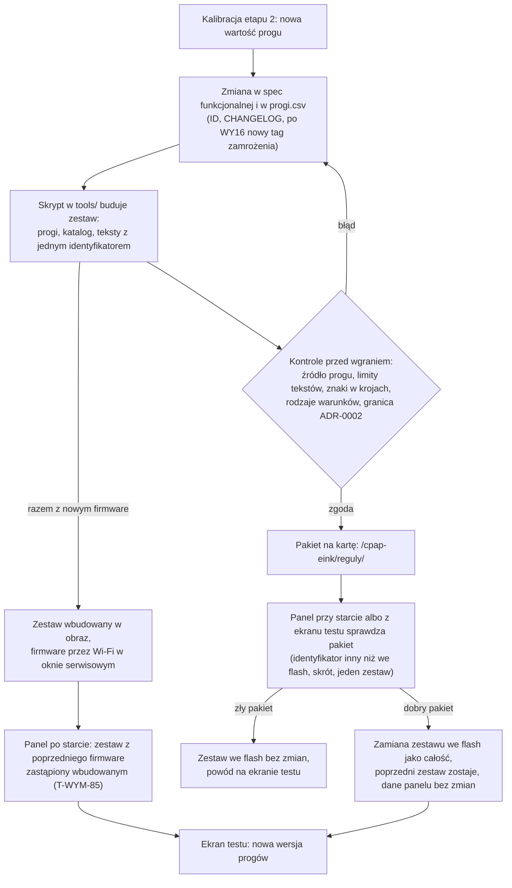

Przy drodze przez kartę kod się nie zmienia. Przy drodze z firmware zmienia się obraz, ale tylko o wygenerowany plik zestawu wbudowanego: kod reguł jest ten sam, więc zasada ADR-0023 „po kalibracji zmienia się plik, nie kod” zostaje, a próg dochodzi na panel przez Wi-Fi jak dziś w prototypie. Dzisiejsze `uploadfs` z prototypu odpada, bo kasuje historię, czynniki i dziennik ekranów.

**Kontrola granicy ADR-0002 (ADR-0023 pkt 3 z adnotacją 01.11.2026).** Panel nie odróżni pliku zbudowanego skryptem od poprawionego ręcznie; skrót chroni tylko przed uszkodzeniem. Dlatego granica w tekstach trzyma się kontroli przed wgraniem, w skrypcie budującym. Na panelu jest jedna kontrola: lista reguł obowiązkowych (niżej, T-WYM-86), bo nie daje fałszywych odrzutów. Filtr słów zostaje w skrypcie: na panelu odrzucałby też teksty dozwolone, np. `Aparat dobiera EPAP średnio o {x} cmH2O wyżej niż zwykle.` (spec funkcjonalna 4.11).

| Kontrola | Co sprawdza | Gdy nie przejdzie |
|---|---|---|
| źródło progu | każdy `id_progu` w katalogu istnieje w `progi.csv` i ma źródło w spec | zestaw się nie buduje |
| limity tekstów | długość po wstawieniu najdłuższych wartości według 5.4.4, te same reguły co `tools/spojnosc.py` | zestaw się nie buduje |
| znaki | każdy znak tekstów jest w krojach wgranych w firmware (kroje przycięte, R-NF-14) | zestaw się nie buduje; nowe znaki = nowa wersja firmware |
| rodzaje warunków | katalog wskazuje tylko rodzaj z listy wyżej, znany wersji firmware podanej w pakiecie | zestaw się nie buduje |
| słowa kluczowe granicy | teksty z trafieniem słowa z przeglądu 9.3 (`cmH2O`, `EPR`, `EPAP`, `PS`, `wyższ`, `niższ` i inne) skrypt budowy zestawu zgłasza ostrzeżeniem (`tools/zestaw/buduj_zestaw.py` `SLOWA_GRANICY`), a tekst musi stać dosłownie w spec funkcjonalnej | nowy albo zmieniony tekst z trafieniem przechodzi przegląd ręczny według spec funkcjonalnej 9.3 przed wydaniem |
| reguły bez słowa kluczowego | dwie reguły 9.3 bez słowa kluczowego | czytanie przy każdej zmianie tekstów L, H i raportu (proces, nie skrypt) |
| zmiana katalogu | pilność, okno, wyłączenie wzorca | lista „mechanizmy” z 9.3 (proces) |
| reguły obowiązkowe | każda reguła z listy reguł obowiązkowych ma w katalogu wiersz włączony, ze stanem nie niższym niż stan minimalny z listy („aktywna” albo „tylko raport”, spec funkcjonalna 2.6, ADR-0029) i z poziomem (dla wzorców L: pilnością) nie niższym niż na liście | zestaw się nie buduje; panel sprawdza to samo przy starcie i przy wgraniu pakietu (T-WYM-86) |
| liczba progu w tekście | liczba równa wartości progu tej samej reguły bez `{prog:…}` | ostrzeżenie do poprawy tekstu |

**Lista reguł obowiązkowych** (T-WYM-86; ADR-0023 pkt 3 z adnotacją 01.11.2026). Stan minimalny reguły jest jeden dla wszystkich trybów obsługiwanych (ADR-0030); reguła, która w danym trybie nie działa (spec funkcjonalna 4.11), nie łamie listy. Lista jest wkompilowana w firmware, budowana tym samym skryptem ze spec funkcjonalnej i zmienia się tylko z nową wersją firmware. Kryterium: na listę trafia każda reguła katalogu, która należy do rdzenia (spec mówi, że nie da się go wyłączyć) albo kieruje do lekarza. Ekrany spokoju S2a…S2c i S6 nie są regułami katalogu (wybiera je T-KOMP-08), więc ich nie ma. Według spec funkcjonalnej daje to:

| Grupa | Reguły | Skąd w spec funkcjonalnej |
|---|---|---|
| rdzeń: zdarzenia z progiem stałym | E-01, E-03, E-04, E-05, E-07, E-10, E-11, E-12, E-20, E-22, E-30 | 2.6, tabela „Rdzeń” („Rdzeń … nie da się go wyłączyć”) |
| rdzeń: ekrany kontekstowe i kamienie | S-K-01, S-K-10, S-K-18, S-K-27, S-K-28, S-K-29 | 2.6, tabela „Rdzeń” |
| rdzeń: wzorce do lekarza | L-01, L-03, L-04, L-09; w trybie ASV także L-02(a) (od 04.11.2026); L-06 dopiero po odblokowaniu (R-SKI-42) | 2.6, tabela „Rdzeń”; pilność z 5.12.4; stan minimalny z tabeli „Gotowość funkcji w wydaniu 1.x” |
| rdzeń: ekrany z krokiem do lekarza albo linią wzorca | S7 (linia wzorca z pilnością B po 28 dniach, R-SKI-13), S8 (krok do lekarza przy wysokim AHI w normie, R-EKR-36) | 2.6, tabela „Rdzeń” i akapit pod nią |
| skierowania do lekarza z modułu „Wzorce rozszerzone” | L-02, L-05, L-07, L-08, L-10, L-11, L-12 | 2.6, tabela „Moduły”; 5.12.4; ADR-0004 |

Od 04.11.2026 lista ma przy każdym wzorcu L stan minimalny (ADR-0029 pkt 6; spec funkcjonalna 2.6): w wydaniu 1.0 „aktywna” dla L-03 w gałęzi ≥ 10 / h, L-08, L-09 i L-11, „tylko raport” dla L-01 (do testu na egzemplarzu), L-02, L-03 w gałęziach 5–10 / h, L-04, L-05, L-07, L-10 i L-12; L-06 bez zmian (zablokowane do ustalenia sposobu oznaczania oksymetrii). Zmiana stanu minimalnego wymaga nowej wersji firmware (ADR-0024), a przestawienie reguły z „tylko raport” na „aktywna” tylko nowego zestawu danych (ADR-0023). Lista zabrania wyłączenia i osłabienia reguły w **katalogu**. Wyłączenie modułu przez użytkownika ustawieniem `Moduły` (R-KONF-32) działa dalej według spec: to decyzja osoby, nie pliku. Poziom i pilność porównuje się z wartościami ze spec (6.4, 5.12.4) zapisanymi na liście. Inne reguły, których tekst kieruje do lekarza albo po pomoc (np. linia okresu infekcji R-INF-10, ekrany E-23, E-31, E-33, E-36), nie są na liście, bo nie należą do rdzenia ani nie są wzorcem L; czy je dopisać, oceni przegląd lekarzy PSG w etapie 2. Lista nie obejmuje parametrów reguły: okna, liczonych nocy, trybów, wykluczeń, bramek i progów panel nie porównuje ze spec; pilnuje ich skrypt budowy (źródło progu, 9.3) i przegląd zmian katalogu przed wgraniem (lista „mechanizmy”).

| ID | Wzorzec | Wymaganie | Weryfikacja | Źródło |
|---|---|---|---|---|
| T-WYM-64 | Event | WHEN panel się uruchamia, the Panel shall sprawdzić w zestawie danych reguł we flash (T-DANE-29, T-DANE-30, T-DANE-31) wersję formatu i skrót każdego pliku, ten sam identyfikator zestawu, pochodzenie i zakres firmware w trzech plikach, to, że zakres firmware obejmuje bieżącą wersję, to, że każdy wiersz katalogu wskazuje rodzaj warunku znany firmware i istniejące `id_progu`, to, że każde odwołanie do tekstu ma tekst, oraz to, że plik tekstów ma każdy tekst z wkompilowanej listy tekstów, których potrzebuje sam firmware (ekrany U-01…U-05, ekran testu, linie awarii, S5, S10; teksty U-06 i ekranu testu w trybie awaryjnym są w firmware, T-WYM-68). | Test na PC: zestaw poprawny → przyjęty; zestaw z `firmware=1.0.0..1.99.99` przy firmware 2.0.0 → odrzucony; plik tekstów bez tekstu tytułu U-04 → odrzucony; plik progów z jedną zmienioną cyfrą → skrót niezgodny, zestaw odrzucony; plik tekstów z innego zestawu → zestaw odrzucony; wiersz katalogu z rodzajem `nieznany` → ten wiersz niepoliczalny (T-WYM-66), reszta zestawu przyjęta. | ADR-0023 pkt 4|
| T-WYM-65 | IF/THEN | IF zestaw danych reguł wgrany wcześniej do flash nie przejdzie przy starcie sprawdzenia wersji, skrótu albo identyfikatora zestawu (T-WYM-64) albo brakuje pliku zestawu, który był wgrany (stan „zestaw wgrany” w NVS), THEN the Panel shall używać całego zestawu wbudowanego w firmware, nigdy mieszanki plików z dwóch zestawów, pokazać wersję zestawu wbudowanego i powód na ekranie testu sprzętu, dodać linię uwagi R-AW-30 i oznaczać noce z tego czasu jako poza okresem testowym WY16, gdy identyfikator zestawu wbudowanego różni się od zamrożonego; flash bez zestawu i bez stanu „zestaw wgrany” (pierwszy start) to nie błąd: zestaw wbudowany zapisany jako bieżący, bez linii (R-AW-33); zestaw z pochodzeniem `wbudowany` i innym identyfikatorem obsługuje T-WYM-85, a zestaw z pochodzeniem `karta`, którego zakres firmware nie obejmuje bieżącej wersji albo któremu brakuje tekstu wymaganego przez firmware (T-WYM-64), to błąd według tego wymagania. | Test na PC: plik tekstów usunięty po wgraniu pakietu → progi, katalog i teksty z zestawu wbudowanego jednej wersji, ekran testu `zestaw reguł: wbudowany {wersja}, powód: brak teksty.csv`, linia uwagi grupy „awarie”, rekordy nocy z tego czasu z oznaczeniem „poza WY16” tylko przy identyfikatorze innym niż zamrożony; pierwszy start z pustą flash → zestaw wbudowany w `/reguly/`, bez linii; zestaw z karty z `firmware=1.0.0..1.0.9` po aktualizacji do 1.1.0 → zestaw wbudowany, linia R-AW-30, ekran testu `powód: zestaw dla innej wersji`, linia `Plik reguł nie pasuje do panelu. Używam wbudowanych.` (R-AW-30). | ADR-0023 pkt 5; R-AW-30, R-AW-33 |
| T-WYM-66 | IF/THEN | IF wiersza katalogu nie da się policzyć z powodu błędu zestawu (rodzaj warunku nieznany firmware, brak progu albo parametru), THEN the Panel shall uznać tę regułę za nieaktywną i nieocenioną, tak że warunek uspokojenia (5.4.13) jest niespełniony, dopóki reguła nie daje się policzyć, i wpisać powód do logu; brak danych wejściowych (np. czujnika) obsługują wymagania spec dla tej reguły, nie to wymaganie. | Test na PC: katalog z L-01 bez progu `L-01.srednia_ca` → L-01 nieaktywne, S2a bez `W normie. `, wpis w logu; próg przywrócony → uspokojenie według 5.4.13; S-K-01 bez Qingping → pominięty według R-KON-06, uspokojenie bez zmian. | ADR-0023 pkt 5; R-AW-31, R-EKR-32; `src/stany.cpp` `PUNKTY_USPOKOJENIA` (`PUNKTY_USPOKOJENIA`) |
| T-WYM-67 | Event | WHEN przy starcie albo z ekranu testu sprzętu panel znajdzie na karcie pakiet zestawu reguł (T-DANE-36) z identyfikatorem innym niż zestaw we flash (także starszym) i z pochodzeniem `karta`, który przechodzi sprawdzenie z T-WYM-64 (w tym zakres firmware), the Panel shall skopiować trzy pliki zestawu i katalog `sceny/` pakietu (gdy jest; każda scena zgodna ze skrótem ze spisu) do flash jako całość (katalog tymczasowy, potem zamiana), zachować poprzedni zestaw w `/reguly-poprzednie/` do następnego wgrania, nie zmieniać innych plików, zmienić nazwę pakietu na karcie na `reguly.wgrane` i pokazać wersję progów na ekranie testu sprzętu, a pakiet, który sprawdzenia nie przechodzi, zostawić bez kopiowania żadnego pliku, z powodem na ekranie testu. | Pakiet z nową wartością `E-30.ahi` na karcie, restart → ekran testu z nową wersją progów, poprzedni zestaw w `/reguly-poprzednie/`, rekordy nocy, czynniki i konfiguracja bajt w bajt jak przed; ten sam pakiet wgrany z ekranu testu bez restartu → ten sam wynik; pakiet starszy niż zestaw we flash (cofnięcie kalibracji) → wgrany; pakiet z identyfikatorem jak we flash → bez zmian; pakiet z błędnym skrótem albo jedną sceną zmienioną po zbudowaniu → zestaw i sceny we flash bez zmian, powód na ekranie testu (np. `pakiet odrzucony: skrót teksty`), pakiet na karcie bez zmiany nazwy. | ADR-0023 pkt 6; ADR-0022 (wariant A, przyjęty 01.11.2026); ADR-0024 decyzja 2; R-NF-30 |
| T-WYM-85 | Event | WHEN przy starcie zestaw danych reguł we flash ma w nagłówku `pochodzenie=wbudowany` i identyfikator inny niż zestaw wbudowany w bieżący firmware (po aktualizacji albo po powrocie do starszej wersji), the Panel shall zapisać zestaw wbudowany do flash jako bieżący (katalog tymczasowy, potem zamiana, poprzedni zestaw w `/reguly-poprzednie/`), bez linii uwagi, wpisać zmianę do logu (T-WYM-49) i pokazać nową wersję progów na ekranie testu sprzętu, a zestaw z `pochodzenie=karta`, którego zakres firmware obejmuje bieżącą wersję, zostawić bez zmian. | Test na PC: flash z zestawem wbudowanym firmware 1.0.0, start firmware 1.0.1 z innym zestawem wbudowanym (`E-30.ahi` zmienione) → we flash zestaw 1.0.1, E-30 liczone z nowym progiem, bez linii R-AW-30, w logu `zestaw {stary} → {nowy}`; powrót do 1.0.0 → zestaw 1.0.0 we flash, bez linii; flash z zestawem z karty w zakresie 1.0.0..1.99.99 i start 1.0.1 → zestaw z karty zostaje; ten sam identyfikator → bez zapisu do flash. | ADR-0024 decyzja 2 z adnotacją 01.11.2026; R-AW-33|
| T-WYM-86 | IF/THEN | IF katalog reguł zestawu danych (we flash przy starcie albo w pakiecie na karcie przy wgraniu) nie ma włączonego wiersza dla reguły z wkompilowanej listy reguł obowiązkowych (9.3) albo daje jej stan niższy niż stan minimalny („tylko raport” przy minimum „aktywna”, ADR-0029) albo poziom (dla wzorców L: pilność) niższy niż na tej liście, THEN the Panel shall odrzucić cały zestaw: przy starcie używać zestawu wbudowanego z linią uwagi `Plik reguł nie pasuje do panelu. Używam wbudowanych.` (R-AW-30) i powodem `reguła obowiązkowa {ID}` na ekranie testu sprzętu (T-WYM-65), a przy wgraniu z karty nie kopiować żadnego pliku pakietu (T-WYM-67); teksty sprawdza tylko skrypt budowy (9.3), nie panel. | Test na PC: zestaw z wierszem L-03 wyłączonym → odrzucony, zestaw wbudowany, linia R-AW-30, ekran testu `reguła obowiązkowa L-03`; pakiet z pilnością L-01 obniżoną z B do C → pakiet nie wgrany, zestaw we flash bez zmian; zestaw bez wiersza E-01 → odrzucony; zestaw bez wiersza S8 → odrzucony; L-01 z innym oknem i poprawnym poziomem → przyjęty przez panel (okna pilnuje skrypt budowy, 9.3); zestaw z L-02 włączonym i modułem „Wzorce rozszerzone” wyłączonym w konfiguracji → przyjęty, L-02(b) nieoceniane według R-KONF-32, a L-02(a) w trybie ASV oceniane, bo od 04.11.2026 należy do rdzenia (spec funkcjonalna 2.6); zestaw z L-11 w stanie „tylko raport” → odrzucony, ekran testu `reguła obowiązkowa L-11`; tekst `Obniż EPR o 1` w ręcznie poprawionym pliku tekstów → przyjęty przez panel (kontrola tekstów jest w skrypcie, T-TEST-033). | ADR-0023 pkt 3 z adnotacją 01.11.2026; spec funkcjonalna 2.6, R-AW-30, R-NF-30|
| T-WYM-68 | Ubiquitous | The Panel shall brać progi terapii, katalog reguł i teksty ekranów wyłącznie z zestawu danych reguł (z flash albo wbudowanego), z jednym wyjątkiem: teksty U-06 i wierszy ekranu testu w trybie awaryjnym są stałą w firmware (T-WYM-83), bo tryb awaryjny działa bez plików i bez wczytywania zestawu; zestaw wbudowany powstaje tym samym skryptem z tych samych plików repozytorium co pakiet na kartę, a stałą tekstów trybu awaryjnego generuje ten sam skrypt ze spec funkcjonalnej (5.6.3). | Skrypt w `tools/` szukający w kodzie firmware wartości z `progi.csv` i tekstów z pliku tekstów poza wygenerowanym plikiem zestawu wbudowanego i wygenerowaną stałą tekstów trybu awaryjnego → 0 trafień; teksty U-06 w firmware zgodne 1:1 z 5.6.3 spec funkcjonalnej; zestaw wbudowany i pakiet zbudowane z tego samego commitu → ten sam skrót każdego pliku. | ADR-0023 pkt 1; wyjątek U-06 |
| T-WYM-79 | Ubiquitous | The komponent treści i rysowania (T-KOMP-09) shall rysować kartę z budzikiem i ekran nocny S9 zawsze z budzikiem i jego otoczeniem na białym tle, niezależnie od tonu, sceny i tekstów z zestawu danych reguł i z konfiguracji. | Test symulatora: zestaw danych z tonem ciemnym dla karty i dla wariantów S9 A1–A3 → otoczenie sceny i budzika białe w każdym zrzucie; przegląd kodu → tło karty i S9 nie jest czytane z żadnego pliku danych ani ustawienia. | ADR-0007, ADR-0009, ADR-0018; R-HUM-04, R-KON-36 |

### 9.4 Czas i strefa

| Sprawa | Rozwiązanie | Wymagania i dowód |
|---|---|---|
| reprezentacja czasu | wewnątrz firmware czas to liczba sekund UTC; daty i godziny lokalne liczy jedna funkcja T-KOMP-02 (T-WYM-69) | R-NF-20 |
| strefa | w wydaniu 1.0 stała w firmware: Europe/Warsaw, reguła POSIX `CET-1CEST,M3.5.0,M10.5.0/3` (tak jak prototyp, `src/adaptery_esp32.cpp` `STREFA`); spec 5.6.4 nie ma ustawienia strefy, więc strefa z konfiguracji byłaby zmianą spec, a zostaje punktem rozszerzenia (9.9 (a)); zmiana czasu w marcu i październiku liczona przez bibliotekę C. Prototyp ustawia strefę po każdym wybudzeniu (`src/dyrygent.cpp` `Przebieg::zwykleWybudzenie()`), bo zegar chodzi w uśpieniu, a zmienna strefy nie | R-NF-20 (a) |
| kolejność źródeł | NTP (R-AW-08) → AirBridge, pole `esp_time` w `/api/status` (R-AW-18; od v2.2.1, z dokładnością do minuty; nagłówka `Date` AirBridge nie wysyła) → zegar panelu, gdy chodzi bez przerwy od synchronizacji sprzed najwyżej 72 h (R-AW-19) → stan bez czasu U-04 (R-AW-20); źródło z czasem wcześniejszym niż start ostatniej sesji odrzucone (R-AW-21) | 5.3.3 „Źródła czasu”; T-INT-01, T-INT-04 |
| czas z AirBridge | `esp_time` w `/api/status` (od v2.2.1) to czas lokalny modułu według jego ustawienia `tz` (domyślnie `UTC0`), z dokładnością do minuty, ustawiany z NTP (serwer z ustawienia `ntp_server`, bez niego z DHCP albo `pool.ntp.org`), a bez NTP z zegara aparatu; bez ważnego czasu pole ma wartość `"--"` ([`app_config.cpp`](https://raw.githubusercontent.com/m-kozlowski/airbridge/v2.2.1/src/app_config.cpp) l. 82–84, [`wifi.cpp`](https://raw.githubusercontent.com/m-kozlowski/airbridge/v2.2.1/src/wifi.cpp) l. 93–115, [`web_ui.cpp`](https://raw.githubusercontent.com/m-kozlowski/airbridge/v2.2.1/src/web_ui.cpp) l. 349–359, 390–393). Obok jest `resmed_time`, zegar aparatu w tej samej postaci, albo `"--"`, gdy odczyt jest nieświeży ([`air10_clock.cpp`](https://raw.githubusercontent.com/m-kozlowski/airbridge/v2.2.1/src/air10_clock.cpp) l. 70–78). Panel nie wymaga ustawienia strefy w AirBridge: gdy ma czas z NTP, zapisuje przesunięcie `esp_time` względem swojego czasu lokalnego, zaokrąglone do 15 min, a przesunięcie `resmed_time` tylko jako diagnostykę (ekran testu, log), bez korekty danych (T-WYM-80, T-DANE-18). Przy awarii NTP czas z AirBridge (R-AW-18, treść bez zmian) to `esp_time` minus zapisane przesunięcie, z dokładnością do 1 min (pole nie ma sekund); bez zapisanego przesunięcia (NTP nigdy nie działał) przesunięcie = 0 z wpisem w logu; `esp_time` = `"--"` albo w innej postaci → AirBridge nie jest źródłem czasu w tym wybudzeniu. Strony WWW AirBridge instrukcja instalacji nie dotyka: zmiana `tz` przy włączonym `resmed_time` przestawia zegar aparatu ([`air10_clock.cpp`](https://raw.githubusercontent.com/m-kozlowski/airbridge/v2.2.1/src/air10_clock.cpp) l. 395–420, 504) | R-AW-18, R-NF-20, T-WYM-80 |
| ciągłość zegara | zegar „chodzi bez przerwy” tylko po wybudzeniu z głębokiego uśpienia; każdy inny start (zasilanie, reset, spadek napięcia, nowe oprogramowanie) kasuje ciągłość do następnej synchronizacji (T-WYM-70) | R-AW-19 |
| dokładność bez sieci | zegar w uśpieniu chodzi na wewnętrznym generatorze RC (brak kwarcu 32 kHz, 3.1); dryf zmierzone (pomiar 12: zegar panelu bez sieci ok. 587 s na dobę, PCF8563 ok. 0,71 s na dobę (PCF8563 z 49,8 h, zegar panelu z pierwszych 4,9 h; 1 egzemplarz, temperatura pokojowa; błąd po 72 h to ekstrapolacja)); wybór źródła czasu: otwarte (PCF8563 albo krótszy czas z R-AW-19). Gdy dryf jest za duży, zapasem jest zegar PCF8563 z kwarcem: odczyt przy każdym wybudzeniu i korekta zegara systemowego (decyzja po pomiarze 12) | 3.1 (zegar), 2.4 (pomiar 12) |
| data poranka i doba | data poranka (4.1) i dzień tygodnia z czasu lokalnego; godziny sesji z AirBridge (`start_ms`, `end_ms`, `edf_prefix`) to czas cywilny zegara aparatu bez strefy, a doba `day` to 12:00–12:00 tego zegara ([`air10_clock.h`](https://raw.githubusercontent.com/m-kozlowski/airbridge/v2.2.1/src/air10_clock.h) l. 84–92); przy ustawieniu `resmed_time` włączonym domyślnie AirBridge ustawia zegar aparatu ze swojego czasu lokalnego (`tz`), gdy aparat czuwa ([`air10_clock.cpp`](https://raw.githubusercontent.com/m-kozlowski/airbridge/v2.2.1/src/air10_clock.cpp) l. 395–420, 504), więc zegar aparatu może chodzić w innej strefie niż panel; panel czyta godziny sesji jako czas cywilny bez przeliczania z UTC i bez korekty, a datę poranka bierze z `day` + 1 (spec funkcjonalna 4.1 (c)); przesunięcie `resmed_time` zapisuje jako diagnostykę, a różnica od 15 min daje linię R-AW-36 bez korekty danych (T-WYM-80 zamknięte); czas terapii z `used_seconds`, więc noc zmiany czasu nie zmienia M-01 | 4.1, 8.3 (R-NF-20) |
| punkt rozszerzenia | strefa jako ustawienie F i K przed publikacją: tabela nazw IANA → reguła POSIX w firmware, wybór w konfiguracji; kod liczenia bez zmian | 9.9 |

| ID | Wzorzec | Wymaganie | Weryfikacja | Źródło |
|---|---|---|---|---|
| T-WYM-69 | Ubiquitous | The Panel shall trzymać czas jako liczbę sekund UTC, a każdą godzinę i datę ze spec (okna, sloty, data poranka, dzień tygodnia, terminy odpowiedzi) liczyć jedną funkcją przeliczenia na czas lokalny według reguły strefy stałej w firmware (Europe/Warsaw, `CET-1CEST,M3.5.0,M10.5.0/3`). | Test na PC na przypadkach z R-NF-20: 09:30 UTC 15.07.2026 → 11:30, 09:30 UTC 15.01.2026 → 10:30, 22:45 UTC 31.10.2026 → 23:45; doby 29.03.2026 i 25.10.2026 → okno poranne 05:00–11:00 według zegara lokalnego; przegląd kodu → przeliczenie na czas lokalny tylko w T-KOMP-02. | R-NF-20; `src/adaptery_esp32.cpp` `STREFA` |
| T-WYM-70 | IF/THEN | IF start panelu nie jest wybudzeniem z głębokiego uśpienia (włączenie zasilania, reset, spadek napięcia, nowe oprogramowanie), THEN the Panel shall uznać, że zegar panelu nie chodził bez przerwy (R-AW-19), i zapisać to w T-DANE-18 do następnej synchronizacji. | Na panelu: zanik zasilania i powrót bez sieci → U-04 (R-AW-20); wybudzenie z uśpienia 48 h po synchronizacji bez sieci → czas z zegara panelu, w logu „źródło czasu: zegar panelu”. | R-AW-19, R-AW-20 |
| T-WYM-71 | Event | WHEN zegar zostanie ustawiony z NTP albo z AirBridge, the Panel shall zapisać w T-DANE-18 źródło i chwilę synchronizacji (UTC). | Test na PC: synchronizacja z NTP o 06:00 → NVS `czas` z `zrodlo` = NTP i `sync` = 06:00 UTC; restart bez sieci 10 min później → U-04 mimo zapisanej synchronizacji (T-WYM-70). | R-AW-08, R-AW-18, R-AW-19 |
| T-WYM-80 | Event | WHEN panel ma czas ważny z NTP, a odpowiedź `/api/status` ma `esp_time` albo `resmed_time` w postaci `RRRR-MM-DD hh:mm`, the Panel shall zapisać w T-DANE-18 przesunięcie każdego z tych pól względem swojego czasu lokalnego, zaokrąglone do 15 min, i przy braku NTP brać czas z AirBridge jako `esp_time` minus przesunięcie `esp_time`; przesunięcie `resmed_time` służy diagnostyce (ekran testu, log) i linii R-AW-36 (porównanie różnicy bez zaokrąglenia z progiem 15 min, wynik w T-DANE-13) i nie zmienia godzin sesji (`start_ms`, `end_ms`, `edf_prefix`) ani przypisania nocy (data poranka = `day` + 1, spec funkcjonalna 4.1); wartość `"--"` albo innej postaci nie zmienia zapisanego przesunięcia. | Test na PC: czas lokalny z NTP 15.01 10:07, `esp_time` `2027-01-15 09:07` (moduł w `UTC0`) → przesunięcie −60 min; potem brak NTP i `esp_time` `2027-01-15 13:20` → czas panelu 14:20 (±1 min); `resmed_time` `2027-01-15 09:08` → zapisane przesunięcie −60 min, linia R-AW-36 `… o 1 h …`; `resmed_time` o 10 min różny → przesunięcie 0 (wielokrotność 15) i bez linii; `start_ms` 23:10 → 23:10 bez korekty, noc z `day` 20832 (14.01.2027) → data poranka 15.01.2027; `esp_time` = `"--"` → przesunięcie bez zmian i AirBridge nie jest źródłem w tym wybudzeniu; restart z NVS → te same przesunięcia. | R-AW-18, R-AW-36, R-NF-20; Załącznik A pkt 4 i 5 |

### 9.5 Energia

Liczby budżetu i scenariusze pomiaru są w sekcji 2 (T-NF) i w spec 8.1. Tu zasady, które wynikają z budowy panelu:

| Zasada | Dlaczego | Jak w firmware |
|---|---|---|
| Wi-Fi dominuje budżet doby | odbiór ok. 90 mA, nadawanie do 340 mA wobec µA w uśpieniu (3.1) | plan wybudzenia (T-KOMP-24) zbiera w jednym wybudzeniu wszystko, co wymaga sieci (AirBridge, źródło otoczenia, pogoda, czas), a dyrygent (T-KOMP-01) włącza Wi-Fi raz i wyłącza od razu po ostatnim żądaniu, przed zapisem i rysowaniem (R-NF-03, 7.1); wybudzenie tylko na zapis czujników nie włącza Wi-Fi (8.1); czuwanie na przycisk tylko po wybudzeniu przyciskiem, bez Wi-Fi |
| każda próba ma limit czasu | ponawianie przy niedostępnym źródle zjada budżet (8.1, wiersz R-AW-26) | limity z R-AW-01, R-AW-11, R-AW-26 w adapterze sieci (T-KOMP-16), liczone od początku próby |
| karta raz na dobę | karta wymaga zasilania `SD_EN`, montowania i dzielonej magistrali z ekranem; czas i energia [do zmierzenia] (pomiar 13) | kopia po zapisie nocy (T-WYM-60); poza tym karta tylko przy imporcie, wgraniu zestawu i konfiguracji z karty; zasilanie karty wyłączone poza dostępem (T-WYM-63) |
| zapis do flash jest tani | bez radia; według pomiaru 15 dopisanie wiersza trwa dziesiątki milisekund (mediana 54–58 ms, max 126 ms), a przepisanie pliku ok. 13 ms na 1 KB (plik 46 KB ok. 0,63 s, plik 233 KB ok. 3,0 s); zmierzone 02.11.2026, partycja 1,5 MB, 1 egzemplarz | serie dopisywane po każdym odczycie (T-DANE-02) zamiast trzymania całej nocy w RTC; czas zapisu na partycji docelowej i energia zapisu [do zmierzenia] (pomiar 15) |
| odświeżenie e-ink tylko przy zmianie | pełne odświeżenie trwa sekundy (3.1) | T-KOMP-08 porównuje treść ekranu z poprzednią i nie rysuje tego samego drugi raz |
| stan w RTC zamiast odczytu z flash przy każdym wybudzeniu | odczyt i parsowanie historii przy każdym wybudzeniu kosztuje czas aktywny | wyniki oceny nocy (normy, stany) w pamięci podręcznej T-DANE-09, T-DANE-10; historia czytana tylko rano i po zmianie |
| pomiar w każdym wybudzeniu | budżet z 8.1 trzeba wykazać (R-NF-01) | dziennik wybudzeń T-DANE-27: powód, czas Wi-Fi i Bluetooth, odświeżenia, napięcie |

### 9.6 Obsługa błędów

Zasada spec 5.3.1: błąd nigdy nie udaje sukcesu ani braku danych, a brak danych nigdy nie udaje zera. W firmware każdy adapter i komponent źródła zwraca wynik z jednym z rodzajów z kolumn 5.3.3: dane, brak, przekroczony czas, niezrozumiałe, powtórzone; „brak” i „niezrozumiałe” nigdy nie zamieniają się w zero ani w pustą listę. Reakcję widoczną dla użytkownika wybiera zawsze T-KOMP-08 (ekran) przez katalog reguł (rodzaj `sygnal_komponentu`), a wpis do logu robi T-KOMP-14.

| Źródło (5.3.3) | Fail-path w spec | Wykrywa | Reaguje |
|---|---|---|---|
| AirBridge: lista nocy i raport | R-AW-01, R-AW-11, R-AW-12, R-AW-38, R-AW-15, R-AW-02, R-AW-22, R-AW-03, R-DANE-19…R-DANE-22, R-DANE-24 | T-KOMP-03 (rdzeń: kody HTTP, klucze krytyczne, stany nocy), przez T-KOMP-16 | T-KOMP-05 (rekordy bez zmian przy błędzie, R-AW-14), T-KOMP-08 (E-01, E-03, E-10) |
| AirBridge: raport częściowy | R-DANE-03, R-DANE-15, R-DANE-18, R-DANE-25 | T-KOMP-03 | T-KOMP-05 (rekord „częściowa”), T-KOMP-08 (E-04) |
| AirBridge: ustawienia | R-AW-09, R-NOR-14, R-NOR-15 | T-KOMP-03 | T-KOMP-06 (zmiana ustawień), T-KOMP-09 („–”) |
| AirBridge: kanały oksymetru i chrapania | R-AW-10 | T-KOMP-03 | T-KOMP-07 (reguły saturacji nie startują), T-KOMP-09 (ukrycie elementów) |
| AirBridge: przebiegi nocy (manifest i artefakty) | R-AW-37 | T-KOMP-03 (503 `report_build_failed` na jobie manifestu, 404 na artefakcie) | T-KOMP-05 (rekord z raportu dnia), T-KOMP-06 (fail-path R-DANE-23, R-DANE-32), log i ekran testu (T-WYM-39) |
| AirBridge: surowy przepływ | R-AW-04 | T-KOMP-21 | T-KOMP-21 (GI „–”, poza normą GI) |
| Karta microSD: kopia, pliki wejściowe | R-AW-28, R-AW-29, R-DANE-37, R-KONF-19, R-NF-30 | T-KOMP-18 | przy ADR-0022 A dotyczy tylko kopii i plików wejściowych: T-KOMP-05 (T-WYM-61; ocena nocy bez zmian, R-AW-28), T-KOMP-08 (linia R-AW-29) |
| Pamięć flash (nowe przy ADR-0022 A) | R-AW-05, R-AW-05b, R-AW-16, R-AW-17, R-AW-23, R-NF-12; T-WYM-51…T-WYM-56 | T-KOMP-18 (montowanie, zapis) | T-KOMP-05 (stara wersja pliku, kopia z karty), T-KOMP-08 (linia R-AW-05, R-AW-23) |
| Czujnik w panelu | R-AW-13 | T-KOMP-19 | T-KOMP-04 (brak pomiaru, nie zero) |
| Qingping | R-AW-06, E-07 | T-KOMP-19 (Bluetooth LE) | T-KOMP-04, T-KOMP-08 |
| Internet: pogoda i powietrze | R-AW-07 | T-KOMP-04 przez T-KOMP-16 | T-KOMP-09 (stopka bez pogody) |
| Lokalne źródło otoczenia | R-AW-25, R-AW-26, R-AW-27, R-NF-27 | T-KOMP-04; sprawdzenie adresu i zakaz przekierowań w T-KOMP-16 | T-KOMP-04 (świeżość ostatniej odpowiedzi, T-DANE-22), T-KOMP-08 (E-08) |
| Zegar | R-AW-08, R-AW-18, R-AW-19, R-AW-20, R-AW-21, R-AW-08b, R-AW-36 | T-KOMP-02 (także różnica `resmed_time`, T-WYM-80) | T-KOMP-24 (bez pobierania nocy w planie), T-KOMP-08 (U-04, bez E-01) |
| Bateria | E-05 | T-KOMP-19 | T-KOMP-08 |
| Przyciski | R-PRZ-07, R-PRZ-09 | T-KOMP-19 | T-KOMP-10 |
| Plik konfiguracji | R-KONF-20, R-KONF-21, R-KONF-22 | T-KOMP-12 | T-KOMP-12 (wartość domyślna), T-KOMP-08 (linia R-KONF-21) |
| Zestaw danych reguł (nowe) | R-AW-30, R-AW-31, R-NF-30; T-WYM-64, T-WYM-65, T-WYM-66 | T-KOMP-15, T-KOMP-07 | T-KOMP-07 (zestaw wbudowany, reguła nieoceniona), T-KOMP-08 (linie R-AW-30, R-AW-31) |
| Pliki w nowszej albo starszej wersji (nowe) | T-WYM-54, T-WYM-55, T-WYM-56 | T-KOMP-05 | T-KOMP-05, ekran testu sprzętu |

### 9.7 Log bez danych wrażliwych i sekretów

| Log | Zawartość | Czego nie ma | Przechowywanie |
|---|---|---|---|
| log zdarzeń T-DANE-26 | zdarzenie techniczne: komponent, poziom, kod, krótki opis (np. `T-KOMP-03;blad;http_500;lista nocy`) | sekretów, tokenów, nagłówka `Authorization`, wartości metryk terapii, czynników, odpowiedzi na pytania, tekstów z ekranów L i H | 30 dni, plik na dobę; najstarsze pliki usuwane (T-WYM-73) |
| dziennik wybudzeń T-DANE-27 | powód wybudzenia, czasy, napięcie, liczba odświeżeń | jak wyżej | 30 dni |
| log trybu próbnego T-DANE-28 | ID ekranu S-K, slot, wartość wyzwalacza (R-KON-05), czyli wartości otoczenia i metryk tej reguły | sekretów | co najmniej 3 miesiące (R-NF-06) |
| port serwisowy i ekran testu sprzętu | to samo co log zdarzeń; nazwa brakującego albo błędnego ustawienia bez jego wartości (prototyp: `złe hasło AB_PASS`, `src/dyrygent.cpp` `Przebieg::rysujTestTeraz()`) | sekretów i tokenów | brak |

Dane zdrowotne leżą w plikach z 9.1 tak samo jak w logu trybu próbnego, więc log nie zwiększa tego, co da się odczytać z panelu albo z karty. Zakaz wartości terapii w logu zdarzeń ma inny powód: log trafia do zgłoszeń błędów i zrzutów przez port serwisowy, a tam danych zdrowotnych być nie powinno.

| ID | Wzorzec | Wymaganie | Weryfikacja | Źródło |
|---|---|---|---|---|
| T-WYM-72 | Ubiquitous | The Panel shall nie zapisywać w logu zdarzeń (T-DANE-26), w dzienniku wybudzeń (T-DANE-27), na porcie serwisowym ani na ekranie testu sprzętu haseł, tokenów (źródła otoczenia, serwera raportu i formularza), klucza sekretów ani treści nagłówka `Authorization`, a w logu zdarzeń także wartości metryk terapii, czynników nocy i odpowiedzi na pytania. | 7 dni pracy z testowymi sekretami o znanych wartościach → 0 trafień sekretów w logach i zapisie portu serwisowego (także w base64 i hex); 0 wartości AHI, czynników i odpowiedzi w T-DANE-26. | R-NF-22; 9.7 |
| T-WYM-73 | IF/THEN | IF log zdarzeń albo dziennik wybudzeń przekroczy 30 dni, THEN the Panel shall usuwać najstarsze pliki albo wiersze logu i nigdy nie usuwać plików danych z 9.1. | Test na PC: 40 dni logu → zostaje 30 ostatnich dni; pliki nocy, czynników i konfiguracji bez zmian. | R-NF-06; `src/bateria.h` `BAT_DNI` |

### 9.8 Bezpieczeństwo

| Sprawa | Rozwiązanie | Wymagania |
|---|---|---|
| sekrety w pliku konfiguracji | hasło Wi-Fi, hasło AirBridge i token źródła otoczenia w pliku T-DANE-23 (i jego kopii T-DANE-35) wyłącznie jako `enc:1:{base64}`: AES-256-GCM z losowym numerem jednorazowym, klucz T-DANE-24 tego egzemplarza (T-WYM-74). Sekret wpisany jawnie w pliku (droga K) panel szyfruje i przepisuje plik (T-WYM-75). Sekret, którego nie da się odszyfrować (karta z innego panelu), to brak wartości (T-WYM-76) | R-NF-22, R-KONF-35 |
| skąd klucz | rekomendacja dla 1.0: losowy klucz 256 bitów z generatora sprzętowego przy włączonym radiu, zapisany w NVS (T-DANE-24), poza kopią na karcie. Wystarcza do R-NF-22: plik na karcie bez tego egzemplarza jest nieczytelny. Nie chroni przed kimś, kto ma panel w ręku i zrzuci jego pamięć flash | R-NF-22 |
| mocniejsza ochrona (opcja) | ESP-IDF daje dwie drogi: szyfrowanie NVS z kluczem wyprowadzanym z klucza HMAC w eFuse (`CONFIG_NVS_ENCRYPTION`, `CONFIG_NVS_SEC_KEY_PROTECT_USING_HMAC`, cel klucza `HMAC_UP`, bez włączania szyfrowania flash) albo własne wyprowadzenie klucza funkcją `esp_hmac_calculate()` z bloku eFuse z celem `HMAC_UP` ([ESP-IDF: NVS encryption](https://docs.espressif.com/projects/esp-idf/en/stable/esp32s3/api-reference/storage/nvs_encryption.html), [ESP-IDF 5.3: HMAC](https://docs.espressif.com/projects/esp-idf/en/v5.3/esp32s3/api-reference/peripherals/hmac.html)). Koszt: zapis eFuse jest nieodwracalny ([ESP-IDF: eFuse](https://docs.espressif.com/projects/esp-idf/en/v5.3/esp32s3/api-reference/system/efuse.html)), zajmuje jeden z 6 bloków kluczy, a bez bezpiecznego rozruchu ktoś z panelem w ręku i tak wgra własny program, który użyje HMAC. Biblioteki przypiętego rdzenia 3.3.12 są zbudowane bez szyfrowania NVS (`# CONFIG_NVS_ENCRYPTION is not set`, `esp32-arduino-libs/esp32s3/sdkconfig`, l. 2982), więc ta droga wymaga własnej konfiguracji ESP-IDF. Do rozstrzygnięcia przed wydaniem publicznym | R-NF-22 |
| login AirBridge | AirBridge domyślnie wymaga logowania Digest (T-INT-01) kontem `admin` i hasłem `airbridge`; puste konto i hasło w AirBridge wyłączają logowanie, lista `auth_whitelist` (od v2.2.0) je pomija, a nazwa konta jest ustawieniem AirBridge (spec Załącznik A pkt 0). W panelu konto i hasło to ustawienia spec 5.6.4 (formularz i plik; hasło opcjonalne, puste: żądania bez logowania, R-KONF-09). Hasło to sekret jak hasło sieci domowej: `enc:1:` (T-WYM-74), nigdy jawnie w logu, na ekranie testu ani w formularzu (R-KONF-38, R-KONF-39). Odrzucone logowanie: R-AW-34, R-AW-35, przy konfiguracji R-KONF-37 | R-NF-22, R-KONF-09, R-KONF-38, R-KONF-39, R-AW-34, Załącznik A |
| adres źródła otoczenia | sprawdzenie adresu przed pierwszym żądaniem i zakaz podążania za przekierowaniem w adapterze sieci (T-KOMP-16), dla każdego żądania do źródła; token tylko w nagłówku `X-Token` żądania do adresu, który przeszedł sprawdzenie | R-NF-27, R-KONF-35 |
| serwery raportu i formularza | token 128 bitów z generatora sprzętowego przy włączonym Wi-Fi (T-WYM-35; generator daje liczby prawdziwie losowe tylko przy włączonym radiu albo źródle entropii, [ESP-IDF: Random Number Generation](https://docs.espressif.com/projects/esp-idf/en/v5.3/esp32s3/api-reference/system/random.html)); serwer zna tylko listę ścieżek z R-NF-10 (odczyt `/raporty/` i EDF, zapis kluczy z 5.6.4), każda inna ścieżka 404; wyłączenie po 5 żądaniach bez ważnego tokenu i po 15 min | R-NF-09, R-NF-10, R-LEK-03b, R-KONF-14, R-KONF-18 |
| wgrywanie przez Wi-Fi | strategia w sekcji 8. Od strony sekretów: hasło wgrywania nie jest w repozytorium ani w publicznym obrazie firmware; w prototypie pochodzi z `include/secrets.h` przy kompilacji (`include/secrets.example.h`); docelowo według ADR-0024 hasło okna serwisowego jest generowane przy pierwszym wgraniu kablem, trzymane w Pęku kluczy komputera i wkompilowane w obraz (8.7), a na panelu nie leży w pliku wczytywanym z karty (T-DANE-23, T-DANE-35) ani w formularzu; okno wgrywania otwiera tylko działanie użytkownika na ekranie testu (prototyp: 10 min, `src/wybudzenie.h` `OKNO_SERWISOWE_MS`) | R-NF-19 |
| karta bez szyfrowania | rekomendacja dla 1.0: kopia na karcie bez szyfrowania, jak mówi spec 8.1 (kartę traktuje się jak wydruk z gabinetu), poza sekretami (`enc:1:`). Szyfrowanie kluczem panelu zrobiłoby kopię bezużyteczną właśnie wtedy, gdy jest potrzebna: po awarii panelu klucz ginie razem z nim, a kopii nie da się też przeczytać narzędziami na komputerze | spec 8.1, R-NF-08 |
| dane poza dom | żaden komponent poza T-KOMP-11 nie udostępnia plików z 9.1 w sieci; poza dom wychodzą tylko T-INT-03 i T-INT-04 (sekcja 4) | R-NF-07, ADR-0001 |

| ID | Wzorzec | Wymaganie | Weryfikacja | Źródło |
|---|---|---|---|---|
| T-WYM-74 | Ubiquitous | The Panel shall zapisywać hasło Wi-Fi, hasło AirBridge i token źródła otoczenia w pliku konfiguracji (T-DANE-23, T-DANE-35) wyłącznie jako `enc:1:{base64}`, gdzie treść to szyfrogram AES-256-GCM z losowym numerem jednorazowym, a klucz to klucz sekretów tego egzemplarza (T-DANE-24). | Plik konfiguracji po pierwszej konfiguracji z hasłem `Test-123-hasło` → w pliku brak hasła jawnie, w base64 i w hex; odszyfrowanie narzędziem na komputerze z błędnym kluczem → błąd uwierzytelnienia GCM. | R-NF-22 |
| T-WYM-75 | IF/THEN | IF w pliku konfiguracji sekret stoi jawnym tekstem (droga K), THEN the Panel shall zaszyfrować go według T-WYM-74, przepisać plik we flash i na karcie bez postaci jawnej i dopiero potem użyć go do połączenia. | Plik K z jawnym hasłem Wi-Fi i tokenem → po starcie połączenie z siecią i `GET` z `X-Token`, w obu plikach konfiguracji tylko `enc:1:`. | R-NF-22 |
| T-WYM-76 | IF/THEN | IF sekretu `enc:1:` nie da się odszyfrować kluczem tego egzemplarza (inny panel, uszkodzony plik), THEN the Panel shall traktować ten sekret jak brak wartości (przy haśle Wi-Fi pierwsze uruchomienie z U-02, przy tokenie żądanie bez `X-Token`) i wpisać nazwę ustawienia, bez wartości, do logu. | Karta z konfiguracją z egzemplarza A w egzemplarzu B → U-02, w logu `sekret nieczytelny: wifi`; token nieczytelny → `GET` bez nagłówka, przy odpowiedzi 401 dane według R-AW-25. | R-NF-22 |

**Model zagrożeń.** Przed kim i czym chronimy dane panelu w wydaniu 1.0. Kolumna „Kryterium sprawdzenia” mówi, który test pokazuje, że ochrona działa.

| Kto | Co mógłby zrobić | Ochrona w 1.0 | Kryterium sprawdzenia |
|---|---|---|---|
| osoba z kartą microSD w ręku (zgubiona, pożyczona, wyjęta) | przeczytać kopię: noce, czynniki, odpowiedzi, raporty | sekrety tylko jako `enc:1:` (T-WYM-74); reszta kopii jawnie, jak wydruk z gabinetu (spec 8.1, wiersz „karta bez szyfrowania” wyżej). Ryzyko przyjęte: kopia ma być czytelna na komputerze po awarii panelu | T-TEST-090: w pliku na karcie brak hasła jawnie, w base64 i w hex |
| domownik albo inne urządzenie w domowym Wi-Fi | pobrać raport, zmienić ustawienia, wgrać własny firmware | serwery raportu i formularza tylko po działaniu użytkownika, najwyżej 15 min, token 128 bitów, wyłączenie po 5 żądaniach bez tokenu (T-WYM-35, R-NF-09, R-NF-10); poza tymi oknami panel nie nasłuchuje (T-WYM-40); okno wgrywania tylko z ekranu testu, z hasłem (8.8) | T-TEST-088, T-TEST-089, T-TEST-242 (skan portów, zaproszenie spoza sieci, firmware bez hasła) |
| ktoś, kto podsłuchuje domowe Wi-Fi | odczytać ruch panel ↔ AirBridge i stronę raportu w drodze do telefonu | połączenia w sieci lokalnej idą bez TLS (T-INT-01, T-INT-06); ochroną jest szyfrowanie sieci Wi-Fi (WPA2 albo WPA3, T-TEST-247); hasło AirBridge nie płynie jawnie (Digest), token serwera raportu płynie w adresie | ryzyko przyjęte dla wydania osobistego; ponowna ocena przed publikacją |
| osoba z panelem w ręku | zrzucić pamięć flash (dane, klucz sekretów T-DANE-24), wgrać własny program kablem | brak w 1.0: klucz sekretów w NVS chroni tylko kartę (wiersz „skąd klucz”); eFuse, szyfrowanie NVS i bezpieczny rozruch to decyzja przed publikacją | – |
| internet | wejść do panelu albo dostać dane terapii | panel nie przyjmuje połączeń z internetu; wychodzą tylko NTP i zapytanie o pogodę z samym miastem (T-INT-03, T-INT-04, ADR-0001, ADR-0013) | T-TEST-205 (atrapa sieci), T-TEST-244 (podsłuch 7 dni) |
| AirBridge albo urządzenie pod jego adresem | podsunąć panelowi złe dane | panel tylko czyta (`GET`), parser odporny na nowe i brakujące klucze (T-TEST-019), zły format → E-03 (R-AW-02); granica ADR-0002: żadnego żądania zapisu | T-TEST-019, T-TEST-082 |

**Kopia i usunięcie danych.** Kopia: karta microSD dostaje kopię raz na dobę (T-DANE-34, R-DANE-36), w CSV czytelnym na komputerze. Usunięcie: spec funkcjonalna nie ma funkcji, którą użytkownik usuwa dane bez komputera; w wydaniu 1.0 dane usuwa tylko skasowanie całej pamięci kablem (`pio run -t erase`, 8.8) i sformatowanie karty. Przycisk albo ustawienie „Usuń dane” przed publikacją to zmiana spec funkcjonalnej do decyzji.

### 9.9 Punkty rozszerzenia

Przegląd specyfikacji wskazał trzy miejsca, w których produkt jest zaszyty na jeden kraj i jedną konfigurację. Wydanie 1.0 pozostaje „PL, aparaty ResMed serii 10 w trybach CPAP, AutoSet, ASV i ASVAuto, AirBridge” (ADR-0030); punkty rozszerzenia sprawiają, że następna wersja zmienia dane albo dokłada adapter, a nie przepisuje logiki.

| Punkt | Bez zmiany kodu | Wymaga kodu | Stan w 1.0 |
|---|---|---|---|
| plik tekstów (T-DANE-31) | inny język albo inne brzmienie: nowy plik tekstów w zestawie (kolumna `jezyk` w nagłówku) | nowe znaki spoza krojów (przebudowa krojów, R-NF-14); odmiana liczebników i rodzajów, jeśli język ma inne reguły niż polski | jeden plik, polski (zależy od ADR-0023, przyjęte 01.11.2026) |
| strefa czasu | wybór strefy z tabeli nazw IANA → reguła POSIX w konfiguracji (9.4) | strefa spoza tabeli (dopisanie wiersza tabeli) | stała Europe/Warsaw (5.6.4); ustawienie F i K przed publikacją |
| kalendarz okazji | daty przerywników S2d (5.7.6, np. G01 w niedzielę zmiany czasu) jako wiersze katalogu reguł z rodzajem kalendarzowym i datą; inny kraj = inne wiersze | reguła daty, której nie da się zapisać datą stałą ani regułą „n-ty dzień tygodnia miesiąca” | przerywniki bez przyjętych tekstów; do decyzji |
| warstwa źródła danych | nic: nowe źródło to nowy adapter | adapter nowego urządzenia albo modułu (np. inny aparat), który zamienia jego dane na rekord nocy T-DANE-01 w modelu 4.x; norma, reguły i ekrany bez zmian | dwa adaptery: AirBridge (T-KOMP-03) i plik importu z karty aparatu (T-DANE-33, ADR-0017) |
| tryb terapii | warianty reguł zależne od trybu jako kolumna `tryby` katalogu i pole `tryb` pliku progów (ADR-0016, ADR-0030, 4.11) | nowy tryb z metrykami, których rekord nie ma | cztery tryby: CPAP, AutoSet, ASV, ASVAuto |

### 9.10 Symulator ekranów na komputerze

**Stan w prototypie.**

| Element | Co robi | Ograniczenie |
|---|---|---|
| `firmware/prototyp/test/podglad.cpp` | rysuje ekrany na komputerze tym samym kodem co panel (`src/ekrany.cpp`) na danych syntetycznych (nie prawdziwych nocach, WY12) i zapisuje pliki PBM 800×480; `tools/prototyp/testy.sh` zamienia je na PNG | scenariusze wpisane w kod; brak porównania z obrazem wzorcowym |
| `firmware/prototyp/test/atrapy/` | atrapy nagłówków Arduino, ESP-IDF i bibliotek (`Arduino.h`, `GxEPD2_BW.h`, `LittleFS.h`, `Preferences.h` i inne) do sprawdzenia składni `src/main.cpp` i `src/adaptery_esp32.cpp`; także atrapy wszystkich interfejsów z `src/adaptery.h` z zachowaniem sterowanym z testu (`adaptery_atrapy.h`), na których dyrygent przechodzi całe wybudzenia na komputerze (`test/testy_wybudzenie.cpp`, `test/testy_dyrygenta.cpp`) | porównania obrazu z wzorcem w repo jeszcze nie ma |
| `tools/prototyp/podglad.py` | nie jest symulatorem: odbiera z panelu przez port serwisowy zrzut bufora ekranu (firmware z `ZRZUT_EKRANU=1`, tylko środowisko `e1001_dev`: `pio run -e e1001_dev -t upload`; zwykły obraz `e1001` bez zrzutu) i zapisuje PNG | wymaga panelu i kabla |

**Docelowo.** Symulator to cały rdzeń firmware z 6.4 (wszystkie komponenty warstwy „rdzeń”) razem z dyrygentem, skompilowany na komputerze z atrapami adapterów T-KOMP-16…T-KOMP-19, T-KOMP-22 i T-KOMP-23 (T-WYM-78; budowa rdzenia bez Arduino to T-WYM-01, ten sam bufor co na panelu to T-WYM-09). Wejście scenariusza: zestaw danych reguł (ten sam plik co na panel), syntetyczna historia nocy, zegar, stan z 9.1. Wyjście: PNG każdego ekranu i zrzut stanu. Porównanie pikselowe z obrazami wzorcowymi i scenariusze to sekcja 11; ten sam scenariusz na panelu daje zrzut przez `podglad.py`, więc obraz z symulatora i z panelu da się porównać wprost. Prawdziwe noce nie trafiają do repozytorium (WY12): scenariusze z prawdziwymi nocami uruchamia się lokalnie.

| ID | Wzorzec | Wymaganie | Weryfikacja | Źródło |
|---|---|---|---|---|
| T-WYM-78 | Ubiquitous | The firmware shall mieć symulator: cały rdzeń z 6.4 i dyrygent, uruchamiane na komputerze z atrapami wszystkich adapterów (T-WYM-02), który dla scenariusza (zestaw danych reguł, syntetyczna historia nocy, zegar, stan z 9.1) zapisuje obraz każdego narysowanego ekranu i zrzut stanu. | Scenariusz doby z atrapami w środowisku bez narzędzi ESP32 → obraz każdego ekranu doby i zrzut stanu; ten sam scenariusz drugi raz → te same pliki bajt w bajt; lista komponentów symulatora porównana z warstwą „rdzeń” w 6.4 → wszystkie obecne. | ADR-0021 (wariant A, przyjęty 01.11.2026); `firmware/prototyp/test/` |

## 10. SOUP i licencje

SOUP (ang. *software of unknown provenance*) to każdy kod, którego nie napisał projekt: biblioteki, rdzeń Arduino, system ESP-IDF, kroje pisma, grafiki i narzędzia. Wzorcem jest IEC 62304 (ADR-0020 pkt 7): dla każdego elementu znamy wersję, licencję, rolę i ryzyko. Dokument nie deklaruje zgodności z normą.

Skutek w jednym zdaniu: dopóki panel jest tylko u Ciebie, licencje niczego nie wymagają; przy publikacji firmware najprościej wydać na GPL-3.0 (koszt bliski zera), a druga droga to wymiana sterownika ekranu ((kilka dni pracy i testy na sprzęcie)).

### 10.1 Lista SOUP

Licencje sprawdzone 01.11.2026 w plikach licencji i nagłówkach źródeł (raw.githubusercontent.com). Wersja „w źródle” to najnowsza w repozytorium biblioteki tego dnia; nie musi być tą, którą wkompilował prototyp, bo `lib_deps` nie są przypięte (10.3).

| ID | Składnik | Wersja | Licencja (sprawdzona w źródle) | Do czego | Ryzyko i jak ograniczone | Wkompilowany? |
|---|---|---|---|---|---|---|
| T-SOUP-01 | platforma PlatformIO pioarduino `platform-espressif32` | 55.03.312, przypięta adresem wydania `55.03.312-1` (`firmware/prototyp/platformio.ini:11`) | Apache-2.0 ([LICENSE](https://raw.githubusercontent.com/pioarduino/platform-espressif32/55.03.312-1/LICENSE)) | pobiera rdzeń Arduino, ESP-IDF, kompilator i esptool w wersjach z [platform.json](https://raw.githubusercontent.com/pioarduino/platform-espressif32/55.03.312-1/platform.json) | wydanie z zewnętrznego adresu może zniknąć; przy wydaniu panelu kopia archiwum i jego skrót w notatce wydania (sekcja 12) | nie (narzędzie budowania) |
| T-SOUP-02 | rdzeń Arduino-ESP32 (Serial, GPIO, SPI, Wire, czas, uśpienie przez API Arduino) | 3.3.12 (z `platform.json` platformy) | LGPL-2.1 ([LICENSE.md](https://raw.githubusercontent.com/espressif/arduino-esp32/3.3.12/LICENSE.md)) | warstwa sprzętu pod adapterami T-KOMP-16…T-KOMP-19 | zmiany API między wersjami głównymi (2.x → 3.x już łamała zgodność); tylko adaptery widzą rdzeń (ADR-0021), więc zmiana dotyka jednej warstwy. LGPL przy łączeniu statycznym: przy rozpowszechnianiu binarki trzeba umożliwić ponowne zlinkowanie (przy otwartym kodzie spełnione) | tak |
| T-SOUP-03 | biblioteki rdzenia `WiFi` i `HTTPClient` | 3.3.12 (z rdzeniem) | LGPL-2.1 lub późniejsza (nagłówki [WiFi.h](https://raw.githubusercontent.com/espressif/arduino-esp32/3.3.12/libraries/WiFi/src/WiFi.h), [HTTPClient.h](https://raw.githubusercontent.com/espressif/arduino-esp32/3.3.12/libraries/HTTPClient/src/HTTPClient.h)) | łączenie z siecią, żądania HTTP do AirBridge i źródła otoczenia (T-KOMP-16, T-INT-01, T-INT-02) | przekierowania i limity czasu muszą być ustawione jawnie (R-NF-27, R-AW-01); testy z atrapą AirBridge (sekcja 11) | tak |
| T-SOUP-04 | biblioteka rdzenia `Preferences` (NVS) | 3.3.12 | Apache-2.0 (nagłówek [Preferences.h](https://raw.githubusercontent.com/espressif/arduino-esp32/3.3.12/libraries/Preferences/src/Preferences.h)) | małe ustawienia i liczniki w NVS (T-KOMP-18) | klucz najwyżej 15 znaków (3.1); wersja przestrzeni NVS jawna (ADR-0022 decyzja 3) | tak |
| T-SOUP-05 | biblioteka rdzenia `LittleFS` i komponent `joltwallet/littlefs` | rdzeń 3.3.12; komponent `^1.22.1` ([idf_component.yml](https://raw.githubusercontent.com/espressif/arduino-esp32/3.3.12/idf_component.yml)) | Apache-2.0 (nagłówek [LittleFS.h](https://raw.githubusercontent.com/espressif/arduino-esp32/3.3.12/libraries/LittleFS/src/LittleFS.h)); komponent MIT ([LICENSE](https://raw.githubusercontent.com/joltwallet/esp_littlefs/master/LICENSE)) | pliki w pamięci flash panelu (T-KOMP-18) | odporność na zanik w trakcie zapisu sprawdza T-NF-16, nie zapewnienie biblioteki; montowanie bez formatowania (`src/dyrygent.cpp` `Przebieg::wczytajPliki()`) | tak |
| T-SOUP-06 | system plików littlefs (rdzeń biblioteki) | w komponencie z T-SOUP-05 | BSD-3-Clause ([LICENSE.md](https://raw.githubusercontent.com/littlefs-project/littlefs/master/LICENSE.md)) | jw. | jw. | tak |
| T-SOUP-07 | `ESPmDNS` (rdzeń) i komponent `espressif/mdns` | rdzeń 3.3.12; komponent `^1.11.2` ([idf_component.yml](https://raw.githubusercontent.com/espressif/arduino-esp32/3.3.12/idf_component.yml)) | MIT (nagłówek [ESPmDNS.h](https://raw.githubusercontent.com/espressif/arduino-esp32/3.3.12/libraries/ESPmDNS/src/ESPmDNS.h)); komponent Apache-2.0 ([LICENSE](https://raw.githubusercontent.com/espressif/esp-protocols/master/components/mdns/LICENSE)) | ogłoszenie `cpap-eink.local` przy wgrywaniu przez Wi-Fi (T-INT-08) | ogłaszanie tylko w oknie wgrywania; strategia w ADR-0024 | tak |
| T-SOUP-08 | `ArduinoOTA` i `Update` (rdzeń) | 3.3.12 | Apache-2.0 (nagłówki [ArduinoOTA.h](https://raw.githubusercontent.com/espressif/arduino-esp32/3.3.12/libraries/ArduinoOTA/src/ArduinoOTA.h), [Updater.cpp](https://raw.githubusercontent.com/espressif/arduino-esp32/3.3.12/libraries/Update/src/Updater.cpp)) | wgrywanie przez Wi-Fi (T-KOMP-15, T-INT-08) | dostęp chroniony hasłem (`src/dyrygent.cpp` `Przebieg::startOta()`); siła uwierzytelnienia i podpis obrazu: ADR-0024 | tak |
| T-SOUP-09 | ESP-IDF (uśpienie, generator losowy, NVS, stos Wi-Fi, partycje) | 5.5.x: pakiet `framework-espidf` v5.5.5 w `platform.json`; rdzeń 3.3.12 pozwala na `>=5.3,<6.2` ([idf_component.yml](https://raw.githubusercontent.com/espressif/arduino-esp32/3.3.12/idf_component.yml)); biblioteki rdzenia 3.3.12 zbudowane na ESP-IDF v5.5.5 `b774170ff46` (`esp32-arduino-libs/esp32s3/versions.txt`, l. 2; `CONFIG_IDF_INIT_VERSION="5.5.5"` w `sdkconfig`, l. 394; archiwum `esp32-core-3.3.12-libs.tar.xz`, sprawdzone 01.11.2026) | Apache-2.0 ([LICENSE](https://raw.githubusercontent.com/espressif/esp-idf/v5.5.5/LICENSE)) | wszystko pod rdzeniem Arduino | błędy systemu poza kontrolą projektu; przed wydaniem przegląd znanych błędów (10.4) | tak |
| T-SOUP-10 | mbedTLS (fork Espressif w ESP-IDF) | z ESP-IDF (T-SOUP-09) | Apache-2.0 ([LICENSE](https://raw.githubusercontent.com/espressif/mbedtls/master/LICENSE): pliki na Apache-2.0, o ile plik nie mówi inaczej); projekt główny: Apache-2.0 albo GPL-2.0-or-later ([LICENSE](https://raw.githubusercontent.com/Mbed-TLS/mbedtls/development/LICENSE)) | MD5 do logowania Digest w AirBridge (`src/adaptery_esp32.cpp` `md5Hex()`) | MD5 jest słaby kryptograficznie, ale wymaga go AirBridge (Załącznik A) i działa tylko w sieci lokalnej; MD5 nie służy do niczego innego | tak |
| T-SOUP-11 | FreeRTOS (w ESP-IDF) | z ESP-IDF | MIT ([LICENSE.md](https://raw.githubusercontent.com/espressif/esp-idf/v5.5.1/components/freertos/FreeRTOS-Kernel/LICENSE.md)) | zadania i czas pod rdzeniem | stos zadania w PSRAM nie może zasnąć (3.1) | tak |
| T-SOUP-12 | lwIP (fork Espressif w ESP-IDF) | z ESP-IDF | BSD-3-Clause ([COPYING](https://raw.githubusercontent.com/espressif/esp-lwip/master/COPYING)) | stos TCP/IP | jw. T-SOUP-09 | tak |
| T-SOUP-13 | biblioteki binarne Wi-Fi i warstwy radiowej (`esp32-wifi-lib`, `esp-phy-lib`) | z ESP-IDF | Apache-2.0 ([LICENSE](https://raw.githubusercontent.com/espressif/esp32-wifi-lib/master/LICENSE), [LICENSE](https://raw.githubusercontent.com/espressif/esp-phy-lib/master/LICENSE)), ale bez kodu źródłowego | radio Wi-Fi | kod zamknięty: błędów nie da się poprawić w projekcie; zgodność z GPL-3.0 firmware do oceny (10.2) | tak |
| T-SOUP-14 | biblioteka binarna kontrolera Bluetooth LE (`esp32c3-bt-lib`, rodzina C3 i S3 w ESP-IDF) | z ESP-IDF | Apache-2.0 ([LICENSE](https://raw.githubusercontent.com/espressif/esp32c3-bt-lib/master/LICENSE)), bez kodu źródłowego | odbiór rozgłoszeń Qingping (T-INT-05) | jw. T-SOUP-13; przypisanie biblioteki do ESP32-S3 do potwierdzenia w logu kompilacji | w prototypie nie (bez Bluetooth); docelowo tak |
| T-SOUP-15 | biblioteki uruchomieniowe kompilatora GCC (libgcc, libstdc++) | z kompilatora platformy | GPL-3.0 z wyjątkiem GCC Runtime Library Exception ([COPYING.RUNTIME](https://raw.githubusercontent.com/gcc-mirror/gcc/master/COPYING.RUNTIME)) | kod uruchomieniowy C++ (`std::string`, `std::vector`) | wyjątek pozwala rozpowszechniać program skompilowany zwykłym GCC pod licencją wybraną przez projekt | tak |
| T-SOUP-16 | biblioteka C (newlib Espressif, w ESP-IDF jako `esp_libc`) | z ESP-IDF | zbiór licencji przypisanych do plików ([COPYING.NEWLIB](https://raw.githubusercontent.com/espressif/newlib-esp32/master/COPYING.NEWLIB)); niesprawdzone plik po pliku | funkcje C (`snprintf`, `time`) | do przeglądu przed decyzją o licencji | tak |
| T-SOUP-17 | GxEPD2 (`zinggjm/GxEPD2`) | 1.6.9, przypięta w `lib_deps` (`platformio.ini`; [library.properties](https://raw.githubusercontent.com/ZinggJM/GxEPD2/master/library.properties)) | GPL-3.0 ([LICENSE](https://raw.githubusercontent.com/ZinggJM/GxEPD2/master/LICENSE), jak w 3.3) | sterownik ekranu UC8179: inicjalizacja, przesłanie bufora, odświeżenie pełne i częściowe (T-KOMP-17) | licencja wiąże całe firmware przy publikacji (10.2); nowa wersja może zmienić tablice odświeżania (jakość obrazu, R-NF-25): przypięcie wersji i test na sprzęcie przy każdej zmianie | tak |
| T-SOUP-18 | Adafruit GFX Library | 1.13.0, przypięta w `lib_deps` (`platformio.ini`; [library.properties](https://raw.githubusercontent.com/adafruit/Adafruit-GFX-Library/master/library.properties)) | BSD, 2 warunki ([license.txt](https://raw.githubusercontent.com/adafruit/Adafruit-GFX-Library/master/license.txt)) | bufor 1-bit 800×480 (`GFXcanvas1`, `src/main.cpp` `nvs`) i format krojów `gfxfont.h` | atrapa `firmware/prototyp/test/atrapy/gfxfont.h` powtarza definicje z biblioteki, więc przy publikacji potrzebuje tej samej informacji o licencji | tak |
| T-SOUP-19 | Adafruit BusIO | dociągana jako zależność Adafruit GFX (`depends=` w jej `library.properties`); 1.17.4, przypięta w `lib_deps` (`platformio.ini`; [library.properties](https://raw.githubusercontent.com/adafruit/Adafruit_BusIO/master/library.properties)) | MIT ([LICENSE](https://raw.githubusercontent.com/adafruit/Adafruit_BusIO/master/LICENSE)) | nieużywana bezpośrednio | przypięta w `platformio.ini`; czy linker ją dołącza: do sprawdzenia (`pio pkg list`) | do sprawdzenia |
| T-SOUP-20 | krój Source Serif 4 | plik TTF z `google/fonts`, wersja niezapisana w repo | OFL-1.1 ([OFL.txt](https://raw.githubusercontent.com/google/fonts/main/ofl/sourceserif4/OFL.txt)) | kroje S140, S120, S110, SN96, SN56, SB44, SB24 jako bitmapy 1-bit w `include/fonty.h`, generowane przez `tools/prototyp/generuj.py` | OFL wymaga dołączenia informacji o prawach i tekstu licencji do każdej kopii; bitmapy to wersja zmieniona, więc nie mogą nosić nazwy zastrzeżonej (tu brak nazwy zastrzeżonej) | tak (bitmapy) |
| T-SOUP-21 | krój Public Sans | jw. | OFL-1.1 ([OFL.txt](https://raw.githubusercontent.com/google/fonts/main/ofl/publicsans/OFL.txt)) | kroje P34B, P28B, P24B, P22B w `include/fonty.h` | jw. T-SOUP-20 | tak (bitmapy) |
| T-SOUP-22 | krój IBM Plex Sans Condensed (Medium) | jw. | OFL-1.1 z nazwą zastrzeżoną „Plex” ([OFL.txt](https://raw.githubusercontent.com/google/fonts/main/ofl/ibmplexsanscondensed/OFL.txt)) | zapas dla znaków, których brak w dwóch krojach głównych (`ZAPAS`, `tools/prototyp/generuj.py:61`); generator wymaga go jako argumentu | czy jakikolwiek glif trafił do `fonty.h`: nazwa „Plex” nie może być nazwą krojów pochodnych (dziś nie jest) | do sprawdzenia |
| T-SOUP-23 | sceny budzika (grafiki wygenerowane narzędziem AI, ADR-0008) | 22 sceny kart i 8 scen nocy w `include/obrazy.h` (`SCENY_N`, `SCENY_NOCY_N`) z `assets/budzik/` | niesprawdzone: warunki generatora i status prawnoautorski grafik z AI nieustalone (ADR-0008) | karty i ekran nocny S9 (T-KOMP-09) | przed publikacją decyzja do tego czasu grafiki tylko do użytku osobistego | tak |
| T-SOUP-24 | firmware AirBridge (`m-kozlowski/airbridge`) | na egzemplarzu referencyjnym v2.3.0 (odczyt 01.11.2026; wcześniej v2.2.1), Załącznik A opisuje v2.2.1, zakres od v2.2.0 (README, Załącznik A); v2.3.0 po T-TEST-261 | GPL-3.0 ([LICENSE](https://raw.githubusercontent.com/m-kozlowski/airbridge/master/LICENSE)) | źródło danych terapii przez HTTP (T-INT-01) | zmiana formatu raportu: R-NF-17, WY14; licencja nie przechodzi na panel (3.3) | nie |
| T-SOUP-25 | PlatformIO Core | wersja na komputerze budującym | Apache-2.0 ([LICENSE](https://raw.githubusercontent.com/platformio/platformio-core/develop/LICENSE)) | budowanie i wgrywanie | narzędzie; wersję zapisuje notatka wydania | nie |
| T-SOUP-26 | esptool | v5.4.0 (`tool-esptoolpy` w `platform.json`) | GPL-2.0 ([LICENSE](https://raw.githubusercontent.com/espressif/esptool/master/LICENSE)) | wgrywanie kablem (T-INT-08) | narzędzie; licencja nie przechodzi na wgrywany program | nie |
| T-SOUP-27 | Pillow (Python) | niezapisana | MIT-CMU ([LICENSE](https://raw.githubusercontent.com/python-pillow/Pillow/main/LICENSE)) | `tools/prototyp/generuj.py` (kroje i sceny), `tools/prototyp/podglad.py`, generatory makiet | inna wersja może inaczej rasteryzować glify, więc `fonty.h` po regeneracji może się różnić: wersja zapisana w nagłówku generowanego pliku | nie (narzędzie; wynik jest w `fonty.h` i `obrazy.h`) |
| T-SOUP-28 | pyserial (Python) | niezapisana | BSD-3-Clause ([LICENSE.txt](https://raw.githubusercontent.com/pyserial/pyserial/master/LICENSE.txt)) | `tools/prototyp/zrzut_plikow.py` (zrzut plików przez port serwisowy, T-INT-10) | narzędzie serwisowe | nie |
| T-SOUP-29 | NumPy (Python) | niezapisana | BSD-3-Clause ([LICENSE.txt](https://raw.githubusercontent.com/numpy/numpy/main/LICENSE.txt)) | generator makiet ekranów (nie jest częścią repozytorium) | poza firmware i poza narzędziami spójności (`tools/spojnosc*.py`, `tools/kalibracja/` używają tylko biblioteki standardowej) | nie |
| T-SOUP-30 | generator kodów QR Project Nayuki (QR Code generator library) | `src/qr.cpp` napisany według tej biblioteki (części wyrażeń i tabel odpowiadają jej kodowi) | MIT ([LICENSE](https://www.nayuki.io/page/qr-code-generator-library)); nota w nagłówku `src/qr.cpp`, tekst w `LICENSES/MIT.txt` | kody QR sieci panelu, formularza i raportu | nota licencyjna musi zostać w pliku | tak |
| T-SOUP-31 | `gfxfont.h` w atrapach (`test/atrapy/gfxfont.h`) | powtarza definicje z Adafruit GFX 1.13.0 | BSD-2-Clause (pełny tekst w pliku i w `LICENSES/BSD-2-Clause.txt`) | kompilacja testów na komputerze | tylko testy | nie (nie wchodzi do firmware) |

Poza listą: ArduinoJson. Przekazanie etapu 3 wymienia go wśród bibliotek prototypu, a w katalogu atrap jest `test/atrapy/ArduinoJson.h`, ale `src/` go nie dołącza (parser JSON w `src/airbridge.cpp` jest własny, `src/airbridge.h` `FiltrJson`) i nie ma go w `lib_deps`, więc nie jest SOUP firmware.

### 10.2 Zgodność licencyjna (wejście do decyzji o licencji)

**Co jest pewne.** Licencje mają znaczenie dopiero przy rozpowszechnianiu: panel użyty prywatnie nie wymaga niczego (GPL-3.0 nie nakłada obowiązków na użytek własny). Przy publikacji firmware (kodu albo binarki) wiąże je GxEPD2 (T-SOUP-17, GPL-3.0): biblioteka jest wkompilowana, więc całe firmware musi mieć licencję zgodną z GPL-3.0 albo trzeba wymienić sterownik ekranu. Licencja AirBridge na panel nie przechodzi (3.3).

**Pozostałe licencje wobec GPL-3.0.** Apache-2.0 (ESP-IDF, mbedTLS, `Preferences`, `LittleFS`, `ArduinoOTA`, mDNS), LGPL-2.1 lub późniejsza (rdzeń, `WiFi`, `HTTPClient`), MIT i BSD (Adafruit GFX, BusIO, FreeRTOS, lwIP, littlefs, `ESPmDNS`) są według powszechnej wykładni FSF zgodne z GPL-3.0; wniosek do potwierdzenia w źródle FSF przed publikacją. Trzy miejsca wymagają osobnej oceny: biblioteki binarne Wi-Fi i Bluetooth bez kodu źródłowego (T-SOUP-13, T-SOUP-14), kroje OFL-1.1 wkompilowane jako bitmapy (T-SOUP-20…T-SOUP-22) i biblioteka C ze zbiorem licencji plikowych (T-SOUP-16). Grafiki budzika (T-SOUP-23) są osobną sprawą (decyzja o licencji grafik).

**Dwie drogi.**

| Droga | Na czym polega | Co Cię to kosztuje | Na co się godzisz | Rekomendacja |
|---|---|---|---|---|
| **A. Firmware panelu na GPL-3.0 (lub późniejszej)** | kod panelu publikowany na GPL-3.0; GxEPD2 zostaje | prawie nic w kodzie: plik `LICENSE`, nagłówki plików, plik z listą licencji obcych i informacjami o prawach (Apache-2.0 wymaga przekazania pliku `NOTICE`, jeśli składnik go ma; OFL wymaga tekstu licencji krojów); ocena (biblioteki binarne, kroje) | każdy, kto dostanie firmware, może je zmieniać i rozpowszechniać na tej samej licencji; przy binarce trzeba udostępnić pełny kod źródłowy; nikt nie zamknie kodu w produkcie komercyjnym bez otwarcia swojego. Licencja nie rozstrzyga sprawy MDR: analiza MDR i tak zaleca publikację bez binarek | **rekomendowana**: zgodna z ekosystemem AirBridge (też GPL-3.0), bez kosztu w kodzie, a architektura i tak zostawia drogę B otwartą |
| B. Licencja permisywna (np. MIT albo Apache-2.0) i własny sterownik ekranu | GxEPD2 zastąpiony własnym, cienkim sterownikiem UC8179 w adapterze ekranu (T-KOMP-17) albo inną biblioteką z licencją permisywną (do znalezienia i sprawdzenia) | kilka dni pracy plus testy na egzemplarzu: inicjalizacja, przesłanie bufora, pełne i częściowe odświeżenie, linia BUSY, tablice odświeżania; ryzyko gorszego obrazu (ślady poprzedniego obrazu, R-NF-25), które wychodzi dopiero na sprzęcie. Dzięki podziałowi z ADR-0021 zmiana dotyka jednego adaptera i jego atrapy | inni mogą użyć kodu także w zamkniętym produkcie; własny sterownik trzeba utrzymywać przy zmianach ekranu | tylko jeśli chcesz, żeby kod dało się wziąć do zamkniętego produktu |

**Wybór (06.11.2026): droga A.** Firmware, narzędzia i dokumentacja na GPL-3.0-or-later: pełny tekst w `LICENSE`, nagłówek `SPDX-License-Identifier: GPL-3.0-or-later` w plikach źródłowych (cały `firmware/` i `tools/`; pliki bez nagłówka w `REUSE.toml`, teksty licencji w `LICENSES/`; pliki generowane dostają nagłówek od generatora), składniki obce z wersjami i licencjami w `NOTICE`. Grafiki budzika są wyjątkiem opisanym w `NOTICE`: prawa zastrzeżone autora, użycie tylko w ramach projektu. Wersje bibliotek są przypięte, więc lista licencji odpowiada temu, co jest wkompilowane (10.3).

### 10.3 Przypięcie wersji

Dziś przypięta jest tylko platforma (adres wydania, `platformio.ini:11`), a biblioteki nie (`platformio.ini:31-33`: `zinggjm/GxEPD2` i `adafruit/Adafruit GFX Library` bez wersji). Skutek zwykłymi słowami: ta sama kopia repozytorium skompilowana za miesiąc może dać inny obraz na ekranie albo nie skompilować się wcale, a lista SOUP nie mówi, co naprawdę jest w panelu.

| Co | Dziś | Docelowo (przed pierwszym wydaniem, sekcja 12) |
|---|---|---|
| biblioteki firmware | bez wersji | dokładna wersja przy każdej bibliotece w `lib_deps` (zapis z wersją po `@`), także zależność dociągana (Adafruit BusIO); wersje wzięte na komputerze, na którym prototyp działa, z `pio pkg list -e e1001` i z logu `pio run -v -e e1001`, nie z najnowszych w źródle; wersja ESP-IDF z pliku `esp32s3/versions.txt` pakietu bibliotek rdzenia (dla 3.3.12: `esp-idf: v5.5.5 b774170ff46`) |
| platforma, rdzeń, ESP-IDF, kompilator | platforma przypięta adresem, reszta wynika z platformy | bez zmian; notatka wydania podaje wersje z logu kompilacji i skrót archiwum platformy |
| kroje pisma | pliki TTF podawane ręcznie do generatora, wersja niezapisana | nazwa, wersja i skrót pliku TTF zapisane w nagłówku `fonty.h` przez `generuj.py` (zmiana narzędzia, do zrobienia w sekcji 13) |
| narzędzia Pythona | bez listy wersji | plik z wersjami Pillow i pyserial dla narzędzi, które tworzą zasoby firmware |
| zmiana wersji SOUP | dziś dowolna | tylko jawnie: nowy wiersz w CHANGELOG, przegląd zmian i znanych błędów nowej wersji (10.4), testy na komputerze i test ekranu na egzemplarzu dla T-SOUP-17 i T-SOUP-18 |

### 10.4 Klasa bezpieczeństwa oprogramowania (wzorzec procesu, ADR-0025)

IEC 62304 dzieli oprogramowanie na klasy według najgorszej szkody, do której może doprowadzić jego błąd: A (szkoda niemożliwa), B (możliwa szkoda niepoważna), C (możliwa śmierć albo poważna szkoda). Od klasy zależy, ile pracy wkłada się w projekt i testy. Projekt nie deklaruje zgodności (ADR-0020 pkt 7, status MDR otwarty), ale klasa jako wzorzec mówi, jak starannie robić testy i przeglądy.

Propozycja: **klasa B jako wzorzec dla całego firmware**, bez deklaracji, z ponowną oceną po opinii o statusie MDR. Uzasadnienie, warianty i skutki dla procesu: [ADR-0025](../decisions/0025-klasa-bezpieczenstwa-oprogramowania.md). Przy klasie B lista SOUP z 10.1 ma dodatkowo dwa obowiązki przed każdym wydaniem: zapisane wymagania wobec składników, od których zależy ocena nocy i ekran (T-SOUP-02, T-SOUP-03, T-SOUP-05, T-SOUP-09, T-SOUP-10, T-SOUP-17, T-SOUP-18), i przegląd ich opublikowanych list znanych błędów dla przypiętej wersji.

## 11. Plan testów

Plan opisuje, jak sprawdzić, że firmware robi to, co mówi specyfikacja funkcjonalna. Wzorcem jest ISO/IEC/IEEE 29119-3 w wersji lekkiej (ADR-0020 pkt 7): poziomy, środowiska, kryteria wejścia i wyjścia, przypadki testowe z wymaganiami. Dzienników wykonania i raportów incydentów jako osobnych dokumentów nie ma: wynik testu to wyjście skryptu w opisie zmiany albo w notatce wydania, a błąd znaleziony w działaniu dostaje przypadek T-TEST, który go odtwarza, potem poprawkę i wpis w CHANGELOG (ADR-0020 pkt 7, wzorzec IEC 62304).

**Skutek prostymi słowami.** Prawie wszystko, co panel mówi rano, da się sprawdzić na komputerze, bez panelu i bez prawdziwych nocy: rdzeń firmware (ADR-0021, przyjęty 01.11.2026) liczy na danych syntetycznych, a symulator rysuje te same ekrany co panel. Na panelu zostaje to, czego komputer nie zmierzy: bateria, czasy odświeżania, przyciski, dźwięk, radio i czytelność z łóżka. Ostatni sprawdzian to okres testowy na nocach egzemplarza referencyjnego po zamrożeniu progów (WY16).

### 11.1 Poziomy testów

| Poziom | Co sprawdza | Środowisko | Narzędzie dziś → docelowo | Kto i kiedy uruchamia |
|---|---|---|---|---|
| jednostkowe rdzenia | logika bez sprzętu: noc i norma, stany odchylenia, reguły (L, E, H, S-K, O), wybór ekranu, limity, pytania, konfiguracja, migracje plików; weryfikacje z kolumny „Weryfikacja” spec jako przypadki o znanej odpowiedzi | PC, zwykły kompilator C++ (`g++ -std=c++17 -Wall -Wextra -Werror`), dane syntetyczne | `tools/prototyp/testy.sh` z `firmware/prototyp/test/testy.cpp` → ten sam skrypt na rdzeniu (sekcja 13), jeden plik testów na komponent | autor zmiany przed każdym commitem kodu; przegląd kodu przed scaleniem |
| symulator ekranów | całe doby i ekrany: rdzeń z atrapami adapterów rysuje bufor 800×480 1 bit tym samym kodem co panel; porównanie pikselowe z wzorcami (PNG z `design/png/` i makiety skali B) oraz sprawdzenia bufora (tylko 2 wartości pikseli, szerokość tekstów, budzik na białym tle) | PC; `firmware/prototyp/test/podglad.cpp` | dziś: 35 stanów makiet rysowanych do `mak-*.png`, porównanie z makietami składa skrypt poza repo (README prototypu) → porównanie w repo z progiem [PRÓG] | jak wyżej; pełny przebieg 7.8 przed każdym wydaniem (WY2) |
| integracja z atrapami | rdzeń razem z adapterami za atrapami zewnętrza: atrapa AirBridge (Digest, job, lista nocy, raport, `/api/status`, błędy), atrapa źródła otoczenia (kontrakt wersji 1), atrapa czasu (NTP, `esp_time` AirBridge, brak sieci), atrapa pamięci (zanik zasilania w trakcie zapisu, karta tylko do odczytu), atrapa telefonu (serwer raportu i formularza) | PC; atrapy w `firmware/prototyp/test/atrapy/` (atrapy wszystkich adapterów z zachowaniem w `adaptery_atrapy.h`, obok nagłówki Arduino i krój) | dziś: odpowiedzi AirBridge jako syntetyczne JSON w `test/testy.cpp` oraz kolejki odpowiedzi HTTP atrapy sieci w testach dyrygenta (`test/testy_wybudzenie.cpp`, `test/testy_dyrygenta.cpp`) → osobna atrapa AirBridge z Digest, jobem i błędami Załącznika A na tym samym interfejsie (T-TEST-080; ADR-0021 pkt 3, Konsekwencje) | jak jednostkowe |
| narzędzia i dane | spójność dokumentów i danych, z których powstaje zestaw danych reguł: spec, macierze, `progi.csv`, teksty (limity długości, znaki w krojach, granica ADR-0002) | PC, Python 3 (biblioteka standardowa) | `tools/spojnosc.py`, `tools/spojnosc_tech.py`, `tools/test_*.py`, `tools/kalibracja/test_noce.py` → plus skrypt budowy zestawu danych (ADR-0023 pkt 3, przyjęty 01.11.2026) | przed oddaniem każdej zmiany spec albo danych (reguła projektu) |
| sprzęt | to, czego PC nie zmierzy: energia, czasy odświeżania i reakcji, budzenie przyciskami, buzzer, czujnik, zegar bez sieci, karta i ekran na wspólnej magistrali, radio, ruch wychodzący, zanik zasilania, wgranie nowej wersji z danymi | egzemplarz reTerminal E1001, komputer z PlatformIO, AirBridge v2.2.1 w aparacie | dziś: ekran „Test sprzętu”, `/bateria.csv`, zrzut ekranu `tools/prototyp/podglad.py`, zrzut plików `zrzut_plikow.py` → te same narzędzia plus protokół pomiarów | osoba wydająca panel (z komputerem połączonym z panelem), przed wydaniem i po zmianie adapterów |
| zgodność AirBridge (WY14) | czy dana wersja AirBridge daje raporty, które panel czyta bez E-03 i z tymi samymi metrykami | archiwum co najmniej 14 nocy raportów tej wersji (poza repo, WY12) + atrapa AirBridge odtwarzająca archiwum | brak → skrypt porównania (T-TEST-261) | osoba wydająca, przed dopisaniem wersji AirBridge do zakresu wydania |
| okres testowy (WY16) | zachowanie na prawdziwych nocach po zamrożeniu progów: fałszywe ekrany (WY3), odkrycia (WY4), wykrycia (WY5), budżet alarmów (WY6) | panel w zwykłej pracy, co najmniej 30 nocy po dacie zamrożenia | log panelu + ocena osoby testującej w osobnej kolumnie; w repo tylko wyniki zbiorcze (WY12) | osoba testująca, raz na zamrożenie |
| ludzie | czytelność z 1,5 m i zrozumienie komunikatów | wydruki 1:1 i zdjęcia ekranu, 3 osoby | brak | osoba testująca, przed wydaniem (`[etap 3]` w R-NF-23, R-NF-26) |

Poziomy od góry do dołu są coraz droższe. Zasada: każde wymaganie sprawdza się na najtańszym poziomie, na którym da się to zrobić uczciwie; wyższy poziom powtarza tylko to, czego niższy nie widzi (np. symulator nie zmierzy czasu odświeżenia e-ink).

### 11.2 Środowiska

| Środowisko | Skład | Ograniczenia | Źródło |
|---|---|---|---|
| komputer bez narzędzi ESP32 (np. CI) | Linux, `g++` z obsługą C++17, Python 3 z Pillow (opcjonalnie, tylko do zamiany PBM na PNG), `mmdc` do diagramów | kompilacja na ESP32 nie działa tam, gdzie nie można pobrać narzędzi PlatformIO; bez sprzętu i bez sieci domowej | 3.4 |
| komputer deweloperski (Mac) | PlatformIO z platformą pioarduino przypiętą w `platformio.ini`, port szeregowy panelu (`/dev/cu.usbserial-*`), Pęk kluczy z hasłami (`tools/prototyp/sekrety.sh`) | wgrywanie kablem tylko przy 115 200 b/s; dane prawdziwych nocy tylko w folderze poza repo (WY12) | 3.4; README prototypu |
| egzemplarz | reTerminal E1001 (3.1), AirBridge v2.2.1 w AirCurve 10 CS, sieć domowa 2,4 GHz, opcjonalnie lokalne źródło otoczenia | jeden egzemplarz: test niszczący (np. wiele zaników zasilania) tylko po zrzucie plików | 3.1 |
| dane | archiwa syntetyczne w repo (generator `tools/kalibracja/syntetyczna.py`, wektory w `test/testy.cpp`); prawdziwe noce tylko lokalnie, do repo liczby zbiorcze | archiwum syntetyczne z WY5 (b) ma być stałym zbiorem w repo, nie losowanym przy każdym teście | WY5, WY12 |

### 11.3 Kryteria wejścia, wyjścia i zawieszenia

| Poziom | Wejście (kiedy wolno zacząć) | Wyjście (kiedy zalicza) |
|---|---|---|
| jednostkowe i symulator | kod kompiluje się bez ostrzeżeń (`-Werror`); dane testowe w repo | 0 przypadków źle; każdy nowy albo zmieniony komponent ma przypadki dla wymagań, które realizuje (macierz techniczna, kolumna `testy`); przypadki graniczne dla każdej zmienionej reguły |
| integracja | jednostkowe zaliczone; atrapa ma ten sam interfejs co adapter | 0 źle; atrapa AirBridge odtwarza każdy przypadek fail-path z Załącznika A, którego dotyka zmiana |
| narzędzia i dane | zmiana spec, `progi.csv` albo tekstów zapisana w gałęzi | `tools/spojnosc.py --strict` i `tools/spojnosc_tech.py` z 0 błędów; testy narzędzi zaliczone; skrypt budowy zestawu danych bez blokady (ADR-0023 pkt 3) |
| sprzęt | wszystkie poziomy na PC zaliczone na tym samym commicie; `pio run` bez błędów; zrzut plików panelu zrobiony (`zrzut_plikow.py`) | wynik każdego przypadku sprzętowego zapisany w notatce wydania z datą, commitem i wersją zestawu danych; liczby zmierzone wpisane w sekcję 2 zamiast `[do zmierzenia]` |
| zgodność AirBridge | archiwum ≥ 14 nocy z tej wersji | brak E-03, każde pole Załącznika A obecne, M-01, M-02, M-07 i M-05p zgodne z poprzednią obsługiwaną wersją (WY14) |
| okres testowy | progi zamrożone tagiem `progi-RRRRMMDD`, panel pokazuje na ekranie testu tę samą wersję zestawu danych (12.4), WY1, WY2, WY5 (b), WY7, WY9 zaliczone | WY3, WY4, WY6 spełnione na nocach okresu (WY16 (b)); oceny osoby testującej zapisane osobno (WY16 (e)) |

**Zawieszenie i wznowienie.** Okres testowy przerywa (i zaczyna od nowa z nową datą zamrożenia) każda zmiana z WY16 (d): progu, definicji, skryptu kalibracji, zestawu włączonych ekranów, listy `Metryki niewalidowane`, a także noc, w której panel działał na zestawie wbudowanym zamiast zamrożonego (ADR-0023 pkt 5, przyjęty 01.11.2026). Testy na PC zawiesza tylko błąd środowiska (np. brak kompilatora); przypadek, który pada, nie jest pomijany ani wyłączany bez wpisu w CHANGELOG z powodem.

### 11.4 Stan w wersji beta

Bramki jakości i ich ostatni zmierzony stan (liczby z tabeli poniżej to wartości z pomiaru 02.11.2026, nie bieżące).

| Narzędzie | Co sprawdza | Wynik |
|---|---|---|
| `bash tools/prototyp/testy.sh` | logika prototypu bez Arduino (18 plików `src/*.cpp` z listy `ZRODLA` w `tools/prototyp/zrodla.sh`: 15 plików logiki oraz `src/wybudzenie.cpp`, `src/start.cpp`, `src/dyrygent.cpp`), przypadki o znanej odpowiedzi, symulacja 4 dób co 30 min i 5 nocy S9 minuta po minucie, AirBridge na syntetycznych JSON (Digest z wektorem RFC 2617), teksty ekranów (forma grzecznościowa, brak P95 na ekranach dnia), składnia `src/main.cpp` i `src/adaptery_esp32.cpp` z atrapami nagłówków Arduino i ESP-IDF, podgląd 83 ekranów do PNG (w tym 35 stanów makiet); także testy kroku 1 (`test/testy_wybudzenie.cpp`: decyzje wybudzenia, siatka aktualizacji, dyrygent z atrapami) i scenariusze dyrygenta (`test/testy_dyrygenta.cpp`) | `testy: 2071 dobrze, 0 źle`; teksty ok; składnia ok (nie zastępuje `pio run`); `testy kroku 1: 315 dobrze, 0 źle`; `testy dyrygenta: 124 dobrze, 0 źle`; ok. 29 s |
| `bash tools/jakosc/sprawdz.sh` | wszystkie bramki rdzenia jak w CI, bez ESP32: flagi ostrzeżeń, brak wyjątków i RTTI w `src/`, ASan + UBSan na trzech programach testów, clang-tidy wobec bazy, pokrycie linii wobec bazy, bazy wobec `main`, spójność i testy narzędzi | wszystkie zielone: sanitizery 0 zgłoszeń; clang-tidy 20 ostrzeżeń = baza, 0 nowych; pokrycie 94,00% (4356 z 4634 linii) = baza; bazy wobec `af2bdc2` 0 błędów; ok. 3,5 min |
| kompilacja ESP32 (`pio run -e e1001`, sekrety ze wzoru) | obraz firmware i budżet rozmiaru (Flash ≤ 80% slotu, RAM ≤ 60%) | job `esp32` w CI (tylko PR i `main`) i komputer deweloperski; bez błędów i ostrzeżeń, Flash 1 714 737 B (51,3%), RAM 103 908 B (31,7%) |
| `python3 tools/spojnosc.py --strict` | spójność spec funkcjonalnej i macierzy śledzenia | 0 błędów, 2 ostrzeżenia (kanwa: artboard wycofanego S-K-26, brak artboardu S-K-32) |
| `python3 tools/spojnosc_tech.py` | spójność tego dokumentu, macierz techniczna, odwołania do kodu po nazwie (j) | 0 błędów, 1 ostrzeżenie (tag `spec-v1.2` z nagłówka powstanie przy wydaniu spec); pokrycie 597 z 600, każdy `[do zmierzenia]` z numerem pomiaru 2.4 |
| `python3 -m pytest tools` | testy narzędzi, m.in. `test_spojnosc.py` 85, `test_spojnosc_tech.py` 38, `test_progi.py` 17, `test_wersja_do_czytania.py` 16, `test_jakosc.py` 12, `kalibracja/test_noce.py` 47, `test_licencje.py` 4 | 0 błędów |

**Czego brakuje** (sekcja 13): wyników na panelu dla siatki aktualizacji (T-TEST-275, powrót z T-TEST-242) i doby pracy jak przed zmianą; testów kolejności zapisów do NVS w przebiegu doby z AirBridge i odtworzenia `StanAB` po zaniku zasilania (T-WYM-23); porównania pikselowego w repo z progiem (dziś porównanie bajt w bajt z poprzednią wersją robi autor zmiany); przypadków 7.8 jako testów (prototyp nie ma reguł L, E, H); przypadków granicznych A-35; testów migracji jako osobnych funkcji. Testy decyzji wybudzenia i atrapy adapterów z zachowaniem są w repozytorium. Testy na GitHub (`.github/workflows/testy.yml`, joby `testy`, `jakosc`, `esp32`) uruchamiają się tylko przy pull requeście i pushu na `main`; gałąź robocza bez PR nie ma przebiegu CI.

### 11.5 Zasady przypadków testowych

- **ID stabilne** `T-TEST-nnn` (ADR-0020 pkt 4). Zakresy w tej sekcji: 001–029 jednostkowe zbiorcze, 030–049 narzędzia i dane, 050–069 symulator, 080–099 integracja, 101–153 przypadki 7.8 (numer = 100 + numer przypadku), 161–172 wejście wzorców L-01…L-12 (numer = 160 + numer wzorca), 181–192 wyjście tych wzorców (180 + numer), 201–229 przypadki przekrojowe, 231–259 sprzęt, 261–279 kryteria wydania. Wolne numery zostają na nowe przypadki.
- **Przypadek zbiorczy** obejmuje weryfikacje z kolumny „Weryfikacja” spec dla zakresu wymagań jednego modułu: każda weryfikacja to osobny test o znanej odpowiedzi w pliku testów komponentu, z ID wymagania w nazwie testu, żeby raport testów dał się złożyć z ID wymagań (WY1).
- **Przypadek graniczny**: dla każdego progu reguły test na progu i tuż pod nim (przy warunku „poniżej” albo „mniej niż”: na progu i tuż nad nim). „Tuż” = jeden krok rozdzielczości danych: 0,1 / h (AHI, CA/h), 0,1 / min (M-13), 0,1 cmH2O, 0,1 pkt proc. (CSR%), 1 min (T88, T90, czas z maską), 1 L/min (wyciek P95, jak w R-NOR-12), 1 noc, 1 dzień, 1 tydzień. Wartości progów biorą testy z pliku progów (ADR-0023, przyjęty 01.11.2026), nie z kodu testu, więc zmiana progu po kalibracji przesuwa przypadki graniczne sama; liczby w tabelach 11.8 i 11.9 to stan `progi.csv` z 01.11.2026 dla trybu ASVAuto. Jak liczyć noce na granicy okna (np. „w ciągu 28 nocy”): do ustalenia przy implementacji.
- **Dane**: wyłącznie syntetyczne albo z liczbami zbiorczymi (WY12). Wzorzec nocy syntetycznej: `tools/kalibracja/syntetyczna.py` i wektory w `test/testy.cpp`.
- **Tryb i ustawienia**: przypadki z L-06, T88 albo T90 przy `Saturacja` = `włączona` na danych syntetycznych; przypadek 47 i weryfikacja R-SKI-42 w obu ustawieniach (WY13). Przypadki AutoSet z 7.8 w trybie AutoSet i w odpowiedniku trybu ASVAuto (4.11, WY2); tryby CPAP, AutoSet i ASV tylko na danych syntetycznych (ADR-0030). Moduł GI i przerywniki z datami poza kryteriami 1.x (WY13).
- **Granice ADR**: żaden przypadek nie wymaga od panelu żądania zapisu do AirBridge ani tekstu z wartością albo drogą zmiany ustawień; atrapa AirBridge odrzuca każde żądanie inne niż `GET` i odnotowuje je jako błąd testu (T-TEST-082).

### 11.6 Przypadki zbiorcze: jednostkowe rdzenia

| ID | Poziom | Co sprawdza | Wejście → oczekiwany wynik | Sprawdza |
|---|---|---|---|---|
| T-TEST-001 | jednostkowe | DANE: pobieranie, rekord nocy, noc ważna, stany nocy 5.1.4, import karty | weryfikacje z kolumny „Weryfikacja” spec 5.1.2 dla każdego wymagania → wynik z kolumny; dziś część w `test/testy.cpp` (raport → rekord, `partial`, R-DANE-24, doba tylko z STR) | R-DANE-01…R-DANE-07, R-DANE-09…R-DANE-29, R-DANE-31…R-DANE-37 |
| T-TEST-002 | jednostkowe | NORMA: norma osobista, Δ, stany odchylenia, nowy poziom, zmiana ustawień | weryfikacje 5.2.3 → wynik z kolumny; dziś R-NOR-03…R-NOR-06, R-NOR-22 w `test/testy.cpp` | R-NOR-01…R-NOR-26 |
| T-TEST-003 | jednostkowe | AWARIE: decyzje rdzenia przy braku sieci, AirBridge, karty, czasu, czujników | weryfikacje 5.3.2 → wynik z kolumny; przypadki z dostępem do sprzętu powtarza integracja z atrapami (T-TEST-080, T-TEST-086, T-TEST-087) | R-AW-01…R-AW-33, R-AW-05b, R-AW-08b |
| T-TEST-004 | jednostkowe | PRZYCISKI: mapa 5.6.2, przytrzymanie, powroty po czasie, noc 23:30–05:00 | weryfikacje 5.6.7 → wynik z kolumny; dziś symulacja przycisków w `test/testy.cpp` i `test/testy_nawigacja.cpp` (`src/nawigacja.cpp`; kolejka naciśnięć R-PRZ-20: `testKolejkaNacisniec`; skrót ◀ + ▶ R-PRZ-21: `testSkrotTestu`) | R-PRZ-01…R-PRZ-21 |
| T-TEST-005 | jednostkowe | KONFIGURACJA: U-01, wartości 5.6.4, plik konfiguracji, wybór modułów; formularz U-03: parsowanie i zapis `co2`, `miasto`, `humor`, `buzzer`, `cisza`, `podpowiedz`, `raport.czynniki`, od 06.11.2026 `uwaga_o_masce` (R-KONF-42, T-TEST-361), tabela 18 miast wojewódzkich (wszystkie współrzędne w Polsce), pierwszeństwo współrzędnych przed `secrets.h`, rozmiar strony (test/testy_formularz_u03.cpp) | weryfikacje 5.6.7 → wynik z kolumny; serwery i sieć panelu powtarza integracja (T-TEST-089, T-TEST-090) | R-KONF-01…R-KONF-36, R-KONF-41, R-KONF-42 |
| T-TEST-006 | jednostkowe | KARTA I HUMOR: tryb karty, limity kart, sceny, pule zdań | weryfikacje 5.7.7 → wynik z kolumny; dziś limity i dziennik `/humor.csv` w `test/testy.cpp` | R-HUM-01…R-HUM-27 |
| T-TEST-007 | jednostkowe | KONTEKST: sloty, ekrany S-K, tryb próbny, S9 | weryfikacje 5.8.9 → wynik z kolumny; dziś S9 (R-KON-31…R-KON-40) w symulacji 5 nocy; powrót z K1 albo K2 w nocy → S9 z faktami z pierwszego rysowania, bez zapytania do AirBridge (T-WYM-33) | R-KON-01, R-KON-02, R-KON-04…R-KON-40, T-WYM-33 |
| T-TEST-008 | jednostkowe | SPRZĘT (maska i filtr): okresy wymiany (maska 6 mies., filtr 4 tyg.), migracja dat poduszki do maski, klucze ignorowane (rura, komora, typ poduszki), stary `okres.filtr` ×4, S-K-31, S-K-32, blokada L-09 z jednym licznikiem | weryfikacje 5.9.7 → wynik z kolumny; test/testy_sprzet_maska_filtr.cpp | R-MAS-01…R-MAS-06, R-MAS-08…R-MAS-14 |
| T-TEST-009 | jednostkowe | INFEKCJA: S-K-30, okres infekcji, wstrzymania, pytanie „gorzej” | weryfikacje 5.10.4 → wynik z kolumny | R-INF-01…R-INF-10 |
| T-TEST-010 | jednostkowe | CZYNNIKI: kiedy pyta, zapis, warstwy, grupa kontrolna, prywatność | weryfikacje 5.11.8 → wynik z kolumny; dziś grupa kontrolna (90 z 700 nocy w oczekiwanym 72–128) w `test/testy.cpp` | R-CZY-01…R-CZY-24 |
| T-TEST-011 | jednostkowe | LEKARZ: wzorce L, pilność, stany 5.12.12, łączenie, pytania tak/nie | weryfikacje 5.12.10 → wynik z kolumny; granice każdego wzorca: T-TEST-161…T-TEST-192 | R-SKI-01…R-SKI-44 |
| T-TEST-012 | jednostkowe | LEKARZ: „Omówione z lekarzem”, wyciszenia, powrót o kolejne Δ | weryfikacje 5.12.10 dla R-LEK-09, R-LEK-10, R-LEK-24…R-LEK-27 → wynik z kolumny | R-LEK-09, R-LEK-10, R-LEK-24…R-LEK-27 |
| T-TEST-013 | jednostkowe | HIPOTEZY H: ramka „najpewniej do poprawy”, warianty trybu, wyłączenie podpowiedzi | weryfikacje 5.12.10 dla R-HIP → wynik z kolumny; tekst ramki tylko z katalogu (ADR-0012) | R-HIP-01…R-HIP-10 |
| T-TEST-014 | jednostkowe | BUZZER: wyzwalacze, cisza nocna, odłożony sygnał | weryfikacje 5.14.2 → polecenia dla adaptera dźwięku (rdzeń zwraca „zagraj wzór X o godzinie Y”); dźwięk na sprzęcie: T-TEST-237 | R-BUZ-01…R-BUZ-07, R-BUZ-02b |
| T-TEST-015 | jednostkowe | GI przed pomiarem 21 | brak surowego przepływu → GI „–”, E-37, S-K-19 i L-10 w wariancie GI milczą bez komunikatu (R-GI-06); `GI` = `tymczasowy` → S-K-19 i L-10 na M-10 (R-GI-10, T-TEST-170); pozostałe weryfikacje R-GI zablokowane do pomiaru 21 i poza kryteriami 1.x (WY1, WY13) | R-GI-01…R-GI-10 |
| T-TEST-016 | jednostkowe | PIERWSZEŃSTWO: tabela 7.2, bramki 7.3, limity 7.4, kolejka linii 7.5 | weryfikacje 7.7 → wynik z kolumny; całe przypadki: T-TEST-101…T-TEST-160, T-TEST-254 | R-PIE-01…R-PIE-13 |
| T-TEST-017 | jednostkowe | odkrycia: test permutacyjny z poprawką na liczbę porównań (R-NF-24, `[etap 3]`; parametry testu z 9.3, „Parametry testu permutacyjnego”) | archiwum z czynnikiem przypisanym losowo we wszystkich 7 czynnikach, 200 przebiegów ze stałym ziarnem → odsetek przeglądów z odkryciem O-12 nie większy niż poziom istotności z 9.3; archiwum z wstrzykniętą różnicą po czynniku → O-12 jest (WY5 (b)) | R-NF-24, R-CZY-24, R-EKR-27 |
| T-TEST-018 | jednostkowe | token serwera: generator i długość | 100 kolejnych uruchomień serwera raportu i formularza → 100 różnych tokenów, każdy ≥ 128 bitów z generatora sprzętowego (adapter zwraca bajty, rdzeń buduje token); przegląd kodu generatora; część rdzenia w `test/testy_raport_a4.cpp` `testToken()` (100 zestawów bajtów → 100 różnych tokenów po 26 znaków) | R-NF-09, R-LEK-03, R-KONF-13, T-WYM-35, T-NF-27 |
| T-TEST-019 | jednostkowe | parser raportu AirBridge odporny na nowe klucze | raport z dodatkowym kluczem `foo` i dodatkowym kanałem → metryki policzone, brak E-03; brak klucza krytycznego → E-03 według R-AW-02 | R-NF-17, R-AW-02, T-NF-24 |
| T-TEST-020 | jednostkowe | każde ustawienie 5.6.4 zmienne bez wgrywania | dla każdego wiersza 5.6.4 zmiana wskazaną drogą (przyciski, formularz, plik) → nowa wartość obowiązuje po R-KONF-06 albo po restarcie | R-NF-16, R-KONF-06, R-KONF-22, T-NF-22 |

### 11.7 Przypadki: narzędzia, symulator i integracja

| ID | Poziom | Co sprawdza | Wejście → oczekiwany wynik | Sprawdza |
|---|---|---|---|---|
| T-TEST-030 | narzędzia | spójność spec funkcjonalnej | `python3 tools/spojnosc.py docs/spec/specyfikacja-funkcjonalna.md --kanwa design/kanwa/canvas.json --strict` → 0 błędów | brak (spójność dokumentu, nie zachowanie panelu; kryterium SP2, SP4) |
| T-TEST-031 | narzędzia | spójność tego dokumentu i pokrycie | `python3 tools/spojnosc_tech.py --macierz docs/spec/macierz-techniczna.csv --koniec-etapu` → 0 błędów, każde R-* z komponentem i testem albo z powodem braku | brak (kryterium zakończenia etapu 3) |
| T-TEST-032 | narzędzia | plik progów wobec spec | `tools/test_progi.py` → każdy `[PRÓG]` spec ma wiersz w `progi.csv` albo `progi-poza-zakresem.csv`, wartości zgodne | brak (dane wejściowe silnika reguł, WY16 (a)) |
| T-TEST-033 | narzędzia | budowa zestawu danych reguł (zależy od ADR-0023, przyjęte 01.11.2026) | skrypt budowy na spec i `progi.csv` → plik progów, katalog reguł i plik tekstów z jedną wersją i skrótem; tekst dłuższy niż limit 5.4.4 → blokada; znak spoza krojów panelu → blokada; tekst z trafieniem słowa kluczowego 9.3 spoza listy tekstów przejrzanych → blokada do przeglądu ręcznego | R-EKR-07, R-NF-14, R-NF-15, R-LEK-07, R-SKI-07, T-WYM-68 |
| T-TEST-034 | narzędzia | skrypt kalibracji (etap 2) | `tools/kalibracja/test_noce.py` → metryki z plików EDF według 4.3 i 4.11 na danych syntetycznych | brak (narzędzie kalibracji etapu 2; zgodność z panelem sprawdza przypadek WY9 w 11.12) |
| T-TEST-035 | narzędzia | teksty w kodzie prototypu, do czasu pliku tekstów | `tools/prototyp/testy.sh`, część „teksty ekranów”: forma grzecznościowa wielką literą w środku zdania albo `P95` w tekście ekranu dnia → błąd | R-NF-15, R-EKR-07 |
| T-TEST-050 | symulator | każdy ekran katalogu 6 w 1 bicie, z krojem ≥ 18 px i polskimi znakami | zrzut bufora każdego ekranu z katalogu rozdz. 6 na danych z wartościami z ą, ć, ę, ł, ń, ó, ś, ź, ż i znakami ↔ ↑ ↓ → ◀ ▶ ↻ ◆ → tylko dwie wartości pikseli; najmniejszy tekst ≥ 18 px; brak znaku zastępczego; obrazy z symulatora całego rdzenia z atrapami adapterów (T-WYM-78); `tools/prototyp/testy.sh` w ≤ 2 min (T-NF-23) | R-NF-13, R-NF-14, R-EKR-08, R-EKR-09, T-WYM-78, T-NF-23 |
| T-TEST-051 | symulator | EKRAN DANYCH: stany pola głównego, układ szablonu A, linia uwagi, S6, S7, S8, „Otwarte sprawy” | weryfikacje 5.4.11 → zrzut i tekst ekranu jak w kolumnie; dziś warianty tytułu S2a (R-EKR-41, R-EKR-46; karta K22 po nocy niepewnej z P95 18 L/min z faktem `–` `AHI niepewne`, `test/testy.cpp`), R-EKR-39, słowa porównania, szerokości tekstów | R-EKR-03…R-EKR-43, R-EKR-45…R-EKR-56, R-EKR-59 |
| T-TEST-052 | symulator | KOKPIT K1 i K2 | weryfikacje 5.5.5 → zrzut i treść jak w kolumnie; dziś R-KOK-03, R-KOK-05, R-KOK-06, R-KOK-08, R-KOK-09, a od wersji beta (`test/testy_kokpit_k1_k2.cpp`) R-KOK-15 we wszystkich czterech trybach i R-KOK-16 | R-KOK-01…R-KOK-16 |
| T-TEST-053 | symulator | porównanie pikselowe z eksportami kanwy | ekran z symulatora i PNG z `design/png/` dla tego samego stanu → różnica w każdym obszarze maski poniżej progu [PRÓG]; świadome różnice z README prototypu jako maski, nie jako wyjątki w kodzie testu | R-EKR-09, R-NF-13 |
| T-TEST-054 | symulator | porównanie z makietami skali B | 35 stanów makiet (`mak-*.png`, dziś rysowane przez `test/podglad.cpp`) wobec renderu makiet z `docs/design/czytelnosc-b/` → różnica poniżej progu [PRÓG] | R-EKR-52, R-EKR-53, R-KOK-15 |
| T-TEST-055 | symulator | budzik nigdy na czarnym tle, także na S9 | zrzuty wszystkich kart i wariantów S9 A1–A3 z archiwum testowego → otoczenie sceny białe w każdym zrzucie (ADR-0009, ADR-0018); to samo przy zestawie danych, który podaje ciemny ton karty albo S9 (T-WYM-79) | R-HUM-04, R-KON-36, T-WYM-79 |
| T-TEST-056 | symulator | najdłuższe teksty w limitach | każdy szablon tekstu z największymi wartościami (najdłuższy skrót dnia, liczby z największą liczbą cyfr) → mieści się w polu bez obcięcia; dłuższy → wariant z R-EKR-07 albo ekran danych (R-HUM-05) | R-EKR-07, R-HUM-05 |
| T-TEST-057 | symulator | doba w symulacji: powody wybudzeń i radio | 4 doby co 30 min z naciśnięciami i pytaniami bez odpowiedzi (dziś: symulacja 4 dób w `test/testy.cpp`) → każde wybudzenie z powodem z listy R-NF-02; Wi-Fi tylko przy czynnościach z R-NF-03 (log rdzenia „włącz radio, powód”); rdzeń skompilowany bez nagłówków Arduino (T-WYM-01), dyrygent z atrapami wszystkich adapterów wykonuje tylko polecenia planu (T-WYM-02, T-WYM-03): kolejność kroków z 7.1, Wi-Fi wyłączone przed zapisem i rysowaniem, czuwanie tylko po przycisku (T-WYM-20), wybudzenie przyciskiem bez Wi-Fi (T-WYM-24), terminy snu tylko z R-NF-02, bez zapytań do AirBridge 23:30–05:00 (T-WYM-28), wybudzenia pomiarowe bez Wi-Fi (T-WYM-31) | R-NF-02, R-NF-03, R-PIE-13, T-WYM-01, T-WYM-02, T-WYM-03, T-WYM-20, T-WYM-24, T-WYM-28, T-WYM-31, T-NF-06 |
| T-TEST-058 | symulator | wersje w raporcie i E-03 | raport z atrapy → stopka z wersją firmware i wersją AirBridge; wymuszone E-03 → powód z wersją AirBridge | R-NF-18 |
| T-TEST-080 | integracja | atrapa AirBridge: zwykły przebieg | atrapa z Digest (401, potem 200, licznik `nc`), `/api/status`, job 202 → 200 co 5 s, lista nocy, raport doby → rekord nocy jak w `test/testy.cpp`, jedno wybudzenie w budżecie 120 s; terapia trwa (`rop` = 1) → bez listy i raportów, bez S5 | R-DANE-11, R-AW-11, R-AW-15, R-DANE-35, R-DANE-04, T-WYM-25, T-NF-13 |
| T-TEST-081 | integracja | atrapa AirBridge: błędy | brak odpowiedzi → 3 próby co 10 s (R-AW-01); 401 dwa razy → złe hasło bez ponowień, w logu `logowanie odrzucone` bez hasła, od tej próby (06:00) S5 z tekstem R-AW-35, bez S10 (R-AW-34, R-AW-35, R-EKR-57); puste hasło, atrapa z logowaniem → 1 żądanie, odmowa; puste hasło, atrapa bez logowania → 200 bez nagłówka `Authorization`; ciało urwane, inny `day`, brak klucza krytycznego → ponowienie albo E-03 według R-AW-02; doba `stale` → ponowne pobranie (R-AW-03); wersja poniżej v2.2.0 → E-03; atrapa trzyma połączenie bez końca → sen po ≤ 300 s i wpis w logu (T-WYM-30); raport dnia 200, manifest 503 `{"source":"edf","error":"report_build_failed"}` → rekord nocy, M-28 `–`, bez nieudanej próby, 2 ponowienia w kolejnych wybudzeniach, kod i `error` w logu; artefakt 404 → bez ponowień (R-AW-37); raport dnia 503 → nieudana próba (R-AW-12); `pna` i `srn` z `/api/status` w rekordzie nocy, także nocy pobranej jako luka (R-NOR-25) | R-AW-01, R-AW-02, R-AW-03, R-AW-12, R-AW-37, R-NOR-25, R-AW-24, R-AW-34, R-AW-35, R-EKR-57, T-WYM-25, T-WYM-26, T-WYM-30 |
| T-TEST-082 | integracja | tylko odczyt z AirBridge | atrapa zapisuje metodę i ścieżkę każdego żądania przez 7 symulowanych dób z raportem, konfiguracją i pierwszym pobraniem historii → wyłącznie `GET`, nigdy `/api/settings` ani `DELETE` (ADR-0002) | R-LEK-08, T-WYM-05, T-WYM-27 |
| T-TEST-083 | integracja | pierwsze pobranie historii | atrapa z 181 dobami, część tylko z STR, część z błędem → partie najwyżej 4 raporty i 90 s na wybudzenie, od najnowszej, przycisk przerywa, doby z błędem po 3 próbach co 3 h pominięte, restart niczego nie gubi | R-DANE-06, R-DANE-26, R-DANE-34 |
| T-TEST-084 | integracja | atrapa lokalnego źródła otoczenia | odpowiedź kontraktu wersji 1 → pogoda, PM2.5, CO2 sypialni zapisane; wersja kontraktu inna → jak brak źródła; brak odpowiedzi → 3 próby co 2 s, odpowiedź do 3 s (R-AW-26); `X-Token` wysłany tylko pod adres lokalny (T-TEST-204) | R-DANE-33, R-AW-25, R-AW-26, R-AW-27, R-KONF-35, T-NF-08 |
| T-TEST-085 | integracja | atrapa serwisu pogody (Open-Meteo) | miasto w konfiguracji → zapytanie z samym miastem, bez danych terapii; miasto puste → zero zapytań (R-KONF-24); serwis nie zna miasta → pogoda pominięta bez komunikatu (R-AW-07) | R-DANE-16, R-AW-07, R-KONF-24 |
| T-TEST-086 | integracja | atrapa czasu | NTP działa, `esp_time` o 60 min wcześniej niż czas lokalny → zapisane przesunięcie −60 min; potem brak NTP przy starcie → czas z `esp_time` AirBridge plus 60 min (T-WYM-80, Załącznik A pkt 5); `esp_time` = `"--"` → AirBridge nie jest źródłem w tym wybudzeniu; 72 h bez sieci → zegar z adaptera z dryfem z pomiaru 12; NTP wraca → korekta; zanik zasilania bez sieci → zegar uznany za przerwany, U-04 (T-WYM-70); synchronizacja zapisana ze źródłem i chwilą (T-WYM-71) | R-AW-08, R-AW-08b, R-AW-18, R-AW-19, R-AW-20, R-AW-21, T-WYM-70, T-WYM-71, T-WYM-80 |
| T-TEST-087 | integracja | atrapa pamięci: karta i flash (zależy od ADR-0022, przyjęte 01.11.2026) | karta wyjęta, tylko do odczytu, pełna albo nieczytelna → ocena nocy, norma i nowy poziom bez zmian (R-AW-28), po 7 dniach bez kopii linia R-AW-29; pamięć flash tylko do odczytu albo zajęta w 90% → R-AW-05, R-AW-05b, R-AW-23; partycja plików nie montuje się → bez formatowania, konfiguracja z kopii na karcie, kopia nienadpisana, linia R-AW-05 (R-AW-16, R-AW-17, T-WYM-34); NVS zapisywane tylko przy zmianie (T-WYM-58); kopia raz na dobę i karta wyjęta (T-WYM-60, T-WYM-61); pusta partycja z kopią albo zrzutem prototypu → przywrócenie z kontrolą liczby rekordów (T-WYM-62) | R-AW-05, R-AW-05b, R-AW-16, R-AW-17, R-AW-23, R-AW-28, R-AW-29, R-DANE-36, R-DANE-37, R-KONF-23, R-NF-12, T-WYM-34, T-WYM-58, T-WYM-60, T-WYM-61, T-WYM-62, T-NF-17 |
| T-TEST-088 | integracja | serwer raportu z atrapą telefonu | ▶ na ekranie L → serwer z nowym tokenem, strona z `Pobierz PDF` i `Udostępnij`, PDF ≤ 250 kB z 10 strefami; żądanie bez tokenu → 404, po 5 → serwer wyłączony; po 15 min albo po ◀ → serwer i Wi-Fi wyłączone; odczyt pliku spoza `/raporty/` → 404 | R-LEK-01…R-LEK-08, R-LEK-11…R-LEK-23, R-LEK-28…R-LEK-35, R-LEK-03b, R-NF-10 |
| T-TEST-089 | integracja | sieć panelu i serwer formularza | start bez sieci → sieć panelu z hasłem jednorazowym i U-02; zapis formularza → sieć panelu wyłączona, połączenie z domową, `GET /api/status`; złe hasło → po 60 s sieć panelu znowu; formularz bez hasła AirBridge → zapis, żądania bez logowania; złe konto albo hasło AirBridge (atrapa 401) → U-02 `AirBridge pod {adres} odrzucił logowanie. Sprawdź konto i hasło.`; formularz z U-01 → pola haseł puste z `ustawione`, puste pola przy zapisie → hasła bez zmian, pole `bez hasła` → hasło usunięte; klucz spoza 5.6.4 → odrzucony | R-KONF-07…R-KONF-18, R-KONF-37, R-KONF-38, R-KONF-39, R-KONF-25…R-KONF-29, R-KONF-34, R-NF-09, R-NF-10 |
| T-TEST-090 | integracja | plik konfiguracji i sekrety | plik na karcie z `humor = wyłączony` → wczytany do flash przed pierwszym pobraniem, pozostałe ustawienia bez zmian, plik przemianowany; brak konfiguracji, pliku i kopii → domyślne; wartość zła → wartość dotychczasowa (bez niej domyślna) i linia; hasło sieci domowej, hasło AirBridge i token wpisane jawnie → po starcie zapisane w postaci nieczytelnej (próby base64 i hex → brak hasła), logowanie do atrapy AirBridge udane; log z całego testu → brak sekretów jawnie; kopia z karty w innym egzemplarzu → U-02 | R-KONF-19…R-KONF-24, R-KONF-38, R-NF-22, T-WYM-74, T-WYM-75, T-WYM-76, T-NF-28 |
| T-TEST-091 | integracja | czujnik Qingping przez Bluetooth LE (zablokowane do podłączenia czujnika) | atrapa rozgłoszeń z CO2, PM2.5, PM10, temperaturą i wilgotnością → odczyty sypialni (M-23) w serii nocy T-DANE-02; brak rozgłoszeń → R-AW-06 | R-DANE-10, R-AW-06 |
| T-TEST-092 | integracja | import historii z karty SD aparatu (ADR-0017) | plik importu z 40 nocami, 3 noce z AirBridge (2 pełne, 1 tylko z STR) → 39 nocy wczytanych, PS z pliku dopisane do pełnej nocy, drugi start bez ponownego wczytania; import nie kasuje innych danych panelu (zależy od ADR-0022, przyjęte 01.11.2026) | R-DANE-31, R-DANE-32, R-DANE-34 |

### 11.8 Przypadki ze znaną odpowiedzią (spec 7.8)

Każdy przypadek 7.8 to jeden test symulatora na archiwum syntetycznym: wejście to kolumna „Sytuacja”, oczekiwany wynik to kolumna „Oczekiwany ekran”, dosłownie z tekstami ekranów, liniami, buzzerem i datami (WY2). Tabela niżej podaje skrót; treść wiążąca jest w spec 7.8. Przypadki z L-06 przy `Saturacja` = `włączona`, przypadki ASV w odpowiedniku ASVAuto (WY13).

| ID | Poziom | Co sprawdza | Wejście → oczekiwany wynik | Sprawdza |
|---|---|---|---|---|
| T-TEST-101 | symulator | 7.8 nr 1: S5 przed wzorcem A | E-01 aktywne, w kolejce L-06(b) → S5 (E-01) z linią `Wciąż: Saturacja poniżej 88%.` | R-PIE-01, R-SKI-22 |
| T-TEST-102 | symulator | 7.8 nr 2: wzorzec A blokuje zaproszenie | L-06(b) i odchylenie AHI w jednej nocy → L-06(b), bez linii zaproszenia do pytania | R-PIE-01, R-PIE-06 |
| T-TEST-103 | symulator | 7.8 nr 3: S-K-30 przed S-K-10 | S-K-30 i S-K-10 tej samej nocy → S-K-30; po „tak” S-K-10 wstrzymane do końca okresu infekcji | R-PIE-01, R-INF-02, R-INF-05 |
| T-TEST-104 | symulator | 7.8 nr 4: E-22 przed S-K-10 | E-22 i S-K-10 → E-22 | R-PIE-01, R-PIE-03 |
| T-TEST-105 | symulator | 7.8 nr 5: maska po terminie blokuje L-09 | maska po terminie, warunek L-09 spełniony → S-K-31 | R-PIE-01, R-MAS-03 |
| T-TEST-106 | symulator | 7.8 nr 6: S7 przed kamieniem | 1. dzień miesiąca, S-K-28 → rano S7, S-K-28 następnego ranka | R-PIE-01, R-PIE-04, R-EKR-18 |
| T-TEST-107 | symulator | 7.8 nr 7: konflikt wieczorny | wieczór: upał i CO2 1200 ppm → S-K-05 | R-PIE-01 |
| T-TEST-108 | symulator | 7.8 nr 8: wzorzec trzyma wieczór | rano L-01 (B), wieczorem CO2 1200 ppm → wieczorem nadal L-01 | R-PIE-01, R-PIE-02 |
| T-TEST-109 | symulator | 7.8 nr 9: niedziela i poniedziałek | niedziela: S-K-19 i S-K-18 → niedziela S-K-18, poniedziałek rano S-K-19 | R-PIE-01 |
| T-TEST-110 | symulator | 7.8 nr 10: kamień w rozruchu | rozruch, 7. noc ≥ 4 h → S-K-28, nie S6 | R-PIE-01 |
| T-TEST-111 | symulator | 7.8 nr 11: okres infekcji i L-06 (`Saturacja` = `włączona`) | okres infekcji, noce niepewne, T88 = 45 min w 3 nocach → po 2. nocy L-06(b) (A), buzzer po ciszy nocnej, 2 poranki z linią, trzeci z pełnym ekranem | R-PIE-01, R-SKI-21, R-INF-03, R-SKI-10, R-SKI-22, R-BUZ-01, R-BUZ-02b, R-SKI-42 |
| T-TEST-112 | symulator | 7.8 nr 12: awaria pamięci panelu i wzorzec A (ADR-0022) | atrapa pamięci flash tylko do odczytu od nocy 1, T88 = 45 min → po 2. nocy L-06(b) z pamięci, buzzer, linia `Błąd pamięci panelu. Wyniki mogą być niepełne.` w dni bez pełnego ekranu | R-PIE-01, R-AW-05, R-AW-05b, R-SKI-22 |
| T-TEST-113 | symulator | 7.8 nr 13: bateria krytyczna i wzorzec A | bateria 4%, wejście L-06(b) → L-06(b) z linią `Naładuj ekran: bateria 4%.`; następnego dnia S5 z linią wzorca A | R-PIE-01, R-PIE-07, R-SKI-22 |
| T-TEST-114 | symulator | 7.8 nr 14: niedziela z wzorcem A bez pełnego ekranu | niedziela, L-06(b) aktywne → brak pytania o senność; o 17:00 S-K-18 jako ekran danych z linią wzorca A i krokiem `→ Sprawa z linii wyżej wciąż otwarta.` | R-PIE-01, R-SKI-16, R-PIE-02, R-SKI-22, R-HUM-17, R-KON-23, R-EKR-32 |
| T-TEST-115 | symulator | 7.8 nr 15: hipotezy przy L-01 | L-01 bez zmiany ustawień / 30. noc po zmianie EPR / to samo z L-12 → bez ramki / ramka `Przyczynę oceni lekarz.` (H-08) i zdanie R-HIP-10 w strefie 2 / `Przyczynę oceni lekarz.` (H-05) | R-PIE-01, R-HIP-01, R-HIP-05, R-HIP-08, R-HIP-10 |
| T-TEST-116 | symulator | 7.8 nr 16: „gorzej” podnosi L-02 do A | L-06(b) „Omówione” w dniu 10, od dnia 20 L-02(b), „gorzej” = tak → L-02 (A), buzzer, raport; linia z datą „Omówione” co 3 dni | R-PIE-01, R-PIE-06, R-SKI-18, R-SKI-19, R-SKI-22, R-LEK-24, R-BUZ-01 |
| T-TEST-117 | symulator | 7.8 nr 17: L-05 w okresie infekcji | bez oksymetru, okres infekcji, noce niepewne i krótkie, „gorzej” = tak w 3. nocy → L-05 (A) po 5. nocy, buzzer; przy „nie” linia `Noce mało czytelne: bezdechów nie oceniam.` | R-PIE-01, R-SKI-23, R-SKI-24, R-INF-03, R-INF-07, R-BUZ-01 |
| T-TEST-118 | symulator | 7.8 nr 18: L-09 z nocy niepewnych | maska nosowa, 10 z 14 nocy z warunkiem E-20 → L-09 jako ekran „problem” z krokiem do dostawcy | R-PIE-01, R-SKI-27, R-SKI-15 |
| T-TEST-119 | symulator | 7.8 nr 19: raport w budowie rano | maska do 07:20, `partial` o 06:00, raport kompletny o 07:30 → do 07:30 ekran z `dane z {data}`, potem import i ekran dnia | R-PIE-01, R-DANE-02, R-DANE-03, R-DANE-19, R-DANE-22, R-EKR-39 |
| T-TEST-120 | symulator | 7.8 nr 20: noc pojawia się po 11:00 | dzień na liście dopiero o 12:40 → o 11:00 linia E-10, o 13:00 import, linia znika | R-PIE-01, R-DANE-18, R-DANE-20, R-DANE-21, R-NOR-17 |
| T-TEST-121 | symulator | 7.8 nr 21: nowy poziom metryki zdrowotnej | L-01 (B), M-13 + 3,5 / min przez 28 nocy, L-05 od nocy 3 → bez `Nowy poziom…`, L-05 trwa, linia `Od 3 tyg.: …` najwyżej co 7 dni | R-PIE-01, R-NOR-06, R-NOR-20, R-NOR-21, R-NOR-22 |
| T-TEST-122 | symulator | 7.8 nr 22: „Omówione” drugi raz przy wzorcu A | L-06(b) (A), „Omówione” 10.11 i 6.01 → linie co 3 dni, zdanie Q-omowione, pełny ekran 3.02, bez raportu drugie „Omówione” niedostępne | R-PIE-01, R-LEK-09, R-LEK-24, R-LEK-25, R-LEK-26, R-SKI-10 |
| T-TEST-123 | symulator | 7.8 nr 23: odkrycie przy wzorcu C | poniedziałek, L-07 (C), kandydat O-03 → karta O-03 z krokiem `→ Otwarte sprawy: K1, potem ▶.` | R-PIE-01, R-EKR-32 |
| T-TEST-124 | symulator | 7.8 nr 24: senność w niedzielę | niedziela 17:00, senność „tak” → S-K-18 jako ekran danych z linią senności i krokiem `→ Za kierownicą nie ryzykuj.` | R-PIE-01, R-SKI-28, R-KON-23, R-HUM-17 |
| T-TEST-125 | symulator | 7.8 nr 25: L-11 wariant 2 tygodnie | dwie niedziele z „tak” → L-11 (B) od drugiej niedzieli, w poniedziałek ekran L-11 bez buzzera | R-PIE-01, R-SKI-29 |
| T-TEST-126 | symulator | 7.8 nr 26: typ maski a noc niepewna | `MSK` = `Full Face`, wyciek 25–26 L/min przez 2 h (P95 26) → E-20, E-22, noce niepewne, linia `Noce mało czytelne…`, bez E-23; `Nasal`, `Pillows`, `Pediatric`, bez tagu → to samo | R-PIE-01, R-DANE-23, R-KON-12 |
| T-TEST-127 | symulator | 7.8 nr 27: pytanie „Co było inaczej?” przyciskami | odchylenie AHI w jednej nocy; ↻ 2 s, ↻, ↻ 2 s → zaproszenie, pytanie, zapis „nic szczególnego”; bez naciśnięć o 11:00 „brak odpowiedzi” | R-PIE-01, R-CZY-01, R-CZY-03, R-CZY-17, R-CZY-18 |
| T-TEST-128 | symulator | 7.8 nr 28: cofnięcie odpowiedzi | pytanie „gorzej”, ▶ o 08:10, potem ◀ 2 s → `Zapisano: tak.`, cofnięcie do C, buzzer nie drugi raz | R-PIE-01, R-PRZ-10, R-PRZ-11, R-PRZ-12, R-PRZ-13, R-SKI-19, R-BUZ-01 |
| T-TEST-129 | symulator | 7.8 nr 29: wieczór i S9 | start 23:10, CO2 1200 ppm → S-K-01 o 23:10, o 23:30 S9, potem bez odświeżeń | R-PIE-01, R-KON-01, R-KON-02, R-KON-09, R-KON-31 |
| T-TEST-130 | symulator | 7.8 nr 30: zmiana sieci Wi-Fi | nowe hasło Wi-Fi, 3. noc bez danych → S5 `Brak danych od 3 nocy`, buzzer raz, droga K2 → U-01 → U-02, po zapisie pobranie luk | R-PIE-01, R-KONF-28, R-KONF-26, R-KONF-29, R-KONF-25, R-KONF-27, R-BUZ-07 |
| T-TEST-131 | symulator | 7.8 nr 31: limity próśb wieczornych | 8 wieczorów z CO2 i suchym powietrzem → S-K-01 albo S-K-04 na zmianę, W4 w wieczory 4, 7 i 8 | R-PIE-01, R-PIE-10, R-PIE-11, R-PIE-12, R-CZY-17 |
| T-TEST-132 | symulator | 7.8 nr 32: S8 po 30 nocach | 30. noc ważna, brak kandydatów R1–R6 → S8 `Twoja norma` jako ekran danych | R-PIE-01, R-EKR-33, R-EKR-34, R-EKR-35 |
| T-TEST-133 | symulator | 7.8 nr 33: uspokojenie przy stanie odchylenia AHI | AHI 4,4–4,8, stan odchylenia AHI, E-31 → E-31 w 2 dniach, dowód spokoju bez zdań uspokajających, krok `→ Obserwuj kolejne noce.` po 21 nocach (do 04.11.2026 `→ Pokaż lekarzowi.`) | R-PIE-01, R-EKR-32, R-KON-14, R-KON-23, R-NOR-21, R-NOR-23 |
| T-TEST-134 | symulator | 7.8 nr 34: kolejka linii uwagi dzień po dniu (ADR-0022) | L-06(b) „Omówione”, pamięć flash tylko do odczytu, senność „tak” → linie według dni z 7.8 | R-PIE-01, R-LEK-24, R-PIE-09, R-SKI-28, R-AW-05 |
| T-TEST-135 | symulator | 7.8 nr 35: ton S8 | pasmo AHI 1,2–5,4 → S8 „informacja” z krokiem do lekarza; pasmo 0,8–2,1 z L-09 → `→ Otwarte sprawy…`; bez wzorców → „spokój” | R-PIE-01, R-EKR-33, R-EKR-36 |
| T-TEST-136 | symulator | 7.8 nr 36: trzecie „Omówione” | L-06(b), trzecie „Omówione” bez poprawy → pełny ekran co 2 tygodnie; czwarte z poprawą → 56 nocy, licznik od nowa | R-PIE-01, R-LEK-24, R-LEK-25, R-LEK-26, R-LEK-27, R-SKI-10 |
| T-TEST-137 | symulator | 7.8 nr 37: histereza L-01 | L-01 drogą CA ≥ 50% AHI, „Omówione”, CA/h 1,5 i 2,6 → bez pętli, wyjście po nocy 17, powrót w nocy 28 bez nowego raportu | R-PIE-01, R-SKI-03, R-SKI-31, R-LEK-01 |
| T-TEST-138 | symulator | 7.8 nr 38: termin odpowiedzi po imporcie o 13:00 | raport o 13:00, wyzwalacz S-K-30 → pytanie z terminem 15:00; bez odpowiedzi wybudzenie o 15:00 i „brak odpowiedzi” | R-PIE-01, R-PIE-13, R-DANE-18, R-INF-05, R-INF-08, R-INF-10 |
| T-TEST-139 | symulator | 7.8 nr 39: rotacja dowodu spokoju | sobota S2c, seria 12 nocy → niedziela S2b (K01), o 17:00 S-K-18, poniedziałek S2c; przerywnik bez przesunięcia rotacji | R-PIE-01, R-EKR-15, R-EKR-16 |
| T-TEST-140 | symulator | 7.8 nr 40: pamięć panelu prawie pełna i linia „Omówione” | L-06(b) „Omówione” 31.10, pamięć flash zajęta w 91% → linie R-AW-23 i R-LEK-24 naprzemiennie | R-PIE-01, R-AW-23, R-LEK-24, R-PIE-09 |
| T-TEST-141 | symulator | 7.8 nr 41: L-01 przy skośnym rytmie CA | CA 0 · 0 · 0 · 2,6 · 2,6 · 2,6 · 2,6, potem AHI 12 → L-01 trwa bez pętli, wyjście rano po nocy 39 | R-PIE-01, R-SKI-03, R-SKI-31 |
| T-TEST-142 | symulator | 7.8 nr 42: wyjazd z aparatem | AirBridge niedostępny 21–25.10 → S5 z tekstami kolejnych nocy, buzzer raz, 4 noce „spanie poza domem” | R-PIE-01, R-AW-24, R-CZY-19, R-BUZ-07 |
| T-TEST-143 | symulator | 7.8 nr 43: przerwa planowana | 10 nocy przerwy, ▶ na `Przerwa była planowana?` → S-K-29, bez E-12 i L-08; ◀ → E-12 tego ranka | R-PIE-01, R-SKI-34, R-SKI-35 |
| T-TEST-144 | symulator | 7.8 nr 44: wzorzec B i przerywnik | L-11 (B), przerywnik w poniedziałek → dowód spokoju jako ekran danych, linia `Wciąż: Senność mimo terapii.` co 3 dni | R-PIE-01, R-SKI-37, R-HUM-26, R-SKI-10 |
| T-TEST-145 | symulator | 7.8 nr 45: rotacja linii C | L-08 i L-07 (C), niedziela z S5 → linie C w kolejnych niedzielach według rotacji | R-PIE-01, R-SKI-12, R-SKI-41 |
| T-TEST-146 | symulator | 7.8 nr 46: odwołanie „spanie poza domem” | AirBridge bez sieci, ◀ na `Spanie poza domem od 22.10?` → noce bez czynnika, norma przeliczona, ekran dnia od nowa | R-PIE-01, R-CZY-19, R-CZY-22, R-CZY-23, R-PRZ-10, R-NOR-17 |
| T-TEST-147 | symulator | 7.8 nr 47: saturacja zablokowana i włączona | `Saturacja` = `zablokowana`, T88 = 45 min → brak L-06, linia raz; po `włączona` L-06(b) (A) | R-PIE-01, R-SKI-42, R-SKI-21, R-BUZ-01 |
| T-TEST-148 | symulator | 7.8 nr 48: „Otwarte sprawy” | K1, ▶ przez 5 spraw → teksty `Ty:` i `Dalej:` z 7.8, liczniki i wyciszenia bez zmian | R-PIE-01, R-EKR-47, R-EKR-48, R-EKR-49 |
| T-TEST-149 | symulator | 7.8 nr 49: noc niepewna na ekranie dnia | wyciek 25–26 L/min przez 14% czasu (P95 26), limit S-K-10 → S2a z linią `Wciąż: Maska przeciekała.` i `ocena ograniczona` | R-PIE-01, R-EKR-46, R-EKR-48, R-EKR-49, R-EKR-40 |
| T-TEST-150 | symulator | 7.8 nr 50: noce w trybie spoza wydania i zmiana trybu | 3 noce VAuto między nocami ASV → brak E-30 i zerowania normy, jedna linia trybu; noc bez `settings` nieoceniana; wariant 2: 3 noce AutoSet → zmiana ustawień z linią R-NOR-14, ocena wariantem AutoSet, E-30 | R-PIE-01, R-DANE-29, R-NOR-14 |
| T-TEST-151 | symulator | 7.8 nr 51: L-04 w ASVAuto | P95 EPAP ≥ 9,5 w 6 z 7 nocy, zdarzenia 6 / h → L-04 z ramką i H-02; tylko 4 z 7 → brak | R-PIE-01, R-HIP-01 |
| T-TEST-152 | symulator | 7.8 nr 52: zmiana ustawień w ASV | zmiana MXS albo EEP / z L-12 / tylko RMT, HMS, EPR → linia zmiany i H-08 ze zdaniem R-HIP-10 / H-05 / bez linii i bez zerowania normy | R-PIE-01, R-NOR-14, R-HIP-08 |
| T-TEST-153 | symulator | 7.8 nr 53: import karty a L-04 | import 40 nocy bez rodzaju bezdechu, potem noce z AirBridge → L-04 dopiero po 7. nocy z AirBridge | R-PIE-01, R-DANE-31, R-SKI-02 |
| T-TEST-154 | symulator | 7.8 nr 54: noc z maską do 10:40, AirBridge przetwarza pliki, raport o 12:30 | sekwencja z przypadku 54 spec → od 05:00 do zdjęcia maski ekran z R-EKR-37; potem karta S10; o 11:00 noc w budowie: nadal S10, bez E-01; o 12:30 import i ekran dnia z `dane 12:30` | R-EKR-57, R-DANE-35, R-AW-32, R-EKR-37 |
| T-TEST-155 | symulator | 7.8 nr 55: karta wyjęta, kopia po 7 dniach | karta wyjęta 1.11 po kopii z 31.10, noce spokojne → 1.11–6.11 bez linii, noce w normie; 7.11 i 14.11 linia `Brak kopii na karcie od 31.10. Dane są w panelu.` (grupa „dane”); karta włożona 15.11 → kopia, linia nie wraca | R-PIE-01, R-AW-28, R-AW-29, R-EKR-52 |
| T-TEST-156 | symulator | 7.8 nr 56: zły zestaw reguł i linia „Omówione” | L-06(b) „Omówione” 31.10, plik tekstów wgranego zestawu uszkodzony od 1.11 → linie R-AW-30 i R-LEK-24 naprzemiennie, noce poza WY16; poprawny pakiet 6.11 → bez linii R-AW-30 | R-PIE-01, R-AW-30, R-LEK-24, R-PIE-09, R-NF-30 |
| T-TEST-157 | symulator | 7.8 nr 57: hasło AirBridge zmienione w module | atrapa AirBridge z nowym hasłem od 21.10 22:00 → 22.10 05:00 401 bez ponowień, od razu S5 `AirBridge odrzucił logowanie` jako ekran danych, bez S10 i K16; po 11:00 próby co 30 min; 24.10 buzzer raz; nowe hasło w konfiguracji 24.10 09:00 → trzy noce pobrane | R-PIE-01, R-AW-34, R-AW-35, R-EKR-57, R-BUZ-07 |
| T-TEST-158 | symulator | 7.8 nr 58: zegar aparatu w UTC | atrapa `/api/status` z `resmed_time` o 1 h wcześniej niż czas z NTP od 15.01 → linia `Zegar aparatu różni się o 1 h. Daj znać instalującemu.` 15.01 i 22.01, bez niej 16.01–21.01; M-18 i data poranka bez korekty; różnica 0 od 25.01 → linia nie wraca; różnica 10 min → bez linii | R-AW-36, T-WYM-80 |
| T-TEST-159 | symulator | 7.8 nr 59: odmowa przebiegów nocy | atrapa: raport dnia 200 o 05:30, manifest za każdym razem 503 `{"source":"edf","error":"report_build_failed"}`, tryb ASV, maska twarzowa → rekord nocy, dowód spokoju, bez E-01 o 11:00, M-28 `–`, E-20 i noc niepewna z `leak_high_seconds`, zapytania o manifest o 05:30, 06:00 i 06:30, potem żadnego; następnej nocy znowu | R-AW-37, R-AW-12 |
| T-TEST-160 | symulator | 7.8 nr 60: wyciek od 27 L/min | wyciek 30 L/min przez 1 h z 7 h, reszta 8 L/min (P95 30 L/min), maska nosowa → E-23 `Wyciek od 27 l/min w nocy` z tekstami 6.4, bez S-K-10 (wariant jednonocny) i bez linii E-20, E-20 liczy się do E-22; ta sama noc jako 3. z 7 z P95 > 24 → S-K-10 `Maska przecieka od 3 nocy` (wariant „problem”; wariant opisowy od ustawienia R-KONF-42 E-23 nie wyklucza), bez E-23 (R-KON-13); S-K-11 nie wykluczone; `Full Face` → to samo; P95 26 → bez E-23; następna noc szczelna → E-23 wygasa | E-23, R-DANE-23, R-EKR-32, R-KON-13, R-PIE-01 |
| T-TEST-254 | symulator | 7.8 nr 61: wyciek widoczny | mediana 7 nocy P95 12 L/min w paśmie normy 8–16 → w pasku `↔` i `wyciek widoczny`, bez ramki, zdanie bez zmian; 10 → bez słowa; 18 → `wyżej niż zwykle`; K1 druga linia `wyciek widoczny`; K2 bez słowa | R-EKR-59, R-EKR-56, R-KOK-03 |

### 11.9 Przypadki graniczne wzorców L

Wejście wzorca na progu i tuż pod nim, potem wyjście na progu i tuż obok. Wartości z `docs/spec/progi.csv` (stan 01.11.2026, tryb ASVAuto, wszystkie progi `[PRÓG]` do kalibracji w etapie 2; od ADR-0030 te same testy dla wierszy trybów CPAP, AutoSet i ASV z `progi.csv`, bez nocy strojenia); testy czytają je z pliku progów, więc po kalibracji zmieniają się liczby, nie przypadki. „Noce L” = noce ważne dla L (R-SKI-01), „noce z terapią” = M-01 ≥ 15 min (R-SKI-27).

| ID | Poziom | Co sprawdza | Wejście → oczekiwany wynik | Sprawdza |
|---|---|---|---|---|
| T-TEST-161 | jednostkowe | L-01 wejście, poza karencją | 7 nocy L: (a) średnia CA/h 5,0 i CA ≥ 5 / h w 3 z 7 → L-01 (B); średnia 4,9 przy 3 z 7 → brak; średnia 5,0 przy 2 z 7 → brak. (b) mediana AHI 5,0 i mediana CA/h 2,5 (50%), średnia CA/h < 5 → L-01; mediana CA/h 2,4 → brak; mediana AHI 4,9 przy CA/h 2,5 → brak. Karencja (tryb CPAP albo AutoSet, 56 nocy od daty „Początek leczenia”): pilność B w 14. nocy trwania warunku, w 13. jeszcze nie; średnia CA/h 10,0 → B od razu, 9,9 → czeka; bez daty „Początek leczenia”, z datą sprzed ponad 56 nocy albo tylko po zmianie ustawień → B od razu (bez karencji) | R-SKI-01, R-SKI-02, R-SKI-08 |
| T-TEST-162 | jednostkowe | L-02 wejście | 14 nocy L: (a) `csr_seconds` > 0 w 3 z 14 i łącznie 30 min → L-02(a) (B); 3 z 14 i 29 min → brak; 2 z 14 i 30 min → brak. (b) norma CSR% mediana 1,0: mediana 7 nocy 2,0 (2 × i +1,0 pkt) → L-02(b) (C); 1,9 → brak; norma 0,5: 1,5 → wejście, 1,4 (+0,9 pkt) → brak. (b) z L-05 aktywnym: warunek trwa 3 noce → A; 2 noce → B | R-SKI-01, R-SKI-02, R-SKI-19 |
| T-TEST-163 | jednostkowe | L-03 wejście | (≥ 10) 14 nocy L, E-12 nieaktywne: mediana AHI 10,0 przy 10 nocach L w oknie → L-03 (B); 9,9 → brak; 10,0 przy 9 nocach → brak; 10,0 przy aktywnym E-12 → brak. (5–10) 28 nocy: mediana 5,0 bez „tak” o senność → L-03 (C); 4,9 → brak; 5,0 i senność „tak” w 2 z 4 tygodni → (B); w 1 z 4 → (C). W rozruchu tylko wariant ≥ 10 | R-SKI-01, R-SKI-02, R-SKI-04 |
| T-TEST-164 | jednostkowe | L-04 wejście, ASVAuto, maksimum EAX = 10 cmH2O | 7 nocy L z rodzajem bezdechu: P95 EPAP ≥ 9,5 w 5 z 7 i mediana OA 5,0 / h → L-04 (B); ≥ 9,5 w 4 z 7 → brak (wariant graniczny przypadku 51); w piątej nocy 9,4 → brak; mediana OA 4,9 → brak; OA 3,0 i UA + H 4,0 / h → brak (UA i spłycenia się nie liczą); brak tagu `EAX` → L-04 nie działa tej nocy; noc z importu bez OA i CA nie liczy się do okna | R-SKI-01, R-SKI-02, R-AW-09 |
| T-TEST-358 | jednostkowe | L-04 wejście, AutoSet, maksimum `MPA` = 13 cmH2O (od 04.11.2026 tylko OA; `test/testy_wzorce_l_hipotezy_h.cpp`, blok „tryby CPAP i AutoSet”) | 7 nocy L: M-05p ≥ 12,5 w 5 z 7 i mediana OA 5,0 / h → L-04 (B; w zestawie 1.0 „tylko raport”); OA 4,9 → brak; OA 3,0 i UA + H 4,0 / h (suma 7,0) → brak (UA i spłycenia się nie liczą); przy L-04 ramka `Przyczynę oceni lekarz.` (H-08, bez H-02); tryb CPAP (bez `MPA`) → L-04 nie działa | R-SKI-01, R-SKI-02, R-HIP-04 |
| T-TEST-360 | jednostkowe | noc niepewna od M-07 P95 ≥ 15 L/min (wariant C, 06.11.2026; `nocNiepewna()` w `src/stany.cpp`, test `test/testy_rekord_nocy.cpp` `testNocNiepewnaM08`) | P95 14,9 bez innych warunków → pewna; 15,0 → niepewna; 22 → niepewna (bez E-20); P95 10 i M-08 30 min → niepewna (warunek 24 L/min zostaje); P95 brak i M-08 brak, mediana 3 → pewna (jak przed C); P95 brak, M-08 45 min → niepewna; noce z P95 23 i AHI 6,5 nie wchodzą do stanu AHI (`test/testy.cpp` `testStany`); karta „dobra terapia” G18 dopiero poniżej 15 (`test/testy_przerywniki_s2d.cpp`, `testy_przerywniki_s2d_brzegowe.cpp`) | R-DANE-23, R-NOR-05, R-NOR-19, R-SKI-01 |
| T-TEST-361 | jednostkowe | S-K-10 według modelu pasm wycieku (decyzja 06.11.2026): wariant opisowy `Wyciek widoczny`, ton „problem” od 15 L/min i ustawienie „Uwaga o masce od” (R-KONF-42; `test/testy_sprzet_infekcja_sk.cpp` `testRano`, `testSk10Opisowy`, `testDyrygentSK10Opisowy`, `test/testy_stany_nocy_sloty_wieczorne.cpp` `testWieczorPoSk10Opisowym`, `test/testy_formularz_u03.cpp` `testUwagaOMasce`) | zakres 10–15, domyślnie 10, `SK10_PROBLEM_P95` = `NIEPEWNA_P95` = 15; ustawienie 10: P95 9,9 → brak S-K-10; 10, 12, 14,9 → wariant opisowy (R8, bez tonu „problem”, bez karty, typ `SK10W`, `W części nocy wyciek 12 l/min, bez dużego wycieku.`, linia przerywana = 10 l/min, noc pewna); 15, 18, 24 → `Maska przeciekała` (R5c, typ `SK10`) z powodem `W części nocy wyciek {x} l/min. AHI mniej pewne.` i linią 15 l/min, noc niepewna; 25 z M-08 40 → `Wyciek ponad 24 l/min przez 40 min. AHI mniej pewne.`, linia 24; ustawienie 12: P95 11 → brak, 12 → opisowy; noc bez P95 albo bez rekordu → brak; P95 12 w 3 z 7 nocy → `Wyciek widoczny od 3 nocy` / `Wyciek od 10 l/min w 3 z 7 nocy.`; P95 16, 18, 17 → `Maska przecieka od 3 nocy` / `Wyciek powyżej 15 l/min w 3 z 7 nocy.` bez wykluczania E-23 (`sk10Kilka()` fałsz); P95 18, 18, 26 → dni 1–2 `W części nocy wyciek 18 l/min…` z kluczem `S-K-10/15`, dnia 3 `Wyciek ponad 24 l/min przez 40 min. AHI mniej pewne.` z kluczem `S-K-10`; P95 26, 26, 26 → „od kilku nocy” `Wyciek ponad 24 l/min w 3 z 7 nocy.`; P95 14,9 → `W części nocy wyciek 14 l/min…` (`{x}` w dół); ustawienie 15: P95 14,9 w 1 i w 3 z 7 nocy → brak S-K-10; P95 16, 18, 29 przy E-23 → bez S-K-10; 3 z 7 nocy > 24 → „od kilku nocy” `Wyciek ponad 24 l/min w 3 z 7 nocy.` także przy E-23; dwa pokazania `SK10W` w 7 dniach nie blokują wariantu „problem”; stały P95 18 przez 10 nocy → S-K-10 „problem” w dniach 1, 2, 8 i 9 (8 i 9 „od kilku nocy”, R-KON-14); okres infekcji → brak; P95 12 z M-08 30 min albo 42 min z 420 (warunek E-20) → brak wariantu opisowego, M-08 29 albo brak M-08 → jest (R4). Dyrygent: noc z P95 12 bez wiersza i z `uwaga_o_masce=20` (odrzucone → 10) → log `ekran S-K-10 (R8): ekran danych`; `uwaga_o_masce=13` → bez S-K-10; P95 18 → `ekran S-K-10` bez `(R8)`; doba symulowana 6:00–23:20 z nocą P95 12: rano `ekran S-K-10 (R8): ekran danych`, `grupaRano("SK10W")` = 8 (nie „zostaje cały dzień”, nie prośba dnia R-PIE-10), wieczorem o 22:30 `ekran wieczorny SK01` (R1). Plik K i formularz U-03: `uwaga_o_masce` 10, 12, 15 przyjęte, 9, 16, 24, `abc`, puste, `15.5`, `-12` odrzucone z wpisem w `bledy`; formularz: 13 i 15 zapisane, 10 i puste usuwają wiersz, 9, 16, 24, `abc`, `1,5` → błąd `Liczba od 10 do 15.`; pole w grupie „Sprzęt” z `min="10" max="15"` i zdaniem `Od tej wartości do 15 l/min … Domyślnie 10, 15 = bez tej informacji.` | R-KONF-42, R-KON-13, R-KON-14, R-PIE-10 |
| T-TEST-165 | jednostkowe | L-05 wejście | norma M-13 mediana 15,0 / min, L-01 aktywne: M-13 18,0 w 3 kolejnych nocach L → L-05 (B); 17,9 w jednej z nich → brak; 18,0 w 2 kolejnych → brak; 18,0 w 3 nocach bez L-01, L-02(b), L-06(c) i bez „gorzej” = tak → brak L-05; z „gorzej” = tak → (A). Okres infekcji po „gorzej” = tak: noc niepewna 2 h 30 min z M-13 18,0 liczy się, noc z terapią 14 min nie | R-SKI-01, R-SKI-02, R-SKI-23 |
| T-TEST-166 | jednostkowe | L-06 wejście, `Saturacja` = `włączona` | noce z terapią i pokryciem SpO2 ≥ 70%: (a) T88 5 min w 3 z 7 → L-06(a) (B); 4 min w jednej z 3 → brak; 5 min w 2 z 7 → brak; noc z pokryciem 69% nie liczy się, 70% liczy; terapia 15 min liczy, 14 min nie. (b) T88 30 min w 2 z 3 ostatnich → L-06(b) (A); 29 min → brak. (c) mediana T90 z 14 poprzednich 10 min: T90 20 min w 3 z 7 → L-06(c) (C); 19 min → brak; mediana 2 min: 12 min → wejście, 11 min → brak. Te same noce przy `zablokowana` → brak L-06 | R-SKI-02, R-SKI-20, R-SKI-21, R-SKI-42 |
| T-TEST-167 | jednostkowe | L-07 wejście, ASVAuto (M-06p) | norma M-06p mediana 9,0 cmH2O, ustawienia bez zmian: mediana M-06p z 7 nocy 11,0 przez 14 nocy → L-07 (C); 10,9 → brak; 11,0 przez 13 nocy → brak; zmiana ustawień w oknie → brak; ten sam próg w S-K-20 | R-SKI-01, R-SKI-02 |
| T-TEST-168 | jednostkowe | L-08 wejście | E-12 aktywne 28 dni, E-22 nieaktywne → L-08 (C); 27 dni → brak; 28 dni z E-22 aktywnym w tym czasie → brak. Wariant szybki: M-19 30 dni wcześniej 27 z 30 (90%), dziś 14 z 30 → L-08 (B); dziś 15 z 30 (50%, warunek „poniżej”) → brak; 30 dni wcześniej 26 z 30 → brak; noce przerwy z „tak” na `Przerwa była planowana?` poza M-19 tego wariantu | R-SKI-02, R-SKI-27, R-SKI-35 |
| T-TEST-169 | jednostkowe | L-09 wejście | E-22 aktywne 21 nocy → L-09 (ekran „problem”, R5c); 20 nocy → brak; M-07 P95 ≥ `R-NOR-05.niepewna_p95` (15 L/min) w 10 z 14 nocy z terapią, także niepewnych → L-09 (od 08.11.2026, ADR-0034: 10 z 14 po 18 L/min → L-09, 10 z 14 po 12 L/min → brak, 9 z 14 po 18 → brak, 15,0 na progu → L-09, 24 → L-09, 14,9 → brak); 9 z 14 → brak; stały wyciek 18 L/min z pamięcią reguł: L-09 wchodzi po 10. nocy i nie wychodzi, wyjście po 7. kolejnej nocy z P95 < 15 L/min; noce bez P95 (parametr `brak`): okno 14 ostatnich nocy z terapią, 10 po 18 + 4 bez P95 → L-09, 9 + 5 → brak, po 30 nocach bez P95 L-09 nieaktywne, wyjście po 7. nocy bez P95, przeplot P95 9 i brak P95 → wyjście po 7. nocy; stałe `NIEPEWNA_P95`, `E30_*`, `SKI24_*`, `WYCIEK_*` równe progom zestawu wbudowanego; w okresie infekcji → brak; poduszka po terminie: po 4. pokazaniu S-K-31 bez zapisu wymiany → L-09, po 3. → brak | R-SKI-02, R-SKI-27, R-INF-02, R-MAS-03, R-MAS-10 |
| T-TEST-170 | jednostkowe | L-10 wejście, wariant tymczasowy (`GI` = `tymczasowy`) | S-K-19 na M-10 spełnione w 2 kolejnych tygodniach i senność „tak” w obu → L-10 (C); S-K-19 tylko w 1 tygodniu → brak; „tak” w 1 z 2 tygodni → brak; po 4 tygodniach trwania nadal C, bez wzrostu do B; wariant GI: bez przepływu milczy | R-SKI-40, R-KON-30, R-GI-06, R-GI-10 |
| T-TEST-171 | jednostkowe | L-11 wejście | senność „tak” w 3 z 4 tygodni, M-19 21 z 30 (70%), mediana AHI z 28 nocy 4,9 → L-11 (B); AHI 5,0 (warunek „poniżej”) → brak; M-19 20 z 30 → brak; „tak” w 2 z 4 niekolejnych tygodni → brak. Wariant „2 tygodnie”: „tak” w 2 kolejnych tygodniach z odpowiedzią w ostatnich 4 → L-11 bez warunku AHI i M-19; tydzień z „brakiem odpowiedzi” między nimi pominięty; drugi tydzień 5 tygodni wstecz → brak | R-SKI-02, R-SKI-27, R-SKI-29 |
| T-TEST-172 | jednostkowe | L-12 wejście | zmiana ustawień w dniu D, po 14 nocy z terapią przed i po D: AHI +3,0 / h → L-12 (C, od 04.11.2026; wcześniej B); +2,9 → brak; czas z maską krótszy o 60 min → L-12; o 59 min → brak; wyciek P95 +10 L/min → L-12; +9 → brak; 13 nocy po D → brak; przy aktywnym L-01 tylko dopisek `od zmiany ustawień {data}` | R-SKI-02, R-SKI-05, R-SKI-27 |
| T-TEST-181 | jednostkowe | L-01 wyjście i ponowne wejście | wejście drogą (a): średnia CA/h 2,9 przez 7 kolejnych nocy L → wyjście rano po 7. nocy; 3,0 (warunek „niższa niż 3”) → trwa; 2,9 przez 6 nocy → trwa. Droga (b) przy medianie AHI wejścia 5,0 (próg wyjścia 2,0): mediana CA/h 1,9 przez 7 nocy → wyjście; 2,0 → trwa; udział 39% → wyjście, 40% → trwa. Ponowne wejście w 28. nocy od wyjścia → stan sprzed wyjścia, bez nowego raportu; w 29. → nowy wzorzec (liczenie nocy do ustalenia) | R-SKI-03, R-SKI-31 |
| T-TEST-182 | jednostkowe | L-02 wyjście | (a) CSR w 1 z 14 nocy → wyjście; w 2 z 14 → trwa. (b) norma CSR% 1,0: mediana 1,25 przez 7 nocy → wyjście (warunek „najwyżej”); 1,3 → trwa; 1,25 przez 6 nocy → trwa | R-SKI-03 |
| T-TEST-183 | jednostkowe | L-03 wyjście | (≥ 10) mediana 6,9 → wyjście; 7,0 → trwa. (5–10) mediana 4,9 → wyjście; 5,0 → trwa | R-SKI-03 |
| T-TEST-184 | jednostkowe | L-04 wyjście, ASVAuto | P95 EPAP przy maksimum w 2 z 7 nocy → wyjście; w 3 z 7 → trwa; OA 2,9 / h przez 7 nocy → wyjście; 3,0 → trwa | R-SKI-03 |
| T-TEST-185 | jednostkowe | L-05 wyjście | norma M-13 15,0: M-13 16,4 przez 3 noce → wyjście; 16,5 (warunek „poniżej”) → trwa; 16,4 przez 2 noce → trwa; w stanie odchylenia M-13 próg liczony od normy sprzed odchylenia, więc po 21 nocach wzorzec nie kończy się sam | R-SKI-03, R-NOR-22 |
| T-TEST-186 | jednostkowe | L-06 wyjście, `Saturacja` = `włączona` | (a), (b), (c): warunek spełniony w 1 z 7 ostatnich nocy z pomiarem → wyjście; w 2 z 7 → trwa | R-SKI-03, R-SKI-21 |
| T-TEST-187 | jednostkowe | L-07 wyjście, ASVAuto | odchylenie M-06p (jak E-36) w 4 z 7 nocy → wyjście; w 5 z 7 → trwa | R-SKI-03 |
| T-TEST-188 | jednostkowe | L-08 wyjście | M-19 ≥ 21 z 30 (70%) przez 14 dni → wyjście; 20 z 30 w jednym z 14 dni → trwa; 21 z 30 przez 13 dni → trwa | R-SKI-03, R-SKI-27 |
| T-TEST-189 | jednostkowe | L-09 wyjście | 7 kolejnych nocy z terapią bez warunku E-20 → wyjście; 6 → trwa; noc bez terapii między nimi nie przerywa serii i się nie liczy | R-SKI-03, R-SKI-27 |
| T-TEST-190 | jednostkowe | L-10 wyjście, wariant tymczasowy | S-K-19 niespełnione przez 2 tygodnie → wyjście; przez 1 → trwa; senność „nie” przez 2 tygodnie → wyjście; przez 1 → trwa | R-SKI-03, R-SKI-40 |
| T-TEST-191 | jednostkowe | L-11 wyjście | senność „tak” w 1 z 4 tygodni → wyjście; w 2 z 4 → trwa | R-SKI-03, R-SKI-27 |
| T-TEST-192 | jednostkowe | L-12 wyjście | 14 nocy z terapią bez warunku → wyjście; 13 → trwa; kolejna zmiana ustawień → wyjście od razu | R-SKI-03, R-SKI-27 |

### 11.10 Przypadki przekrojowe

| ID | Poziom | Co sprawdza | Wejście → oczekiwany wynik | Sprawdza |
|---|---|---|---|---|
| T-TEST-201 | symulator | zmiana czasu w marcu | doba z 02:00 → 03:00 lokalnie, wybudzenia co 30 min z atrapą czasu → okno poranne 05:00–11:00, 11:00 i 23:30 według zegara lokalnego; brak wybudzenia „w nieistniejącej godzinie”; M-01 z `used_seconds` bez zmiany; przerywnik G01 (K17) w niedzielę zmiany czasu | R-NF-20, R-DANE-20, R-HUM-15, T-WYM-04, T-WYM-69 |
| T-TEST-202 | symulator | zmiana czasu w październiku i przeliczenie UTC | doba z 03:00 → 02:00 lokalnie → godzina 02:00–03:00 dwa razy, slot nocny i S9 bez podwójnego rysowania; NTP 09:30 UTC 15.07 → 11:30 lokalnie (po 11:00), 09:30 UTC 15.01 → 10:30 (przed 11:00); NTP 22:45 UTC 31.10 → 23:45 lokalnie, slot nocny; wybudzenie o 23:29:50 z pobieraniem 2 min → decyzja S9 dopiero przy następnym wybudzeniu (T-WYM-22) | R-NF-20, R-KON-31, T-WYM-22, T-WYM-69 |
| T-TEST-203 | integracja | zanik zasilania w losowej chwili doby | 20 restartów atrapy w losowych chwilach symulowanej doby (stałe ziarno) → po każdym ekran dnia i każdy wiersz tabeli 8.4 jak przed zanikiem; usunięty zapis norm i stanów odchylenia → te same wartości z przeliczenia rekordów; na sprzęcie: T-TEST-241 | R-NF-11, R-NOR-17, T-WYM-07, T-WYM-23, T-WYM-32, T-WYM-59, T-NF-15 |
| T-TEST-204 | jednostkowe | adres źródła otoczenia spoza sieci lokalnej i przekierowanie | adresy `http://10.0.0.5/o`, `http://172.16.0.1/o`, `http://172.31.255.254/o`, `http://192.168.1.60:8080/otoczenie`, `http://169.254.10.1/o`, `http://ha.local/o` → żądanie wysłane; `http://172.32.0.1/o`, `http://203.0.113.5/otoczenie`, `http://8.8.8.8/o`, `http://ha.lan/o`, `http://192.168.1.60.nip.io/o`, a także `http://192.168.1.60?@203.0.113.5/otoczenie`, `http://192.168.1.60#@203.0.113.5/o`, `http://dom.local?x=@8.8.8.8/o` (host wyznaczany jak HTTPClient: do pierwszego `/`), adres z `@`, `\`, spacją, znakiem sterującym albo bajtem spoza ASCII, `HTTP://…`, `http://010.0.0.5/o`, `http://0xC0A80101/o`, `http://3232235777/o`, `http://192.168.1/o`, `http://192.168.001.060/o`, końcowa kropka (`http://192.168.1.60./o`, `http://ha.local./o`), IPv6 (`http://[fe80::1]/o`), `http://localhost/o`, port 0 i ponad 65535 → zero żądań i zero tokenu (atrapa sieci); `http://HA.LOCAL/o` → żądanie wysłane; linia `Błąd w pliku konfiguracji: źródło otoczenia.` przy pliku, odrzucenie pola w formularzu (te dwie części dochodzą z plikiem konfiguracji, na tej samej funkcji `src/otoczenie.cpp` `adresWSieciLokalnej()`), powód `adres poza siecią domową` w diagnostyce U-05, na U-05 `Źródło otoczenia: poza siecią domową` (T-WYM-39); źródło odpowiada 301 albo 302 → bez podążania, odmowa bez ponowień, powód `przekierowanie`; token nigdy w logu | R-NF-27, R-AW-25, R-KONF-18, R-KONF-21, R-KONF-35, T-NF-29 |
| T-TEST-205 | integracja | ruch wychodzący poza sieć lokalną | atrapa sieci zapisuje adres, ścieżkę i treść każdego żądania przez 7 symulowanych dób z raportem, formularzem, wgraniem przez Wi-Fi i pierwszym pobraniem historii → poza adresami lokalnymi tylko serwis pogody (zapytanie z miastem) i NTP; żadna wartość z rekordu nocy, sypialni, czynników ani raportu w żądaniach; na sprzęcie: T-TEST-244 | R-NF-07, R-LEK-08, R-KONF-24, T-NF-26 |
| T-TEST-206 | integracja | zanik zasilania w trakcie zapisu | atrapa pamięci przerywa zapis w losowym bajcie, 50 razy dla rekordu nocy, konfiguracji i raportu → każdy plik czytelny w starej albo nowej wersji, nigdy w połowie (zapis do pliku tymczasowego i zmiana nazwy, `src/magazyn.cpp` `Magazyn::zapisz()`) | R-NF-12, R-NF-11, T-WYM-51, T-WYM-52, T-WYM-53, T-NF-16 |
| T-TEST-207 | jednostkowe | migracja plików krok po kroku (zależy od ADR-0022, przyjęte 01.11.2026) | `/noce.csv` w każdym znanym układzie (8, 9, 12, 13, 14 i 20 pól, `src/noc.h`) i `/sypialnia.csv` z 4 polami → plik w wersji bieżącej z nagłówkiem wersji, ta sama liczba rekordów, te same wartości pól wspólnych, kopia poprzedniej wersji obok; migracja przerwana w połowie → po restarcie stara wersja i ponowna migracja | R-NF-19, R-DANE-05, T-WYM-50, T-WYM-55, T-WYM-56, T-WYM-57 |
| T-TEST-208 | jednostkowe | starszy firmware i nowszy plik (zależy od ADR-0022, przyjęte 01.11.2026) | plik z wersją wyższą niż znana → odczyt pól znanych, brak zapisu tego pliku, napis „dane z nowszej wersji” na ekranie testu U-05; po powrocie do nowszego firmware dane kompletne | R-NF-19, R-NF-28, T-WYM-54 |
| T-TEST-209 | integracja | aktualizacja oprogramowania z danymi | obraz pamięci atrapy z 100 rekordami, konfiguracją, raportami i stanami 8.4, wgranie nowej wersji (zależy od decyzji o aktualizacji w sekcji 8) → po starcie te same rekordy, konfiguracja i ekran dnia; na sprzęcie: T-TEST-242; obraz, który nie przejdzie samosprawdzenia → pliki w starej wersji formatu (T-WYM-43) | R-NF-19, R-NF-11, R-DANE-37, T-WYM-43, T-NF-25 |
| T-TEST-210 | integracja | zły albo niepełny zestaw danych reguł (ADR-0023 pkt 5; spec R-AW-30, R-AW-31) | zestaw ze złym skrótem, z plikami z dwóch wersji albo bez pliku progów → cały zestaw wbudowany w firmware, napis na ekranie testu, linia grupy „awarie”, noce z tego czasu oznaczone jako poza okresem testowym; wiersz katalogu z nieznanym rodzajem → ta reguła nieoceniona, uspokojenie zablokowane, reszta zestawu działa, linia `Część reguł nie działa: błąd w pliku reguł.` (T-WYM-66) | R-AW-30, R-AW-31, R-AW-33, R-EKR-32, T-WYM-64, T-WYM-65, T-WYM-66, T-NF-18 |
| T-TEST-211 | integracja | zmiana progu bez zmiany kodu (zależy od ADR-0023, przyjęte 01.11.2026) | ten sam firmware, plik progów z L-01 średnia CA/h 5 → 6 → archiwum z T-TEST-161 daje wejście przy 6,0, a nie przy 5,0; wersja progów na ekranie testu nowa | R-SKI-02, R-NF-16, R-NF-30, T-WYM-67, T-WYM-68, T-NF-21 |
| T-TEST-212 | integracja | log bez danych wrażliwych i sekretów | log z portu serwisowego i pliku logu z 7 symulowanych dób → brak hasła Wi-Fi, hasła AirBridge, tokenu źródła, tokenu serwera, kodów czynników w jawnej postaci | R-NF-22, R-NF-08, T-WYM-72, T-NF-28 |
| T-TEST-213 | jednostkowe | metryki niewalidowane | lista `Metryki niewalidowane` = M-07, potem M-02, potem M-14 i M-15 → reguły milkną według trzech zasad R-DANE-28, znacznik `*` w K1 i K2, linia raz, raport bez liczb (R-LEK-19); lista pusta → wszystkie reguły | R-DANE-28, R-LEK-19 |
| T-TEST-214 | integracja | pojemność danych | atrapa pamięci z 400 rekordami nocy, 50 raportami i logiem 90 dni → każdy plik czytelny, K1 jak z archiwum referencyjnego, zajętość w logu; liczby rozmiaru z sekcji 9; log starszy niż 30 dni usunięty, pliki danych nie (T-WYM-73); liczba kasowań bloków atrapy pamięci × 10 lat poniżej wytrzymałości z 9.1 (T-NF-20) | R-NF-06, R-DANE-05, R-LEK-23, T-WYM-73, T-NF-20 |
| T-TEST-215 | jednostkowe | tryb terapii spoza wydania i brak trybu | noc z `MOP` = VAuto albo nieznanym numerem → noc nieoceniana; noc z `MOP` = CPAP, AutoSet albo ASV → noc oceniana wariantem trybu (ADR-0030); noc spoza listy → noc nieoceniana, linia trybu raz, norma bez zerowania; noc bez `settings` i bez wcześniejszego odczytu → `Nie znam trybu aparatu: tej nocy nie oceniam.` | R-DANE-29, R-NOR-14 |
| T-TEST-272 | jednostkowe | strażnik zadania i licznik startów po nieprawidłowym zakończeniu | atrapa strażnika i pamięci RTC: wybudzenie z każdym krokiem 7.1 → strażnik odnowiony na granicy kroków i w pętli joba; atrapa wywołania, które nie wraca → zgłoszone przekroczenie, przy następnym starcie przyczyna `ESP_RST_TASK_WDT` i licznik 1; 3 starty z rzędu `ESP_RST_PANIC` → tryb awaryjny przy 3.; nieudana aktualizacja (`ESP_RST_SW` dwa razy) → licznik bez zmian; `ESP_RST_BROWNOUT` → licznik bez zmian, osobny licznik spadków; start kończący się snem → licznik 0; magia innej wersji → licznik 0 | T-WYM-81, T-WYM-82, R-AW-39 |
| T-TEST-273 | integracja | tryb awaryjny bez zapisu danych i bez sieci (R-AW-39) | obraz pamięci atrapy ze 100 rekordami, start z licznikiem z R-AW-39 → U-06 w zrzucie symulatora z tekstami z 5.6.3 spec, 0 zapisów w pamięci plików, 0 wywołań sieci przez 24 h symulowanej doby, sen tylko z budzeniem przyciskami; ▶ → U-05 z oknem serwisowym; atrapa wgrania innej wersji → zwykły start, dane bajt w bajt jak przed; ↻ 2 s na U-06 → zwykły start; restart zasilania w trybie awaryjnym → U-06 | R-AW-39, R-NF-29, T-WYM-83 |
| T-TEST-276 | jednostkowe | pierwsze formatowanie tylko partycji nowej (T-WYM-84) | atrapa pamięci flash: partycja `0xFF` i NVS bez znacznika → jedno formatowanie, znacznik `fs_init`, okno przywracania i przywrócenie zrzutu z atrapy portu serwisowego (T-WYM-87, T-WYM-62); śmieci bez superbloku i NVS bez identyfikatora układu → formatowanie; uszkodzony superblok LittleFS → bez formatowania, linia R-AW-05, obraz bez zmian; znacznik w NVS i partycja nieczytelna → bez formatowania; drugi start → bez formatowania | T-WYM-84, T-WYM-34, R-AW-16, R-DANE-37 |
| T-TEST-280 | integracja | przywracanie kablem przez port serwisowy (T-WYM-87) | atrapa portu serwisowego i pamięci: pierwsze formatowanie, potem 6 plików zrzutu prototypu (412 nocy) komendą `W` → pliki w `/przywracanie/`, 412 nocy w wersji 1, czynniki i dziennik jak w zrzucie, znacznik `cpap`/`przywr`, bez atrapy karty; plik ze złym skrótem → odrzucony; komenda poza oknem → odrzucona; okno bez komendy → praca bez historii, bez pobierania w oknie; plik nocy odrzucony, noc z AirBridge, następny start zasilania → okno, poprawny plik nocy, scalenie (413 nocy); okno przegapione, noce z AirBridge, następny start zasilania → okno, `przywrócono 412 z 412`; plik czynników odrzucony → bez znacznika, następny start zasilania → okno i czynniki przyjęte; restart w oknie bez `K` → bez znacznika, okno wraca; koniec czasu bez kompletu → bez znacznika; `K` z kompletem i zanik zasilania przed znacznikiem → znacznik przy następnym starcie; restart programowy → bez okna; plik nocy bez nocy → bez znacznika; po znaczniku → bez okna, `poza oknem`; wybudzenie z uśpienia → bez okna; `?` → wiersz okna; przycisk kończy okno; treść komendy `W` po bajcie co 4,9 s → okno kończy się po 10 min; błąd zapisu w połowie przywracania → istniejące pliki bez zmian; narzędzia: `K` nie idzie po `BLAD`, skrypt przejścia pyta `?` po restarcie DTR/RTS, zrzut z nowymi ścieżkami (`dane/noce/RRRR.csv`) przepisany na pliki prototypu, zrzut bez nocy = błąd | T-WYM-87, T-WYM-62, R-DANE-37, R-AW-16 |
| T-TEST-277 | integracja | zestaw reguł po aktualizacji firmware (ADR-0024 decyzja 2 z adnotacją 01.11.2026) | atrapa flash z zestawem `pochodzenie=wbudowany` firmware 1.0.0, start 1.0.1 z innym zestawem wbudowanym → zestaw 1.0.1 we flash, bez linii, ekran testu z nową wersją; powrót do 1.0.0 → zestaw 1.0.0; zestaw z karty w zakresie → zostaje; zestaw z karty poza zakresem → zestaw wbudowany, linia R-AW-30, powód `zestaw dla innej wersji`; pakiet na karcie poza zakresem → bez kopiowania; zestaw bez tekstu wymaganego przez firmware → zestaw wbudowany z linią | R-AW-33, R-AW-30, R-NF-30, T-WYM-64, T-WYM-65, T-WYM-67, T-WYM-85 |
| T-TEST-278 | integracja | lista reguł obowiązkowych na panelu (T-WYM-86) | zestaw z wyłączonym L-03, z pilnością L-01 obniżoną do B albo bez wiersza E-01 → przy starcie zestaw wbudowany, linia R-AW-30, powód na ekranie testu; ten sam pakiet na karcie → bez kopiowania; L-02 włączone w katalogu przy module wyłączonym w konfiguracji → zestaw przyjęty; zestaw wbudowany każdego obrazu (z T-TEST-033) → przechodzi listę | R-AW-30, R-NF-30, T-WYM-86 |
| T-TEST-279 | symulator | rzadsze ponawianie od drugiej doby bez danych (R-DANE-18, zmiana 01.11.2026) | atrapa AirBridge bez odpowiedzi od 21.10 06:00, 4 symulowane doby → 22.10 po 11:00 wybudzenia z Wi-Fi co 30 min do 23:30; 23.10 i 24.10 okno poranne co 30 min, po 11:00 tylko 14:00, 17:00, 20:00, 23:00; atrapa wraca 24.10 o 14:10 → noc pobrana o 17:00, E-01 znika; atrapa odrzuca logowanie w drugiej dobie → co 30 min; log doby → liczba wybudzeń i czas Wi-Fi w drugiej dobie zgodne z T-NF-02 | R-DANE-18, R-NF-02, T-NF-02 |
| T-TEST-281 | symulator | przerysowanie ekranu dnia bez Wi-Fi co 2 h (R-EKR-60, decyzja 03.11.2026) | doba bez slotu dziennego (przypadek zastępczy: jawny wariant testowy symulatora `KonfiguracjaPanelu::bezSlotuDziennego`, bo przy nocy zapisanej o 07:00 slot dzienny trwa od 08:00 i R-EKR-60 w nim milczy, T-TEST-282) z nocą zapisaną o 07:00 i sprawdzeniem o 11:00 → wybudzenia bez Wi-Fi o 13:00, 15:00, 17:00 i 19:00 z powodem `odswiezenie`, każde z odczytem czujnika panelu i jednym pełnym odświeżeniem, gdy klatka różni się od wyświetlonej (inny odczyt czujnika), a bez odświeżenia, gdy klatka jest identyczna (7.1 „Klatka bez zmian”), bez żądań; przerysowanie bez zmian nad stopką (tryb i linia uwagi z ostatniego narysowania); bez 21:00 (okno stałe R-KON-17); ▶ o 14:10 i powrót o 14:15 → następne o 16:15; S5 albo S10 na ekranie, ekran otwarty przyciskiem, slot nocny i brak czasu → bez przerysowań; odświeżenie nie daje snu 1 s (bez `powodyZalegle()`); log doby → wybudzenia ≤ 80, czas Wi-Fi bez zmian wobec doby bez R-EKR-60, pełne odświeżenia ≤ 30 | R-EKR-60, R-NF-02, T-WYM-28 |
| T-TEST-282 | symulator | slot dzienny w planie wybudzeń; R-KON-41, R-KON-42, R-KON-52, decyzje 04.11.2026) | koniec terapii 06:40, import 06:55 → wybudzenie o 07:55 z powodem `slot_dzienny`, potem oceny o pełnych godzinach 08:00…20:00 z powodem `slot_dzienny_godzina`, każda z jednym `GET /api/status` (ze źródłem otoczenia także jednym `GET` do źródła), bez raportu nocy i pogody, Wi-Fi wyłączone przed rysowaniem, e-ink odświeżony tylko przy zmianie klatki; import 11:30 → start 12:30; ▶ na ekranie dnia po imporcie → slot od tej chwili, bez terminu startu; panel uśpiony w chwili startu → start przy najbliższym wybudzeniu, po 21:00 bez powodów slotu; noc bez terapii (E-10) albo brak nocy przy E-01 → slot od 11:00, przy E-01 oceny bez Wi-Fi (`slot_dzienny_bez_sieci`), zapytania tylko w rytmie R-DANE-18; miasto ustawione i prognoza starsza niż 3 h → `prognoza_godzinowa` przy starcie (po starcie przyciskiem przy pierwszej ocenie o pełnej godzinie), bez miasta bez zapytania; w slocie dziennym bez przerysowań R-EKR-60; log doby z nocą o 07:00 → wybudzenia z powodem z R-NF-02, bez Wi-Fi 23:31–04:59, Wi-Fi ≤ 10 min, ≤ 80 wybudzeń, ≤ 30 pełnych odświeżeń; AirBridge milczy w slocie → ocena jedną próbą `/api/status` (≤ 8 s Wi-Fi); zanik zasilania między importem a startem → slot od chwili odczytu z NVS + 60 min; NTP cofa zegar → bez wybudzeń bez powodu (`test/testy_slot_dzienny_w_planie.cpp`). Ograniczenia: noc bez terapii (E-10) sprawdzona tylko w teście planu, bo prototyp jej nie rozpoznaje (stany nocy 5.1.4); R-KON-52 tylko jako powód w planie i wiersz logu | R-KON-41, R-KON-42, R-KON-52, R-EKR-60, R-NF-02, R-NF-03 |
| T-TEST-283 | jednostkowe | slot dzienny, obrazek dnia i ekrany CO2 (spec 5.8.3, 5.8.12) | przypadki z kolumny „Weryfikacja” R-KON-43…R-KON-62 na prognozach syntetycznych: okno zimowe 11:00–15:00 → `Wietrz od 11:00.`, potem `Wietrz do 15:00.` z `Potem smog za oknem.`; upał → `Okna zamknięte do 20:00.`, o 20:00 `Wietrz do 23:00.`; CO2 1150 ppm i czysta godzina → `Przewietrz teraz.`; brzoza zaznaczona → `Pyłek brzozy wysoko.`; „Jutro rano” w kolejności ślisko, mróz, deszcz, wiatr i po 16:00 przed oknem; filtr 10.09 + 2 mies. → S-K-35 03.11, 05.11, 07.11; wschód i zachód dla 12 dat ≤ 2 min od NOAA; S-K-38 w pierwszym bloku slotu każdego dnia, potem S-K-37, z zastępstwami (T-TEST-340); stopka dzienna z drzemką; drzemka 60 min z P95 30 → S-K-39; dobór obrazka powtarzalny dla dnia, na przemian pula kontekstowa i neutralna, bez manifestu jedna pula, nieznane tagi ignorowane, plik ponad 800×434 odrzucony; S-K-01 (noc ≥ 2 h ponad 1000 ppm albo odczyt bieżący, PM2.5 za oknem blokuje, tabela konfliktów 5.8.5, limity 7.4 i R-KON-29, tryb próbny do logu), S-K-13 z R-KON-20; granice slotu R-KON-41 (`test/testy_slot_dzienny.cpp`); skrypt `tools/obrazki/przygotuj.py` na obrazkach syntetycznych (`tools/obrazki/test_przygotuj.py`) | R-KON-04, R-KON-05, R-KON-10, R-KON-20, R-KON-29, R-KON-41, R-KON-43…R-KON-51, R-KON-53, R-KON-54, R-KON-57…R-KON-62 |
| T-TEST-284 | symulator | slot dzienny w przebiegu wybudzenia z atrapami | doba 4.11.2026 z nocą o 07:00 i współrzędnymi miasta → przy starcie slotu o 08:00 po jednym zapytaniu `/v1/forecast` i `/v1/air-quality` (atrapa odpowiedzi Open-Meteo) w tej samej sesji Wi-Fi, `/dane/prognoza.csv` zapisana po wyłączeniu Wi-Fi; od 08:00 S-K-38 z `/obrazki/` z jednym wpisem w `/dane/obrazki.csv` przez cały dzień, oceny bez zmiany klatki bez odświeżenia e-ink; bez obrazków S-K-37; bez współrzędnych bez zapytań do serwisu i ekran z rana; o 21:00 z CO2 1250 ppm z lokalnego źródła S-K-01 z wpisem `SK01` w dzienniku ekranów (`test/testy_slot_dzienny_dyrygent.cpp`); zrzuty plansz SK33…SK39, S-K-01 z kartą K05 i bez, S-K-02, S-K-13 w `test/podglad.cpp`. drzemka 15:10–16:20 → ocena o 16:00 z `rop` = 1 bez odświeżenia e-ink, o 17:00 raport doby bez nowego rekordu nocy i S-K-39 (P95 doby wobec P95 nocy); linia uwagi z kolejki 7.5 na ekranach slotu; wybór S-K-01 dnia zapamiętany (ten sam powód po powrocie z K1, `test/testy_slot_dzienny_brzegowe.cpp`) | R-KON-42, R-KON-52, R-KON-53, R-KON-54, R-KON-55, R-KON-56, R-KON-61 |
| T-TEST-302 | jednostkowe i symulator | raport A4 dla lekarza (spec 5.13, R-LEK-*) | `test/testy_raport_a4.cpp`: kod QR (odczyt z podglądu przez OpenCV w `tools/prototyp/testy.sh`), token, serwer (trasy, 404, 5 złych żądań, 15 min), `raport=` i `raport.czynniki=`, treść stref według trybu, „tylko raport”, „nie oceniam”, limit wzorców R-LEK-30, tabelka R-LEK-31, zdania R-LEK-35, ekrany QR, ściągi i braku Wi-Fi, dyrygent z atrapą gniazda; `test/testy_raport_a4_brzegowe.cpp` (blokuje); składnia gniazda `src/serwer_raportu_esp32.cpp` z atrapą `WebServer.h` | R-LEK-05, R-LEK-18, R-LEK-19, R-LEK-30, R-LEK-31, R-LEK-33, R-LEK-34, R-LEK-35, R-CZY-06 |
| T-TEST-285 | jednostkowe | pełne ekrany zdarzeń E (S3), R-KON-14, linia `Wciąż`, koniec slotu dziennego (spec 5.4.2, 6.4, 7.2, 7.4) | `test/testy_ekrany_zdarzen_e.cpp`: każde zdarzenie E z poziomem „problem” (E-30, E-31, E-33, E-36, E-23, E-22, E-21, E-10, E-12, E-13, E-14) daje pełny ekran S3 z tytułem, powodem i krokiem z `teksty.csv` w limitach 5.4.4 (także najdłuższe zmienne), wykresem 30 nocy z progiem albo medianą normy i stopką `↻ 2 s wiem`; wybór według 7.2 (R5b > R5c > R5d, wykluczenia); ekran pokazany 2 razy w 7 dniach nie wraca do upływu 7 dni (R-KON-14, przykład E-21: dni 1, 2, 8, 9); po „wiem” 7 dni i w dniach limitu linia `Wciąż: {tytuł}.` (R-EKR-22, R-EKR-40), karta w „Otwartych sprawach” (R-EKR-48 (4)); okno wieczorne od 19:00 → bez ocen slotu dziennego o 19:00 i 20:00, przerysowania R-EKR-60 13:00, 15:00, 17:00; okno 21:10 → ocena o 21:00 w slocie; okno puste → przerysowania do 23:00; wspólne wyniki zdarzeń do testu i podglądu w `test/zdarzenia_ekrany_e.h`; `test/testy_ekrany_zdarzen_e_brzegowe.cpp` (blokuje) | R-KON-14, R-EKR-22, R-EKR-40, R-EKR-48, R-EKR-60, R-KON-41, R-KON-09 |
| T-TEST-290 | jednostkowe | czynniki nocy, odkrycia, S7, S8, „Co znaczą te liczby” (spec 5.4.7, 5.4.8, 5.4.10, 5.4.14, 5.11, 6.5) | `test/testy_czynniki_odkrycia.cpp`: R-CZY-24 z kolumny „Weryfikacja” (efektywna liczebność 3,2 → brak O-12), O-12 z różnicą po czynniku (test permutacyjny p < 0,01, tytuł, powód, R-CZY-20, R-CZY-21, profil publiczny), czynnik losowy w 20 przeglądach bez O-12 (skrót T-TEST-017), p > α ⇒ niespełnione, para pokazana poza przeglądem, O-03, O-04, O-07, O-08 spełnione, niespełnione i za mało nocy, zablokowane O-05, O-06, O-10, O-11, wybór R8 (R-EKR-25, R-EKR-27, R-EKR-28, R-EKR-30, R-EKR-31, D4), R-CZY-19 (przypadek 21.10–25.10), R-CZY-22, R-CZY-23, R-CZY-06, S7 (R-EKR-18…R-EKR-20), S8 (R-EKR-34, R-EKR-36), nawigacja R-EKR-35, R-EKR-51, okoliczności ranka w `poranekCzynnikow()` (R-CZY-01 wzorzec A, R-CZY-07, R-CZY-15, R-CZY-17), pytanie o wyjazd przez dyrygent (R-CZY-22: przed ekranem dnia, „gorzej” tego ranka, termin 11:00 i import po 09:00; R-CZY-23: ◀ zdejmuje, ◀ 2 s cofa), K1 z tytułem i powodem O-12 nad 4 liczbami (R-CZY-20); podglądy `b15-*` w `test/podglad.cpp` | R-CZY-01, R-CZY-04, R-CZY-06, R-CZY-07, R-CZY-15, R-CZY-17, R-CZY-19, R-CZY-20, R-CZY-21, R-CZY-22, R-CZY-23, R-CZY-24, R-EKR-18, R-EKR-19, R-EKR-20, R-EKR-25, R-EKR-26, R-EKR-27, R-EKR-28, R-EKR-29, R-EKR-30, R-EKR-31, R-EKR-33, R-EKR-34, R-EKR-35, R-EKR-36, R-EKR-51, R-NF-24 |
| T-TEST-291 | jednostkowe | moduły SPRZĘT, INFEKCJA i pozostałe ekrany S-K (spec 5.8.3–5.8.5, 5.9, 5.10, 7.2–7.4) | S-K-18 (R-KON-23, zmiana 08.11.2026): krok pory tylko przy < 7 z 7 nocach ≥ 4 h (7 z 7 z rozrzutem → „Nic do zrobienia”, 6 z 7 → pora), krok czasu przy < 5 z 7, powód bez nocy z terapią; progi na granicy (S-K-03 16 °C tak, 16,1 nie; S-K-04 35% nie, 34% tak; S-K-30 M-13 15,9 nie), pierwszeństwo W1 (S-K-05 przed S-K-04), limity „raz na 3 dni”, „3 ekrany S-K w dobie”, R-PIE-10, R-PIE-12; S-K-30 wyklucza S-K-17, wariant ASV z M-06p; S-K-31: wiek, Δ wycieku, nachylenie, okres infekcji blokuje; licznik pokazań S-K-31 i blokada L-09 do 4. pokazania i 14 nocy po wymianie (R-MAS-03, R-MAS-08, R-MAS-10); S-K-32 jednorazowo; pytanie `Wymieniona poduszka?` (spadek ≥ 8, 30 dni, okno bez nocy infekcji); okresy infekcji (koniec 2 nocami w normie albo po 14, noce okresu poza normą, pytanie „gorzej” od 3. nocy co 3 dni, linia R-INF-10 raz na 3 dni); S-K-18 z krokami, S-K-21 wariant weekend w poniedziałek; teksty z zestawu dosłownie ze spec; rysowanie bez awarii i negatyw tonu „problem”; karencja po okresie z limitem 14 nocy, wspólny licznik S-K-31 poduszki i maski, blokada L-09 tylko przy możliwym S-K-31, koniec miesiąca w wieku elementu (`test/testy_sprzet_infekcja_sk.cpp`, `test/testy_sprzet_infekcja_sk_brzegowe.cpp`); katalog `SK.csv`, `rodzaje-sk.csv` i progi `// próg:` w kodzie zgodne z `progi.csv` (`tools/test_katalog_sk.py`) | R-MAS-01…R-MAS-06, R-MAS-08…R-MAS-14, R-INF-01…R-INF-10, R-SKI-23, R-KON-05, R-KON-06, R-KON-13, R-KON-14, R-KON-19, R-KON-26, R-KON-27, R-KON-29, R-PIE-10, R-PIE-12 |
| T-TEST-292 | symulator | SPRZĘT, INFEKCJA i ekrany S-K w przebiegu wybudzenia z atrapami | K2 ↻ 2 s → „Sprzęt”; ↻ przesuwa kursor (NVS `sp_kur`), ◀ 2 s przy filtrze zapisuje `wymiana.filtr` w `/konfiguracja.txt` bez zmiany reszty pliku (R-MAS-01); ↻ 2 s przy filtrze nic; przy masce `Nowy model maski zapisany.` z datą maski i NVS `sp_model` (R-MAS-11), ↻ po 10 s przywraca datę maski sprzed przytrzymania (u testu: scaloną ze starego `wymiana.poduszka`) i usuwa `sp_model` (R-MAS-14), inny przycisk zostawia zapis, upływ 30 s wraca do „Sprzęt”, w slocie nocnym do 05:00; historia 81 nocy z wyciekiem rosnącym od 3 tygodni i maską z 01.03 (w pliku jako stary `wymiana.poduszka`) → ekran dnia S-K-31 o 07:30, ◀ 2 s na nim zapisuje wymianę maski, potem bez S-K-31 i L-09 wstrzymane 14 nocy; S-K-30 rano jako pytanie `Katar albo infekcja?`, ▶ zapisuje `infekcja;tak`, potem okres od pierwszej nocy wyzwalacza i E-20, E-21, E-22 „nie oceniam” (`test/testy_sprzet_infekcja_sk.cpp` `testDyrygentSprzet()`, `testDyrygentSK31()`, `testDyrygentSK30()`); zrzuty `b16-*` w `test/podglad.cpp` (S-K-03, S-K-04, S-K-05, S-K-10, S-K-18, S-K-21, S-K-30, S-K-31, „Sprzęt”, pytanie o poduszkę, `Nowy model maski zapisany.` dzień i noc) | R-MAS-01, R-MAS-05, R-MAS-08, R-MAS-11, R-MAS-14, R-PRZ-04, R-INF-01, R-INF-02, R-INF-05, R-SKI-23 |
| T-TEST-293 | jednostkowe | ekrany CO2 per egzemplarz i przerywniki S2d (spec 5.8.8, 5.7.6) | ustawienie `co2` (`tak`, `nie`, zła wartość, brak) i `co2Wlaczone()`; plan doby 17:00–23:30: wybudzenia z Wi-Fi ze źródłem 21:00, 21:30, 22:00, 22:30, 23:00, ze źródłem i `co2=nie` tylko 21:00 (pogoda), bez źródła żadne; przebieg doby z atrapami: S-K-01 przy CO2 1300 ppm tylko w egzemplarzu ze źródłem, egzemplarz testowy bez połączeń Wi-Fi w oknie wieczornym; teksty G01–G18 w limitach 5.4.4, bez kroku, liczb, `wiemy` i słów granicy ADR-0002; 70 spokojnych dni: 1 na 7 dni, scena spoza 6 poprzednich dni, G02 tylko w poniedziałek, G03 tylko w piątek, w 8 tygodniach co najmniej 5 różnych scen z G09–G18, 25.12 → G05, bez przerywnika przy problemie, linii uwagi i humorze `oszczędny`; losowanie powtarzalne z ziarnem z daty, w 12 tygodniach co najmniej 7 różnych scen, E-08 tylko z ekranami CO2 (`test/testy_ekrany_co2.cpp`); przy aktywnym wzorcu B (L-11) w przebiegu dyrygenta bez przerywnika, etykieta bez oceny tygodnia (`test/testy_ekrany_co2_brzegowe.cpp`) | R-KON-01, R-KON-05, R-HUM-10, R-HUM-14, R-HUM-15, R-HUM-16, R-HUM-21, R-HUM-22, R-HUM-26 |
| T-TEST-300 | jednostkowe i symulator | karencja po okresie infekcji w logu (spec 5.10.3, R-INF-04) | `test/testy_trend_ps_podpisy_osi.cpp` `testKoniecKarencji()`: okres 26.11–09.12 zakończony limitem 14 nocy → `infekcja::koniecKarencji()` pusty 09.12, `2026-12-23` od 10.12 do 23.12, pusty 24.12, przy końcu poprawą (R-INF-06) i przy trwającym okresie pusty; scenariusz symulatora `infekcja`: w `log-panelu.txt` od 10.12 wiersz `infekcja: karencja do 2026-12-23 (R-INF-04.karencja, bez S-K-30 i nowego okresu)` (zapowiedź sprawdza go) | R-INF-04, R-INF-09 |
| T-TEST-310 | jednostkowe + symulator | profil publiczny (spec 5.4.14, 5.6.4, R-EKR-43, R-EKR-51) | `test/testy_profil_publiczny.cpp`: klucz `profil=publiczny|prywatny` w `/konfiguracja.txt` (domyślnie prywatny, zła wartość w logu), BOM i spacje na końcu dla `profil`, dat wymiany, `co2`, `raport`, `raport.czynniki`; S7 i S8 z `AHI` w obu profilach (R-EKR-43 po decyzjach 04.11.2026), stopka S8 z K1 z `▶ co znaczą liczby` tylko w profilu publicznym, „Co znaczą te liczby” objaśnia AHI; dyrygent z atrapami: K1 → ◀ 2 s S8 → ▶ „Co znaczą te liczby” tylko w profilu publicznym, fail-path R-EKR-51 (profil wyłączony w trakcie oglądania: ◀ do S8, następne ▶ do K1); `test/testy_profil_publiczny_brzegowe.cpp` (raport, linia R-NOR-21, stopka slotu i E-30 z AHI); symulator: opcja `--profil-publiczny` także z `--pokaz-wszystko` i scenariusz `profil-publiczny` (`tools/test_symulator_scenariusze.py`) | R-EKR-43, R-EKR-51, R-EKR-53 |
| T-TEST-301 | jednostkowe | treść i rysowanie ekranów (spec 6.4, R-EKR-50, R-KOK-16, 5.12.5, 6.5) | `test/testy_trend_ps_podpisy_osi.cpp`: podpisy osi S3 dla 13 kluczy zdarzeń E i ich szerokość w 744 px, `Ocena: częściowa` z dopiskiem, trend PS (Δ 2 cmH2O), tytuły L-07 i O-09, karencja infekcji; z prawdziwego silnika reguł (AutoSet): E-13 `Średnio 4 h 48, zwykle 7 h 12 (ostatnie 5 nocy).` i `linia przerywana = zwykle 7 h 12`, E-14 `Przerwy w nocy: 6, zwykle 1.`, E-12 i E-10 bez `,0`; `test/testy_trend_ps_podpisy_osi_brzegowe.cpp` (blokujący) | R-EKR-06, R-EKR-50, R-KOK-16, R-NOR-03 |
| T-TEST-320 | jednostkowe | ocena slotu wieczornego bez Wi-Fi w planie wybudzenia (spec 5.8.9, 7.3) | `test/testy_wieczor_bez_wifi_obrazki.cpp` `testPlanWieczoruBezSieci()`: egzemplarz z CO2 i źródłem → `slot_wieczorny` z Wi-Fi o 21:00, 21:30, 22:00, 22:30, 23:00, bez `slot_wieczorny_bez_sieci`; bez źródła → 0 wybudzeń z Wi-Fi i `slot_wieczorny_bez_sieci` w tych samych minutach; źródło z `co2=nie` → Wi-Fi tylko o 21:00 (pogoda), oceny bez Wi-Fi; okno od 21:10 → 21:10…23:10; okno puste → bez ocen; powód bez pobrania i nie pomiarowy | R-KON-01, R-NF-02, R-NF-03 |
| T-TEST-321 | symulator | doba egzemplarza bez źródła otoczenia | `test/testy_wieczor_bez_wifi_obrazki.cpp` `testDobaTesteraS_K_08()`: noc 20 min terapii, doba 06:00–23:20 bez naciśnięcia → S-K-08 o 21:00 z wybudzenia zegarem, wybudzenia `slot_wieczorny_bez_sieci` 21:00…23:00 co 30 min, 0 połączeń Wi-Fi w oknie, 1 odświeżenie e-ink w oknie; `testStopkaZPamieci()`: czujnik co godzinę inny w zakresie spokojnym → 0 odświeżeń w oknie, 15 °C od 22:00 → S-K-03 i 1 odświeżenie; `test/testy_wieczor_bez_wifi_obrazki_brzegowe.cpp` blokuje | R-KON-01, R-KON-24, R-NF-01 |
| T-TEST-322 | jednostkowe i symulator | obrazki dnia komendą `W` (8.6) | `test/testy_wieczor_bez_wifi_obrazki.cpp` `testNazwyIObrazki()`, `testWgranieObrazkow()`: nazwy `obrazki/001_las.pbm`, `obrazki/obrazki.json` tak; `..`, ukośnik, wielkie litery, `.PBM`, 41 znaków nie; PBM 801×434, treść nie-PBM, zły manifest → `tresc`, zmieniony bajt → `skrot`, ponad 64 KB → `rozmiar`; wybudzenie zegarem z `?` i komendami `W` → pliki w `/obrazki/` (nadpisanie atomowe), `BLAD … nazwa` dla złych nazw, dane nocy, `/przywracanie/` i znaczniki NVS bez zmian, znacznik `bez przywracania` zostaje; samo `?` przedłuża czuwanie o 20 s; `testTrescNieJestKomenda()`: rozmiar nieczytelny, ponad 4 MB, ponad 64 KB i przerwa ponad 5 s w środku pliku → `BLAD … rozmiar`, bez zrzutu i okna serwisowego z bajtów treści, następna komenda przyjęta; dobór: manifest bez pozycji z plikiem → wiersz w logu | T-WYM-87, R-KON-55, R-KON-62 |
| T-TEST-323 | jednostkowe (pytest) | `wgraj_pliki.py --obrazki` i nazwy z `przygotuj.py` | `tools/test_wgraj_pliki.py` `test_b19_*`: kolejność (PBM po nazwie, manifest na końcu), nazwy spoza wzoru i pliki ponad 64 KB niewysyłane, `.DS_Store` pominięty, bez `K`, ponowienie po `BLAD … skrot`, wzór i limit zgodne z `src/magazyn.h`; ostrzeżenie o manifeście bez pozycji, `tools/test_wgraj_obrazki_brzegowe.py` bez xfail: dowiązanie niewysłane, stop i rada po `brak odpowiedzi`, zły port jednym zdaniem, rada przy oknie przywracania; `tools/obrazki/test_przygotuj.py` `test_nazwa_panelu_b19()`: małe litery, bez polskich znaków, 40 znaków, dopisek przy powtórzeniu | T-WYM-87, R-KON-55 |
| T-TEST-324 | jednostkowe i symulator | `/konfiguracja.txt` komendą `W` oraz ważność nocy bez modelu aparatu (8.6, R-DANE-29) | `test/testy_wieczor_bez_wifi_obrazki.cpp` `testWgranieKonfiguracji()`: `sprawdzKonfiguracjeW()` (poprawna, krótsza treść → `rozmiar`, zmieniona treść tej samej długości → `skrot`, bajt 0 → `tresc`, ponad 16 KB → `rozmiar`, nazwy `konfiguracja.txt.bak`, `Konfiguracja.txt`, `../konfiguracja.txt`, `/konfiguracja.txt`, `obrazki/konfiguracja.txt` → `nazwa`); wybudzenie zegarem z `?` i komendami `W` (zły skrót, inna nazwa → `poza oknem`, ponad 16 KB, poprawna) → `/konfiguracja.txt` ma treść ostatniej poprawnej, bez `.tmp`, noce, `/przywracanie/` i NVS bez zmian, port zsynchronizowany; zła treść nie zastępuje dobrego pliku. `test/testy.cpp` `testAirBridge()`: noc z `pna` `AirSense_10_AutoSet`, `AirSense_10_Elite`, `AirCurve_10_CS_PaceWave` i bez `pna` jest ważna i zapisuje `pna` w rekordzie (model nie decyduje, ADR-0030); symulator `--aparat` zmienia tylko atrapę `/api/status`, bez wpływu na konfigurację panelu; `raport=` i `raport.czynniki=` nie trafiają do `bledy` (`parsujUstawieniaDnia()`) | T-WYM-87, R-DANE-29 |
| T-TEST-325 | jednostkowe (pytest) | `wgraj_pliki.py --konfiguracja` | `tools/test_wgraj_pliki.py` `test_b21_*`: nazwa w komendzie `konfiguracja.txt` niezależnie od nazwy pliku, ponowienie po `BLAD … skrot`, bez `K`; plik ponad 16 KB, z bajtem 0, dowiązanie i brak pliku niewysłane; dokładnie 16 KB przechodzi; nazwa i limit zgodne z `src/magazyn.h`; `--konfiguracja` wyklucza zrzut i `--obrazki` | T-WYM-87 |
| T-TEST-326 | jednostkowe | ustawienia AutoSet i CPAP z raportu, linie R-NOR-14 i R-DANE-29, tryb z ostatniej nocy z odczytem, układ kokpitu z `/api/status` przy pustej historii | `test/testy_aparat_autoset_brzegowe.cpp`: tekst ustawień według `MOP`, ASVAuto bez zmian co do bajta, zmiana `MPA` zeruje normę, linie jednorazowe | R-NOR-07, R-NOR-14, R-NOR-15, R-DANE-29 |
| T-TEST-327 | jednostkowe i symulator | zegar nowego panelu: NTP 3 próby, czas z AirBridge (R-AW-18) | `test/testy_zegar_ntp.cpp`: `parsujCzasAb()` (postać `RRRR-MM-DD GG:MM`, odrzucenie `--`, 30.02, 24:00, sekund), przebiegi (a)…(d) z T-WYM-88 na atrapach; `tools/test_symulator.py` `test_B23_bez_ntp_czas_z_airbridge` (symulator `--bez-ntp`: `esp_time` w atrapie `/api/status`, czas z AirBridge, dane na ekranie) | T-WYM-88, R-AW-18 |
| T-TEST-330 | jednostkowe i pytest | teksty przerywników S2d dosłownie jak w pliku autora (spec 5.7.6, R-HUM-21) | `test/testy_przerywniki_s2d.cpp` `testTekstyDoslownie()`: 36 kart (18 z warunkiem, 18 neutralnych), tytuł + powód = tekst z `docs/design/przerywniki-teksty.md`, tytuł to pierwsze zdanie, bez kroku, bez ustawień, wszystkie znaki w kroju; `tools/test_przerywniki_s2d_teksty.py`: plik autora = `teksty.csv` = tabele 5.7.6 | R-HUM-21 |
| T-TEST-331 | jednostkowe | warunki kart przerywników, każda scena spełniony i niespełniony, granice progów (R-HUM-28) | `test/testy_przerywniki_s2d.cpp` `testWarunki()`: `nocPrzerywnika()`, `warunekPrzerywnika()`, progi AHI 5, 1, 10, wyciek 24 L/min, G15 `wycieki niewielkie` P95 do 10 L/min (10 tak, 10,1 i 12 nie; decyzja 06.11.2026), M-01 4 h, 6 h, 7 h, tydzień 5 nocy ocenionych; stan odchylenia AHI | R-HUM-28 |
| T-TEST-332 | jednostkowe | „nie oceniam” bez karty warunkowej (R-HUM-29, ADR-0029 pkt 7) | `test/testy_przerywniki_s2d.cpp` `testNieOceniam()`: brak rekordu nocy z dzisiejszą datą, noc niepewna, bez AHI, nieważna, częściowa, bez terapii, noce niepewne poza tygodniem → żadnej karty z AHI, nigdy tekstu „dobrego” | R-HUM-29 |
| T-TEST-333 | jednostkowe | wybór karty z warunkiem albo neutralnej po wyborze sceny, pierwszeństwo ekranów (R-HUM-28, R-HUM-29, R-HUM-22, R-HUM-26) | `test/testy_przerywniki_s2d.cpp` `testWybor()`: `wybierzPrzerywnik()` z `KontekstHumoru::noc`; brak przerywnika przy S3, SK10, ekranie L, linii uwagi, wzorcu B, humorze `oszczędny`; ta sama scena niezależnie od faktów nocy (okazje, G02 w poniedziałek, G03 w piątek) | R-HUM-28, R-HUM-29 |
| T-TEST-334 | jednostkowe | układ karty S2d bez etykiety mieści 36 tekstów i nie wchodzi na rysunek budzika (5.7.2, 5.7.6, R-HUM-05) | `test/testy_przerywniki_s2d.cpp` `testUklad()`: `kartaPrzerywnikaMiesci()`, render 800×480 każdej z 36 kart: brak nakładania na bitmapę sceny, pas nad tytułem pusty, tekst w marginesach, tytuł w P34B tylko dla G12 z warunkiem i G05 neutralnej | R-HUM-05, R-HUM-21 |
| T-TEST-335 | jednostkowe | S-K-17 wstrzymany w okresie infekcji (R-INF-02, 7.3) | `test/testy_sprzet_infekcja_sk.cpp` `testSK17iSK30()`: `okresInfekcji` = true → brak S-K-17, po okresie S-K-17 działa | R-INF-02, R-INF-04 |
| T-TEST-336 | jednostkowe | krok zamienny przy braku danych a awaria zestawu (decyzja 05.11.2026, 5.4.13 pkt 7, R-EKR-32) | `test/testy_przerywniki_s2d.cpp` `testBrakDanych()`, `test/testy_styki_modulow_brzegowe.cpp`: `powodBrakuDanych()`, `Stany::Niespokoj::DANE` kontra `REGULY`, teksty `S-K-18.krok_dane` i `S-K-18.krok_reguly` | R-EKR-32 |
| T-TEST-337 | symulator | scenariusz `przerywniki`: karta z warunkiem i neutralna w spisie (R-HUM-28) | `tools/symulator/scenariusze.py` `_przerywniki()`: spis nazywa kartę „przerywnik S2d G.. (warunkowa)” albo „(neutralna)”; `tools/test_symulator_scenariusze.py` sprawdza oba oczekiwane ekrany | R-HUM-28 |
| T-TEST-343 | jednostkowe, pytest i symulator | warunki kart przerywników (spec 5.7.6, R-HUM-28, R-HUM-29) | `test/testy_przerywniki_s2d_brzegowe.cpp` (blokuje, w `TESTY`): G03: ostatnia noc AHI < 5, brak nocy ≥ 10, brak E-23/S3/ekranu L w 7 dniach, karty pochwalne neutralne przy aktywnym L-01, L-02/a, L-04, L-07, L-08, PS poza pasmem, G06 i G16: AHI, wyciek, poprzednia noc, G15, G18, stan AHI, G08 z 7 nocy; G01 tylko jesienią, zaokrąglenie `5,0`, wyciszony A; `tools/test_spojnosc.py` (`Tytuł (S2d)` tylko w 5.7.6); `tools/test_symulator_scenariusze.py` (scenariusz `przerywniki` ma kartę z warunkiem w dniu okazji na zrzucie syntetycznym) | R-HUM-28, R-HUM-29, R-HUM-15 |
| T-TEST-340 | jednostkowe | obrazek dnia S-K-38 w pierwszym bloku slotu każdego dnia (R-KON-50) | `test/testy_slot_dzienny.cpp` `testB27_blokObrazka()` i `testR_KON_50_rotacja()`: 61 kolejnych dni (parzyste i nieparzyste) mają S-K-38 w całym bloku 08:00–10:00 i S-K-37 o 10:00; granice `wBlokuObrazka()`; linia uwagi albo brak obrazka → zwykła kolejność D1…D5 bez pustego ekranu; S-K-39 i `Przewietrz teraz.` (CO2) wygrywają z obrazkiem; zwykłe okno S-K-33 w bloku ustępuje obrazkowi, po bloku wraca | R-KON-44, R-KON-50, R-KON-54, R-KON-58 |
| T-TEST-341 | symulator panelu na atrapach | obrazek dnia w przebiegu doby bez dodatkowych odświeżeń (R-KON-42, R-KON-50, R-KON-61) | `test/testy_slot_dzienny_dyrygent.cpp` `testSlotDziennyZObrazkiem()`: slot od 08:00 → S-K-38 o 08:00 i 09:00 bez odświeżenia o 09:00, o 10:00 S-K-37, jeden wpis dziennika `/obrazki.csv` na dzień | R-KON-42, R-KON-50, R-KON-61 |
| T-TEST-342 | jednostkowe | lista scen spokojnych ekranu nocnego S9 (R-KON-32) | `test/testy.cpp` `testDobranocLogika()`: `SCENY_NOCY_DOZWOLONE` ma 4 sceny (W12, G14, G10, G13), przez 366 nocy `wyborNocy()` nigdy nie wybiera sceny spoza listy, każdy wariant ma co najmniej jedną scenę, wszystkie dozwolone sceny wracają (rotacja), scena jest w `obrazy.h` | R-KON-32, R-HUM-10 |
| T-TEST-350 | jednostkowe i dyrygent na atrapach | sekrety poza obrazem firmware (R-KONF-07, R-KONF-38, R-NF-22) | `test/testy_konfiguracja_z_telefonu.cpp` `sekretyLogika()`, `panelWlasciciela()`: pusty NVS → kopia z `secrets.h`; obraz bez sieci → NVS; nowe `secrets.h` → kopia od nowa, chyba że dane z formularza; bez obu → pierwsza konfiguracja; przerwany zapis bez mieszanki; wybudzenie z 401 i Digest, zrzut `Z`, U-05 z oknem → hasła nie ma w logu portu, dzienniku atrapy, plikach, tekstach U-05, nagłówkach żądań ani NVS poza `sekrety` | R-KONF-07, R-KONF-38 |
| T-TEST-351 | jednostkowe | formularz konfiguracji: strona, ciało, walidacja, scalenie, sesja (R-KONF-13…R-KONF-15, R-KONF-18, R-KONF-34, R-KONF-38, R-KONF-39) | `test/testy_konfiguracja_z_telefonu.cpp` `formularzStrona()`, `formularzCialo()`, `formularzWalidacja()`, `formularzSesja()`: hasła nigdy w stronie, ucieczka znaków (XSS przez nazwę sieci), bez zewnętrznych odwołań; puste hasło = bez zmiany, `bez hasła` usuwa, nowa sieć bez hasła = błąd przy polu; adres AirBridge tylko w sieci lokalnej; daty z przyszłości i okres 0 odrzucone, reszta zapisana; inne klucze pliku bez zmian; 404 bez tokenu, 5 złych żądań i 15 min wyłączają serwer | R-KONF-13, R-KONF-14, R-KONF-15, R-KONF-18, R-KONF-34, R-KONF-38, R-KONF-39 |
| T-TEST-352 | dyrygent na atrapach | U-01, U-03 i zapis bezpieczny (R-KONF-02, R-KONF-05, R-KONF-10, R-KONF-12, R-KONF-16, R-KONF-17, R-KONF-36, R-KONF-37) | `test/testy_konfiguracja_z_telefonu.cpp` `mapaUstawien()`, `formularzDyrygent()`: K2 ◀ 2 s → U-01, ↻ kursor, ▶ U-05 albo U-03, ◀ wraca; POST zapisuje `/konfiguracja.txt`; nowe dane AirBridge z 401 → poprzednie zostają, z 200 → NVS (źródło formularz, `secrets.h` już nie nadpisuje); niewidoczna nowa sieć → powrót do poprzedniej i formularz od nowa, widoczna → zapis | R-KONF-02, R-KONF-05, R-KONF-10, R-KONF-12, R-KONF-16, R-KONF-17, R-KONF-36, R-KONF-37 |
| T-TEST-353 | dyrygent na atrapach | sieć panelu U-02 (tylko ręcznie; decyzja 05.11.2026; R-KONF-07, R-KONF-08, R-KONF-25…R-KONF-29, R-KONF-37) | `test/testy_konfiguracja_z_telefonu.cpp` `siecPaneluMapa()`, `siecPaneluDyrygent()`: ◀ 2 s na U-01, U-05 i ekranie pierwszego uruchomienia → AP `cpap-eink-XXXX`, hasło 12 znaków z `losowa()` przy włączonym radiu, różne przy kolejnych uruchomieniach; kod `WIFI:` z ucieczką; ◀ anuluje, 15 min i 5 złych żądań kończą, powrót tam, skąd uruchomiono, sieć domowa bez zmian; restart = zwykły start bez AP; zła sieć i zły AirBridge → stare dane w NVS, AP od nowa; sukces → NVS „f”, ekran dnia; noc bez buzzera; pierwsze uruchomienie bez pobierania i bez E-01; hasła nigdy w logu; strony w trybie jasnym; przegląd `testy_konfiguracja_z_telefonu_brzegowe.cpp` blokująca (zielone, znane) | R-KONF-07, R-KONF-08, R-KONF-25, R-KONF-26, R-KONF-27, R-KONF-28, R-KONF-29, R-KONF-37 |
| T-TEST-354 | dyrygent na atrapach | limit rozmiaru odpowiedzi AirBridge | `test/testy_dyrygenta.cpp` `testListaPonadLimit()`, `testListaPrzezJob()`; `test/testy.cpp` `testAirBridge()` (`limitOdpowiedziAB()`, `ponowicZadanie(AB_KOD_ZA_DUZO, …)`) | T-WYM-89, R-AW-01 |
| T-TEST-355 | dyrygent na atrapach | import historii oznaczony jako wczytany dopiero po zapisie wszystkich plików roku | `test/testy_dyrygenta.cpp` `testImportZapisNieudany()` (atrapa plików `odmawiaZapisuPod = "/dane/noce/2025"`) | T-WYM-90, R-DANE-31 |
| T-TEST-356 | jednostkowe | liczby spoza zakresu w JSON AirBridge i CSV nocy i znacznik awaryjny bez tekstu po czwartym polu | `test/testy.cpp` `testAirBridge()`, `testNoc()`; `test/testy_wybudzenie.cpp` `testT_WYM_83_znacznik()` (`v1;deadbeef;1;1;smieci` i `v1;deadbeef;1;1;` odrzucone); bramka `tools/jakosc/sprawdz.sh sanitizery` z `float-cast-overflow` | T-WYM-91, T-WYM-83, R-AW-02 |
| T-TEST-359 | jednostkowe i dyrygent na atrapach | alarm słabej baterii ekranu: M-25 z napięcia i E-05 (spec 4.3 M-25, 6.4 E-05, 7.5 grupa 1) | `test/testy_alarm_baterii.cpp`: krzywa napięcie → procent (4,15 V = 100%, 3,71 V = 15%, 3,61 V = 5%, 3,30 V = 0%, niemalejąca, poza 3,0–4,5 V brak, 2,999 V brak, 3,0 V = 0%), wygładzenie (jeden odstający pomiar nic nie zmienia, zmiana > 2 pkt po drugim pomiarze, szum ±3 pkt przy 14% bez skoków), kolejka (E-05 przed awarią pamięci, krytyczna jako ostrzeżenie), cykl (S5 z E-05 zawsze ekranem danych, klucz `E-05`, zamiast S10); dyrygent z zestawem wbudowanym: 3,705 V → linia `Ekran: bateria 14%, naładuj w tym tygodniu.`, 18% po linii → linia trwa, 24% → znika, 18% po wyjściu → bez linii; 3,548 V → S5 `Naładuj ekran` / `Bateria 4%.`; 21% → nic; brak napięcia → E-05 `nie oceniam (brak odczytu M-25)`, bez alarmu; atrapa wyników z L-06(b) A → ekran L-06(b) z linią `Naładuj ekran: bateria 4%.` (R-PIE-07), bez A → S5; podgląd `bateria-e05-linia`, `bateria-e05-s5`, `bateria-e05-wzorzec-A`; `test/testy_magazyn_danych.cpp` U-05 `Bateria: 70%` (3,95 V). Brak odczytu w jednym wybudzeniu → procent z RTC, w drugim z rzędu → brak M-25 (`wygladzProcent()` i dyrygent: ↻ z brakiem napięcia → S5 `Bateria 4%.` zostaje, drugie → bez S5); 2,9 V → bez S5, `nie oceniam`; `nacisniecie()` na S5 baterii: ↻ = `POMIAR_BATERII` bez pobrania, S5 z E-01 ↻ = `PONOW_POBRANIE`; stopka S5 baterii `↻ odśwież`, S5 E-01 `↻ ponów`; ↻ przy ładowaniu (3,80 V): pomiar 4%, drugie ↻ w czuwaniu 40%, bez żadnego żądania do AirBridge; 21:00 S5 baterii → 23:35 `bez ekranu nocnego`, bez S9 (kontrola 70% → S9); `decyzjaDnia()` w slocie nocnym z E-05 krytycznym → S5 `E-05` zamiast wpisu z dziennika; S10 w dniu pełnego ekranu A → linia `Naładuj ekran: bateria 4%.`, bez A → S5 zamiast S10; dzień 1 L-06(b) z linią baterii, dzień 2 S5 baterii z linią `Wciąż: …` (R-PIE-07, R-SKI-22) | R-KONF-41, R-PIE-07, R-PIE-02, R-SKI-22, R-PRZ-06, R-EKR-12, R-EKR-52, R-HUM-08, T-WYM-39 |
| T-TEST-382 | jednostkowe | pasmo wycieku 15–24 L/min (ADR-0034): linia R-SKI-24, krok zamienny przy braku ocen z wycieku, E-30 jedną definicją | `test/testy_kolejka_linii.cpp` `testNoceNieczytelne()`: `Stany::nocyNieczytelne` → linia `Noce mało czytelne: bezdechów nie oceniam.` w grupie R-SKI-24 przed zaproszeniem, jako ostrzeżenie, pkt 4 uspokojenia niespełniony; `test/testy_przerywniki_s2d.cpp` `testBrakOcenZWycieku()`: 14 nocy po 18 L/min → `bezOcenZWycieku` i linia, 14 po 9 → nic, 5 nocy po 18 → bez `bezOcenZWycieku` (za mało nocy), z linią, 3 noce → bez linii, 5 krótkich w 14 → linia bez `bezOcenZWycieku`, 5 niepewnych na początku okna → `bezOcenZWycieku` bez linii, 4 → bez; krok S-K-18 `→ Bezdechów nie oceniam: noce z wyciekiem.` zamiast `… za mało nocy.`; `test/testy.cpp` `testStany()`: noce AHI 6, 6, 6, 2, 2, 2, 2 → bez E-30 (mediana 2), 6, 6, 6, 6, 2, 2, 2 → E-30, noc niepewna wypada z okna | R-SKI-24, R-EKR-32, R-NOR-05 |
| T-TEST-383 | symulator | nowy pacjent bez historii, dni 1–30 (ADR-0034) | `tools/test_symulator_nowy_pacjent.py`, scenariusze `nowy-ahi12`, `nowy-wyciek18`, `nowy-ahi7` (AutoSet, zrzut z jedną nocą bez terapii): ekran dnia i linia uwagi każdego poranka według listy oczekiwanej w teście; `nowy-wyciek18` nigdy „Noc w normie”, linia R-SKI-24, L-09 po 10 z 14 nocy; `nowy-ahi7` E-30 bez L-03 | R-SKI-24, R-SKI-15, R-EKR-32, R-KON-14 |
| T-TEST-274 | integracja | migracja na nowe ścieżki przed oznaczeniem wersji (T-WYM-43) | obraz pamięci atrapy z `/noce.csv` w wersji 0 (400 nocy), aktualizacja z migracją 0 → 1: samosprawdzenie zdane → `/dane/noce/RRRR.csv` w wersji 1 i `/noce.csv` bajt w bajt jak przed; atrapa pamięci odmawia zapisu nowych plików → powrót do poprzedniej wersji, która wczytuje 400 nocy z `/noce.csv`; migracja w miejscu z obrazem niezdającym samosprawdzenia → plik w starej wersji, bez kopii | T-WYM-41, T-WYM-43, T-WYM-55, R-NF-19 |
| T-TEST-216 | jednostkowe | czynniki tylko w panelu i w raporcie według zasad | domyślna konfiguracja, archiwum z czynnikami → czynniki wyłącznie w rekordach; w PDF tylko „katar lub infekcja” i leki przy L-01 | R-NF-08, R-CZY-06, R-LEK-16 |

### 11.11 Przypadki na sprzęcie

Te przypadki wymagają egzemplarza i nie dadzą się zastąpić symulatorem. Wynik idzie do notatki wydania i do sekcji 2 (liczby zmierzone zamiast `[do zmierzenia]`).

| ID | Poziom | Co sprawdza | Wejście → oczekiwany wynik | Sprawdza |
|---|---|---|---|---|
| T-TEST-231 | sprzęt | energia: 30 dni na jednym ładowaniu | 7 dni zwykłej pracy (sloty, czujniki, 1 raport, import przed 11:00) z `/bateria.csv` → wybudzenia, czas Wi-Fi i skanu Bluetooth w budżecie 8.1, ekstrapolacja ≥ 30 dni; osobno 1 dzień z wyłączonym AirBridge → budżet „dzień bez danych”; prąd uśpienia z pomiaru 1 | R-NF-01, T-NF-01, T-NF-02, T-NF-04, T-NF-07 |
| T-TEST-232 | sprzęt | wybudzenia i radio na egzemplarzu | log wybudzeń i radia z 7 dni z naciśnięciami → każde wybudzenie z powodem z listy, Wi-Fi tylko przy czynnościach z R-NF-03 (powtórzenie T-TEST-057 na sprzęcie) | R-NF-02, R-NF-03, T-NF-03, T-NF-05, T-NF-06 |
| T-TEST-233 | sprzęt | odświeżenie po imporcie nocy | 10 poranków z logiem → od zapisu rekordu do końca odświeżenia ≤ 60 s w każdym; czas pełnego odświeżenia e-ink z pomiaru 4, w tym poranek z kartą z bitmapą budzika (pomiar 4 w 2.4) | R-NF-04, T-NF-12, T-NF-13 |
| T-TEST-234 | sprzęt | czasy reakcji z uśpienia | stoper, 10 razy: naciśnięcie → widok ≤ 5 s; ▶ na ekranie L → ekran raportu ≤ 20 s; ▶ na `Więcej na telefonie` → ekran formularza ≤ 20 s | R-NF-05, R-PRZ-01, R-LEK-02, R-KONF-12, T-NF-09, T-NF-10, T-NF-11 |
| T-TEST-235 | sprzęt | odświeżenie częściowe (`[etap 3]`) | ↻ → K1, ◀ → K2, ↻ → ekran dnia → K1 i K2 bez pełnego błysku, ekran dnia pełnym; po N częściowych pełne; sterownik bez częściowego → wszystkie pełne, wpis w notatce wydania | R-NF-25, T-NF-14 |
| T-TEST-236 | sprzęt | budzenie trzema przyciskami i przytrzymanie | każdy z przycisków GPIO3, 4, 5 budzi panel z głębokiego uśpienia (`ext1`); przytrzymanie 2 s liczone od naciśnięcia, także przy budzeniu; zacięty przycisk > 10 s nie budzi w kółko | R-PRZ-01, R-PRZ-08, T-WYM-21, T-WYM-29 |
| T-TEST-237 | sprzęt | buzzer | każdy wzór dźwięku z 5.14 słyszalny przy łóżku; buzzer wyłączony w chwili startu (GPIO45 jest pinem rozruchowym, 3.1); cisza nocna | R-BUZ-01…R-BUZ-07, R-BUZ-02b, T-WYM-08 |
| T-TEST-238 | sprzęt | czujnik w obudowie i bateria | SHT40 odczyt co 15 min od początku okna slotu wieczornego do 9:00 (R-DANE-09; okno od 20:30 → 51 odczytów) w wybudzeniach pomiarowych bez Wi-Fi → seria nocy w T-DANE-02 i mediana nocy w pliku sypialni T-DANE-04; czujnik odłączony → prawa część stopki pusta; napięcie baterii przy 15% i 5% → E-05 | R-DANE-09, R-AW-13, R-EKR-52, T-WYM-31 |
| T-TEST-239 | sprzęt | zegar 72 h bez sieci | 72 h bez Wi-Fi, potem porównanie z NTP → błąd zegara w granicy R-AW-19; źródło czasu w uśpieniu według pomiaru 12 | R-AW-19, T-NF-19 |
| T-TEST-240 | sprzęt | karta microSD i ekran na wspólnej magistrali | karta włożona przy każdym starcie i każdym rysowaniu przez 7 dni → ekran nigdy nie zablokowany (linia BUSY), zapis kopii raz na dobę bez błędu; karta wyjęta → zachowanie z T-TEST-087 | R-NF-06, R-AW-16, R-AW-28, R-DANE-36, T-WYM-63 |
| T-TEST-241 | sprzęt | zanik zasilania na egzemplarzu | kilka zaników w losowych chwilach i w trakcie zapisu wywołanego komendą serwisową (sposób wybrany w pomiarze 11) → stan 8.4 i pliki jak w T-TEST-203 i T-TEST-206 | R-NF-11, R-NF-12, T-NF-15, T-NF-16 |
| T-TEST-242 | sprzęt | wgranie nowej wersji z danymi | egzemplarz ze 100 rekordami: zrzut plików, wgranie nowej wersji drogą z sekcji 8 → te same rekordy, konfiguracja i ekran dnia; porównanie zrzutów przed i po; tablica partycji odczytana z egzemplarza zgodna z 8.2 (T-WYM-38); ekran testu z wersjami i slotem (T-WYM-39); skan portów przy ekranie dnia → brak nasłuchu (T-WYM-40); obraz testowy bez Wi-Fi → powrót do poprzedniej wersji, wpis w logu i na ekranie testu (T-WYM-41, T-WYM-42); obraz testowy, który zasypia bez oznaczenia → po wybudzeniu dalej nowa wersja, po resecie poprzednia (7.8); obraz zmieniony, za duży, obraz partycji plików, firmware bez hasła, zaproszenie spoza sieci lokalnej → odrzucone (T-WYM-44…T-WYM-46, R-NF-31); podsłuch w czasie okna → brak połączeń poza sieć lokalną; log wersji przed i po (T-WYM-49) | R-NF-19, R-NF-29, R-NF-31, R-KONF-36, T-WYM-38, T-WYM-39, T-WYM-40, T-WYM-41, T-WYM-42, T-WYM-44, T-WYM-45, T-WYM-46, T-WYM-49, T-NF-25 |
| T-TEST-243 | sprzęt | zgodność symulatora z panelem | ten sam stan na panelu (zrzut bufora `tools/prototyp/podglad.py`) i w symulatorze → bufory identyczne bit w bit | R-NF-13, T-WYM-09 |
| T-TEST-244 | sprzęt | podsłuch ruchu przez 7 dni | 7 dni zwykłej pracy z raportem i konfiguracją, ruch z sieci domowej (sposób wybrany w pomiarze 20) → poza siecią lokalną tylko pogoda, powietrze i czas; do AirBridge tylko `GET` | R-NF-07, R-LEK-08, T-NF-26 |
| T-TEST-245 | sprzęt | kod QR raportu (WY10) | ekran raportu z 40 cm, 5 telefonów (≥ 2 iOS, ≥ 2 Android) → PDF otwarty za pierwszym razem na każdym | R-LEK-06 |
| T-TEST-246 | ludzie | czytelność z 1,5 m (`[etap 3]`) | wydruki 1:1 i zdjęcia ekranu E1001 S2a, S2c, S3, L-06 i S2a z `dane z 18.10`, 3 osoby, światło dzienne w sypialni → każda odczytuje liczby nocy i tytuł bez błędu; 3 z 3 mówi, że wynik dotyczy starszej nocy | R-NF-23, R-NF-26 |
| T-TEST-247 | sprzęt | sieć 2,4 GHz z WPA3 | połączenie z siecią domową WPA2 i WPA3 z H2E (platforma przypięta, 3.4) → połączenie w budżecie łączenia 20 s (README prototypu); sieć tylko 5 GHz → brak połączenia i S5 z E-01 | R-KONF-26, R-AW-01 |
| T-TEST-248 | przegląd | licencje przed publikacją (zablokowane do decyzji o licencji) | lista elementów obcych z sekcji 10, firmware AirBridge i grafik budzika z licencjami → zgodność z decyzją o licencji | R-NF-21 |
| T-TEST-249 | sprzęt | stan w pamięci RTC przez głębokie uśpienie (ADR-0022) | firmware testowy zapisuje w strukturach RTC (T-DANE-21) i w stanie z R-AW-05b znany wzór z sumą kontrolną, potem 10 cykli uśpienia po 1–30 min i 1 zanik zasilania → po każdym wybudzeniu wzór i suma zgodne; po zaniku zasilania magia nieważna i start od wartości domyślnych | R-AW-05b, T-WYM-70 |
| T-TEST-250 | sprzęt | AirBridge po wyłączeniu aparatu z prądu | pomiar 19 z 2.4 → czas do zaniku odpowiedzi `/api/status` albo „nie gaśnie”; wynik w notatce wydania. **Rozstrzygnięte 01.11.2026 bez pomiaru:** egzemplarz referencyjny gaśnie z aparatem; przy innym wariancie AirBridge (zasilanie z USB) test do powtórzenia przed publikacją | brak (fakt o urządzeniu zewnętrznym; wejście do decyzji o kroku E-01 w spec funkcjonalnej) |
| T-TEST-251 | sprzęt | przebieg wycieku i ciśnień z artefaktu nocy AirBridge | pomiar 17 na jednej nocy: manifest `action=prepare` → artefakt PLD → ścieżki `Leak`, `Press`, `EprPress` z krokiem 2 s; P95 z próbek poziomu 0 zgodne z P95 kanału `Leak` raportu dnia (E-23); rozdzielczość `Leak.2s` to 1,2 L/min (0,02 L/s, [`air10_edf.cpp`](https://raw.githubusercontent.com/m-kozlowski/airbridge/v2.2.1/src/air10_edf.cpp) l. 38), więc próbki 26,4 i 27,6 L/min leżą po dwóch stronach progu 27 L/min; seria minutowa T-DANE-03 z tych samych próbek; zapisane bajty artefaktu odtwarza potem atrapa AirBridge na PC (T-TEST-080) | R-DANE-23, R-DANE-32 |
| T-TEST-252 | ludzie | raport, „wiem” i „Otwarte sprawy” bez instrukcji | 3 osoby bez instruktażu przy egzemplarzu, zadania „otwórz raport”, „odłóż komunikat”, „sprawdź, co jest otwarte” → każde zadanie wykonane przez co najmniej 2 z 3 osób; wynik niższy dla któregokolwiek zadania → propozycja ADR o menu „Akcje” | R-PRZ-04 |
| T-TEST-253 | sprzęt | pamięć flash powyżej 16 MB | pomiar 16 z 2.4 → plik 20 MB w partycji powyżej `0x1000000` czytany po 3 restartach ze skrótem zgodnym; niezgodny → układ zapasowy 7,9 MB z 8.2 | T-WYM-38 |
| T-TEST-275 | sprzęt | pętla restartów i zawieszenie na egzemplarzu | obraz testowy z błędem programu po oznaczeniu wersji jako dobrej → przy 3. starcie po błędzie U-06, w logu radia Wi-Fi wyłączone, napięcie baterii po 24 h bez spadku ponad zwykłe uśpienie; obraz z pętlą bez końca w `setup()` → restart po ≤ 150 s i ten sam wynik; ▶ na U-06 → U-05, wgranie poprawnej wersji przez okno serwisowe → zwykła praca, dane jak przed | T-WYM-81, T-WYM-82, T-WYM-83, R-AW-39 |

### 11.12 Przypadki do kryteriów wydania

| ID | Poziom | Co sprawdza | Wejście → oczekiwany wynik | Sprawdza |
|---|---|---|---|---|
| T-TEST-261 | zgodność AirBridge | WY14 dla jednej wersji AirBridge | archiwum ≥ 14 nocy raportów z tej wersji odtwarzane przez atrapę → brak E-03, każde pole Załącznika A obecne, M-01, M-02, M-07 i M-05p równe wynikowi z poprzedniej obsługiwanej wersji dla tych samych nocy; wynik w notatce wydania (wartości tylko zbiorczo, WY12) | R-AW-02, R-NF-17, R-NF-18 |
| T-TEST-262 | zgodność danych | WY9: skrypt kalibracji, panel i OSCAR | ≥ 10 nocy: metryki z `tools/kalibracja`, z rdzenia panelu na raportach AirBridge i z OSCAR → różnice w tolerancjach WY9; metryka poza tolerancją → lista `Metryki niewalidowane` (T-TEST-213) | R-DANE-28, R-LEK-19 |
| T-TEST-263 | zgodność danych | WY16: panel działa na zamrożonym zestawie (proces wydania WY16 (a); zależy od ADR-0023, przyjęte 01.11.2026) | tag `progi-RRRRMMDD` → zestaw zbudowany z tego tagu; ekran testu panelu pokazuje tę samą wersję progów i skrót co notatka zamrożenia | T-WYM-39 |
| T-TEST-264 | okres testowy | WY3, WY6 na nocach okresu testowego | ≥ 30 nocy po zamrożeniu: log ekranów problemu, wzorców L, buzzera, kart i próśb → najwyżej 1 fałszywy ekran problemu na 14 nocy (warunek przeliczony z wartości OSCAR), wzorzec A albo B nie częściej niż raz na 2 miesiące, limity kart, ekranów kontekstowych i próśb | R-PIE-10, R-PIE-12, R-BUZ-01, R-BUZ-07, R-HUM-02 |
| T-TEST-265 | okres testowy | WY4: odkrycia oceniane przez osobę testującą | log kandydatów R8 i pokazań → najwyżej 1 odkrycie ocenione jako nieużyteczne i najwyżej 1 odrzucony kandydat, którego pokazanie byłoby użyteczne | R-EKR-27, R-NF-24 |
| T-TEST-266 | symulator | WY5 (b): zestaw syntetyczny w trzech grupach | stały zbiór w repo, w każdej grupie ≥ 5 przypadków („musi wykryć”, „nie wolno eskalować”, „brak podstaw do oceny”), w tym O-12 z wstrzykniętą różnicą i z czynnikiem losowym → oczekiwany ekran albo milczenie w każdym | R-SKI-02, R-CZY-24, R-DANE-28 |
| T-TEST-267 | przegląd | WY7: granica ADR-0002 | procedura 9.3 (obie listy) na pliku tekstów i katalogu reguł + wynik T-TEST-082 i T-TEST-244 → zero tekstów z wartością albo drogą zmiany ustawień, zero żądań zapisu | R-LEK-07, R-LEK-08, R-KONF-01, R-SKI-07 |
| T-TEST-268 | okres testowy | WY11: tryb próbny | 2–3 miesiące z logiem → liczba pytań „Co było inaczej?” i odsetek odpowiedzi zmierzone; ekrany S-K z trybu próbnego tylko w logu | R-KON-05, R-KON-24 |
| T-TEST-269 | przegląd | WY15: akceptacja pul zdań | przegląd pul 5.7.5 z wpisem akceptacji w CHANGELOG → w każdej puli typu ekranu ≥ 3 zdania zaakceptowane; do tego czasu typ z pulą < 3 jako ekran danych; wynik 08.11.2026: pula przyjęta 08.11.2026 (wpis w CHANGELOG), każda pula ≥ 5 zdań; automatycznie: `tools/test_pule_humoru.py` (pule dosłownie ze spec, zasady 5.7.5: ≤ 45 znaków, słowa zakazane, bez 2. osoby na ekranach „problem”, etykiety wierszy tabeli „Zdania scen przerywników” zgodne z kolejnością `SCENY_G`); 09.11.2026: „dobra noc” 9 zdań, „stała pora” 5 po zamiennikach (decyzja właściciela projektu 09.11.2026); karta odtwarzana z `/humor.csv` po zmianie puli: `kartaZWpisuWazna()` (`test/testy_karty_z_budzikiem_brzegowe.cpp`) | R-HUM-12, R-HUM-27 |
| T-TEST-270 | symulator | 7.8 nr 62: AirBridge bez źródła `edf` | atrapa: lista nocy 503 z `error` = `unsupported` o 05:30; drugi wariant: lista 200, raport dnia 503 `unsupported`; trzeci wariant: lista nocy 503 z innym `error` → w dwóch pierwszych E-03 z krokiem do osoby instalującej, bez ponowień co 10 s, bez E-01 o 11:00, w logu `503 unsupported`; w trzecim nieudana próba według R-AW-12; potem lista i raport 200 → E-03 znika | R-AW-38, R-AW-12 |
| T-TEST-271 | integracja | adres AirBridge `.local` | atrapa mDNS `airbridge.local` → 192.168.1.20, potem 192.168.1.21; atrapa bez odpowiedzi mDNS; adres IP w konfiguracji → żądania pod aktualny adres bez zmiany konfiguracji; bez odpowiedzi mDNS po 5 s brak odpowiedzi jak R-AW-01 (U-02 z R-KONF-11 przy pierwszej konfiguracji); przy adresie IP brak zapytania mDNS | R-KONF-40, R-AW-01, R-KONF-11 |

### 11.13 Wymagania sprawdzane dopiero na sprzęcie, przez ludzi albo po odblokowaniu

| Wymaganie | Dlaczego nie wcześniej | Test |
|---|---|---|
| R-NF-01, R-NF-04, R-NF-05, R-NF-25 | czas i energia zależą od egzemplarza | T-TEST-231, T-TEST-233, T-TEST-234, T-TEST-235 |
| R-NF-23, R-NF-26 | `[etap 3]`: czytelność ocenia 3 osoby na wydruku i zdjęciu ekranu | T-TEST-246 |
| R-NF-24 | `[etap 3]`: parametry testu permutacyjnego są propozycją w 9.3 do potwierdzenia; potem test jednostkowy | T-TEST-017 |
| R-AW-19 | dokładność zegara w uśpieniu zależy od pomiaru 12 | T-TEST-239 |
| R-DANE-10, R-AW-06 (Qingping) | zablokowane do podłączenia czujnika (czujnik niepodłączony); odczyt czujnika w obudowie (R-DANE-09) działa i sprawdza go T-TEST-238 | T-TEST-091 |
| R-GI-01…R-GI-10 (poza R-GI-06 i R-GI-10) | zablokowane do pomiaru 21; poza kryteriami 1.x (WY13) | T-TEST-015 |
| R-SKI-42 i każdy przypadek z L-06, T88, T90 | w egzemplarzu `Saturacja` = `zablokowana` do ustalenia sposobu oznaczania oksymetrii; testy na danych syntetycznych w obu ustawieniach (WY13) | T-TEST-166, T-TEST-186, T-TEST-147 |
| R-LEK-01…R-LEK-08, R-LEK-11…R-LEK-23 (raport PDF) | PDF tylko przy spełnionym warunku ADR-0005 (WY8); inaczej ekran-ściąga (R-LEK-18) | T-TEST-088, T-TEST-245 |
| R-NF-21 | zablokowane do decyzji o licencji, tylko przed publikacją | T-TEST-248 |
| R-AW-05, R-AW-05b, R-AW-16, R-AW-17, R-AW-23 i inne wymagania z kartą microSD | treść może się zmienić po decyzji ADR-0022 (wariant A: pamięć flash jako główna); testy idą za treścią spec po zmianie | T-TEST-087, T-TEST-112, T-TEST-134, T-TEST-140 |

## 12. Plan wydań

Plan mówi, co dostaje numer wersji, co musi być spełnione przed wydaniem i jak od prototypu dojść do wydania 1.0. Wzorcem jest zarządzanie konfiguracją z IEC 62304 (ADR-0020 pkt 7), bez osobnego planu konfiguracji: ten rozdział i notatka wydania wystarczają przy jednym autorze i jednym egzemplarzu.

**Skutek prostymi słowami.** Po wydaniu da się zawsze odpowiedzieć, z jakiego kodu, z jakimi progami i z jakimi bibliotekami powstał firmware, który stoi przy łóżku, i odtworzyć go za rok. Zmiana progu po kalibracji nie wymaga nowego firmware (ADR-0023, przyjęty 01.11.2026): przychodzi pakietem z karty albo razem z nowym firmware jako zestaw wbudowany (T-WYM-85). Zawsze zmienia wersję zestawu danych, więc wiadomo, które noce oceniał który zestaw.

### 12.1 Co ma wersję

| Element | Postać wersji | Gdzie widać | Kiedy rośnie | Dziś |
|---|---|---|---|---|
| firmware panelu | `MAJOR.MINOR.PATCH`, tag `fw-vX.Y.Z` | ekran testu, stopka raportu i treść E-03 (R-NF-18), log startu | MAJOR: zmiana formatu pliku, której starsza wersja nie przeczyta nawet w trybie „tylko odczyt” (ADR-0022 decyzja 3 pkt 4), albo nowy tryb terapii (ADR-0016); MINOR: nowa funkcja albo nowa wersja formatu zgodna wstecz; PATCH: poprawka bez zmiany formatów | identyfikator `{WERSJA}+{skrót commitu}`: stała `WERSJA` (`src/main.cpp` `WERSJA`, `IDENTYFIKATOR`) plus skrót commitu z `firmware/prototyp/wersja_budowy.py` (niżej); tytuł ekranu testu, log startu, licznik startów i znacznik trybu awaryjnego (`src/start.h` `identyfikatorWersji()`); tagów prototypu nie ma |
| zestaw danych reguł (progi, katalog reguł, teksty; zależy od ADR-0023, przyjęte 01.11.2026) | wersja formatu + wersja zestawu + tag zamrożenia progów + skrót zawartości (ADR-0023 pkt 1) | ekran testu; nagłówek każdego pliku zestawu; log nocy (którym zestawem oceniona) | każda zmiana `progi.csv`, katalogu albo tekstów; po WY16 każda zmiana z WY16 (d) to nowy tag `progi-RRRRMMDD` | progi i teksty w kodzie (sekcja 13) |
| format każdego pliku i przestrzeni NVS (zależy od ADR-0022, przyjęte 01.11.2026) | liczba całkowita w wierszu nagłówka (np. `#cpap-eink noce 1`), klucz `wersja` w NVS, pole „magia i wersja” w strukturach RTC | plik na panelu; tabela T-DANE w sekcji 9 | każda zmiana układu pól; nowe pola tylko na końcu wiersza | wersja pośrednio w liczbie pól (`src/noc.h`), bez nagłówka |
| specyfikacja funkcjonalna | tag `spec-vX.Y` | nagłówek tego dokumentu (wiersz „Odwołanie”) | koniec etapu albo wydanie spec | tag `spec-v1.2` na pierwszym commicie publicznym |
| specyfikacja techniczna | tag `spec-tech-vX.Y` | nagłówek tego dokumentu | koniec etapu 3: `spec-tech-v1.0` (ADR-0020 pkt 8) | brak |
| zakres wersji AirBridge | lista wersji z wynikiem testu WY14 | notatka wydania; ekran testu pokazuje wersję modułu | po teście T-TEST-261 dla nowej wersji | v2.2.1 zainstalowany, v2.2.0 dolna granica (spec 2.5, Załącznik A); testu WY14 jeszcze nie było |
| kontrakt źródła otoczenia | `"wersja": 1` w odpowiedzi (Załącznik C) | firmware zna listę wersji; inna = brak źródła | zmiana kontraktu w spec | wersja 1 (`OTO_WERSJA` w `src/otoczenie.h`) |
| skrypt kalibracji | commit wskazany tagiem zamrożenia | notatka zamrożenia | WY16 (a), (d) | `tools/kalibracja`, bez tagu |

Wersjonowanie `MAJOR.MINOR.PATCH` z regułami jak wyżej to propozycja tego dokumentu: łatwo odwracalna, więc bez ADR. Każda wersja wgrana na panel ma identyfikator `{WERSJA}+{skrót commitu}`, żeby zrzut plików dało się powiązać z kodem.

**Jak powstaje identyfikator wersji prototypu.** Skrypt `firmware/prototyp/wersja_budowy.py` jest w `extra_scripts` w `platformio.ini` (`pre:`), więc działa przy każdej kompilacji, tak samo w CI i na komputerze deweloperskim. Bierze skrót bieżącego commitu (`git rev-parse --short=7 HEAD`) i przekazuje go do kompilacji jako `WERSJA_BUDOWY`; `src/main.cpp` skleja `WERSJA "+" WERSJA_BUDOWY`. Gdy w śledzonych plikach są zmiany niezacommitowane, do skrótu dochodzi `-zm` (np. `1.0.0+adfb1d6-zm`); bez gita (np. źródeł) skrót to `nieznany`. Skutek: każdy commit daje inny identyfikator, więc poprawka wgrana z trybu awaryjnego nie jest „tą samą wersją” co zepsuta (T-WYM-82, T-WYM-83), a zrzut plików i log da się powiązać z commitem także bez tagu. Kompilacja poza PlatformIO (testy na komputerze) widzi `nieznany`.

### 12.2 Kryteria wydania i testy

Kryteria wydania v1.0 są w spec 9.1 b) (WY1–WY16) i tam zostają (ADR-0020 pkt 4); tabela mówi tylko, które przypadki z sekcji 11 je sprawdzają i kiedy.

| Kryterium | Testy | Kiedy |
|---|---|---|
| WY1 każde R-* ma test i przechodzi | T-TEST-001…T-TEST-020, T-TEST-050…T-TEST-058, T-TEST-080…T-TEST-092, T-TEST-201…T-TEST-216 i sprzętowe; raport z ID wymagań z macierzy technicznej (kolumna `testy`) i wyników testów | każde wydanie |
| WY2 przypadki 7.8 w symulatorze | T-TEST-101…T-TEST-160, T-TEST-254 | każde wydanie i każda zmiana zestawu danych reguł |
| WY3 fałszywe ekrany problemu | T-TEST-264 | okres testowy |
| WY4 odkrycia | T-TEST-265, T-TEST-017 | okres testowy |
| WY5 (a) epizody osoby testującej, (b) zestaw syntetyczny | (a) log okresu testowego; (b) T-TEST-266 | (b) przed zamrożeniem; (a) okres testowy |
| WY6 budżet alarmów | T-TEST-264 | okres testowy |
| WY7 granica ADR-0002 | T-TEST-267, T-TEST-082, T-TEST-244, T-TEST-033 | każde wydanie i każda zmiana tekstów albo katalogu |
| WY8 raport PDF albo ekran-ściąga | wynik ankiety; potem T-TEST-088 | przed budową raportu |
| WY9 zgodność obliczeń | T-TEST-262 | przed zamrożeniem i po każdej nowej wersji AirBridge |
| WY10 kod QR | T-TEST-245 | wydanie z PDF |
| WY11 tryb próbny | T-TEST-268 | po okresie trybu próbnego |
| WY12 stan funkcji blokowanych i repo bez realnych nocy | notatka wydania; przegląd historii git przed publikacją | każde wydanie; przed publikacją |
| WY13 zakres 1.x | lista wyłączonych ID w notatce wydania; T-TEST-015, T-TEST-166, T-TEST-147 | każde wydanie |
| WY14 zgodność AirBridge | T-TEST-261 | każda wersja AirBridge w zakresie |
| WY15 pule zdań | T-TEST-269 | spełnione 08.11.2026 (pula przyjęta 08.11.2026) |
| WY16 zamrożenie i okres testowy | T-TEST-263 i cały okres testowy (12.4) | raz na zamrożenie |

### 12.3 Zarządzanie konfiguracją: co przypinamy

| Element | Dziś (prototyp) | W wydaniu |
|---|---|---|
| platforma PlatformIO (pioarduino, rdzeń Arduino-ESP32 3.x, ESP-IDF 5.x) | przypięta adresem wydania `55.03.312-1` w `platformio.ini` | bez zmian; wersje rdzenia i ESP-IDF z `pio pkg list` w notatce wydania |
| biblioteki (`lib_deps`: GxEPD2, Adafruit GFX) | bez wersji: każda kompilacja może wziąć inną | przypięte dokładną wersją (`nazwa@X.Y.Z`); wersje i licencje z sekcji 10 |
| płytka i partycje | `seeed_xiao_esp32s3`, `default_8MB.csv`, `qio_opi` | własna definicja płytki albo jawne parametry i tablica partycji w repo (sekcja 8; zależy od ADR-0022, przyjęte 01.11.2026) |
| kroje i sceny | generowane `tools/prototyp/generuj.py` do `include/fonty.h` i `include/obrazy.h` | generator i źródła krojów w repo; skrót wygenerowanych plików w notatce wydania |
| sekrety | `include/secrets.h` poza repo (`.gitignore`), z Pęku kluczy (`tools/prototyp/sekrety.sh`) | obraz firmware bez sekretów; hasła i tokeny w pliku konfiguracji w postaci nieczytelnej (R-NF-22) |
| flagi kompilacji zmieniające zachowanie | `HUMOR_PROPOZYCJE=1` (domyślnie z propozycjami zdań; od puli przyjętej 08.11.2026 listy propozycji puste, więc flaga nie zmienia zdań), `ZRZUT_EKRANU=1` | flaga zmieniająca teksty znika (pule w pliku tekstów, WY15); flagi diagnostyczne wymienione w notatce wydania |
| narzędzia testów | `g++` i Python z systemu | wersje `g++` i Pythona w notatce wydania razem z wynikiem testów |

**Notatka wydania** (plik w repo, jeden na wydanie) zawiera: wersję firmware i commit, wersję i skrót zestawu danych z tagiem zamrożenia, wersje platformy i bibliotek, skrót obrazu firmware, zakres wersji AirBridge z wynikiem T-TEST-261 (WY14), wynik testów na PC i na sprzęcie z datą, stan funkcji blokowanych (WY12), listę ID poza zakresem 1.x (WY13), wynik przeglądu repo bez realnych nocy (WY12). Bez rekordów nocy.

### 12.4 Zamrożenie progów (WY16)

1. **Przed zamrożeniem**: WY5 (b) i WY9 zaliczone, skrypt kalibracji ustalony, długość okresu testowego zapisana z góry (WY16 (a)).
2. **Zamrożenie**: commit z `progi.csv`, `progi-poza-zakresem.csv` i skryptem kalibracji, tag `progi-RRRRMMDD`. Skrypt budowy zestawu danych (ADR-0023 pkt 3, przyjęty 01.11.2026) buduje zestaw z tego taga; wersja i skrót trafiają do notatki zamrożenia.
3. **Wgranie**: zestaw na panel bez kasowania danych: jako zestaw wbudowany w firmware przez Wi-Fi (T-WYM-85) albo pakietem z karty (T-WYM-67); dzisiejsze `uploadfs` odpada, bo kasuje historię. Panel pokazuje wersję progów na ekranie testu; T-TEST-263 porównuje ją z notatką.
4. **Okres testowy**: o tym, czy noc liczy się do okresu, decyduje identyfikator zestawu, którym panel ją ocenił (log nocy ma identyfikator), a nie pochodzenie zestawu: noc liczy się, gdy identyfikator jest zamrożony, także gdy zestaw przyszedł jako wbudowany z firmware (T-WYM-85); noc oceniona zestawem o innym identyfikatorze nie liczy się, także zestawem wbudowanym użytym po odrzuceniu zestawu (R-AW-30: poza okresem tylko przy identyfikatorze innym niż zamrożony; ADR-0023 pkt 5). W trakcie okresu nie zmienia się ani zestaw, ani firmware, chyba że poprawka nie zmienia wyniku reguł; każda inna zmiana to WY16 (d): nowa data, nowy okres.
5. **Koniec**: wyniki zbiorcze WY3, WY4, WY6 w tabeli w repo (data zamrożenia, tag, zakres nocy, wynik każdej części, WY16 (c)).

Tryb ASVAuto ma osobne zamrożenie dla progów L-01, L-02 i E-33 (H-04 wycofane w wydaniu 1.x), gdy będzie co najmniej 30 nocy z raportu AirBridge (WY3); tryby CPAP, AutoSet i ASV (obsługiwane od wersji 1 bez nocy strojenia, ADR-0030) dostają własne zamrożenie po wersji 1.

### 12.5 Droga od prototypu do wydania 1.0

**Zmiana 08.11.2026.** Droga przez kroki 1–9 z wgraniem po każdym kroku nie obowiązuje: kroki 2–9 zrobiono w wersji beta `1.0.0-beta.1` (13.1). Droga od bety: poprawki po becie (jedna lista do decyzji właściciela projektu: każda pozycja zrobiona albo jawnie odłożona za 1.0), potem aktualizacja z wydań GitHub według [ADR-0032](../decisions/0032-aktualizacja-firmware-z-github.md) z podpisem obrazu przed panelem kolejnej osoby, potem kandydat 1.0 jak niżej. Wydania z gotowym obrazem dopiero po opinii prawnika ([ADR-0033](../decisions/0033-licencja-i-dwa-repozytoria.md) pkt 6). Diagram i tabela niżej opisują pierwotny plan.

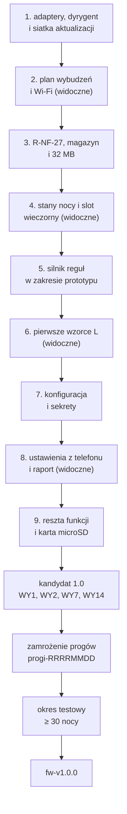

| Krok | Co powstaje | Kryterium przejścia | Zależy od |
|---|---|---|---|
| wariant 24 pól | wariant prototypu z `/noce.csv` o 24 polach (opcjonalny) | testy prototypu zaliczone i sprawdzone na urządzeniu | decyzja o włączeniu wariantu |
| 1–9 | wdrożenie według sekcji 13, na przemian krok pod maską i krok widoczny | po każdym kroku: wszystkie testy na PC zaliczone (także na GitHub), zachowanie niezmienione (krok 1) albo zmienione tylko tam, gdzie spec tak mówi; panel działa przy łóżku | ADR-0021, ADR-0022, ADR-0023, decyzje sekcji 8 |
| kandydat 1.0 | `fw-v1.0.0-rc.N` z zestawem danych sprzed zamrożenia | WY1, WY2, WY7, WY13, WY14, WY15 spełnione; testy sprzętowe z 11.11 z wynikiem; zmiany spec funkcjonalnej z ADR-0022 i ADR-0023 zapisane | etap 2: kalibracja, WY5 (b), WY9 |
| zamrożenie i okres testowy | tag `progi-RRRRMMDD`, log nocy | 12.4 | etap 2 zamknięty w części progów |
| wydanie 1.0 | tag `fw-v1.0.0`, notatka wydania | wszystkie WY spełnione albo z jawnym stanem w notatce (WY12) | opinia o statusie regulacyjnym przed publikacją wydania z gotowym obrazem ([ADR-0033](../decisions/0033-licencja-i-dwa-repozytoria.md)) |

## 13. Rozjazdy prototyp ↔ architektura docelowa

Prototyp dowodzi, że panel da się zbudować na tym sprzęcie. Sprzęt jest za adapterami, a decyzje wybudzenia są w rdzeniu z testami; prototyp nadal trzyma progi i teksty w kodzie, a dane w pamięci flash bez wersji. Ten rozdział zestawia rozjazdy z architekturą z sekcji 6 i 9 (ADR-0021, ADR-0022, ADR-0023, warianty A) i ustala kolejność wdrożenia. Źródła: tabela „Uproszczenia wobec specyfikacji” i wiersze „zadanie” w [README prototypu](../../firmware/prototyp/README.md), rozjazdy T-INT w 4.2. Rozjazdy nie mają własnych ID (ADR-0020 pkt 4).

**Skutek prostymi słowami.** Najpierw porządkujemy wnętrze tak, żeby panel działał dokładnie jak dziś, dało się go testować na komputerze i żeby zła wersja nie mogła rozładować baterii. Potem idziemy na przemian: jedna rzecz pod maską, jedna, którą widać na panelu (najpierw dłuższa praca na baterii, potem stany nocy i slot wieczorny, potem pierwsze wzorce do lekarza, potem ustawienia z telefonu). Dzięki temu nie ma tygodni bez żadnej widocznej zmiany.

### 13.1 Kolejność wdrożenia

**Wgranie.** Kroki 2–9 trafiają na panel razem, jednym wgraniem kablem.

Wdrożenie idzie w plasterkach: na przemian jedna rzecz pod maską i jedna, którą użytkownik zobaczy na panelu albo w dzienniku baterii. ADR-0021 pkt 5 („najpierw adaptery i dyrygent”) zostaje: krok 1 to ten rozkład, w wersji minimalnej.

| Krok | Rodzaj | Co | Dlaczego w tym miejscu | Kryterium zakończenia |
|---|---|---|---|---|
| 1 | pod maską | adaptery i dyrygent wybudzenia w wersji minimalnej, bez zmiany zachowania (ADR-0021 pkt 5): decyzje z `src/main.cpp` do rdzenia z testami, atrapy z zachowaniem; siatka aktualizacji: powrót do poprzedniej wersji (`verifyRollbackLater()` i samosprawdzenie, T-WYM-41), strażnik zadania (T-WYM-81), licznik startów po błędzie i tryb awaryjny (T-WYM-82, T-WYM-83, R-AW-39) | każdy kolejny krok potrzebuje testów decyzji, których dziś nie ma (`src/main.cpp` sprawdzany tylko składniowo); kolejne wersje są wgrywane przez Wi-Fi, więc siatka musi być w pierwszym wgraniu (7.8) | **Stan: zrobione w kodzie.** Kryterium: `bash tools/prototyp/testy.sh` bez zmiany oczekiwanych wyników istniejących sprawdzeń (`testy: 2071 dobrze, 0 źle`) plus nowe testy decyzji z `src/main.cpp` (`testy kroku 1: 315 dobrze`, `testy dyrygenta: 124 dobrze`), zielone także w testach na GitHub (`.github/workflows/testy.yml`); T-TEST-272, T-TEST-273, na panelu T-TEST-275 i powrót z T-TEST-242; panel wgrany i działa dobę jak przed zmianą (porównanie `/humor.csv` i zrzutów) |
| 2 | widoczne | plan wybudzeń tylko z powodów R-NF-02 (bez wybudzeń co 30 min przez całą dobę i bez zapytań do AirBridge w nocy), Wi-Fi wyłączane zaraz po ostatnim żądaniu, czuwanie na przycisk tylko po wybudzeniu przyciskiem (2.2, wnioski 3 i 4); rzadsze ponawianie od drugiej doby bez danych (R-DANE-18) | największa oszczędność energii z całego wdrożenia (2.2) i pierwsza zmiana, którą widać w `/bateria.csv`; pomiar 9 (tydzień na baterii) ma sens dopiero na tym planie | **Stan: zrobione w kodzie; ograniczenia: E-10 tylko w teście planu, prognoza godzinowa (R-KON-52) dochodzi w kroku 9.** Kryterium: T-WYM-20, T-WYM-28, T-TEST-279; log doby: każde wybudzenie z powodem z R-NF-02, Wi-Fi poniżej 10 min; start pomiaru 9 |
| 3 | pod maską | R-NF-27 (adres źródła otoczenia); magazyn danych: wersje plików i NVS, migracje krok po kroku, układ partycji 32 MB z pierwszym formatowaniem (T-WYM-84) i przejściem egzemplarza (8.9) | R-NF-27 to granica ADR-0001 (4.2); przejście na 32 MB wcześnie, bo każda kolejna funkcja zapisuje nowe dane, które powinny od razu trafić do magazynu z wersją, a partycja 1,5 MB prototypu kończy się po roku | **Stan: zrobione w kodzie; test przejścia na kopii zrzutu z panelu czeka na zrzut (`CPAP_ZRZUT`).** Kryterium: T-TEST-204, T-TEST-206, T-TEST-207, T-TEST-208, T-TEST-274, T-TEST-276; T-TEST-280; jednorazowe przejście egzemplarza bez karty: zrzut `Z` dwa razy, wgranie kablem z nowym układem, zrzut z powrotem komendą `W` (8.9), przywrócenie |
| 4 | widoczne | stany nocy 5.1.4 (S10 „noc w drodze”, E-10 o 11:00), slot wieczorny (R-KON-01) i zadania z README prototypu dotyczące ekranu dnia | zachowanie widoczne co dzień; po krokach 1–3 ma testy i magazyn z wersją | T-TEST-001, T-TEST-120, przypadki 7.8 dla stanów nocy i slotu wieczornego w symulatorze |
| 5 | pod maską | silnik reguł w zakresie prototypu: format trzech plików z nagłówkiem (pochodzenie, zakres firmware, 9.3), skrypt budowy z kontrolą tekstów dla progów i tekstów, które prototyp już ma, zestaw wbudowany przychodzący z firmware (T-WYM-85), lista reguł obowiązkowych (T-WYM-86); tylko rodzaje warunków, których używają reguły prototypu | etap 2 zmienia progi w trakcie, więc progi i teksty z kodu do plików jak najwcześniej; zestaw idzie przez Wi-Fi razem z firmware, więc krok nie czeka na sterownik karty; rodzaje warunków na zapas odpadają (praktyk W3) | T-TEST-033, T-TEST-210, T-TEST-211, T-TEST-277, T-TEST-278 dla reguł prototypu; ten sam ekran dnia co przed krokiem przy tych samych nocach |
| 6 | widoczne | pierwsze wzorce L jako wiersze katalogu (np. L-01, L-03, L-09) i linie uwagi; każdy rodzaj warunku (9.3) powstaje razem z pierwszą regułą, która go używa | pierwsza nowa treść na panelu z silnika reguł; rodzaje warunków powstają pod regułę, którą przejrzą lekarze PSG, a nie na zapas | T-TEST-011, przypadki graniczne 11.9 dla tych wzorców (T-TEST-161 i następne), przypadki 7.8 w symulatorze |
| 7 | pod maską | konfiguracja i sekrety z pliku (R-NF-22), własna sieć panelu | zdejmuje sekrety z kompilacji; potrzebne przed formularzem | T-TEST-090, T-TEST-212 |
| 8 | widoczne | U-01…U-03, formularz z telefonu, serwer raportu i raport (R-NF-16) | zmiana ustawień bez wgrywania; raport dla lekarza | T-TEST-089, T-TEST-018, T-TEST-005 |
| 9 | na przemian, dalej | reszta zgodności ze spec i nowych funkcji: pozostałe L, zdarzenia E, hipotezy H, ekrany S-K, odkrycia O, pogoda, S8, Qingping po podłączeniu czujnika, kolejka naciśnięć; karta microSD (kopia, import historii, pakiet zestawu z karty, T-WYM-67); każdy nowy rodzaj warunku z pierwszą regułą | po krokach 1–8 każda zmiana ma testy i trafia do właściwego komponentu; karta na końcu, bo nic wcześniej od niej nie zależy: zestaw reguł idzie z firmware (T-WYM-85), a przejście na 32 MB w kroku 3 wgrywa zrzut z powrotem kablem przez port serwisowy (8.9, T-WYM-87); po tym kroku karta jest drugą drogą przywracania | T-TEST-001…T-TEST-020, T-TEST-101…T-TEST-153, T-TEST-092, T-TEST-209, T-TEST-242 |

**Wariant pośredni.** Gdyby krok 1 okazał się zbyt kosztowny, prototyp zostaje (wariant C z ADR-0021), ale dostaje testy decyzji z `src/main.cpp` i siatkę aktualizacji z kroku 1.

**Adnotacja 08.11.2026.** Kroki 2–9 zrobiono w większości w wersji beta (04–06.11.2026), bez wgrania po każdym kroku: plan wybudzeń i magazyn danych (kroki 2–3; przejście egzemplarza zrobione inaczej: `erase` i wgranie danych od nowa), stany nocy 5.1.4 i sloty wieczór i tydzień (krok 4), silnik reguł z zestawem wbudowanym (krok 5; lista reguł obowiązkowych T-WYM-86 i pakiet z karty jeszcze nie), zdarzenia E, wzorce L, hipotezy H i ekrany z wyłączeniami spec (H-06, H-07, L-06, E-37) (krok 6), sekrety w pamięci panelu i sieć panelu (krok 7; szyfrowanie sekretów nie), U-01, U-03, formularz i raport A4 z serwerem i kodem QR (krok 8), większość kroku 9 z kolejką naciśnięć; bez karty microSD, importu z karty aparatu i Qingpinga przez Bluetooth. Kryteria w tabeli zostają jako opis, czego krok miał dowieść. Ekrany dzienne i obrazek dnia (ADR-0027), zakres skierowań (ADR-0029), tryby CPAP/AutoSet/ASV (ADR-0030) i aktualizacja z GitHub (ADR-0032) nie mają jeszcze własnych komponentów w 6.4.

### 13.2 Rozjazdy

| Obszar | Prototyp (plik) | Docelowo (T-KOMP, ADR) | Co zrobić | Kolejność |
|---|---|---|---|---|
| decyzje wybudzenia w jednym pliku ze sprzętem | dawniej `src/main.cpp` z 1 761 liniami; obecnie `src/main.cpp` ma 81 linii, decyzje są w `src/wybudzenie.cpp` i `src/start.cpp`, przebieg w dyrygencie (`src/dyrygent.cpp` `Przebieg::zwykleWybudzenie()`), sprzęt w `src/adaptery_esp32.cpp` | T-KOMP-01 dyrygent, decyzje w rdzeniu; adaptery T-KOMP-16…T-KOMP-19 (ADR-0021 pkt 1–2) | zrobione w kodzie; zostaje wgranie na panel i doba pracy jak przed zmianą | 1 |
| żądania HTTP i Digest AirBridge | HTTP i MD5 w adapterze (`src/adaptery_esp32.cpp` `SiecEsp32::get()`, `SiecEsp32::md5()`), żądanie z nagłówkiem Digest w dyrygencie (`src/dyrygent.cpp` `Przebieg::abGetRaz()`), adres z `AB_IP` w konfiguracji (`src/main.cpp` `konfiguracja()`) | T-KOMP-16 adapter sieci; logika Digest i parsowanie w T-KOMP-03 (już w `src/airbridge.cpp`) | interfejs adaptera i atrapa sieci z kolejką odpowiedzi są; osobna atrapa AirBridge z Digest, jobem i błędami Załącznika A na tym samym interfejsie (T-TEST-080) | 1 |
| granica „w budowie” 12:00 | w rdzeniu z testem (`src/wybudzenie.h` `wBudowiePrzyBlokadzie()`, test `testGranicaWBudowie12`), zachowanie bez zmian | T-KOMP-03, R-DANE-35 | krok 1: zrobione; krok 4: zadanie (granica 23:30, README prototypu) | 1, 4 |
| zapis plików i NVS | za interfejsami adapterów (`src/adaptery.h` `Pliki`, `Nvs`; `src/adaptery_esp32.cpp` `PlikiEsp32::zapiszAtomowo()`, `PlikiEsp32::dopiszWiersz()`), zapis z dyrygenta (przez magazyn: `src/dyrygent.cpp` `Przebieg::zapiszFormat()`, `Przebieg::nvsTekst()`), stan RTC w jednej strukturze (`src/wybudzenie.h` `StanRtc`); formaty bez zmian | T-KOMP-18 adapter pamięci, T-KOMP-05 magazyn | krok 1: zrobione (za interfejsem bez zmiany formatów); zapis atomowy zostaje (ADR-0022 decyzja 3 pkt 3); wersje plików i migracje: krok 3, zrobione w kodzie (`src/magazyn.cpp`) | 1, 3 |
| adres źródła otoczenia nie jest sprawdzany | żądanie pod adres z konfiguracji bez sprawdzenia (`src/dyrygent.cpp` `Przebieg::otoGetRaz()`, `src/adaptery_esp32.cpp` `SiecEsp32::get()`); zachowanie przy przekierowaniu niesprawdzone (README, wiersz „adres i token źródła otoczenia”) | T-KOMP-04, T-KOMP-16; R-NF-27 | funkcja sprawdzająca adres w rdzeniu (IPv4 RFC 1918, 169.254/16, `.local`), przekierowania wyłączone, 3xx jak odmowa, token nigdy w logu (T-TEST-204) | 3 |
| format `/noce.csv` bez jawnej wersji | wersja w liczbie pól: 8, 9, 12, 13, 14, 20 (`src/noc.h`, `parsujNoc()`); wariant prototypu ma 24 pola | T-KOMP-05; ADR-0022 decyzja 2–3 | wiersz nagłówka z nazwą i wersją, każdy krok migracji osobną funkcją z testem, kopia poprzedniej wersji obok | 3 |
| migracja w kodzie startu | prototyp: `/sypialnia.csv` 4 pola → 3 pola i `/sypialnia-co2.csv`; migracja 0 → 1 na nowe ścieżki przed oznaczeniem wersji (`src/magazyn.cpp` `Magazyn::migrujNaNoweSciezki()`, wołana z `src/dyrygent.cpp` `Przebieg::wczytajPliki()`) | T-KOMP-05 | ta sama zasada co wyżej; test T-TEST-207 | 3 |
| nośnik i partycje | wszystko w LittleFS 1,5 MB, `default_8MB.csv` (`platformio.ini`), 24 MB flash nieużywane (3.1); karta microSD nieobsługiwana (T-INT-09) | T-KOMP-05, T-KOMP-18; ADR-0022 decyzja 1 (wariant A: flash główna, karta kopia) | nowy układ partycji (sekcja 8); przy wariancie A najpierw zmiana spec funkcjonalnej (spec funkcjonalna 1.2: wymagania z kartą, 5.3.3, 8.4, przypadki 12, 34, 40, nowe 54 i 55; do akceptacji) || 3, 9 (karta) |
| import historii kasuje dane | `src/dyrygent.cpp` `Przebieg::importujJesliCzas()` czyta `import.csv` z obrazu `uploadfs`, który kasuje całą pamięć plików (README, „Pliki w pamięci panelu”) | T-KOMP-05, T-INT-09; ADR-0017, ADR-0022 | import z pliku na karcie, bez kasowania danych (T-TEST-092) | 9 |
| sceny budzika wkompilowane | `include/obrazy.h`: 30 z 68 scen (22 sceny kart i 8 scen nocy, `SCENY_N`, `SCENY_NOCY_N`) | T-KOMP-09, T-KOMP-15; ADR-0022 (sceny w partycji plików), ADR-0024 | `include/obrazy.h` zostaje jako zapas wbudowany (spec 5.7.4); sceny z pakietu z karty jako pliki ze spisem i skrótem (T-DANE-36, T-WYM-67) mają pierwszeństwo; brak sceny w obu miejscach według R-KON-40 i R-HUM-11 | 9 |
| progi w kodzie | `PROG_AHI`, `PROG_WYCIEK` (`src/kokpit.h` `PROG_AHI`), `CO2_PROG_NOCY` (`src/sypialnia.h` `CO2_PROG_NOCY`), `BAT_PROG_ROZLADOWANIA_MV` (`src/bateria.h` `BAT_PROG_ROZLADOWANIA_MV`) | T-KOMP-07; ADR-0023 pkt 1 (plik progów z `progi.csv`) | progi z pliku, w kodzie tylko rodzaje warunków; przy okazji zadanie (`cv > CO2_PROG_NOCY`, R-EKR-54) | 5 |
| teksty ekranów w kodzie | napisy w `src/dzien.cpp`, `src/humor.cpp`, `src/dobranoc.cpp`, `src/ekrany.cpp`, `src/kokpit.cpp`; kontrola tekstów przez `grep` w `tools/prototyp/testy.sh` | T-KOMP-09; ADR-0023 pkt 1 i 3 (plik tekstów, skrypt budowy) | teksty do pliku z ID z katalogu spec; zadania tekstowe z README (D2, D3) jako zmiana pliku tekstów | 5 |
| pule zdań flagą kompilacji | `HUMOR_PROPOZYCJE` (`src/dyrygent.cpp` `HUMOR_PROPOZYCJE`, `platformio.ini`) | T-KOMP-08, T-KOMP-09; ADR-0023 | kolumna akceptacji w pliku tekstów; panel losuje tylko zaakceptowane (WY15, R-HUM-27); od 08.11.2026 wszystkie zdania przyjęte (pula przyjęta 08.11.2026), flaga bez skutku | 5 |
| warunek uspokojenia oceniany niepełnie | lista `PUNKTY_USPOKOJENIA` (`src/stany.cpp` `PUNKTY_USPOKOJENIA`) z punktami nieocenianymi | T-KOMP-07, T-KOMP-08; ADR-0023 pkt 5 | punkt = reguła katalogu; reguła nieoceniona blokuje uspokojenie (mechanizm zostaje); zadanie D1 (pkt 6, PS) | 5 |
| sekrety i adresy przy kompilacji | `include/secrets.h`: Wi-Fi, `AB_IP`, `AB_PASS`, `OTO_URL`, `OTO_TOKEN`, `OTA_PASS`; składane w jedną konfigurację (`src/main.cpp` `konfiguracja()`) i podawane dyrygentowi jako dane | T-KOMP-12; T-INT-07; R-NF-22, R-KONF-35 | plik konfiguracji z sekretami w postaci nieczytelnej bez panelu; formularz pierwszej konfiguracji (T-TEST-089, T-TEST-090) | 7, 8 |
| ~~ekran „Test sprzętu” w miejscu U-01~~ | zamknięte: U-01 jest, ciąg U-01 ▶ U-03 ▶ U-05 (mapa 5.6.2) | T-KOMP-10; spec 5.6.3 | bez zmian | 8 |
| brak serwerów lokalnych i raportu | brak (T-INT-06, T-INT-07 w 4.2) | T-KOMP-11, T-KOMP-20; ADR-0005, ADR-0011 | serwer raportu i formularza z tokenem i limitem 15 min; PDF tylko przy warunku ADR-0005 | 8 |
| zadania zgodności z README | wiersze „zadanie” i „do poprawy w kodzie” w tabeli „Uproszczenia”: między innymi czas z `esp_time` (R-AW-18), R-EKR-55 (mediana paska) | komponenty z tabeli sekcji 6 (głównie T-KOMP-02, 03, 06, 09) | każde zadanie: test odtwarzający różnicę ze spec, potem poprawka (wzorzec 62304, 11) | 4, 9 |
| stany nocy i sloty | brak stanów 5.1.4, slotu wieczornego i tygodniowego; wybudzenie co 30 min przez całą dobę, także z zapytaniami do AirBridge w nocy, zamiast wybudzeń tylko z powodów R-NF-02 i zapisu czujników co 15 min w oknie R-DANE-09, R-DANE-10; czuwanie 20 s z włączonym Wi-Fi po każdym wybudzeniu (2.2, wniosek 3) | T-KOMP-24 (sloty, plan i decyzja S9), T-KOMP-03 (stany nocy), T-KOMP-01 | plan wybudzeń z listy R-NF-02, Wi-Fi wyłączone po ostatnim żądaniu, czuwanie tylko po przycisku (7.1): krok 2; stany nocy i sloty w rdzeniu: krok 4 (slot tygodniowy: krok 9) | 2, 4, 9 |
| pakiet 3: L, E, H, S-K, O, linie uwagi | brak (README, wiersze „warunek uspokojenia”, „znaczniki w K2”, „S-K-27…”) | T-KOMP-07, T-KOMP-08 | jako wiersze katalogu reguł na rodzajach warunków z sekcji 9, każdy rodzaj z pierwszą regułą, która go używa; granice A-35 (11.9); pierwsze wzorce L w kroku 6 | 6, 9 |
| pogoda i Qingping | pogoda tylko z lokalnego źródła; Open-Meteo brak (T-INT-03); Qingping brak (T-INT-05) | T-KOMP-04 | klient pogody z miastem z konfiguracji; Qingping po podłączeniu czujnika | 9 |
| naciśnięcie w trakcie odświeżania gubione | README, wiersz „naciśnięcie w trakcie odświeżania” (R-PRZ-09) | T-KOMP-10, T-KOMP-19, T-KOMP-17 | kolejka naciśnięć w adapterze wejść (T-KOMP-19) | 9 |
| wgrywanie przez Wi-Fi | ArduinoOTA z hasłem, okno 10 min z ekranu testu, mDNS `cpap-eink.local` (`src/dyrygent.cpp` `Przebieg::startOta()`); `uploadfs` przez Wi-Fi kasuje pliki | T-KOMP-15, T-INT-08; sekcja 8 (ADR-0024, przyjęty 01.11.2026) | powrót do poprzedniej wersji, samosprawdzenie, strażnik zadania i licznik startów w kroku 1 (7.8): w kodzie; reszta drogi docelowej według sekcji 8; mDNS tylko do wgrywania, nigdy jako źródło adresu AirBridge (ADR-0001, 4.2) | 1, 9 |
| GI | brak | T-KOMP-21; zablokowane do pomiaru 21 | poza wydaniem 1.0 (WY13) | poza 1.0 |

### 13.3 Co z prototypu zostaje

| Co | Plik | Dlaczego zostaje |
|---|---|---|
| logika bez Arduino: noc i norma, stany odchylenia, czynniki, kokpit, ekran dnia, humor, S9, nawigacja, rysowanie, bateria, sypialnia, cykl, wspólne narzędzia | 15 plików `src/*.cpp` (4 226 linii; ADR-0021); obok nich `src/wybudzenie.cpp`, `src/start.cpp`, `src/dyrygent.cpp` | już kompilują się na PC i mają testy; przy wdrożeniu zmieniają miejsce za interfejsami, nie treść |
| klient AirBridge: Digest, status, job, lista, raport → rekord, mapowanie kanałów | `src/airbridge.cpp` (tablica `KANALY_AB` `:506`) | protokół sprawdzony na v2.2.1 (Załącznik A); mapowanie kanałów to opis protokołu, nie reguła, więc zostaje w kodzie |
| klient źródła otoczenia (kontrakt wersji 1) | `src/otoczenie.cpp` | zgodny z Załącznikiem C; dochodzi tylko R-NF-27 (krok 3 w 13.1) |
| zapis atomowy i domykanie urwanego wiersza | w adapterze pamięci (`src/adaptery_esp32.cpp` `PlikiEsp32::zapiszAtomowo()`, `PlikiEsp32::dopiszWiersz()`), wołane z dyrygenta (`src/dyrygent.cpp` `Przebieg::zapiszFormat()`, `Przebieg::dopiszFormat()`); zapis atomowy z `#koniec` w magazynie (`src/magazyn.cpp` `Magazyn::zapisz()`) | spełnia R-NF-12 już dziś |
| ponowienia i budżet wybudzenia | stałe `AB_LIMIT_WYBUDZENIA_MS`, `AB_LIMIT_ZALEGLYCH_MS` (`src/dyrygent.cpp` `AB_LIMIT_WYBUDZENIA_MS`) i `ZALEGLE_NA_WYBUDZENIE` (`src/wybudzenie.h` `ZALEGLE_NA_WYBUDZENIE`); pierwsze pobranie partiami (`src/dyrygent.cpp` `Przebieg::dociagnijHistorie()`, decyzja w `src/wybudzenie.h` `planZaleglych()`) | zachowanie opisane i przetestowane (README, „Budżet czasu wybudzenia”; testy `testZalegleDobyPozaSlotemNocnym` i scenariusz dyrygenta z 4 zaległymi dobami); czasy interfejsu nie są progami terapii (WY16 (a)), więc mogą zostać w kodzie |
| testy i symulator | `firmware/prototyp/test/testy.cpp` (2071 sprawdzeń), `test/testy_wybudzenie.cpp` (315) i `test/testy_dyrygenta.cpp` (124) z atrapami `test/atrapy/adaptery_atrapy.h`, `test/podglad.cpp`, `tools/prototyp/testy.sh` | punkt wyjścia poziomów jednostkowego i symulatora (11.1) |
| narzędzia serwisowe | port serwisowy `Z` i `O` (`src/dyrygent.cpp` `Przebieg::czuwanie()`, T-INT-10), `tools/prototyp/zrzut_plikow.py`, `podglad.py`, `sekrety.sh`, `wgraj_wifi.sh`, `historia.py` | potrzebne do testów na sprzęcie i do przejścia egzemplarza na nowy układ partycji |
| pomiar baterii | `src/bateria.cpp`, `/bateria.csv` | dane do T-TEST-231 i do sekcji 2 |
| kroje i generator zasobów | `include/fonty.h`, `tools/prototyp/generuj.py` | skala B przyjęta; generator przycina kroje do potrzebnych znaków (R-NF-14), co sprawdza skrypt budowy zestawu (T-TEST-033) |

## 14. Decyzje i otwarte pytania

| ADR | Decyzja | Sekcje |
|---|---|---|
| [0020](../decisions/0020-struktura-specyfikacji-technicznej.md) | struktura dokumentu, standardy, schemat ID, macierz techniczna | całość |
| [0021](../decisions/0021-podzial-firmware-na-komponenty.md) | podział firmware: rdzeń bez sprzętu, adaptery, dyrygent | 5, 6, 13 |
| [0022](../decisions/0022-dane-trwale-nosnik-format-migracje.md) | dane trwałe: pamięć flash główna, karta jako kopia; CSV z wersją; migracje | 8, 9, 13 |
| [0023](../decisions/0023-silnik-regul-sterowany-danymi.md) | silnik reguł: progi, katalog reguł i teksty jako pliki | 9, 11, 12 |
| [0024](../decisions/0024-aktualizacja-oprogramowania-i-zestawu-danych.md) | aktualizacja oprogramowania i zestawu danych reguł | 7, 8, 12 |
| [0025](../decisions/0025-klasa-bezpieczenstwa-oprogramowania.md) | klasa bezpieczeństwa oprogramowania według IEC 62304 jako wzorzec, bez deklaracji | 10, 11 |
| [0027](../decisions/0027-ekran-dzienny.md) | slot dzienny, okno na wietrzenie i obrazek dnia (czwarty rodzaj ekranu) | 6, 7, 9 |
| [0029](../decisions/0029-zakres-skierowan-w-wydaniu-1-0.md) | zakres skierowań w wydaniu 1.0, stan „tylko raport”, lista reguł obowiązkowych ze stanem minimalnym | 9, 11 |
| [0030](../decisions/0030-wersja-1-dla-asv-cpap-i-autoset.md) | wersja 1 dla trybów CPAP, AutoSet, ASV i ASVAuto | 9, 11 |
| [0032](../decisions/0032-aktualizacja-firmware-z-github.md) | aktualizacja firmware z wydań GitHub, zmienia ADR-0001 i ADR-0024; wdrożenie po becie | 8, 12 |
| [0033](../decisions/0033-licencja-i-dwa-repozytoria.md) | licencja i dwa repozytoria; bez wydań z gotowym obrazem do opinii prawnika | 10, 12 |
| [0034](../decisions/0034-model-pasm-wycieku-p95.md) | model pasm wycieku P95, siatka L-09 od progu nocy niepewnej | 9, 11 |

Otwarte kwestie techniczne: 14.2.

### 14.1 Wycofane ID

ID wycofane. Nie są używane ponownie (ADR-0020 pkt 4); lista z następcami jest też w `tools/wycofane.csv`.

| ID | Status |
|---|---|
| T-WYM-06 | wycofane, zob. T-WYM-63 |
| T-WYM-36 | wycofane, zob. T-WYM-63 |
| T-WYM-37 | wycofane, zob. T-WYM-62 |
| T-WYM-47 | wycofane, zob. T-WYM-64, T-WYM-65, T-WYM-67 |
| T-WYM-48 | wycofane, zob. T-WYM-64, T-WYM-65, T-WYM-67 |
| T-WYM-77 | wycofane, zob. T-WYM-35 |
| T-TEST-357 | wycofane, zob. T-TEST-159 (M-08 z przebiegu `Leak.2s` cofnięte razem z progiem 15 L/min, wariant A) |

### 14.2 Otwarte kwestie

Otwarte kwestie techniczne są oznaczone w tekście znacznikami `[do zmierzenia]` (plan pomiarów w 2.4) i `[szacunek]`. Do rozstrzygnięcia przed publikacją zostają: potwierdzenie licencji GPL-3.0-or-later i wyjątku dla grafik (10.2), status regulacyjny (10.4), mocniejsza ochrona danych na panelu (9.8) i oznaczenia stref czasowych poza Europe/Warsaw (9.4). Funkcje GI (6.7) czekają na pomiar 21: po nim R-DANE-08 i R-GI-01…R-GI-09 mogą wyjść z 6.7.
